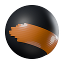
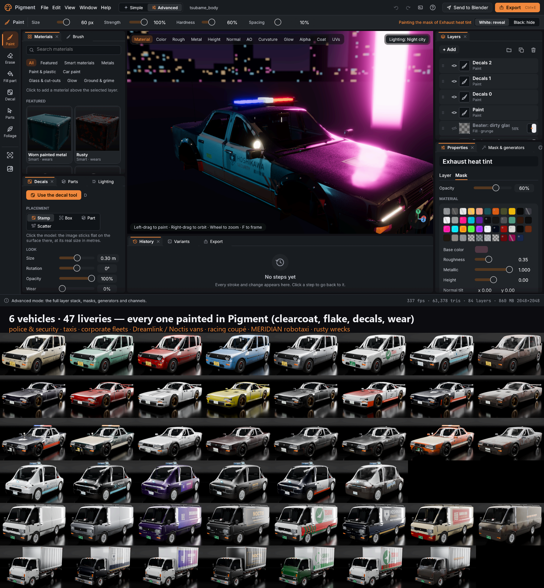
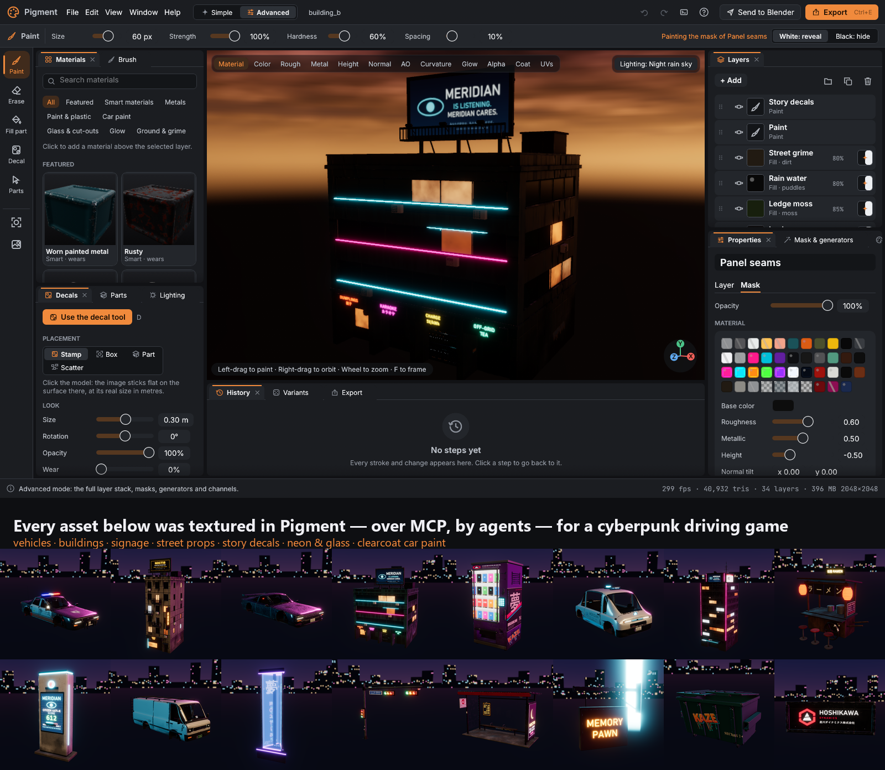

<div align="center">



# Pigment

**An open-source PBR texture painter you can drive by hand or hand to an AI agent.**

Paint colour, roughness, metal, height, glow, glass and clearcoat straight onto 3D models,
stack smart layers and procedural generators, stick decals, and export to
Blender, Unreal, Unity and Godot. Every feature is also an MCP tool.

[](LICENSE)
[](https://www.rust-lang.org/)
[](https://wgpu.rs/)
[](https://github.com/emilk/egui)
[](#install)
[](#use-it-from-an-ai-agent-mcp)
[](tools/blender_addon/pigment_bridge)
[](game)



*Pigment's Advanced mode on the Kanzaki Tsubame-4 security cruiser: clearcoat paint, decals, edge wear and grime
built from layers and generators. Below it, all 6 vehicles and 47 liveries, every one painted in Pigment
(rendered in Blender).*

</div>

---

## Contents

- [Why Pigment](#why-pigment)
- [Install](#install)
- [Getting started (2 minutes)](#getting-started-2-minutes)
- [Use it from an AI agent (MCP)](#use-it-from-an-ai-agent-mcp)
- [Features](#features)
- [The showcase: a cyberpunk driving game](#the-showcase-a-cyberpunk-driving-game)
- [Blender and game engines](#blender-and-game-engines)
- [Building and testing](#building-and-testing)
- [Project layout](#project-layout)
- [Documentation](#documentation)
- [License](#license)

## Why Pigment

- **Easy for anyone.** Simple mode: pick a model, click a smart material, drag *How worn?*, press Export.
  Edge wear, dirt, leaks and rust land where they really would.
- **Deep for experts.** Advanced mode has the full layer stack: folders, masks, 14 procedural generators,
  blend modes, per-channel control, image fills, variants and baked AO and curvature.
- **Built for agents.** All of it is exposed as **48 MCP tools** with strict JSON schemas, so Claude or any
  MCP client can texture whole asset libraries. The showcase city was textured that way.
- **Fast.** GPU compositing in wgpu, painting smooth on 4K texture sets, and a 7-map 4K export in about 0.3 s.

## Install

**Prerequisites:** [Rust](https://rustup.rs/) (stable) and a GPU with Vulkan, DX12 or Metal.

```bash
git clone https://github.com/krnblds/pigment.git
cd pigment
cargo build --release            # builds the app and the MCP server
cargo run --release -p pigment   # opens the welcome screen
```

| Binary | What it is |
|---|---|
| `target/release/pigment` | the desktop app |
| `target/release/pigment-mcp` | the MCP server for AI agents and scripts |

Open a model directly with `pigment model.glb`, or a project with `pigment my.pigment`.
Models need UVs. In Blender: select the model, press **U**, choose *Smart UV Project*, then export as glTF.

## Getting started (2 minutes)

1. **Open something.** On the welcome screen, pick a sample (crate, vending machine, town building, jerry can)
   or drop an OBJ / glTF / GLB onto the window.
2. **Pick a material.** In *Materials*, click e.g. *Worn painted metal*. Use *Fill part* (**G**) to put it on
   one piece only.
3. **Make it yours.** Drag **How worn?**, paint (**B**), stick decals (**D**: stamp, box, fit-to-part or scatter
   with tear/fade wear), and switch the lighting (Studio, Neon night, Lightbox, the night-rain sky...).
4. **Export.** Press **Ctrl+E** and choose Blender, Unreal, Unity, Godot or glTF, or press *Send to Blender*.

Switch **Simple / Advanced** with **Ctrl+Tab**. **Ctrl+K** opens the command palette and **?** shows every shortcut.
Every panel is a dockable widget, so drag tabs to build your own layout.
The full beginner guide with screenshots is **[docs/GETTING_STARTED.md](docs/GETTING_STARTED.md)**.

| Simple mode | Advanced mode | Decal tool |
|---|---|---|
|  |  |  |

## Use it from an AI agent (MCP)

`pigment-mcp` speaks the [Model Context Protocol](https://modelcontextprotocol.io) over stdio. Build it once:

```bash
cargo build --release -p pigment --bin pigment-mcp
```

### Claude Code

```bash
claude mcp add pigment -- /absolute/path/to/pigment/target/release/pigment-mcp
```

Or commit a project-level `.mcp.json` (this repo ships one):

```json
{
  "mcpServers": {
    "pigment": { "command": "target/release/pigment-mcp", "args": [] }
  }
}
```

### Claude Desktop, Cursor and other MCP clients

Add the same server block to the client's MCP config:
- Claude Desktop: `claude_desktop_config.json`, under `mcpServers`.
- Cursor: `.cursor/mcp.json`.

Use the absolute path to `pigment-mcp` (`pigment-mcp.exe` on Windows). Restart the client and the `pigment`
tools appear.

### What an agent can do

```text
new_project      open_project       save_project      get_project_info   batch
list_library     list_layers        list_parts        pick_parts         list_texture_sets
add_layer        update_layer       delete_layer      add_smart_material
save_smart_material                 apply_smart_material
add_filter       update_filter      remove_filter     set_anchor
bake             paint_stroke
project_decal    scatter_decals     place_decal       list_decals
update_decal     delete_decal
render           render_turntable   export_lighting
export_textures  export_variants    send_to_blender   export_mesh
list_export_templates               save_export_template
add_foliage_cell update_foliage_cell scatter_foliage  paint_foliage
add_bark         grow_ivy           export_foliage
export_window_map                   pack_interiors
undo             redo
```

`render` returns the image, so an agent sees its own work. A typical agent loop:

```text
new_project(mesh)
  -> list_parts / pick_parts (find the glass, frames, doors...)
  -> add_layer + generator masks, project_decal / scatter_decals
  -> render (check) -> export_textures / send_to_blender
```

Every call is validated against its schema, so a typo fails with the argument's name and a "did you mean".

### Scripts without a client

```bash
pigment-mcp --script calls.jsonl              # one {"tool": ..., "args": {...}} per line
pigment-mcp --script calls.jsonl --check      # validate only, no GPU
pigment-mcp --script calls.jsonl --keep-going # don't stop at the first error
pigment-mcp --export-for-blender my.pigment out/
```

Real examples: [`scenes/town/scripts/`](scenes/town/scripts) and [`scenes/cyberpunk/`](scenes/cyberpunk).

## Features

| Area | What you get |
|---|---|
| **Channels** | base colour, roughness, metallic, height, normal, emission (HDR), opacity, transmission (glass), clearcoat, coat roughness, metallic flake |
| **Layers** | paint, fill, filter and decal layers, folders (nested, with their own mask and opacity), blend modes per channel, masks, up to 3 generators per mask with ops, anchor points (generators read painted height, mask or colour from below) |
| **Filters (16)** | levels, HSL, blur, warp, slope blur, grow/shrink, noise overlay and more, seam-aware, on masks, layer results or as filter layers |
| **Brushes** | pen pressure curves, 11 tips, spacing, flow, jitter, angle follow, lazy mouse, line and path tools, stencils, X/Y/Z and radial symmetry, clone and smudge |
| **Generators (14)** | edge wear, dirt, grunge, streaks, stripes, spots, scratches, panel lines, ground gradient, leaks/drips, puddles, moss, tiles/bricks/hex, window grid |
| **Fills** | flat materials (45+ presets), smart materials (save and apply `.pigsmart`), tiling image fills in UV or triplanar world space |
| **Decals** | editable decal objects with box, triplanar and wrap projection, a viewport gizmo, auto placement on the largest clear wall, grids and snapping, scatter with spacing/height/fit rules, tear and fade wear |
| **Variants** | many looks from one project (seeded lit windows, decal swaps), exported in one call |
| **Projects** | model texturing, seamless tiles, trim sheets, decal atlases |
| **Bakes** | ambient occlusion, curvature, drip, rain exposure, plus high-to-low: tangent and object normals, position, thickness, height, colour ID and material ID (automatic or manual cage) |
| **Texture sets** | one set per material or UDIM tile, each with its own stack and resolution; strokes paint across sets |
| **Viewport** | PBR with HDR bloom, ACES tone mapping, studio/night/overcast presets, four night-city skies, HDRI loading |
| **UI** | welcome screen, Simple/Advanced modes, dockable panels with saved layouts, design system (dark/light), command palette, history, autosave and recovery |
| **Export** | templates with file patterns and per-channel packing: Unreal, Unity (incl. HDRP mask map), Godot ORM, glTF/Blender, Arnold, or your own; PNG 8/16, TGA, EXR f16/f32; UDIM naming; a `material.json` sidecar |

## The showcase: a cyberpunk driving game

Pigment was pushed by using it, through MCP, to texture a whole open-world city. The city is a 4×4 km night
bay with islands, bridges and a mountain road, run by the Hoshikawa corporation and the MERIDIAN AI. The world,
its assets and a drivable Godot 4.7 game are in this repo:



- **[`game/`](game)**: the Godot project. Open `game/project.godot` and press **F5**. It has wet neon streets,
  traffic, a security cruiser with a light bar, and a simulated car with easy handling (`--sim` for full simulation).
- **[`tools/world/`](tools/world)**: the procedural world generator.
- **[`tools/city/`](tools/city)**: the incremental city build with smart models and live hot-swap into the
  running game. See [docs/CITY_BUILD.md](docs/CITY_BUILD.md).
- **Assets textured in Pigment**:
  - 6 vehicles with 47 liveries;
  - building variants with story signage;
  - 38 street props;
  - Japanese trees;
  - road tiles, trim sheets and decal atlases.

> The game's generated assets (about 300 MB) are git-ignored. Rebuild them with `python -m tools.city build`
> (see [docs/CITY_BUILD.md](docs/CITY_BUILD.md)) before opening the game.

## Blender and game engines

- **Blender add-on**: [`tools/blender_addon/pigment_bridge`](tools/blender_addon/pigment_bridge).
  - Zip the `pigment_bridge` folder and install it via *Edit → Preferences → Get Extensions → Install from Disk*
    (Blender 5.2). It shows up as a **Pigment** tab in the 3D view's sidebar.
  - It links objects to Pigment exports or projects and builds the full material: bump or displacement,
    emission, glass and coat.
  - Textures auto-reload when Pigment re-exports.
  - It picks a random variant per object.
- **Godot**: the *Godot* export preset, plus the loaders and shaders in `game/scripts/` (road, foliage, proxies).
- **Unreal / Unity**: export presets with packed ORM and alpha in the base colour.

## Building and testing

```bash
cargo test --release -- --test-threads=2   # core + GPU + UI harness + MCP schema tests
cargo test -p pigment --release perf_targets -- --ignored --nocapture
```

- The core crate is GPU-free: document model, blend maths, undo, strokes, project files, export packing.
- The app icon is generated: `tools/branding/make_svgs.py` builds the SVGs in `assets/branding`
  (a graphite sphere with a brush stroke modelled on its surface, plus simplified 16-32 px artwork), and
  `make_icons.py` runs it and then renders every PNG, `pigment.ico`, `pigment.icns` and the contact
  sheet `docs/branding/icon_sizes.png`. One command regenerates the lot:

  ```bash
  pip install resvg-py pillow
  python tools/branding/make_icons.py
  ```

  Sizes from 48 px up come from a Cycles render of the same design modelled in 3D
  (`assets/branding/render/pigment-icon-1024.png`). After changing the design, re-render it
  before running `make_icons.py`:

  ```bash
  blender -b --factory-startup --python tools/branding/render_icon.py
  ```
- The app crate:
  - validates every WGSL shader with naga;
  - runs headless GPU tests that paint, composite, bake and export on a real device;
  - drives the real UI through an offscreen harness.

## Project layout

```text
crates/core      GPU-free document model, generators config, export, projects
crates/app       the app (egui + wgpu), renderer, shaders, MCP server (src/bin/pigment-mcp.rs)
tools/           Blender add-on, asset generators, world generator, city build, icon export
assets/          app icon (assets/branding), meshes, decals, tiles, props, vehicles, trees, skies
scenes/          Pigment projects and MCP scripts for the showcase
game/            the Godot showcase game
docs/            guides, design system, per-feature notes (docs/agents/*)
```

## Documentation

- [Getting started](docs/GETTING_STARTED.md): the beginner guide with screenshots.
- [Design system](docs/design/DESIGN_SYSTEM.md): tokens, components and the docking layout.
- [Architecture](docs/DESIGN.md): project format and graphics techniques.
- [City build](docs/CITY_BUILD.md): smart models, incremental builds and hot swap.
- Per-feature notes in [`docs/agents/`](docs/agents): every subsystem's design, MCP args, tests and limits.

## License

[MIT](LICENSE) © 2026 Kieran Builds. Fonts (Inter, JetBrains Mono) are under the SIL Open Font License; see `crates/app/assets/fonts/`.
