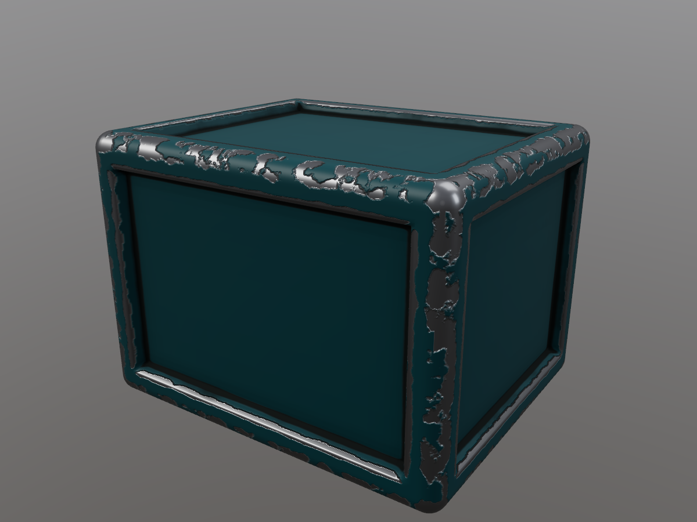

# Pigment

Open-source PBR texture painter: paint base color, roughness, metallic, height and
normal directly onto 3D meshes, build materials from paint and fill layers with
masks and procedural generators, bake mesh maps, and export to Unreal, Unity or Godot.

Rust + wgpu (Vulkan / DX12 / Metal) + egui. Windows, Linux and macOS.



It opens on a demo crate (110k triangles) set up as worn painted metal: a
fill of teal paint, an **Edge wear** fill of bare steel masked by the
curvature-driven edge-wear generator (with recessed chips via height), a
**Dirt** fill masked by the AO/crevice generator, and an empty paint layer.
Click a layer to see how it's built; drag the generator sliders to watch the
wear change live.

See [docs/DESIGN.md](docs/DESIGN.md) for the architecture, project format and the graphics techniques.

## Run

```
cargo run -p pigment --release                 # opens the demo crate
cargo run -p pigment --release -- model.glb     # new project from a mesh
cargo run -p pigment --release -- my.pigment    # open a project folder
```

## Using it

| Action | How |
|---|---|
| Paint | Left-drag on the model |
| Orbit / pan / zoom | Alt+left-drag or right-drag / middle-drag / wheel (or Alt+right-drag) |
| Brush size | `[` and `]` |
| Brush / eraser | `B` / `E` |
| Mask colour (white shows, black hides) | `X` |
| Frame the model | `F` |
| Material ↔ base colour view | `M` |
| Undo / redo | Ctrl+Z / Ctrl+Y (or Ctrl+Shift+Z) |
| Save / save as / open | Ctrl+S / Ctrl+Shift+S / Ctrl+O |
| Export textures | Ctrl+Shift+E |
| New project from a mesh | File menu, or drop an `.obj` / `.gltf` / `.glb` on the window |
| Load an HDRI | Display panel, or drop a `.hdr` / `.exr` on the window |

**Layout**: tool bar on top (brush/eraser, size, opacity, hardness, spacing, and what
you're painting on); brush material and presets on the left; layer stack and
properties on the right; view-mode chips (Material, Color, Rough, Metal, Height,
Normal, AO, Curvature, UVs) and lighting over the viewport.

**Layers**: `+ Add layer` gives paint and fill layers and the smart layers (edge wear,
dirt, rust). Each layer card shows a material thumbnail and, on the right, its mask.
The **Layer / Mask** tabs in Properties choose what you edit *and* what the brush
paints. Painting on a fill layer without a mask gives it a black mask, so the brush
reveals the fill where you paint. Generators read the baked AO and curvature;
paint black on a generator mask to protect areas.

**Texture set** (left panel): resolution (512 to 4096) and the AO / curvature bake.

## Tests

```
cargo test                                                       # 70+ tests, ~5 s
cargo test -p pigment --release perf_targets -- --ignored --nocapture   # performance check
```

The core crate (document model, blend math, undo, strokes, tiles, curvature,
export packing, project files, IBL math) is GPU-free. The app crate validates every
WGSL shader offline with naga, and runs headless GPU tests that paint, undo, redo,
composite, bake, export, save and reload on a real device without opening a window.
