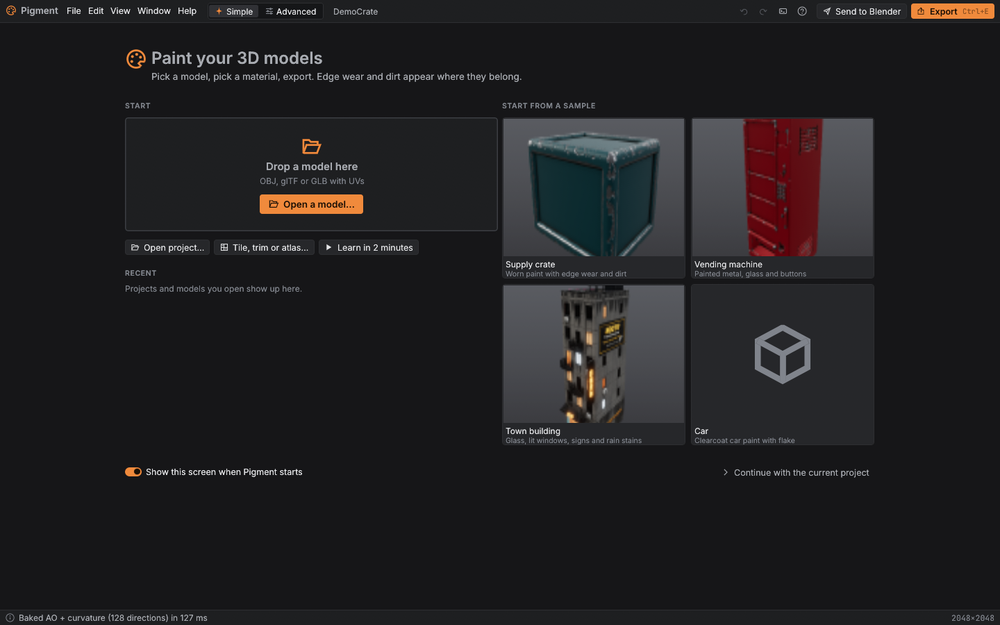
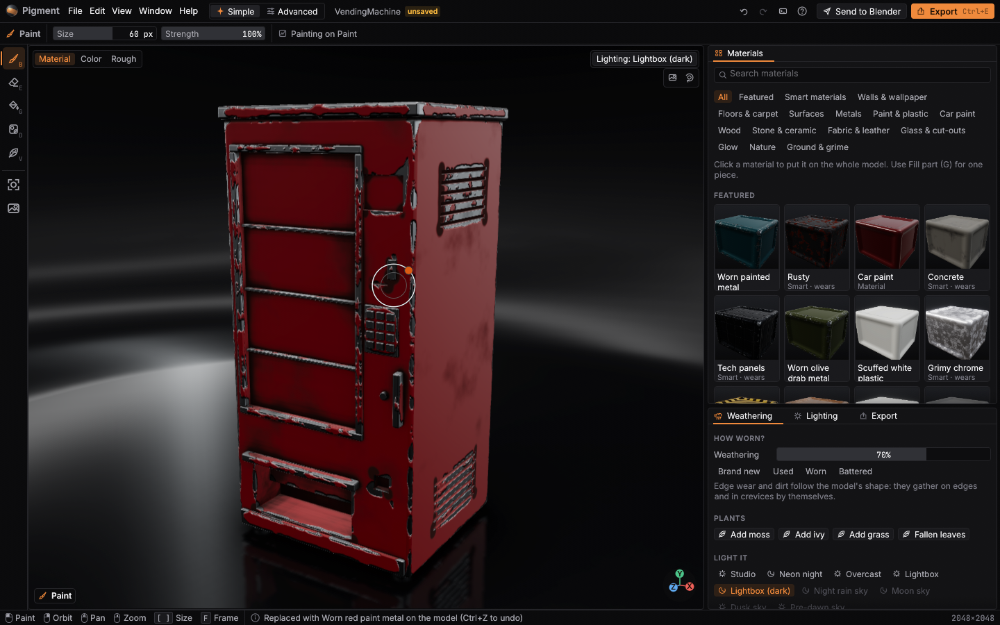
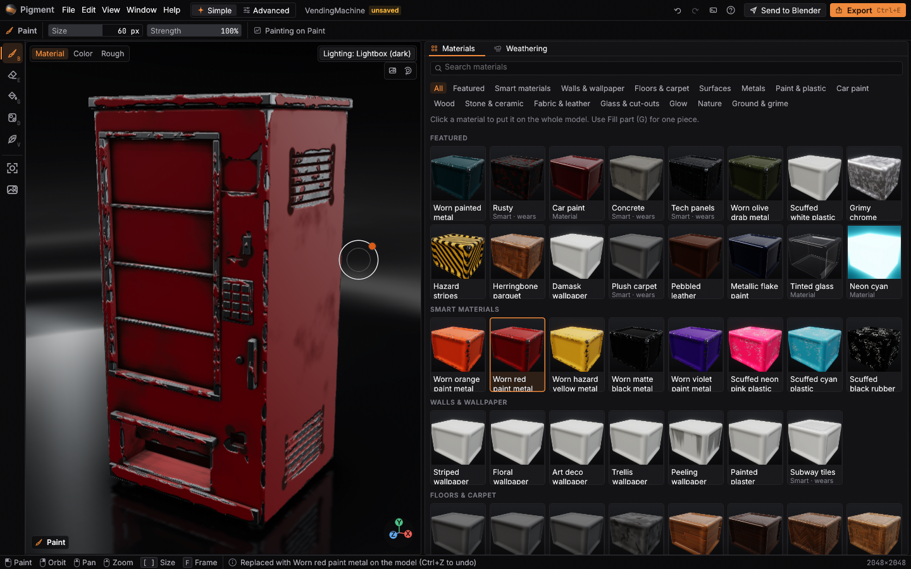
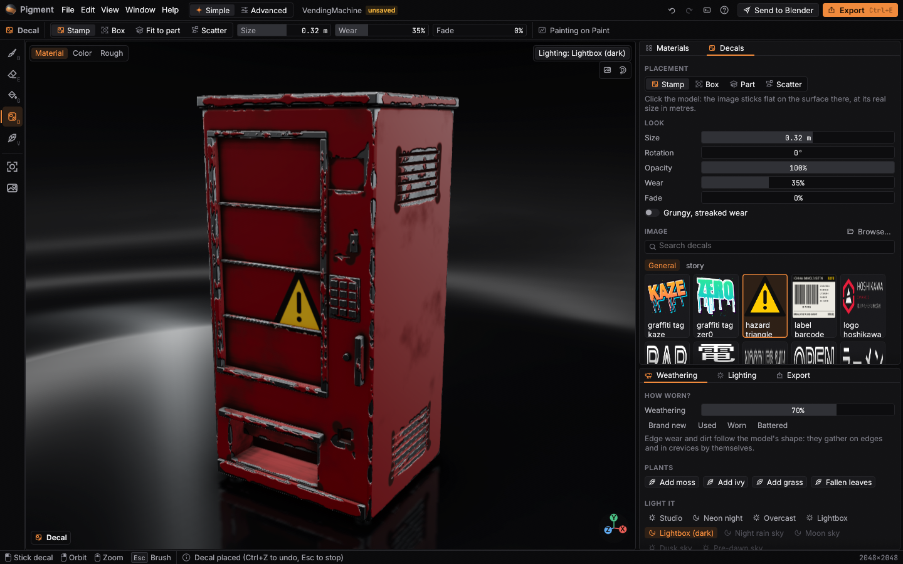
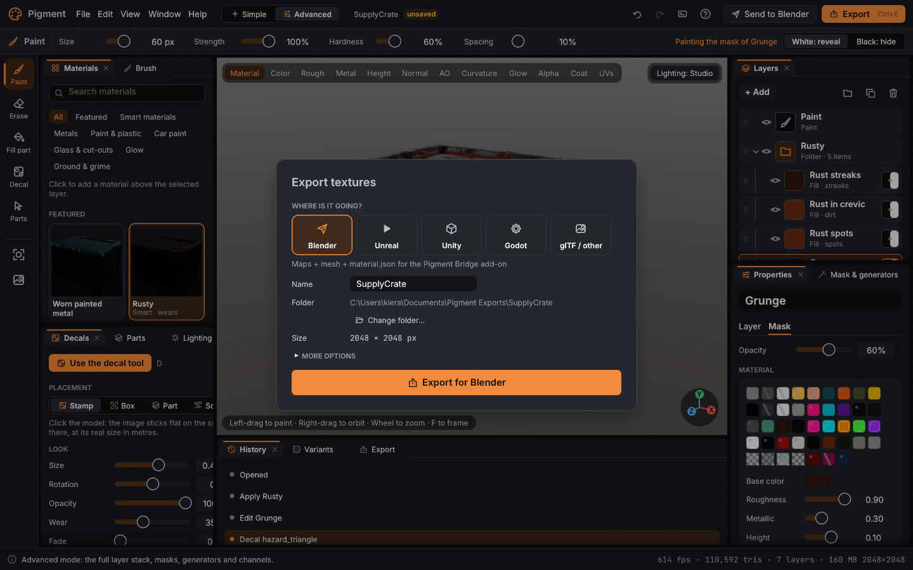
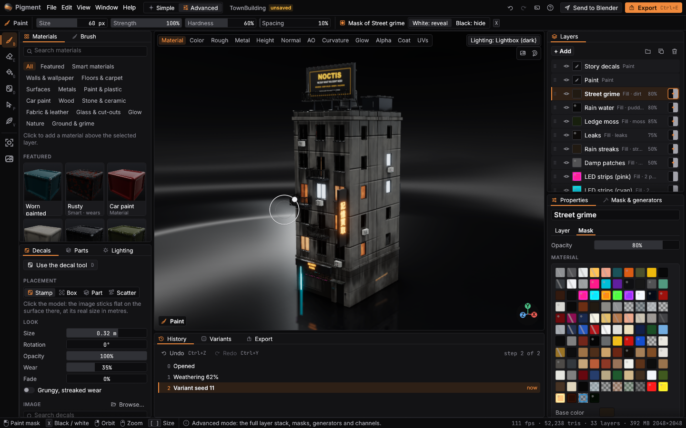
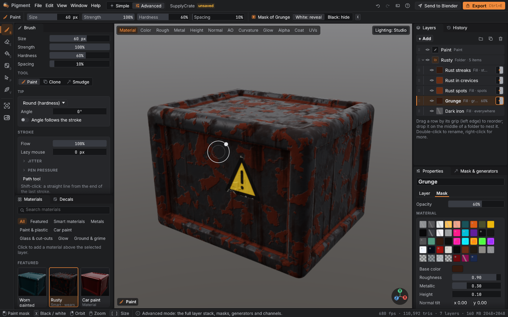
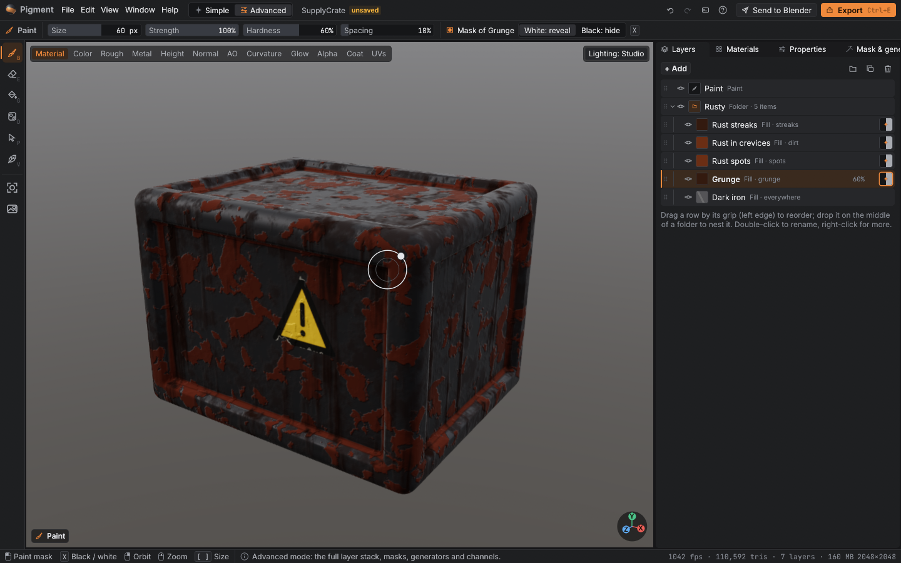
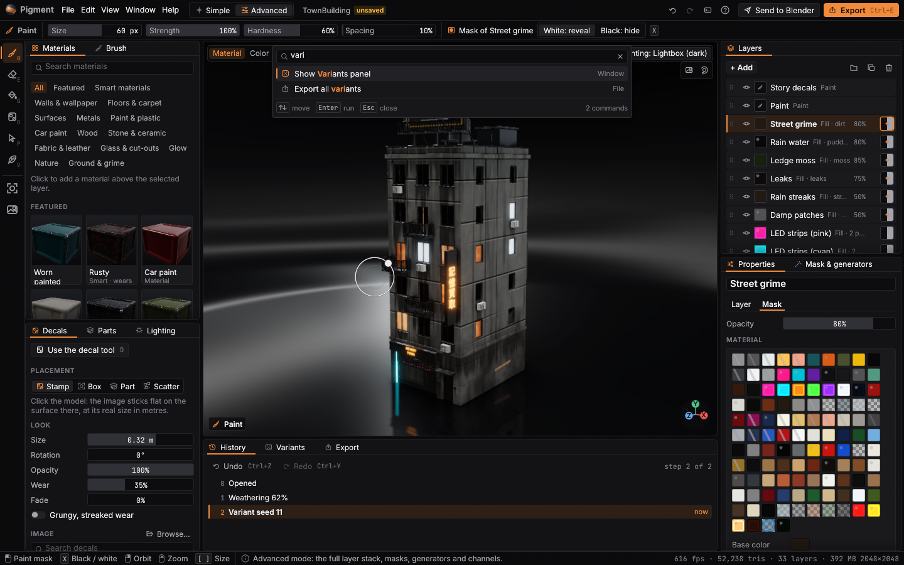

# Getting started with Pigment

Pigment paints textures onto 3D models: colour, roughness, metal, bumps and glow,
ready for Blender, Unreal, Unity or Godot. You don't need to know any of those words
to start.

## 1. Open something

Run `pigment` (or `cargo run --release -p pigment`). The welcome screen opens.

- **Start from a sample**: the crate, the vending machine, a town building, a jerry can
  (and the car, if its paintable body has been generated with `tools/car`).
- **Your own model**: drag an OBJ, glTF or GLB file onto the window, or press *Open a
  model…*. It needs UVs (in Blender: select it, press U, *Smart UV Project*, export).
- **Recent** lists what you opened before. If Pigment closed unexpectedly, a *Recover*
  card brings back your unsaved work.

## 2. Pick a material (Simple mode)

Click a material in **Materials** on the right. It goes on the whole model at once.
Materials marked *Smart · wears* come with edge wear, scratches, rust and dirt that sit
where they'd really be: on edges, in corners and crevices.

- **Search** or pick a category (Metals, Car paint, Glass, Glow...).
- **One part only**: choose *Fill part* on the left (G), click a material, then click a
  piece of the model.
- **How worn?** In **Weathering**, drag the slider or press *Brand new / Used / Worn /
  Battered*.
- **Light it** with *Studio*, *Neon night*, *Overcast* or one of the skies. Lighting only
  changes the preview, not the textures.

## 3. Paint and stick decals

- **Paint** (B): drag on the model. Size and strength are in the bar at the top; `[` and
  `]` change the size. **Erase** with E.
- **Decal** (D): pick an image in the Decals panel, then click the model. *Stamp* sticks
  it flat at a real size in metres, *Box* projects a box you drag, *Fit to part* fills
  the face you click, *Scatter* spreads many copies with random wear. *Wear* and *Fade*
  tear and sun-bleach them.

Made a mistake? Ctrl+Z (or the arrow at the top). The **History** panel lets you jump
back to any step.

## 4. Export

Press **Export** (top right, or Ctrl+E), pick where it's going, press the big button.

The files go to `Documents/Pigment Exports/<name>` (change it with *Change folder…*).
The window keeps working while it exports; a notification says when it's done.
**Send to Blender** writes the maps, the mesh and a `material.json` that the Pigment
Bridge add-on (`tools/blender_addon`) turns into a Blender material.

## 5. When you want more: Advanced mode

Switch at the top (or Ctrl+Tab). You get the full layer stack, masks and generators,
channels, parts, variants and baking.

- **Layers**: drag the grip (⠿) to reorder; drop on the middle of a folder to put a layer
  inside. Right-click a layer for more. The eye hides it, the lock protects it.
- **Mask & generators**: where a layer shows. Pick a generator from the previews (edge
  wear, dirt, leaks, moss, tiles, window grid...) and tune it.
- **Properties**: the material (with glass, glow and car-paint clearcoat / flake
  sections) and **image fills** from `assets/tiles` (brick, concrete...).
- **Save to library** turns a folder into a smart material you can reuse.
- **New project** (Ctrl+N) also makes seamless tiles, trim sheets and decal atlases.

## Arrange the window

Every panel is a tab you can move. Drag a tab onto another panel to join it, onto an
edge to split, or out of the window to float it. Close panels you don't need and bring
them back from **Window**. Window > Layouts has *Beginner*, *Painting*, *Texturing* and
*Compact*, and you can save your own. Pigment remembers the layout, the window size, the
theme and the interface size (Ctrl + / Ctrl -).

| Painting layout | Compact layout |
|---|---|
|  |  |

## Find anything

- **Ctrl+K** opens the command palette: type "rust", "export", "night" or "folder".
- **?** shows every keyboard shortcut.
- **Help > Learn in 2 minutes** walks you through orbit, paint, undo, wear, masks and
  export, pointing at each control as you go.

