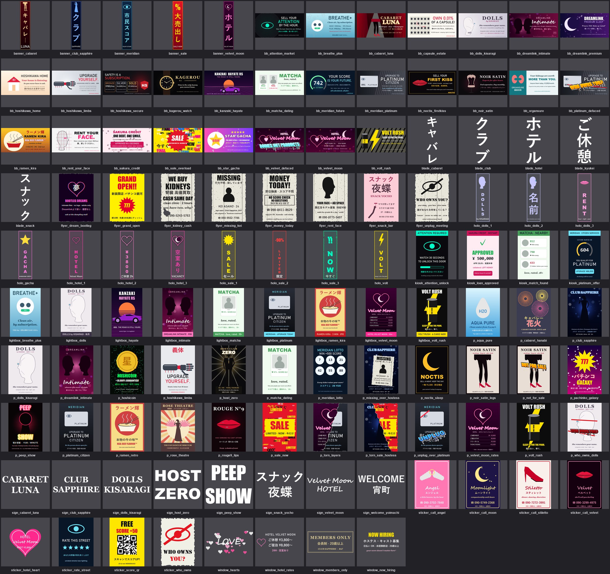

# Ads: a city saturated with advertising (workstream `ads`)

Branch `ads-workstream` (from main 63e707b).

The town now sells everything: bodies, attention, sleep and memories. There are 116 new
procedural ad images in `assets/decals/ads/`. They cover corporate hyper-capitalism, the
red-light district's adult-entertainment advertising, and the street's answer to both. They
are placed on buildings, props and tower crowns under the decal-audit placement rules. The
world has a new red-light district, **Yoimachi 宵町**, and a downtown weighted towards
corporate ads.



| Proof | What it shows |
|---|---|
| `contact_sheet.jpg` | Every new design (116). |
| `yoimachi_night.png` | Cycles, 128 samples, street level in Yoimachi at night. It shows the ホテル blades, Velvet Moon fascias, the WELCOME 宵町 hanging sign, the Noir Satin rooftop billboard and the karaoke and hotel signs down the street. |
| `downtown_corporate.png` | Cycles, a downtown street. The building_c crowns carry the corporate ads (platinum / showroom variants), and the towers have corporate crown billboards. |
| `godot_yoimachi.png`, `godot_downtown.png` | The game (Godot) from the same two cameras (`--spot-cams`). |
| `closeup_*.png` | Pigment close-ups of the new variants: love hotel, hostess bar, cabaret row, the dense ad walls. |

## Content boundaries

The adult-entertainment ads are suggestive and never explicit. Every implied person is an
adult and fully clothed. The people are stylised silhouettes: a woman in a floor-length
gown, a host in a suit, legs in stockings and heels below a skirt hem, lips, a gloved hand
holding a coupe, a corset on a tailor's dress form, and two profiles almost kissing. The
copy is innuendo ("Whoever you want. All night."), and the small print keeps the critique
running: "Partners are licensed dream-likenesses of consenting adult performers. Your
fantasy is logged for quality". Call cards say 20歳以上 (20 and over), and the peep show
says "ALL PERFORMERS ARE ADULTS". There is no nudity, no sexual act, no minors and nothing
non-consensual. Everything is PIL shapes, gradients and type, with no photos and no
downloaded imagery.

## The designs (`tools/make_ad_decals.py`, drawing kit `tools/ads_kit.py`)

```
python tools/make_ad_decals.py [names | prefix*]     -> assets/decals/ads/*.png   (~3 min for all)
python tools/make_ad_decals.py --sheet out.png       (contact sheet)
```

| Format (prefix) | Aspect | Count | Designs |
|---|---|---|---|
| `billboard_ad_*` | 2:1 | 27 | **Corporate:** hoshikawa_limbs, hoshikawa_home ("Your house is listening"), hoshikawa_secure ("Safety is a subscription", Bronze/Silver/Gold), meridian_platinum ("Upgrade to Platinum Citizen"), meridian_future ("Your score is your future"), dreamlink_premium, noctis_firstkiss ("Sell your first kiss ¥2,000"), volt_rush (energy drink), ramen_kira ("Real Beef Flavour™ (contains no beef)"), kagerou_watch, kanzaki_hayate (the fleet's Hayate RS), sakura_credit (debt consolidation, organs as collateral), rent_your_face, breathe_plus (air by subscription), star_gacha, capsule_estate ("Own 0.01% of a capsule!"), sale_overload, organsure (organ insurance), attention_market ("Sell your attention by the hour"). **Red-light:** velvet_moon, dolls_kisaragi ("She remembers your name"), dreamlink_intimate, cabaret_luna, noir_satin, matcha_dating (love rated by MERIDIAN). **Defaced:** platinum_defaced (WHO OWNS YOU?), velvet_defaced (BODIES NOT PRODUCTS). |
| `poster_ad_*` | 0.7 | 27 | club_sapphire (hostess), host_zero, velvet_moon_rates (ご休憩 / ご宿泊 price list), peep_show, noir_satin_legs, rouge9_lips, dolls_kisaragi, rose_theatre (Showa burlesque fan dance), cabaret_hanabi (Showa fireworks), pachinko_galaxy, meridian_lotto, hoshicoin (coin scam), volt_rush, ramen_retro, aqua_pure (water), platinum_citizen, hoshikawa_limbs, dreamlink_intimate, matcha_dating, noctis_sleep, sale_now (glitch). **Torn and defaced:** torn_layers (Velvet Moon ripped off an old MERIDIAN poster), torn_sale_hostess, missing_over_hostess (a MISSING flyer pasted over the hostess club), who_owns_dolls, unplug_over_platinum, not_for_sale. |
| `flyer_*` | 0.71 | 8 | Photocopied wheat-paste flyers: money_today, rent_face, kidney_cash, snack_bar (Showa pink), unplug_meeting, grand_open, missing_kei ("last seen: Club Sapphire"), dream_bootleg. |
| `sticker_*` | 0.71 | 8 | Call cards (angel, velvet, moon, stiletto: phone number, 24H, 20歳以上), score_qr (a scam), rate_street, who_owns, hotel_heart. |
| `lightbox_*` | 0.63 | 9 | Bus-stop lightboxes: dolls, velvet_moon, intimate, matcha, platinum, ramen_kira and volt_rush are lightbox editions of the posters with a lit brand strip; hayate and breathe_plus are drawn for the format. |
| `holo_*` | 0.29 | 11 | Holo-pylon loops: `_1 _2 _3` play round the pylon's three faces (hotel heart pulse, dolls, SALE / LIMITED / NOW), plus volt and gacha. |
| `kiosk_*` | 0.65 | 4 | Data-kiosk screens: platinum_offer ("declining will be noted"), loan_approved (collateral: LEFT KIDNEY), match_found, attention_unlock ("watch 30 seconds to unlock this door"). |
| `window_*` | 2:1 | 4 | Transparent vinyl for shop glass: hotel_rates, members_only, hearts, now_hiring. |
| `banner_*` | 0.21 | 5 | Lit full-colour banners for blade sign faces: velvet_moon, club_sapphire, cabaret, sale, meridian. |
| `sign_*`, `blade_*` | | 8 + 5 | Neon glyphs (white, tinted and made emissive in Pigment): VELVET MOON HOTEL, CLUB SAPPHIRE, CABARET LUNA, DOLLS KISARAGI, PEEP SHOW, HOST ZERO, スナック夜蝶, WELCOME 宵町; blades ホテル, ご休憩, スナック, キャバレー, クラブ. |

The styles are corporate clean, sleazy neon (`Art.glow` and `neon_text`: a blurred overlay
under a crisp core), retro Showa kitsch (`showa`: warm paper tone, faded inks, grain; sun-ray
and fireworks layouts, Mincho type), glitch (`glitch`: RGB split and slice displacement) and
hand-made photocopy (`photocopy`: crushed to toner and paper, specks, roller streaks, torn
edges). The fonts are the ones the decals already use: Yu Gothic, Yu Mincho, Bahnschrift,
Impact, Arial Black, Georgia and Segoe Script. Any line with CJK or symbol glyphs (★ ♥ ☎ →)
falls back to Yu Gothic, and the vertical long-vowel mark ー becomes ｜ in vertical text.
`Art.text` shrinks any line that would run off the canvas.

## Placement (the decal-audit rules, `docs/agents/decalfix/NOTES.md`)

| Kind | Where | Audit kind |
|---|---|---|
| `billboard_ad_*` | Only on billboard geometry: building_a rooftop and back-wall billboards, building_b rooftop, building_c crown panels, the world towers' crown billboards. | billboard |
| `poster_ad_*`, `flyer_*`, `sticker_*` | Street level (0.8–2.2 m) on blank wall, scattered with `fit`, wear and fade. The new **dense ad walls** use 6–9 posters 0.5–0.6 m wide, with centres only 0.32 m apart, so they overlap and layer. Torn-layer and pasted-over designs add the history. | poster (0.8–2.2 m, ≥ 20 texels) |
| `sign_*` (neon) | Centred on the fascia / sign boxes over the ground-floor entrances. The overhead hanging sign has 4 new variants. | shop |
| `blade_*`, `banner_*` | Only on the blade sign faces. Banners are lit (emissive 1.8), not paper. | blade |
| `window_*` | Vinyl on the shop glass, below building_a's transom frame and inside building_b's glazed bays. | window (surface check only) |
| `lightbox_*`, `holo_*`, `kiosk_*` | Props only, on their ad, holo and screen parts. | props (advisory) |

**Building variants** (`tools/town_textures.py`; slot and variant edits only):

| Asset | New variants | Also |
|---|---|---|
| building_a | `love_hotel`: ホテル / Velvet Moon banner blades, VELVET MOON fascia, Velvet Moon roof billboard, Dreamlink Intimate back billboard, rates vinyl on the shop window, a love-hotel ad wall and a burlesque ad wall. `hostess_bar`: Club Sapphire banner and クラブ blades, CLUB SAPPHIRE fascia, Dolls roof billboard, Noir Satin back billboard, MEMBERS ONLY vinyl, a club ad wall and a love-hotel ad wall. | New slots `window`, `ads_back` (back wall, clear of the pipes) and `ads_w`. Existing variants gain ad walls, and implants / capsules / soba get the cyberlimb, credit, capsule-estate and ramen billboards. |
| building_b | `cabaret_row`: CABARET LUNA / PEEP SHOW / HOST ZERO / スナック夜蝶 bays, Cabaret Luna roof, NOW HIRING and hearts vinyl, show and love ad walls. `hostess_row`: CLUB SAPPHIRE / DOLLS / VELVET MOON / KARAOKE bays, Noir Satin roof, club and show ad walls. | New slots `window1`, `window2`, `ads_back` and `ads_e`. noodle_row / pawn_row / night_market get the Volt Rush, Sakura Credit and Star Gacha roofs and ad walls. |
| building_c | `platinum` (Platinum Citizen, Your Score Is Your Future, Safety Is A Subscription, the defaced platinum ad) and `showroom` (Kanzaki Hayate, Kagerou, Hoshikawa Home, Attention Market) on the four crowns. | Corporate posters at the foot. |
| overhead_sign | `welcome` (WELCOME 宵町 on both faces, the district's welcome sign over the street), `velvet_moon`, `peep_show`, `snack`. | |

**Props** (`tools/props/props_textures.py`, new variants only):
- bus_stop gains 9 lightbox variants: dolls, velvet_moon, intimate, matcha, platinum, hayate,
  breathe, volt and ramen. The inside face often sells something else.
- holo_pylon gains 4 loops: hotel, dolls, sale and volt.
- data_kiosk gains 4 screen and back-lightbox pairs: platinum, loan, match and attention.

**World** (`tools/world/`):
- **Yoimachi 宵町**: a new district in `world_config.json`, centre (-720, -120), radius 190 m,
  about 200 m west of the spawn. It is dense, with building_a and building_b only and no
  towers.
- **District variant weights**: `variant_weights` at the world level and per district,
  `{asset: {variant: weight}}`. Variants not listed weigh 1.
  - In Yoimachi, love_hotel, hostess_bar, cabaret_row and hostess_row weigh 7. The
    overhead signs lean to the red-light variants, the bus stops to the dolls / velvet_moon
    / intimate lightboxes, the holo pylons to the hotel and dolls loops, and the kiosks to
    match.
  - Elsewhere the red-light variants weigh 0.1, and the welcome sign 0.
  - Downtown favours building_c platinum / showroom (3), corporate bus-stop ads, sale holo
    loops and platinum / loan kiosks.
  - The result: Yoimachi has 381 buildings and signs, 175 of them red-light variants plus
    the hanging signs. Downtown has 140 corporate-crown building_c.
- **Crown ads**: tower crown billboards pick their ad from `crown_ads` (district, else
  world). Downtown and the corporate island use 16 corporate ads, and the rest of the city
  mixes the story billboards with street ads. The ad is part of the tower mesh key (one mesh
  per ad), and `world_meshes.py` looks in `assets/decals/ads` before `story`. 62 towers
  carry an ad.
- `placement.py`: variant picks now draw from their own seeded stream, so adding a variant
  no longer moves buildings. Street props re-pick their variant with the district's weights.
- **Game** (`game/scripts/automation.gd`): `--spot-cams=<cams.json>` adds Blender cameras as
  bench spots, so the game screenshots match the Cycles shots.

## Audit

```
python tools/decal_audit.py
building_a: 133 decals (billboard 15, blade 16, ghost 2, graffiti 7, other 2, plate 4, poster 79, shop 8); min texels 23; 0 with violations
building_b: 149 decals (billboard 9, graffiti 9, other 4, plate 4, poster 89, shop 34); min texels 10; 0 with violations
building_c: 43 decals (billboard 20, graffiti 5, logo 1, plate 3, poster 12, shop 2); min texels 21; 0 with violations
overhead_sign: 27 decals (shop 27); min texels 97; 0 with violations

352 decal records in 4 assets: 0 with violations
```

There were 181 records before this branch. Min texels 10 on building_b is the window vinyl,
which has no texel minimum.

`decal_audit.py` changes:
- `assets/decals/ads` gets the story rules.
- `flyer_*` and `sticker_*` count as posters, and `banner_*` as blade signs.

The first window placement covered building_a's transom frame. The audit caught it, and
the vinyl now sits below the frame.

Props audit (advisory, `decal_audit.py bus_stop holo_pylon data_kiosk`): the bus-stop
lightboxes pass. The new holo frames and kiosk screens are flagged exactly like the existing
ones: the holo panels' trim lip, and the palm-scanner shelf over the kiosk screen's bottom
edge (already listed for the props workstream in the decalfix notes).

## Rebuild (city build)

```
cargo build --release -j 4 --bin pigment-mcp          # main's checkout binary is older than main (no "Cut-out" material)
python tools/make_ad_decals.py                        # or let the build run decals:ads
python -m tools.city discover                         # new models: decal_set/ads, district/yoimachi
python -m tools.city build building_a building_b building_c overhead_sign prop/bus_stop prop/holo_pylon prop/data_kiosk world:build
python -m tools.city discover --refresh               # new variants -> world keys
python -m tools.city build <same targets>             # world glbs for the new variants
python -m tools.city build godot.tex                  # Godot packs
python tools/decal_audit.py                           # 0 violations
```

Measured on this machine, with other agents sharing the GPU:

| Step | Time |
|---|---|
| `decals:ads` | 180 s |
| Pigment: building_a / b / c | 17 / 56 / 74 s |
| Pigment: overhead sign and the three props | 3–11 s each |
| `world:build`, first pass (gen + build + export, 1382 glbs) | 515 s |
| `world:build`, second pass (no glb changed) | 423 s |

Proof:

```
python tools/ads_proof.py <T>        # picks the street with the most red-light / corporate variants in view -> <T>/cams.json
blender -b --factory-startup --python tools/world/world_driver.py -- --stages build,render \
    --region -964,-386,-66,105 --cams <T>/cams.json --render-dir docs/agents/ads --samples 128 --res 1600x900
godot --path game -- --bench-spots=<T>/godot --spot-cams=<T>/cams.json --spots=yoimachi_night,downtown_corporate --spot-secs=1 --no-drive --clean
```

## Merge notes

- **Hot spots**
  - `tools/town_textures.py` has additive edits only:
    - an `ADS` path in `image_path`;
    - NEON tints;
    - the banner and window looks, and `KIND_ORDER["window"]`;
    - `scatter_slot(**kw)` (`size`, `spacing`);
    - the new slots, the `ADS_*` lists, and the variant entries (some existing variants
      gained ad slots and new roof images).
  - `tools/world/world_config.json` has 3 text insertions: top-level `variant_weights` and
    `crown_ads`, `crown_ads` / `variant_weights` on downtown and corporate, and the
    yoimachi district before midtown.
  - `tools/world/placement.py`: `variant_weights`, the `vrng` stream, `crown_ads`, and the
    prop re-pick.
- **Regenerated and committed:**
  - `scenes/world/world.json` (with Yoimachi);
  - `scenes/town/scripts/*` and `scenes/town/projects/*`;
  - `scenes/props/scripts/{bus_stop,holo_pylon,data_kiosk}.jsonl`;
  - `assets/props/{bus_stop,holo_pylon,data_kiosk}*.glb`, `index.json` and the new variant
    images;
  - the smart models of the touched assets.

  Re-run the build after merging other world or kit changes rather than hand-merging these.
- **Variant picks use a new RNG stream.** Every building's variant changes once, and future
  variants won't reshuffle the layout. The layout itself (positions) is unchanged outside
  Yoimachi.
- **Tower mesh keys** with a crown billboard now end in the ad name
  (`tower_..._billboard_volt_rush`).
- **Known gap in the city build:** `tools/city/pigscript.scan` does not treat
  `scatter_decals` images as inputs. Editing a poster image does not by itself rebuild the
  buildings that scatter it. Changing the scripts does. I did not fix this, because touching
  `pigscript.py` makes every Pigment node stale.
- **Delete the stale folder** `scenes/town/textures/overhead_sign__kiosk/` (from an older
  build) if it is still there.

## Known limits

- **Texel density.** Street-level paper reads at 20–30 texels across at 2048 (see
  decalfix). The ad walls read as colour and layout, not small print.
- **Lightbox editions.** 7 of the 9 lightboxes reuse their poster's art over a brand strip.
- **District weights are soft.** A few ordinary variants still turn up in Yoimachi, and the
  district edge at downtown's radius is a hard boundary.
- **Size.** The 116 PNGs are 17 MB, because the posters carry noise and torn alpha.
