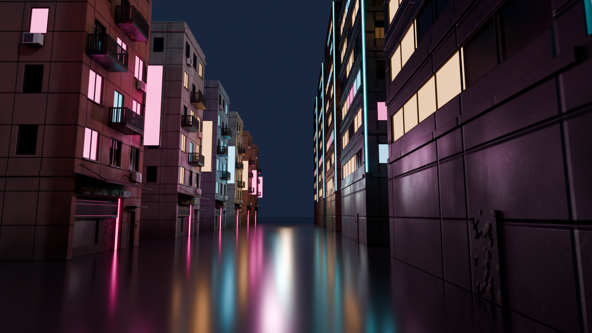
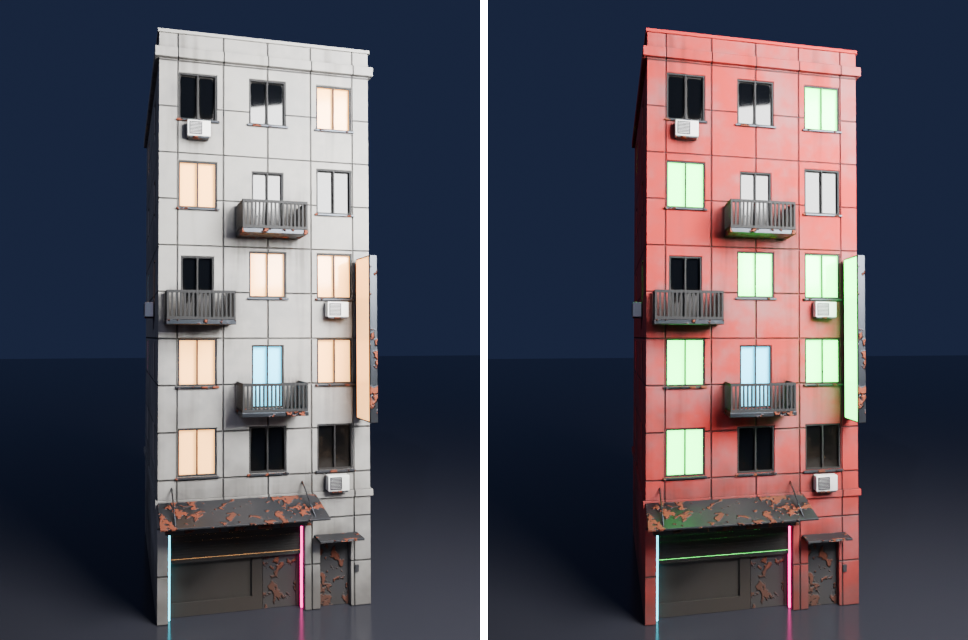

# Pigment ↔ Blender bridge



*Ten instances of two town buildings. Each building picked a random colour variant
(`building_a__warm/cyan/neon`, `building_c__steel/rust`) and was linked by the add-on.
The mesh is the exact one Pigment painted. Cycles, 128 spp.*



*Live reload. Left: as linked. Right: after Pigment re-exported the folder (concrete
turned red, the warm windows became green, and `emissive_scale` went from 6 to 9). The
add-on's timer check rebuilt the material in place.*

## What was built

| Piece | Where |
|---|---|
| `material.json` sidecar, written by **every** texture export (UI and MCP) | `crates/core/src/bridge.rs`, one hook in `PigmentApp::export` (`crates/app/src/app.rs`) |
| glTF (.glb) mesh export with Pigment's tangents, plus OBJ | `crates/core/src/bridge.rs` (`export_mesh`, `write_glb`) |
| MCP tools `send_to_blender` and `export_mesh` | `crates/app/src/app/bridge.rs` (new file), registered in `src/bin/pigment-mcp.rs` |
| CLI `pigment-mcp --export-for-blender` | `src/bin/pigment-mcp.rs` |
| Blender add-on **Pigment Bridge** (Blender 4.2+ / 5.2 extension, with legacy `bl_info`) | `tools/blender_addon/pigment_bridge/` (`core.py` holds the logic, `__init__.py` the UI) |
| `tools/blender_pigment.py`: same API, now a thin wrapper over the add-on's `core.py` | `tools/blender_pigment.py` |
| Variant export demo script | `scenes/town/scripts/blender_bridge_variants.jsonl` |
| Headless end-to-end test | `tools/test_blender_bridge.py` |

### MCP tools

- **`send_to_blender(dir, name?, preset?="separate", mesh?=true, mesh_format?="glb"|"obj", project?)`**
  exports these into `dir`:
  - the maps;
  - `material.json`;
  - `<name>.glb`, the painted mesh with tangents.

  With `project`, it saves the project there first, so the sidecar can point back to it.
  It returns the sidecar entry, the file list and the mesh info.
- **`export_mesh(path, format?)`** writes the loaded mesh as Pigment paints it: world
  transforms applied, with UVs, normals, and (in `.glb`) the TANGENT frame that the
  normal map was baked in. A path with no extension gets `.glb`.
- **`export_textures`** is unchanged, except that it now also writes or updates `material.json`.
- **CLI:** `pigment-mcp --export-for-blender <project.pigment | mesh.glb> <dir> [--name N] [--preset P] [--no-mesh] [--mesh-format glb|obj]`.
  The add-on runs this to export a linked project.

### `material.json`

One file per folder, with one entry per base name (several exports can share a folder):

```json
{ "format": "pigment-material", "version": 1, "materials": { "building_a": {
    "name": "building_a", "preset": "separate", "resolution": 4096,
    "channels": ["base_color","roughness","metallic","ao","normal","height","emissive"],
    "normal_convention": "opengl", "normal_space": "tangent",
    "emissive_scale": 6.0, "has_emission": true,
    "height": { "neutral": 0.5, "min": -1.0, "max": 1.0 },
    "maps": [ { "file": "building_a_BaseColor.png", "suffix": "BaseColor", "format": "rgb8",
                "colorspace": "srgb", "sources": ["red","green","blue"] }, ... ],
    "project": "C:/.../building_a.pigment", "source_mesh": "...", "mesh": "building_a.glb",
    "exported_at": 1793492231, "pigment_version": "0.1.0" } } }
```

Each map's `sources` lists, for every colour channel of the file, which material
channel it carries. For example, unreal's ORM is `["ao","roughness","metallic"]`,
DirectX normals use `normal_y_flipped`, and Unity's alpha holds `smoothness`. This lets
the add-on wire packed maps without guessing. Paths inside the folder are stored
relative to it.

### Texture sets

A project with several texture sets (by material or by UDIM tile) exports every set in
the requested preset as `<name>_<set>_<map>.<udim>.png`. The sidecar gets one entry per
set and a main entry that lists them:

```json
"lantern":       { "texture_sets": ["lantern_Metal", "lantern_Glass", ...], "mesh": "lantern.glb" },
"lantern_Glass": { "texture_set": "Glass", "materials": ["Glass"], "udim": null,
                   "maps": [ { "file": "lantern_Glass_BaseColor.1001.png", ... } ], ... },
"room_corner_tile_1002": { "materials": [], "udim": 1002, ... }
```

A set's `materials` are glTF material names (`[]` means any) and `udim` is its tile
(`null` means any). `<name>.glb` is the **whole** mesh (not the active set's part) with
one glTF material per source material. `core.link_sets` (used by Import Pigment Mesh,
Link and `apply_pigment_material` whenever an entry has `texture_sets`) gives each face
the material of the first set that covers it: its slot's material name (ignoring
Blender's `.001`) and the UDIM tile of its UV centre. A slot that already holds one of
the set materials keeps its set, so re-linking is stable. The in-app Export / Send to
Blender buttons take the same path when the project has sets.

## Install the add-on

1. Zip the folder: `tools/blender_addon/pigment_bridge/` becomes `pigment_bridge.zip`,
   with the `pigment_bridge/` folder at the top level of the zip.
2. In Blender 5.2, open **Edit > Preferences > Get Extensions > ⌄ > Install from Disk…**
   and pick the zip. On older Blender versions use **Add-ons > Install…**.
3. Optional: to link `.pigment` *projects*, the add-on needs `pigment-mcp`. Set its path
   in the add-on preferences, or set `$PIGMENT_MCP`, or put it on `PATH`. When the add-on
   is used straight from the repo, it also finds `target/release/pigment-mcp(.exe)`.

To install it from a script (this is what the test does):
`bpy.ops.extensions.package_install_files(filepath=zip, repo=<repo module>, enable_on_install=True)`.

## Use it

Open the panel at **3D Viewport > Sidebar (N) > Pigment**.

1. **Source** can be any of these:
   - a texture folder (with `material.json`, or just `<name>_<Map>.png` files from any
     Pigment preset);
   - one `<asset>__<variant>` folder;
   - the plain `<asset>` path, whose `<asset>__*` sibling folders hold the variants;
   - a `.pigment` project folder. The add-on exports it with pigment-mcp into a sibling
     `<stem>_blender/` folder the first time, and again whenever the project is newer.

   **Set** picks the base name when a folder holds several.
2. Choose the options:
   - **Height**: *Off*, *Bump* (a Bump node, with distance and strength), or
     *Displacement*. Displacement uses a Displacement node into the Material Output,
     sets the material to *Displacement and Bump*, and can add an adaptive
     **Subdivision** modifier (Cycles).
   - **AO into base colour**: a multiply factor.
   - **Emission ×**.
3. **Link Selected** assigns materials to the selected meshes:
   - Objects that resolve to the same texture set share **one material**, so 100
     lamp posts give 1 material.
   - With **Random variant per object** (and a **Seed**), each object gets a random
     `<asset>__<variant>` folder. The pick is stable per object name and seed.
     **Re-roll Variants** picks again.
   - Linked duplicates (shared mesh data) get object-level material slots, so instances
     keep their own variants.
4. **Import Pigment Mesh** imports `<name>.glb` from the folder (what `send_to_blender`
   wrote) and gives it the material. This is the exact mesh Pigment painted.
5. **Auto-reload** (on by default) runs a timer every *N* s that compares file mtimes:
   - If only PNGs changed, those images are reloaded in place.
   - If `material.json` changed, or maps appeared or disappeared, the material is rebuilt
     in place. All objects using it update, and the new `emissive_scale` is picked up.
   - With **Re-export linked projects**, saving the `.pigment` project triggers a
     background pigment-mcp export, which the next tick picks up.

   **Reload Now** and **Re-export Project** do the same on demand.
6. The **material box** shows the folder, variant, maps, resolution, how many objects
   share the material, the exported emissive scale, and a live **Emission ×** field.

**Emission strength** is a driver on the Principled *Emission Strength*:
`o if o > 0 else s * k`, where `s` is the material's `pigment_emissive_scale` (from
the sidecar), `k` is `pigment_emission_mult`, and `o` is an absolute override. It is a
simple expression, so it runs without "Auto Run Python Scripts".

**From scripts:** use `tools/blender_pigment.py`. `apply_pigment_material(obj, folder, name, emission_strength=None, use_height=False, height_scale=0.01)`
keeps its old signature. `emission_strength=None` now means "use the sidecar's
`emissive_scale`", or 8.0 when there is no sidecar, which is the old default. You can
also use the core module directly:
`sys.path.insert(0, "tools/blender_addon"); from pigment_bridge import core; core.link_objects(objs, folder, variants=True)`.

**From Pigment:**
`pigment-mcp --script scenes/town/scripts/blender_bridge_variants.jsonl` writes these
folders into `scenes/town/textures/blender/` (git-ignored), from the saved town projects:
- `building_a__{warm,cyan,neon}`;
- `building_c__{steel,rust}`;
- `building_c_unreal`, an ORM / DirectX test.

## How it was tested

- `cargo test --release`. The new tests are:
  - `bridge::tests::sidecar_describes_maps_and_merges_entries`: separate and unreal
    presets, ORM sources, DirectX, emission flags, and merging (an export keeps the
    mesh recorded earlier).
  - `bridge::tests::glb_round_trips_through_the_loader_with_tangents`: the glb loads back
    with identical positions, UVs and indices, its TANGENT accessor equals Pigment's
    tangents, and OBJ works.
  - `app::bridge::tests::send_to_blender_writes_maps_sidecar_and_mesh` (GPU): the maps,
    the sidecar (emission, project path, mesh) and the painted mesh, plus `export_mesh`
    obj and the no-extension case.
  - `app::bridge::tests::send_to_blender_with_texture_sets` (GPU): every set in the
    requested preset, set entries whose files exist and which name their materials, the
    whole mesh with its materials, and render framing that ignores which set is active.
  - `bridge::tests::glb_keeps_materials`: a multi-material glb loads back with the same
    material on every triangle.
- `tools/test_blender_texture_sets.py` runs headless after the `scenes/materials` lantern
  and room_corner recipes. It checks that faces per set equal the source's faces per
  material, that sets map to UDIM tiles, that the glass has opacity and transmission maps,
  and that linking the source `.glb` and re-linking are both stable.
- `tools/test_blender_bridge.py` runs headless:
  `blender -b --factory-startup --python tools/test_blender_bridge.py [-- --quick]`.
  It needs `pigment-mcp` built and the variants script run first. It covers:
  - installing the add-on **from a path** into a temporary extension repository (the
    user's Blender config is not touched);
  - mesh import, where the triangle count equals the glb's;
  - 7 linked duplicates getting 3 variants with 3 shared materials, deterministic
    picks, and re-roll;
  - the variant pick from the plain asset path;
  - all wiring: AO multiply, bump, ORM through Separate Color, DirectX green flip
    (with and without a sidecar), Displacement with adaptive subdivision, and height off;
  - the emission driver: strength equals the scale, and ×2 gives twice the strength;
  - a real **Pigment re-export** into a linked folder, after which the timer's tick
    rebuilds the material, BaseColor gets redder and `emissive_scale` goes 6 → 9;
  - a PNG-only change, which reloads the image in place;
  - linking a `.pigment` project (exported through the CLI) and watching it, where
    touching the project re-exports and rebuilds;
  - the two renders above.

  The full run took about 4 min, mostly Cycles.
- `tools/test_blender_pigment.py`, the old importer test, still passes unchanged through
  the wrapper. The only edit is that it now passes `__file__` to `exec`.

## Known limits

- Blender's glTF importer ignores the TANGENT attribute and recomputes MikkTSpace
  tangents. Pigment's tangents are per-vertex Lengyel tangents, Gram-Schmidt'd and
  welded across UV seams, so the two are very close but not bit-identical. The `.glb`
  carries Pigment's exact tangents for consumers that read them.
- The timer is a Blender `bpy.app.timers` timer, and timers don't run in `-b` background
  mode. Headless scripts call `core.check_reload()`, which is exactly what the timer
  calls.
- Linking a `.pigment` project needs `pigment-mcp` and a GPU. The export runs the full
  session (bake included): about 10 s for a small project, about 25 s for a 4K building.
- Height is applied with Pigment's convention (0.5 = neutral, full range = ±1). The
  physical size comes from the *Bump distance* and *Displacement* options; Pigment does
  not export a height in metres yet.
- `material.json` is rewritten whenever that base name is exported. Deleting a set's PNGs
  leaves its entry in place, and the add-on skips maps whose files are missing.
- A material named `Pigment_<name>` that already belongs to another folder makes the
  add-on name the new one `Pigment_<folder>` (variants) or let Blender add `.001`.
  `apply_pigment_material` keeps the legacy behaviour of rebuilding `Pigment_<name>` in
  place.

## Merge notes

- Hot files: these edits are additive only.
  - `crates/core/src/lib.rs`: `pub mod bridge;`.
  - `crates/app/src/app.rs`: `mod bridge;` and the sidecar write in `export()`.
  - `crates/app/src/bin/pigment-mcp.rs`: 2 tool entries, 2 match arms, the
    `--export-for-blender` branch, and a function at the end.

  `automation.rs` is not touched; the session methods live in `src/app/bridge.rs`.
- Every texture export now also writes `material.json` into its folder. Run the variants
  script after regenerating the town textures if you want the demo folders.
