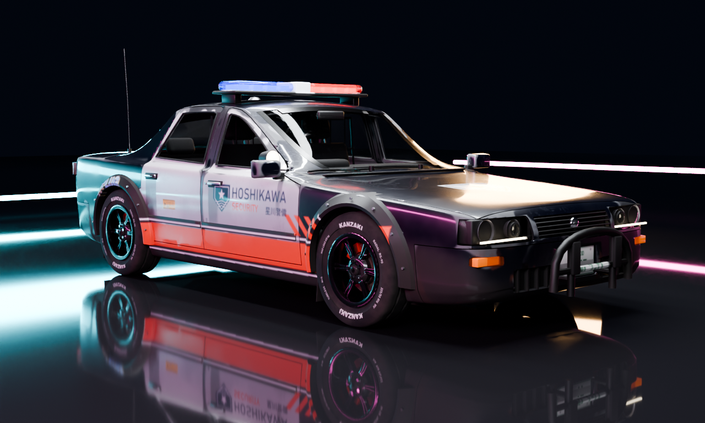
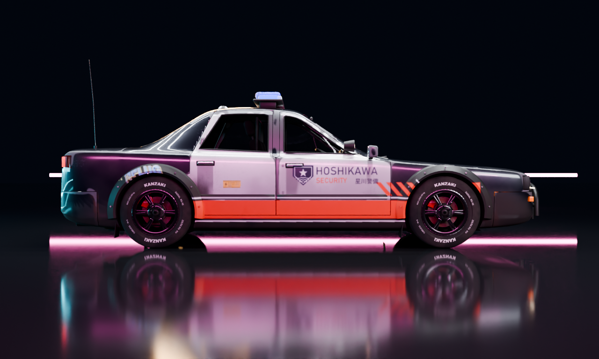
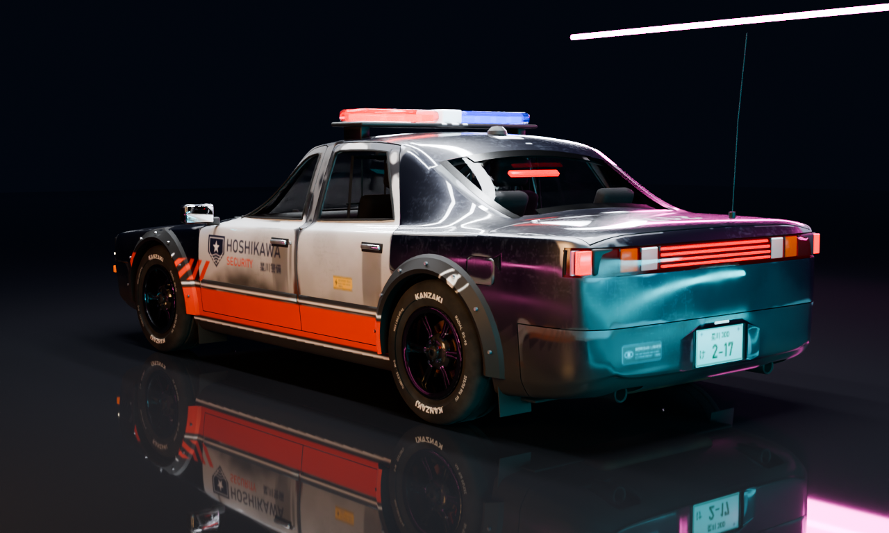
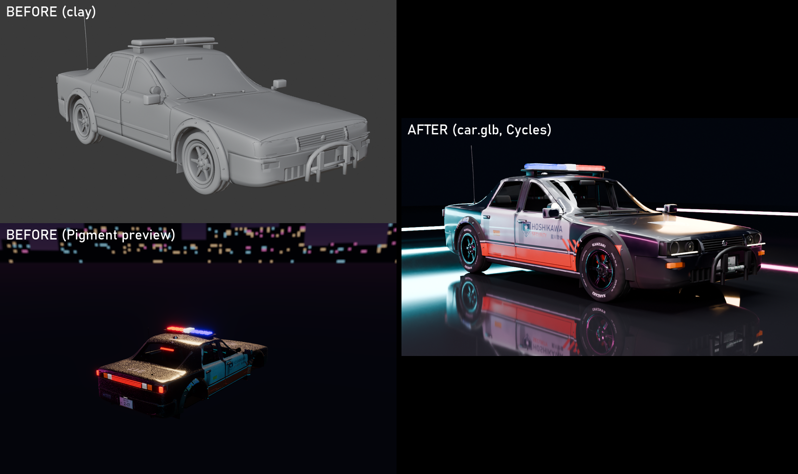

# Car: Kanzaki Tsubame-4, Hoshikawa Security cruiser

An original 1994-style four-door sedan, the fictional Kanzaki Tsubame-4. Hoshikawa Security, the corporate police of Hoshikawa Dynamics, converted it with a push bar, a roof light bar, an A-pillar spotlight, a rear-seat partition and a MERIDIAN dash terminal. Bolt-on overfenders cover the wider track.

Its second livery is a Pigment variant: **Kōen Cab**, the same car bought at a fleet auction and run as a night cab.

The three renders above are the exported `assets/car/car.glb` (what Godot gets), imported into headless Blender and rendered with Cycles at 128 spp. The set is a night studio: a wet black floor, overhead strip lights for reflection lines, and cyan and magenta neon rim tubes.

The quality pass (before → after):
- **Stance:** wider track, so the tyres sit flush with the body. Tighter arches leave a 3.5 cm gap. The ride height is 3 cm lower.
- **Body shape:** the plan view tapers at both ends, the nose is lower, the C-pillar is faster, and the shoulder crease is crisper.
- **Panel edges:** shut lines now roll under through a rounded flange, and the panels take smooth-surface normals, so the boolean cuts don't show in reflections.
- **Paint:** the flake is subtle, and wear is kept to the edges and sills.
- **Details:** projector headlamps, taillight inner structure, windscreen frit bands, and 12-spoke rims.

Other proof images:
- `car_turntable.png`: 8 views.
- `car_clay_wire.png`: clay and wire.
- `pigment_body_night.png`, `pigment_body_rear.png`, `pigment_body_turntable.png`, `pigment_wheel.png`: Pigment MCP renders.
- `pigment_coat_compare.png`: the new Coat channel; see `NOTES_coat.md`.

## Pipeline (all deterministic, all scripted)

| step | command | output |
|---|---|---|
| model | `blender -b --factory-startup --python tools/car/build_car.py [-- --preview DIR]` | `assets/car/src/car_body.glb`, `car_wheel.glb`, `car_parts.json`, `car_info.json`, `car_model.blend` |
| decals | `python tools/car/make_car_decals.py` | `assets/decals/car/*.png` |
| textures | `python tools/car/car_textures.py [body] [wheel]` | `scenes/car/scripts/*.jsonl`, `scenes/car/projects/*.pigment`, `scenes/car/textures/` (git-ignored) |
| export | `blender -b --factory-startup --python tools/car/export_car.py [-- --livery cab]` | `assets/car/car.glb`, `car_lod1.glb`, `car.json` (`car_cab*.glb` for the cab) |
| proof | `blender -b --factory-startup --python tools/car/render_car.py -- studio\|turntable\|clay` | `docs/agents/car/car_*.png` |

### Model (`tools/car/body.py`, `panels.py`, `parts.py`, `wheels.py`, `assemble.py`)

- **Body.** A SubD cage lofted from 12-point half cross-sections at 28 stations. Each point index traces one longitudinal line: sill, rocker crease, shoulder, greenhouse base, roof edge. Both ends are closed with Coons-patch quad grids. Creases are set on the character lines. The cage is subdivided at level 2.
- **Panels.** Cutters work through the Manifold boolean solver. Cutter faces are tagged with a material and deleted afterwards, so every cut stays open.
  - Wheel arches, window openings, lamp and grille apertures, intakes and exhaust holes are cut out.
  - Plate recesses are kept as pockets.
  - 4.5 mm shut-line cutters are unioned first and then subtracted. They separate the 4 doors, hood, trunk lid, both bumpers and the fuel door into their own pieces.
  - Every cut edge gets a rounded flange: a 1.8 mm roll-off, then 14 mm deep.
  - Custom normals are transferred from the uncut smooth surface, so boolean slivers never show in reflections.
  - Glass panes and lamp lenses are the shell surface intersected with each opening, inset by 4–6 mm.
- **Parts.** 225 named parts in total:
  - **Lights:** twin-reflector headlamps with a projector lens, bulbs and a DRL strip. The taillight has a housing, a chrome back plate, black fins and red, amber and white segments. There are amber indicators and a third brake light.
  - **Front:** grille slats and badge, intake meshes, push bar.
  - **Exterior trim:** window seals, windscreen and rear-window frit bands, door rub strips, bolted overfenders, door handles with lock, and mirrors on stalks with mirror glass.
  - **Ancillaries:** wipers, cowl panel, plates and plate lamp, exhaust tips, pipe, silencer and catalyst.
  - **Roof:** light bar on feet, comms puck, whip antenna, spotlight.
  - **Under the car:** mudflaps, underbody tray, tunnel and tank, crossmembers, arch liners, and the suspension (dampers, coil springs, A-arms, knuckles, driveshafts).
  - **Interior (right-hand drive):** buckets and a rear bench with headrests, dash with binnacle and gauges, centre stack, console with shifter and handbrake, the MDT terminal, the steering wheel and column, door cards with armrests, headliner, carpet, partition cage and parcel shelf.
- **Wheel.**
  - Tyre: 225/50 R16-ish, radius 0.332 m, with sidewall bulge, a raised lettering band, 2 circumferential grooves and lug blocks.
  - Rim: 12-spoke (six split pairs), with a dish, a barrel, 5 lug nuts and a centre cap.
  - Brakes: a vented disc on its hat, and a caliper behind the axle.
- **UVs.** Each part is smart-projected, then rescaled to real-world size. Under-car and interior parts get half the density. Everything is packed into one layout per material (body / wheel). A `car_group` face attribute keeps the part family.
- **`car_parts.json`.** Lists every piece with its group, bounding box and triangle count, in glTF coordinates. `car_textures.py` matches each Pigment part to the smallest piece whose box contains it (0 unmatched).

### Triangles

| | triangles |
|---|---|
| LOD0 total (body + 4 wheels + 4 calipers) | **92.5k** |
| body (exterior + interior + under-car) | 63.4k |
| one wheel / one caliper | 7.0k / 276 |
| LOD1 (no interior / under-car detail, decimated) | **9.9k** |
| collider (convex hull) | 364 |

LOD0 is about 12k over the brief's ~80k. The quality pass (rounded flanges, 12 spokes, projector lamps) added that, and the coordinator put quality first. Easy cuts if needed:
- `subdivide(cage, 2)`: the shell is about 25k triangles.
- The interior is about 8k.
- `wheels.py` segment counts.

### Texturing (`tools/car/car_textures.py`, Pigment MCP)

**Body: 4K, 86 steps, every mask a part selection.**
- **Paint.** Midnight candy with clearcoat and subtle flake (coat 1, coat_roughness 0.02, flake 0.12), and pearl-white doors.
- **Wear, on the paint:**
  - coat haze (grunge → coat_roughness);
  - fine scratches;
  - edge chips, primer then bare steel (edge_wear with `coat: 0`);
  - arch rust: edge_wear × ground gradient × spots, so it lands only on the low edges;
  - rust bloom.
- **Weathering, everywhere outside:** gap grime (dirt), rain streaks (leaks), water spots on the glass, road dirt rising from the sills (gradient × grunge), and road spray.
- **Trims:** chrome, satin black, rubber, powder coat, mirror glass, and the exhaust with heat tint.
- **Glass and lenses:** tinted glass (`opacity 0.3, transmission 0.9`), black ceramic frit, and clear, red and amber lenses.
- **Emissive:** headlamps, tail lamps, indicators, reverse lamps, light-bar LEDs, gauges, and the terminal screen (MERIDIAN score billboard).
- **Interior:** cloth, leather, plastics, carpet.
- **Decals:**
  - **Livery:** vermilion side flash (a mirrored image on the right), HOSHIKAWA SECURITY door crest, hood crest, roof unit number `HS-217` for the drones, trunk number, and plates `星川 300 け 2-17`.
  - **Stickers:** DETERRENT FIELD warning stickers and a MERIDIAN LINKED sticker on the bumper.
  - **Story:** an UNPLUG tag (torn and faded) on the right rear quarter and a crossed-eye stencil on the left.

**Variants (`export_variants`).**
- `security`: the authored look.
- `cab`: teal candy with a cream hood and cream flash, KOEN CAB doors, number 0451, yellow plates, and the light bar as an amber cab sign.

Layer and decal groups: `livery_hs`, `livery_cab`, `story`. Both sets export to `scenes/car/textures/car_body__{security,cab}/`.

**Wheel: 2K.**
- Tyre: rubber with tread scuff, a dusty sidewall, and the `KANZAKI RADIAL RS-90 225/50 R16` ring decal fitted to the tyre's outer face.
- Rim: gunmetal clearcoat with a polished lip.
- Brakes: a rusty disc, and an orange caliper with the KANZAKI logo.
- Brake dust and grime over the rim and caliper.

## Godot export contract (as built)

Files: `assets/car/car.glb` (10.1 MB, committed), `car_lod1.glb` (3.7 MB, the same node names) and `car.json`.

- **Axes.** glTF, +Y up. The car faces **+Z**, and **+X is its left side**. The origin is on the ground under the centre of the body.
- **`Body`.** All body parts in one mesh with one material, `Pigment_car_body`.
- **`Wheel_FL`, `Wheel_FR`, `Wheel_RL`, `Wheel_RR`.** Separate nodes with their origin at the hub centre, at rest. Identity rotation: the right-side wheels use a mesh turned 180° about the up axis, so sidewall text reads correctly. Hub positions: (±0.7925, 0.332, +1.33) front and (±0.7925, 0.332, −1.32) rear.
- **`Caliper_XX`.** Extra nodes with the same origin as their wheel. **Steer them with the wheel, but don't spin them.**
- **`Collider`.** A convex hull with extras `{"collider": "convex", "hidden": true}`. Use it as a ConvexPolygonShape3D and hide the mesh.
- **Lamp empties.**
  - `Headlight_L/R` sit at (±0.60, 0.602, 2.184), rotated 180° about Y.
  - `Taillight_L/R` sit at (±0.735, 0.795, −2.21), with identity rotation.
  - Each empty's **local −Z is the beam direction** (Godot SpotLight3D convention).
- **Materials.**
  - glTF PBR with embedded PNG textures: base colour, metallic-roughness, occlusion (via the "glTF Material Output" group), normal, emissive with `KHR_materials_emissive_strength`, `KHR_materials_clearcoat`, and `KHR_materials_transmission` (ignored by Godot). Body textures are 2048, wheel textures 1024, LOD1 at half that.
  - The body is `alphaMode BLEND`, because the glass, lenses and light bar use base-colour alpha. In Godot, set that material's transparency to **Alpha Depth Pre-Pass** (or Alpha Hash) so the opaque paint sorts correctly.
  - Metallic flake isn't in glTF.
- **`car.json`.** Holds the node list, `wheel_radius` 0.332, `wheel_width` 0.215, `track` 1.585, `wheelbase` 2.65, the wheel positions, light positions, directions and colours, `mass_kg` 1280, the centre of mass, a suspension suggestion for VehicleWheel3D, dimensions, triangle counts, and notes.

## Pigment feature: Coat, CoatRoughness, Flake

See `NOTES_coat.md`:
- the new channels, MCP values and views;
- the presets "Car paint clearcoat", "Candy paint" and "Metallic flake paint";
- the `_Coat.png`, `_CoatRoughness.png` and `_Flake.png` export maps;
- `material.json` and the Blender Principled Coat wiring, which produces glTF `KHR_materials_clearcoat`;
- tests and the conflict hot spots.

## Known limits

- The beauty render is the night studio (wet floor + neon), not a street of `cyberpunk_town.blend`. The town textures are git-ignored and absent from this worktree, so no town shot was made. `render_car.py town` only opens the town and imports the car; it doesn't place a camera yet.
- The Pigment viewport's flake hashes per 0.4 mm world cell and still shimmers at a distance. In Blender, flake is procedural and is switched off for the glb export.
- Glass is single-sided (no thickness).
- The body is a single material, so Godot sorts the transparent parts per mesh, not per part (see the Alpha Depth Pre-Pass note above).
- Tyre lettering, interior cloth and decals are texture only: there is no geometry text.
