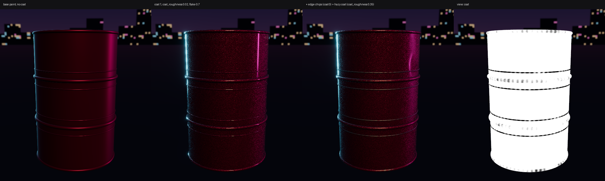

# Clearcoat and metallic flake (Coat, CoatRoughness, Flake)

Pigment can now paint car paint: a glossy clearcoat over the base, plus metallic flake sparkle. Three new channels run through the whole pipeline, in the same way as opacity and transmission:

- **Coat**: clearcoat weight. 0 = none, 1 = a full dielectric varnish layer.
- **CoatRoughness**: roughness of that coat. The default is 0.03, fresh lacquer.
- **Flake**: metallic flake amount in the base under the coat.

`pigment_coat_compare.png` shows four Pigment viewport renders under the `night` lighting. It was made with `coat_demo.jsonl`; the script writes into `docs/agents/car/coat_demo/`, so point its paths somewhere else to re-run it.

1. Candy base, no coat.
2. `coat 1, coat_roughness 0.02, flake 0.7`. The sharp neon highlights come from the coat lobe, and the sparkle comes from the flakes.
3. The same, plus an edge-wear "Chips" fill with `coat: 0` and a grunge-masked "Hazy coat" layer (`coat_roughness 0.35`, only that channel).
4. `view: coat`. The chipped rims have no coat.

## What changed

- **Core.**
  - `document.rs`: `Channel::Coat`, `CoatRoughness` and `Flake`, so `Channel::ALL` now has 11 entries. `Channels.coat/.coat_roughness/.flake` and `MaterialValues.coat` (default 0), `.coat_roughness` (default 0.03) and `.flake` (default 0), all with serde defaults, so old projects load uncoated.
  - Plain fills keep all three off. A fill turns Coat and CoatRoughness on when `coat > 0`, and Flake on when `flake > 0` (`MaterialValues::is_coated`). Paint layers have all three on.
  - New presets: "Car paint clearcoat", "Candy paint" (with flake) and "Metallic flake paint".
- **Project files (`project.rs`).** A layer folder may hold `coat.png`, `coat_roughness.png` and `flake.png` (LA8). They are written only when painted.
- **Export (`export.rs`).** `MaterialImages.coat` is RGBA8 (coat, coat roughness, flake). An empty one means uncoated.
  - The `separate` preset adds `_Coat.png`, `_CoatRoughness.png` and `_Flake.png` (L8).
  - They are written only when used: CoatRoughness only when there is a coat, and Flake only when it is non-zero. Stale maps are deleted.
  - The unreal/unity/godot presets are unchanged.
- **Sidecar (`bridge.rs`).** The `material.json` sources and channels gain `coat`, `coat_roughness` and `flake`.
- **Compositor (`composite.wgsl`, `folder.wgsl`, `texset.rs`).** All four accumulators were full (32 bytes per sample), so the accumulated detail normal now keeps only its xy; z = sqrt(1 − x² − y²), because tangent normals face out.
  - That frees `acc_normal.zw` for coat and flake. Coat roughness goes in `acc_emissive.w`.
  - Blend modes, per-channel opacity, masks and folders all work.
  - Paint layers gain three Rg8 textures at group 2, bindings 12–14 (binding 11 is still the part buffer).
  - `LayerParams` gains `coat_fill`, `coat_blend` and `coat_opacity`, giving 400 of the 512 bytes in the stride.
  - A new `fs_finalize_coat` pass writes the mipmapped `TexSet.coat` (Rgba8Unorm).
  - `SAMPLED_TEXTURES_NEEDED` goes from 18 to 21.
- **Brush (`apply.wgsl`, `paint.rs`).** The extra apply pass now has five targets (opacity, transmission, coat, coat roughness, flake). `BrushGpu` gains `coat` and `coat_on`, and undo covers the new textures automatically.
- **Viewport (`viewport.wgsl`, `viewport.rs`).**
  - A dielectric GGX coat lobe (F0 0.04, split-sum with the coat roughness, specular and horizon occlusion) sits over the base. It attenuates the base by `coat × Fresnel` and uses the unflaked normal.
  - The flake jitters the base normal per 0.4 mm world cell, by up to 0.45 × flake.
  - New views: `coat`, `coat roughness` and `flake`. The UI has a "Coat" chip and Coat / Coat rough / Flake rows in the value grid.

## MCP

- In `add_layer`, `update_layer`, `paint_stroke` and `project_decal`, `values` now takes `coat`, `coat_roughness` and `flake`.
  - Giving a key turns its channel on, even at 0. For example, `{"coat": 0}` on a rust or dirt layer strips the coat. Giving `coat` also turns `coat_roughness` on.
- `channels` and `blend` accept `coat`, `coat_roughness` and `flake`.
- `render` `view`: `coat`, `coat roughness`, `flake`.
- `list_library` materials report `coat`, `coat_roughness` and `flake`.
- The JSON schemas are updated; the schema validation test passes.

Car paint recipe: `values: {base_color: [...], metallic: 0.5, roughness: 0.35, coat: 1, coat_roughness: 0.03, flake: 0.6}`, then wear layers with `coat: 0` (chips, rust) or a raised `coat_roughness` (hazy, weathered coat).

## Blender (`tools/blender_pigment.py`, add-on `pigment_bridge/core.py`)

- `_Coat.png` goes to **Coat Weight** and `_CoatRoughness.png` to **Coat Roughness** as directly linked image nodes. Coat IOR is set to 1.5, and the painted normal goes to **Coat Normal**.
- Blender 5.2's glTF exporter then writes `KHR_materials_clearcoat`: `clearcoatTexture` and `clearcoatRoughnessTexture` packed into one image, plus `clearcoatNormalTexture`. The test checks this.
- `_Flake.png` drives a Voronoi (object space, 2500 cells/m) normal jitter on the base Normal only (option `flake_normal`, default on).
  - Use `apply_pigment_material(..., flake=False)`, or the add-on's "Metallic flake sparkle" toggle, before a glTF export: the procedural normal would hide the normal map from the exporter.
- Test: `blender -b --factory-startup --python tools/test_blender_pigment.py`. Its coat case checks the links, the flake on/off rebuild and the glb's clearcoat extension. It passes on 5.2.

## Tests

- `cargo test --release -j 6 --workspace -- --test-threads=2` passes: core 102, app 59 (5 ignored), mcp 4.
- New tests:
  - core: `coat_and_flake_are_off_on_plain_fills_and_old_projects_load`
  - core: `coat_maps_are_written_only_when_coated`
  - core: `sidecar_lists_coat_maps_only_when_coated`
  - session: `clearcoat_and_flake_flow_through_fill_brush_folder_viewport_export_and_save`. It covers fill values to export, the normal map still flat, `material.json`, a viewport difference, the three views, `coat: 0` stripping, a half-opacity folder halving the coat, brush-painted coat, and save then reopen.

## Limits

- Flake isn't exported to glTF: it is a single L8 map, and Blender wires it procedurally. Engines need their own sparkle shader.
- The godot/unreal/unity presets don't pack the coat. Godot's StandardMaterial3D clearcoat can take `_Coat.png` (R) by hand.
- Packing the detail normal into xy assumes tangent normals with z ≥ 0, which all of Pigment's are. Exported normals are unchanged.
- Viewport flakes are hashed per world cell (0.4 mm), so they shimmer at a distance. The coat isn't depth-sorted with glass any differently from before.

## Merge hot spots (all edits additive unless noted)

- `crates/core/src/document.rs`: Channel enum, `ALL` (8 → 11), `Channels` fields and accessors, `MaterialValues` fields and Default, `is_coated`, `fill_with`, `new_fill_layer`, presets, test.
- `crates/core/src/export.rs`: `MaterialImages.coat` (**every struct literal needs `coat`**), Source variants, `neutral`, `separate` outputs, `sample`, `plane` (`Plane::Const`), `pack`, `is_neutral`, tests.
- `crates/core/src/bridge.rs`, `project.rs`: source names; `LayerPixels` fields (**struct literals**).
- `crates/app/src/shaders/composite.wgsl`: **changes the meaning of `acc_normal`** (packed xy; zw = coat, flake) and `acc_emissive.w`. The `fs_layer` normal/emissive reads and writes, `fs_clear` and `fs_finalize` were edited, and `fs_finalize_coat` is new. Any branch that reads `acc_normal.xyz` directly must use `acc_n()`. `folder.wgsl` was edited the same way.
- `crates/app/src/render/texset.rs`: `LAYER_FORMATS` (8 → 11), `LayerTex.ch`, `LayerParams` (+3 vec4), `layer_params`/`folder_params`, layer bgl bindings 12–14, bind-group order, the `coat` texture plus its finalize pass and mipgen.
- `render/paint.rs`, `apply.wgsl`: `BrushGpu` + `coat`, `coat_on` (**every `BrushGpu` literal**: `app.rs`, `gpu_tests.rs`), apply bindings 11–13, `before: [Tex; 11]`.
- `render/viewport.rs`, `viewport.wgsl`: ViewMode 13–15, material binding 8, the coat lobe in `shade` (`let n` became `var n`).
- `render/io.rs`, `render/gpu.rs` (`SAMPLED_TEXTURES_NEEDED` = 21).
- Brush `channels: [bool; 11]` in `app.rs`, `tour.rs`, `ui.rs`, `automation.rs` and `automation/decal_tools.rs`.
- `bin/pigment-mcp.rs`: value schema, render view description.
- `tools/blender_addon/pigment_bridge/core.py` (`DEFAULT_OPTIONS`, `SUFFIXES`, labels, coat/flake wiring, `_flake_normal`), `__init__.py`, `tools/blender_pigment.py` (new `flake=` kwarg), `tools/test_blender_pigment.py`.
- After merging: rebuild `pigment-mcp`. Existing exports and projects are unaffected (no coat means no new maps).
