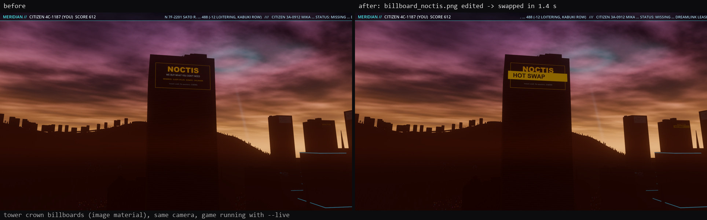
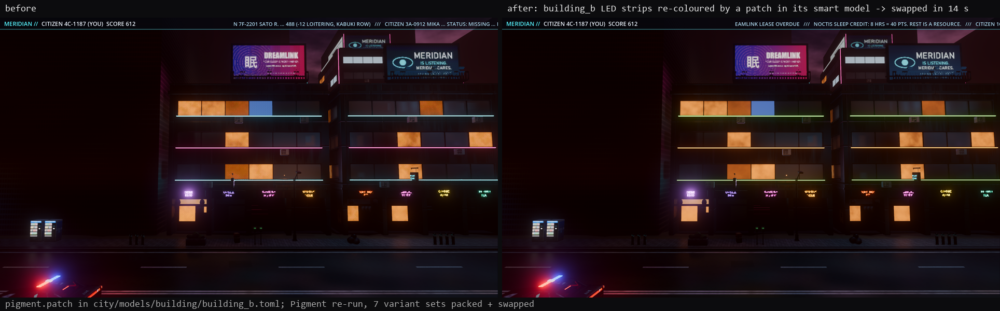
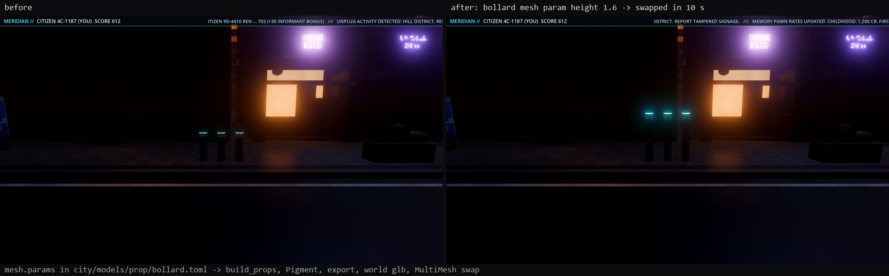

# citybuild: incremental city build with smart models and hot swap

The city was built by a chain of separate scripts: kit meshes, Pigment textures, decals, the
world (gen, build, verify, render, export: about 55 minutes for the export alone), then the
Godot copies and a headless import. Changing one building meant knowing which scripts to rerun,
in which order, and usually rerunning far more than needed.

`tools/city` is one build system over the existing tools. Every asset has a **smart model**
(`city/models/<kind>/<name>.toml`), every step is a node in a **file-driven dependency graph**,
nodes are keyed by the **hashes** of what they read, outputs live in a **content-addressed
cache**, and a **live link** swaps rebuilt assets into a running Godot (and Blender) in place.

User guide: [docs/CITY_BUILD.md](../../CITY_BUILD.md).

## Measured (RTX 4070 Ti shared with other agents, 16 cores)

| | before (the script chain) | city build |
|---|---|---|
| **cold full build** (every node: decals, 46 meshes, 55 recipes, 74 Pigment scripts, 44 exports, the world, 63 Godot texture packs, import) | hours: props textures ~1 h, fleet ~7 min per vehicle, world export ~55 min, all by hand | **~22 min** (1,063 s for 333 nodes with `pigment=2`, + the 4K hero body at 2048 and the Godot import 175 s) |
| world gen + build + export | 35 s + 3 min + ~55 min | **335 s** (export stage 87 s: 1,369 glbs written, fingerprints 5 s, writing 17 s) |
| world rebuilt with no geometry change | the same ~58 min | **270 s, 0 of 1,369 glbs rewritten** (the build is deterministic; only gen + build cost time) |
| **no-op build** (338 nodes fresh) | n/a | **3.3-5 s** |
| `city status` | n/a | 2-5 s (graph 1.1 s) |

Hot swap into a running `godot --path game -- --live` (times from the edit; `tools/city/proof.py`,
results in `proof.json`):

| change | what rebuilds | first swap | all swapped | undo (cache restore + swap) |
|---|---|---|---|---|
| **decal image** `billboard_noctis.png` | `godot.images:world` (tower crown billboards) | **1.4 s** | 1.4 s | 1.3 s |
| ... same edit, the Pigment variants that show it (`watch --fast`) | building_a / b / c: open the saved project, `export_variants only=` the 1 / 1 / 1 variant(s), pack | **4.1 s** | 17.9 s | 2.6 s |
| ... same, full Pigment re-runs (no `--fast`) | the 3 buildings' scripts (building_c is 4K) + 20 packs | 27.7 s | 83 s | 2.7 s |
| **building recipe** (`pigment.patch` on building_b's LED strips) | Pigment re-run of building_b (7 variants, 7.2 s) + 7 packs | 11.4 s | **13.7 s** | 4.1 s |
| **prop mesh parameter** (bollard `height` 0.96 -> 1.6) | mesh, recipe, Pigment, pack, export, world glb (6 nodes, ~1.5 s each) | 6.1 s | **9.6 s** | 2.0 s |

Each swap itself takes 6-460 ms in Godot (the longest is reading a 2048 px texture set and
building its mipmaps). The car keeps its position; nothing restarts.

| decal image | building recipe | prop mesh parameter |
|---|---|---|
|  |  |  |

Same camera before and after, set by the live link (`{"type": "camera"}`), captured by the live
link (`{"type": "screenshot"}`), with the game running the whole time.

Other runs:

- `city watch` on a decal: change seen, rebuilt and queued in 0.1 s after the poll picked it up.
- A Pigment project saved outside the build (`pigment-mcp` re-saving `street_lamp.pigment` with
  an extra layer, as the app would): `watch` pinned `pigment:street_lamp` to the project,
  exported from it and repacked in 3.0 s; `city unpin` + build restored the recipe's textures
  from the cache in 0.2 s.
- `city verify`: road obstacle scan 0 of 30,972 instances on a carriageway (1.3 s), 74 Pigment
  scripts pass `--check` (8 s), decal audit skipped (not merged yet), world verify all 0 (263 s).
- The world loads in Godot from the new glbs (headless `--drive-test`: 1,678 collision shapes,
  0 read-backs, drive test normal).

## What was built

| piece | where |
|---|---|
| CLI: discover, models, show, status, build, adopt, verify, watch, graph, open, live, unpin, clean | `tools/city/cli.py` (`python -m tools.city`, `tools/city.py`) |
| smart models (70, generated from the pipeline, hand-editable) | `city/models/<kind>/<name>.toml`, `tools/city/discover.py`, `manifest.py`, `toml_io.py` |
| graph: nodes, edges from overlapping input / output patterns, cycle detection, topo order, keys | `tools/city/graph.py`, `hashing.py` |
| manifests -> nodes | `tools/city/rules.py` |
| actions (wrap the existing scripts) | `tools/city/actions.py`, `recipe.py`, `pigscript.py`, `pins.py` |
| engine: pools, parallel, early cut-off, cache restore, timing summary | `tools/city/engine.py`, `cache.py` |
| incremental world export: per-asset glbs, fingerprinted unique glbs, fast glb writer | `tools/city/blender/world_assets.py`, `export_hook.py`, `glb_writer.py` |
| hot swap: Godot live link, Blender event queue | `game/scripts/live_link.gd`, `tools/city/live.py`, `tools/blender_addon/pigment_bridge/core.py` |
| watch | `tools/city/watch.py` |
| proof driver | `tools/city/proof.py` |
| tests | `tools/city/tests/` |

### The graph (342 nodes for the current city)

| node | wraps | pool |
|---|---|---|
| `mesh:<asset>` | `assets/blender/town/<a>.py`, `tools/props/build_props.py -- 
`, `tools/vehicles/build.py -- <v>`, `tools/make_fence.py` | blender |
| `recipe:<asset>` | writes the Pigment script: `town_textures.py` jobs (via `tools/city/recipe.py`, which runs the job with Pigment's final run switched off), `props_textures.py --no-run`, `vehicles/textures.py --no-run`, `road_textures.py` | pigment (lists parts) |
| `pigment:<asset>[/<script>]` | `pigment-mcp --script` on that script (+ the model's `patch` ops) | pigment |
| `export:<asset>` | `tools/props/export_props.py`, `tools/vehicles/export.py` | blender |
| `decals:<set>` | `make_story_decals.py`, `props/make_prop_decals.py`, `vehicles/decals.py` | cpu |
| `world.mesh:<asset>` | the world glbs of one kit / props asset, without building the world | blender |
| `world:build` | `world_driver.py --stages gen,build,export` with the incremental export hook | blender |
| `godot.tex:<folder>` | one texture set through `pack_textures.pack()` (+ the layout's emissive scale / opacity) | cpu |
| `godot.images:world` | image materials (road tiles, world sheets, billboards) | cpu |
| `props:index`, `godot.sync:vehicles`, `godot.sync:car`, `sky:<preset>` | `write_index.py`, `sync_vehicles.py`, `sync_car.py`, `make_sky.py` | cpu / blender |
| `godot.import` | `godot --headless --import` | godot |
| `verify:world`, `verify:roads`, `verify:scripts`, `verify:decals` | world verify, the `clear_carriageways` scan on world.json, `pigment-mcp --check` on every script, `tools/decal_audit.py` when it lands | gates |

Edges are not written by hand: node B depends on node A when one of B's input patterns overlaps
one of A's outputs (`scenes/town/textures/building_a__*` feeds `godot.tex:building_a__soba`).
Pigment nodes take their inputs and outputs from their script (`new_project.mesh`,
`project_decal.image`, `export_variants` folders, `save_project`), so a recipe that starts using
a new decal gets the edge by itself.

**Keys.** sha256 of the node id, its parameters, the content of its tools (the generator scripts)
and of its inputs, and a hash of its own action's source (`actions.impl`, so editing one action
does not invalidate the others). File hashes are memoised by size + mtime (`.citycache/stat.json`).
Two refinements keep false rebuilds out:

- `assets/props/index.json::placement`: the world reads only the placement-relevant fields of
  the props index (scatter, footprint, files, collider type, variants), so re-texturing or
  reshaping a prop does not regenerate the world.
- `material.json` is hashed without its `exported_at` time: Pigment's exports are deterministic
  (an identical re-run gives byte-identical PNGs), and now the graph sees that.

**Cache.** After a node runs, its outputs are stored once each in `.citycache/objects/` under
their sha256 and listed under the key. A node whose key was built before (undoing an edit) or
whose outputs were deleted gets them copied back instead of rerunning. `city clean --gc` keeps
the newest two keys per node.

**Early cut-off.** A node's key is computed when its dependencies have finished, from the files
as they are then. A rebuilt dependency that wrote the same bytes leaves it fresh.

**Pools.** `pigment=2`, `blender=1`, `godot=1`, `cpu=half the cores`; independent nodes in other
pools run in parallel (`--pool pigment=1` when the GPU is busy).

## World export: per asset and per chunk

`world_export.py` exported every mesh with Blender's glTF exporter, one call per glb, in the
38k-object world scene. Each call walks the whole scene: measured 2.5-3.7 s per glb, so about
55 min for the 1,428 glbs, whatever changed. Now:

1. **Shared meshes per asset.** The 36 glbs made from one kit or props asset (the 7
   `building_a__<variant>` copies, `PROP_<name>`, lamps, poles, signs) come from
   `tools/city/blender/world_assets.py`, which rebuilds exactly that mesh (same import, join,
   transform-apply as `import_kit` / `import_prop`, same material names) in an empty scene and
   writes it with `export_town.export_mesh`. Geometry is bit-identical to the full export (the
   binary chunk compares equal); only the unused material factors differ. A building change
   re-exports its glbs in about 2 s, with no world build. The world export skips these keys
   (`$CITY_SKIP_KEYS`).
2. **Fingerprinted unique meshes.** For the rest (terrain chunks, roads, junctions, decals,
   bridges, sea walls, towers, the port), the export hook fingerprints each mesh (vertices,
   faces, corner normals, UVs, material names) and writes only those whose fingerprint changed,
   so a world change re-exports the chunks it touched. The build reports the 256 m chunks the
   rewritten glbs fall in.
3. **A fast glb writer.** `glb_writer.py` writes the same glb from numpy (POSITION / NORMAL /
   TEXCOORD_0 per material, glTF axes, v flipped, vertices welded per position / normal / UV).
   Compared with the exporter on 36 world meshes: same triangles in the same order, identical
   positions and UVs, normals within 6e-5. 1-100 ms per glb instead of 2.5-3.7 s.

The world itself (gen + build, about 4 min in Blender) still runs whenever its config, its
scripts or the placement part of the props index change; a new seed rebuilds everything, as
expected.

## Hot swap

`game/scripts/live_link.gd` is an autoload that does nothing unless the game runs with
`-- --live`. Then it tails `game/assets/.live/events.jsonl`, applies each event and appends an
acknowledgement with its time to `acks.jsonl`; a heartbeat file says it is alive.

- **Textures**: the packed PNGs are read with `Image.load_from_file` (mipmaps generated) and set
  on every `ORMMaterial3D` built from that folder; image materials likewise. No import wait.
- **Meshes**: the glb is parsed with `GLTFDocument` and swapped into every MultiMesh cell
  (streamed in, and the not-yet-streamed entries in `town_loader._cells`), every single mesh, and
  every merged region that contains it (re-merged with the loader's own `_merge_job`). The new
  mesh keeps the old surfaces' materials, so variant remaps stay.
- **Materials**: emissive scale / opacity are re-read from the layout.

The swap never touches the car, traffic or collision: the car keeps its position.

**Blender**: the Pigment Bridge add-on already reloaded changed maps by mtime. Its timer now
also reads `.citycache/blender_events.jsonl` (`core.check_city_events`): texture-folder events
rebuild those materials, mesh events re-import the glb and swap the mesh data of objects tagged
with `core.link_city_mesh(obj, glb)`. Tested headless only
(`blender -b --factory-startup --python tools/city/tests/blender_bridge_city.py`: all PASS).

**Pigment**: `city open <model>` opens the model's project in the Pigment app. When it is saved,
`city watch` sees a project the build did not write and pins the node to it: the texture sets
are exported from the project (`open_project` + `export_variants` + `export_textures`) and flow
downstream; `city unpin` returns to the recipe.

## Tests

- `python -m pytest tools/city/tests -q`: 26 tests. Pattern overlap; edges from files; cycle
  detection (the cycle is reported); topo order; selection; keys track inputs / tools / params;
  directory and glob inputs; JSON projections; volatile timestamps; stat cache; incremental
  rebuilds; early cut-off; status reasons; cache restore of a reverted edit and of deleted
  outputs; failures skip dependents only; pool limits; TOML and manifest round trips (including
  every committed model); validation; refresh keeping user edits; config deep-merge by name;
  Pigment script scan and patches; the real models compiling into an acyclic graph.
- `tools/city/tests/blender_bridge_city.py` (headless Blender): mesh swap keeps materials, a
  texture event shows the new base colour, no event applies twice.
- The proof scenarios below run the real tools end to end.

## Merge notes

Edits to shared scripts (all small and additive):

| file | change |
|---|---|
| `tools/godot/export_town.py` | `export_layout(..., write_mesh=None)`: optional per-mesh writer. Default path unchanged |
| `tools/world/world_export.py` | loads `$CITY_EXPORT_HOOK` when set (`make_writer`, `finish`) and passes it to `export_layout` and the terrain LOD loop. Unchanged without the variable |
| `tools/godot/pack_textures.py` | `if __name__ == "__main__": main()` guard so `pack()` can be imported |
| `tools/props/proplib.py` | `Prop.param(key, default)` reads `$CITY_PARAMS` |
| `tools/props/models_street.py` | `m_bollard` takes `height` (default 0.96: the same mesh) |
| `tools/blender_addon/pigment_bridge/core.py`, `__init__.py` | city event queue functions appended; one call in the timer |
| `game/project.godot` | `[autoload] LiveLink="*res://scripts/live_link.gd"` |
| `.gitignore`, `game/.gitignore` | `.citycache/`, `assets/.live/` |

Not touched: `tools/town_textures.py` (the recipe step loads it as a module and switches off its
final Pigment run), `car.gd`, `main.gd`, `automation.gd`, `town_loader.gd` (the live link uses
its fields and functions from outside).

After merging:

- `python -m tools.city discover --refresh` updates the derived facts in the models (the decal
  workstream's new placements, `tools/decal_audit.py` becomes a gate automatically).
- In a checkout that already has the generated assets: `python -m tools.city adopt`.
- The main checkout's `target/release/pigment-mcp.exe` was older than the town scripts (it did not
  know the `Cut-out` material): rebuild it, or point `$PIGMENT_MCP` at a current build.

## Known limits

- **Not every generator is byte-deterministic.** `build_props.py` gives a slightly different glb
  each run (UV packing), and the props / fleet game exports embed re-encoded textures, so
  rebuilding a prop mesh always reaches Pigment and the export even when nothing really changed.
  The early cut-off works wherever the tool is deterministic: Pigment's PNGs, the decal
  generators, the kit meshes, the world glbs, the packs.
- **The world itself is one node.** Its gen + build (~4 min) runs whenever its config, scripts or
  the placement part of the props index change; only the glb export is per chunk. Splitting
  generation by region would need world_gen changes.
- **Collision and far proxies** are not rebuilt by a live swap (bounds rarely change; a restart
  rebuilds them). Live-swapped meshes have no generated LODs until the next import.
- **The decal fast path** (`watch --fast`) re-exports only the variants showing the decal; the
  authored base folder keeps the old decal until the next full build (the node is marked partial
  and shows as stale).
- **`city adopt`** trusts existing outputs. Use it once per checkout (or after merging generated
  assets), not to hide real changes.
- The Pigment GUI was not opened in tests (`city open --dry`); the pin flow was tested by re-saving
  a project with `pigment-mcp`, which is what the app's save writes.
- The Blender side was tested headless only; the add-on needs reinstalling (zip) in the user's
  Blender to get the queue.
- `.citycache` grows with every distinct build (about 1 GB after adopting this city):
  `city clean --gc` keeps the newest two keys per node.

