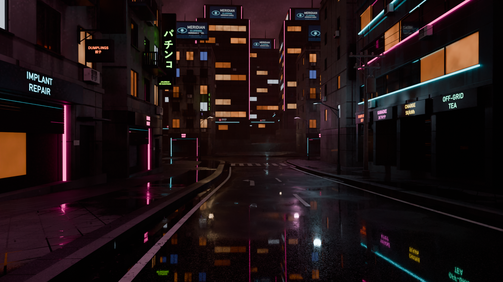

# Decal placement: real-world rules, real signage geometry, an audit

User feedback: *"I think a billboard decal should only go onto a billboard, and other
decal placement is questionable."* It was right. The audit below finds problems in
103 of the 139 old decal records, not counting texel density: billboards painted over
windows, shop signs projected onto the awning, posters and graffiti outside their
height bands, and plates nowhere near a door.



*Cycles, street level, the hillside town with the regenerated kit and variants.*

## The rules

These are written down once here and enforced in two places: by the slot builders in
`tools/town_textures.py` and by `tools/decal_audit.py`.

| Kind | Where it may go | Audit check |
|---|---|---|
| **Billboard** (`billboard_*`) | Only on billboard geometry: a vertical panel part at least 3 x 3 m inside its own frame part. | The host part must be a "panel" that has a frame part 0.1–1 m bigger on every side in the same plane. |
| **Ghost sign** (a billboard image painted on a wall) | Only as a deliberately weathered old mural on blank wall with no openings. Use them sparingly: building_a's back wall, in 2 of 7 variants. | Opacity ≤ 0.5, fade ≥ 0.5, wear ≥ 0.3, no glow, not on a sign part, plus the surface check. |
| **Shop sign** (`sign_*`) | Centred on the fascia or sign box over a ground-floor entrance, sized to fit. | The host is a proud sign box (≤ 0.5 m deep, ≤ 1.5 m tall), its bottom is 2.0–6.5 m up, and the decal centre is within 5 cm of the box centre. |
| **Blade sign** (`blade_*`) | Only on the faces of the blade sign box. | The host face is ≥ 3 m tall and ≤ 1.3 m wide. |
| **Logo / corporate** | On a crown sign panel or the lobby fascia / sign box. | The host is a billboard panel or a sign box. |
| **Plate** (curfew, observed, loitering, property) | At eye height beside a door, on flat wall, never over a window or door. Each plate is its own enamel plate part in the kit. | Centre 1.4–1.9 m up, within 2.5 m of a door part, plus the surface check. |
| **Poster / MISSING flyer** | At street level on blank wall between openings. Sometimes clustered and overlapping. Placed with `scatter_decals` using `fit`, wear and fade. | The whole decal is within 0.8–2.2 m, plus the surface check. |
| **Graffiti / stencil** | From ground level up to about 3 m, on blank wall, roller shutters or doors. It may overlap posters (it is recorded after them, so variants replay it on top). Never on windows. | The whole decal is within 0–3.2 m, plus the surface check. |
| **All decals** | On one flat surface. Never across a window, door, ledge, corner or floor line. Sensible scale and resolution. | The surface check (below) and texel density. |

**Surface check.** For every decal in every variant, the audit casts 45 rays
(a 9 x 5 grid) at the decal along its normal, plus one at the centre. The centre
ray picks the host part. Every grid ray must then land on that same part, on a face
coplanar with the decal (within 4 mm and 25°). Anything else is a named violation:

- another part in front ("covered by part 137 (ac …)");
- a recess or opening (window frame or glass, door, bay);
- a different part (crossing onto the upper-floor shell is crossing the floor line);
- no hit (past an edge or corner).

Parts are Pigment's own: the audit recomputes `pigment_core::Mesh::parts` from the
GLB and checks the result against `list_parts`.

**Texels.** The texels across the decal's shorter side are read from the UVs of the
largest coplanar triangle under its centre, at the project resolution.

| Kind | Minimum texels across |
|---|---|
| Readable signage: billboards, shop and blade signs, logos, plates | 96 (Pigment's warning threshold) |
| Posters | 20 |
| Graffiti and ghost signs | 24 |

Posters, graffiti and ghost signs are coarse marks read from street distance.
Making their fine print readable would need roughly 4x the texture space of a
2048 set; see "Known limits".

## What changed

**Kit geometry** (`assets/blender/town/*.py`, `_kit.py`; the GLBs were regenerated
in headless Blender 5.2):

- **building_a**
  - The shutter housing is now a full-width fascia lightbox, 5.3 x 0.8 m. The
    awning and its rods are gone, because the old shop sign was being projected
    onto the awning.
  - New rooftop billboard over the front: a 6.4 x 3.2 m panel in a frame on posts,
    with braces, a catwalk, a rail and two flood lamps.
  - New wall-mounted billboard on the blank back wall: the same size, standing
    0.42 m off the wall on four brackets so it clears the pipes, with two
    gooseneck lamps.
  - An enamel plate part on the pier between the shop and the stair door.
  - The floor-2 front AC unit moved from u=2.6 to u=0, because it stood in front
    of the blade sign's west face.
- **building_b**
  - All four bays now have a fascia sign box, 3.2 x 0.85 m (it was 0.62 m tall, and
    bays 3 and 4 had none).
  - An enamel plate on bay 4's side wall, beside the stair door.
- **building_c**
  - The crown ribbon windows are replaced by framed 8 x 3.6 m sign panels on
    brackets, one per face.
  - A corporate fascia, 6.4 x 0.9 m, stands on the canopy's front edge for the logo.
  - A sign box left of the lobby carries the security / kiosk band.
  - An enamel plate on the lobby recess's side wall.
- **`_kit.py`**
  - `uv_boost(piece, k, facing)`: front faces of signage pieces get k x the texel
    density. UV islands are scaled before `pack_islands`.
  - `cut_split(shell, cuts, z)`: the shell is split at the string course, and the
    seam hides behind the band. The ground-floor wall gets 2.5–3.5x density for
    posters and graffiti.

**Texturing** (`tools/town_textures.py`):

- Every story decal is now a precise world-space box decal (`position` + `normal` +
  `size` in metres). Hand-tuned camera boxes are gone.
- Slots find their target part by shape (`find_part(parts, center, size)`), so part
  ids can move freely.
- Posters are `scatter_decals` clusters with `fit`, wear and fade.
- Records are ordered paper, then plates, then graffiti, so graffiti overlaps posters.
- The ghost sign has its own look: 45 % opacity, grunge wear, 60 % fade, no glow.
- The overhead sign's `kiosk` variant is now `charging` (sign_charge / sign_offgrid).
  sign_meridian_kiosk is a 6.5:1 strip and came out 0.14 m tall on a square face.

**World and Blender layout:**

- `tools/world/world_meshes.py`: the tower crown billboards were bare quads floating
  0.35 m over the facade windows. They now have a cabinet bolted to the facade and a
  frame round the face.
- `tools/blender_town.py`: the billboards pasted on retaining walls are now
  wall-mounted. The face stands 0.11 m proud on a backing cabinet, with top and
  bottom rails and end posts that follow the wall's curve.
- The world facade sheets (`town_textures.py world`) carry only window decals and
  needed no change.

## Audit results

```
python tools/decal_audit.py
building_a: 66 decals (billboard 9, blade 12, ghost 2, graffiti 7, plate 4, poster 26, shop 6); min texels 26; 0 with violations
building_b: 70 decals (billboard 6, graffiti 9, plate 4, poster 25, shop 26); min texels 21; 0 with violations
building_c: 26 decals (billboard 12, graffiti 4, logo 1, plate 3, poster 4, shop 2); min texels 23; 0 with violations
overhead_sign: 19 decals (shop 19); min texels 97; 0 with violations

181 decal records in 4 assets: 0 with violations
```

The same audit on `main` (the old projects and kit) finds 114 of 139 records with
violations. Counted by type (a record can have several):

| Violation | Records |
|---|---|
| Crosses a window, door, edge, ledge, AC or pipe | 60 |
| Texel density | 68 |
| Outside its height band | 34 |
| Billboard off a billboard | 21 |
| Sign not on or not centred on a sign box | 21 |
| Plate far from a door | 4 |

Signage texel density after the change (smallest seen):

| Signage | Texels |
|---|---|
| Billboards | 101–121 |
| Shop signs | 97–117 |
| Blades | 98 |
| Logo | 102 |
| Plates | 98–119 |

Pigment's own `texels_across` warnings on the buildings now come only from posters
and graffiti (2 / 2 / 1 per building script).

**Props (advisory).** `python tools/decal_audit.py props` audits the 38 prop scripts
in `scenes/props/scripts/`, with wrapping allowed on curved parts such as poles and
tanks. Bus-stop ads pass. 39 of 125 records are flagged, mostly small overlaps. The
ones worth fixing in the props workstream:

- **data_kiosk:** the palm-scanner shelf sits in front of the lower 0.2 m of the
  screen and cuts through its bottom text line.
- **trash_bin:** the Meridian sticker overlaps the slot rim.
- **street_name_sign:** the pole collar covers the inner end of each name blade.
- **water_tank:** the UNPLUG graffiti runs over the label plate, 3.2–3.8 m up.

I didn't change the props. Their meshes and textures belong to the props pipeline.

## Proof

Every close-up is a Pigment render at night lighting, with the same variant and
camera before (`main`) and after.

| File | What it shows |
|---|---|
| `contact_buildings.png` | Every building variant, before and after, from the same preview camera. |
| `contact_overhead_sign.png` | The overhead sign's 10 variants, before and after. |
| `closeup_billboard.png` | building_a, memory_pawn. Before: the NOCTIS ad painted across the east-wall windows. After: the same ad on the new rooftop billboard. |
| `closeup_shopfront.png` | building_a's shop sign. Before: smeared over the awning and the shutter. After: centred on the fascia lightbox. |
| `closeup_door_plate.png` | building_a's stair door. Before: the plate is round the corner on the side wall. After: an enamel plate beside the door at 1.62 m. |
| `closeup_poster_wall.png` | building_b's west wall. Before: two posters reaching 2.23 m. After: a torn, scattered cluster within 0.8–2.2 m. |
| `closeup_shop_bays.png` | building_b's bays. Before: bays 3 and 4 had their signs on the bare lintel. After: every bay sign is on its own sign box. |
| `closeup_crown.png` | building_c's crown. Before: ads painted over the crown windows. After: framed crown panels. |
| `closeup_lobby.png` | building_c's lobby. Before: the logo projected onto the lobby glass and frame. After: the logo on the canopy fascia, and the security sign on its own box. |
| `town_street.png` | Cycles, 128 samples: a street-level shot of the hillside town (the T-junction camera). Rooftop billboards, shop sign boxes and blade signs are all on their geometry. |

## Regenerate

```
# kit (only if the .py changed) — headless Blender
blender -b --factory-startup --python assets/blender/town/building_a.py -- assets/town/building_a.glb
blender -b --factory-startup --python assets/blender/town/building_b.py -- assets/town/building_b.glb
blender -b --factory-startup --python assets/blender/town/building_c.py -- assets/town/building_c.glb

# textures, variants, projects, then the audit (exits 1 on any violation)
cargo build --release -j 6 --bin pigment-mcp
PIGMENT_MCP=target/release/pigment-mcp.exe python tools/town_textures.py
PIGMENT_MCP=target/release/pigment-mcp.exe python tools/decal_audit.py
PIGMENT_MCP=target/release/pigment-mcp.exe python tools/decal_audit.py props     # advisory

# proof
python tools/decalfix_proof.py building_a memory_pawn OUT shop:8:2:-0.6:2.6:5:7.5    # Pigment close-ups of one variant
blender -b --factory-startup --python tools/decalfix_town_shot.py -- OUT 128 1600x900 tjunction
```

Check the generated scripts with
`pigment-mcp --script scenes/town/scripts/<asset>.jsonl --check`. All four pass
(0 invalid). No Rust changed.

## Merge notes

- **The kit GLBs changed** (`assets/town/building_{a,b,c}.glb`): new parts, a split
  shell, and new UVs. That means:
  - The textures must be regenerated (`python tools/town_textures.py`).
  - The Godot export (`tools/godot/export_town.py`) and the world
    (`tools/world/world_build.py`) need a re-export.
  - building_a is now 25.9 m tall (it was 21 m) because of the rooftop billboard,
    and 12.7 m deep because of the back-wall billboard.
- **Part ids moved.** Nothing in this repo hard-codes them any more: the slots use
  `find_part` by shape. Other tools with hard-coded building part ids (the decals and folders
  demos) were updated.
- **Overhead sign variants:** `overhead_sign__kiosk` became `overhead_sign__charging`.
  Delete the stale `scenes/town/textures/overhead_sign__kiosk/` folder when
  regenerating, or the layout may still pick it.
- **Variant names** for the buildings are unchanged. Slot names changed:
  - building_a: `high` became `roof`, `back` is unchanged, and there is a new `ghost`;
  - `post_w1` / `post_w2` became `posters_w` / `posters_e` clusters;
  - `blade` became `blade_e` / `blade_w`.

  Only `variant.json` lists them.
- **`tools/town_textures.py`:**
  - `PIG_TMP` overrides the scratch / preview directory.
  - The per-run log goes to `%TEMP%/pig/town_<asset>.log`.
- `tools/decals_demo.py` and `tools/folders_demo.py` hard-coded building part ids. They now use the new ids, and `docs/agents/decals/building_a_story.jsonl` was regenerated.
- **Hot spots:** `tools/town_textures.py` (the story section was rewritten),
  `tools/blender_town.py` (the retaining-wall decal block) and
  `tools/world/world_meshes.py` (the tower crown).

## Known limits

- Paper and paint on the shell reach 20–32 texels across at 2048, which is enough to
  read as a torn MISSING poster but not to read its fine print. Readable posters would
  need UDIMs or a separate street-level texture set.
- The audit approximates legacy camera-aimed `part` / `box` records (still used by a
  few props) as the planar rect Pigment aims at. Perspective is ignored.
- The pipes on building_a's back wall classify as "led" in `town_textures.classify`
  (they are 0.1 m thick and 19 m long), so they glow. This was already the case, it
  isn't a decal issue, and I left it alone.
