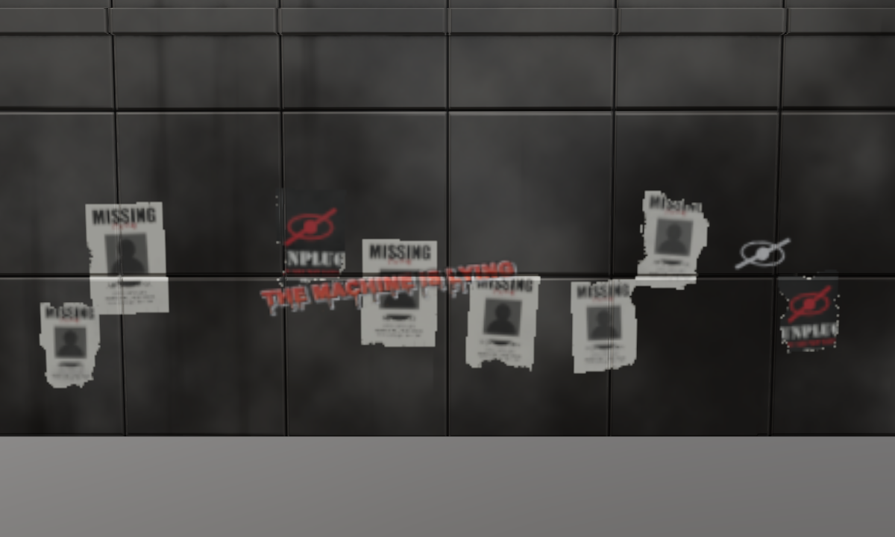

# Decals: precise placement, scatter, wear

Story decals at exact spots on facades: several posters on one wall,
scattered torn posters at street level, graffiti over them, a plate by a door.



| | |
|---|---|
| `before_wall.png` | building_a's east wall at street level, town material stack only |
| `after_wall.png` | 8 scattered MISSING / UNPLUG posters (torn, faded), THE MACHINE IS LYING and a crossed-eye stencil sprayed over them |
| `after_wall_closeup.png` | close-up: tears with bare-paper rims, graffiti over the posters |
| `after_door_plate.png`, `after_plate_closeup.png` | THIS STREET IS OBSERVED plate beside the front door, faintly lit |

Reproduce: `python tools/decals_demo.py . docs/agents/decals` writes
`building_a_story.jsonl` (building_a's town script plus the decal calls), then
`target/release/pigment-mcp --script docs/agents/decals/building_a_story.jsonl`.

## What it is

World-space **box decals**. A decal is an oriented box: a centre on the
surface, the surface normal, right/up axes and a size in metres
(`pigment_core::decal::Placement`). The mesh is rasterised into the texture
(as the brush does), and every texel inside the box that faces the decal takes
the image (`shaders/decal_box.wgsl`). There's no camera, so a decal is exact
and repeatable, its size is true in metres, it doesn't depend on the texture
resolution, and occluders don't matter. The older camera-projected
`rect` / `part` modes are unchanged.

- **Precise placement** (`project_decal` + `anchor` or `position`). `anchor` [u, v] is
  across a side of a part's box, or of the whole mesh's box if there's no
  `part`. A ray from that point snaps the decal onto the real surface of
  the part. Alternatively, `position` + `normal` snaps a world point onto the
  surface along the normal.
- **Scatter** (`scatter_decals`). This picks area-weighted random points on
  candidate triangles, then rejects any that break a constraint. All of it is
  CPU-side, deterministic per seed and unit-tested in `pigment_core::decal`.
  Images are dealt in shuffled rounds, so every image appears before any
  repeats.
- **Wear** (shader). `wear` tears the decal with fbm noise, biased towards the
  edges and the bottom, and leaves a rim of bare paper along each tear.
  `fade` adds patchy sun-bleaching and wear-through. `wear_style: "grunge"`
  uses ridged, vertically streaked noise. In a scatter, each decal gets its
  own noise seed and a jittered amount.
- **Overlap order**. With `overlap_order: n` (and no `layer`), the decal goes on the
  paint layer `Decals n`. That layer is created and slotted among the other
  `Decals k` layers so that a higher n is always on top, whatever the call
  order. For example, posters use 0 and graffiti uses 1.
- **Undo**. A placement or a whole scatter is **one** undo step: a new
  `Edit::Strokes(Vec<Snapshot>)`. Undo swaps the snapshots newest-first and
  redo oldest-first. Only the tiles under each decal's UV footprint are
  snapshotted: `Placement::mark_tiles` maps the footprint through each
  triangle's affine UVs, so a poster on a 2-triangle wall doesn't snapshot
  the whole wall.
- **Texel report**. Each result includes `texels_across`, which is how many
  texels the smallest decal gets at the current resolution. It adds a
  `warning` below 96.
- **Render close-ups**. `render` takes `target` [x,y,z] and `distance` (m) to
  orbit a world point.

## MCP

`project_decal` (new args; `image` still required):
- `anchor` [u, v] (0..1, (0,0) = top-left seen from outside), optional `part`, and `face`
  (`front` +Z, `back`, `left` -X, `right` +X, `top`, `bottom`, `auto`), or
- `position` [x,y,z] + `normal` [x,y,z];
- `size` (width in metres, height from the image aspect; or [w, h]; default 0.5),
  `rotation` (degrees, counter-clockwise seen from outside), `depth` (box half-thickness);
- `wear`, `fade`, `wear_style` (noise | grunge), `wear_scale` (default 5), `wear_seed`,
  `paper_rim` (default 0.035), `overlap_order`;
- existing: `tint`, `material`, `emissive_strength`, `height`, `opacity`, `layer`, `mask`,
  `alpha_from_luminance`, `channels`.

`scatter_decals`:
- `images` (required), `count` (6), `seed`;
- where: `parts`, `mask` (a layer whose part mask limits it), `region` {min, max};
- constraints: `height` [min, max] above `ground` (default: mesh's lowest point; the whole
  decal must fit), `size` [min, max] width in m, `rotation`, `rotation_jitter` (6),
  `min_spacing` (centre to centre, default 0.9 x max size), `facing` (`horizontal` = walls
  within `max_tilt` 20 deg of vertical; `any`), `fit` (default true: every corner and edge
  midpoint must lie on a coplanar surface of the candidate set, so nothing hangs over a
  window, door or corner);
- look: all the wear args above, plus `wear_jitter` (0.15), `tint`, `material`, `opacity`,
  `layer`, `overlap_order`;
- returns `placed`, `requested`, the layer, and per decal: image, centre, normal, size, wear, fade.

Example (from the demo):
```json
{"tool": "scatter_decals", "args": {"images": ["assets/decals/story/poster_missing_aiko.png", "assets/decals/story/poster_unplug.png"],
  "count": 8, "seed": 3, "parts": [1], "region": {"min": [3.8, 0, -5.5], "max": [4.6, 5, 5.5]},
  "height": [0.5, 3.0], "size": [0.6, 0.8], "rotation_jitter": 5, "min_spacing": 0.85,
  "wear": 0.32, "fade": 0.3, "wear_scale": 3.5, "overlap_order": 0}}
{"tool": "project_decal", "args": {"image": "assets/decals/story/graffiti_lying.png", "position": [4.4, 1.55, 0.6], "normal": [1, 0, 0],
  "size": 2.8, "rotation": 4, "fade": 0.25, "wear_style": "grunge", "paper_rim": 0, "overlap_order": 1}}
{"tool": "project_decal", "args": {"image": "assets/decals/story/poster_missing_ren.png", "part": 1, "face": "left", "anchor": [0.92, 0.919], "size": 0.65, "wear": 0.4}}
```

## Tests

- `pigment_core::decal` (4 unit tests). Covers placement frames
  (upright, right-handed, rotation, floors), face points and the part
  raycast, the tile footprint and `uv_size`, and scatter (height band,
  walls only, no hanging off the edge, spacing, every image dealt,
  same seed gives the same result, region on a floor).
- `shader_tests::decal_box` validates the WGSL with naga.
- GPU tests through the `Session` on building_a, in
  `app/automation/decal_tools.rs`:
  - an anchored decal lands at the requested face, height and normal, and
    undo removes it;
  - `position` + `normal` placement works, and a bad face is an error;
  - a scatter meets its constraints, `Decals 0` sits below `Decals 1`,
    one undo removes all 5, and redo restores them;
  - `wear` tears part of the decal (not all of it), and the result is
    deterministic.
- The demo script asserts the undo labels (`Undo: Scatter 8 decals`).
  `target/decals_demo/undo_check.png` shows the wall clean after undo.

## Known limits

- **Texel density of the town kit.** building_a's UVs give about 50 texels/m
  at 4096 (building_b about 36, building_c about 18). A 0.6 m poster gets about 30
  texels across, so the posters read as torn posters but their fine print
  doesn't, and the plate's text is a blur. This is a property of the assets'
  UVs, not of the decal path; `texels_across` / `warning` flag it. Readable
  close-ups need denser UVs on street-level walls (UV island scaling, a
  separate street-level material or texture set, or UDIMs). That belongs to
  whoever owns the kit or texture sets.
- Decals paint colour, roughness and metallic (plus emission and height if
  asked), but not normals. Panel-joint grooves from layers below still show
  through a poster, which looks right for paper and less right for a thick
  plate.
- At low texel density, the rip along a torn edge can look like a straight
  cut a few texels wide.
- Scatter `min_spacing` is centre to centre, so posters may overlap (on
  purpose: it looks pasted up). The scatter and footprint code loops over all
  triangles without a BVH. That's fine for the town kit (building_a
  is 47k triangles and the whole demo runs in seconds), but huge meshes
  would be slow.
- The `mask` option uses the layer's **part** mask only, not its generator.
- No new UI. It's MCP / `Session` only, and `ui.rs` is untouched to keep
  merges clean. The grouped undo works in the UI history too.

## After merging with the other workstreams

- **Variants.** Anchored (`anchor` / `position`) `project_decal` calls and
  every decal a `scatter_decals` places are recorded on their paint layer,
  just like `rect` / `part` / `box` decals, so `export_variants` can switch
  them on and off by name (default: the image's file stem) or by group
  (`variant`), swap their image or look, and replay them.
  - A scattered decal is recorded as a resolved anchored call: `position`,
    `normal`, `size`, `rotation`, `depth`, plus its own jittered `wear`,
    `fade` and `wear_seed`. A replay therefore reproduces the scatter
    exactly, with no re-scatter. `name` / `variant` / `enabled` on
    `scatter_decals` apply to every decal it places.
  - `enabled: false` records the decals without painting them, for both
    tools.
  - Decals on a layer's mask aren't recorded, and can't be tagged or
    disabled.
  - Test: `anchored_and_scattered_decals_work_with_variants`. It disables
    a group and replays a layer of 4 scattered decals and 1 anchored decal.
    The replayed emission is within 2 % of the authored one.
- **Undo.** The records go into the same undo step as the pixels (a new
  `Edit::DocStrokes`), so a placement or a whole scatter is still one step.
  Undoing it also removes its records, so an undone decal can't come back
  in a variant replay. `rect`, `part` and `box` decals now work the same
  way; before, recording one took a separate undo step.
- **Camera.** `target` [x,y,z] is shared by every tool that takes a camera:
  `render`, `render_turntable`, `paint_stroke`, `pick_parts`, and
  `project_decal` in `rect` mode. `distance` (metres) sits next to it.
- **Opacity.** Box decals write the opacity / transmission channels through
  the shared apply pass. `values` and `channels` work on both tools, e.g.
  `values: {opacity: 0}, channels: ["opacity"]` cuts the decal's shape out.
- **Scatter `height`.** It is only the placement band, never a paint
  height.
