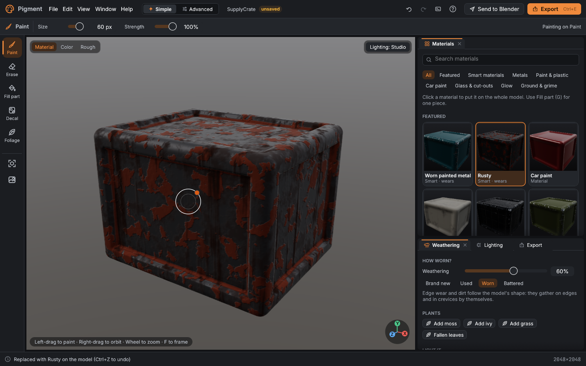
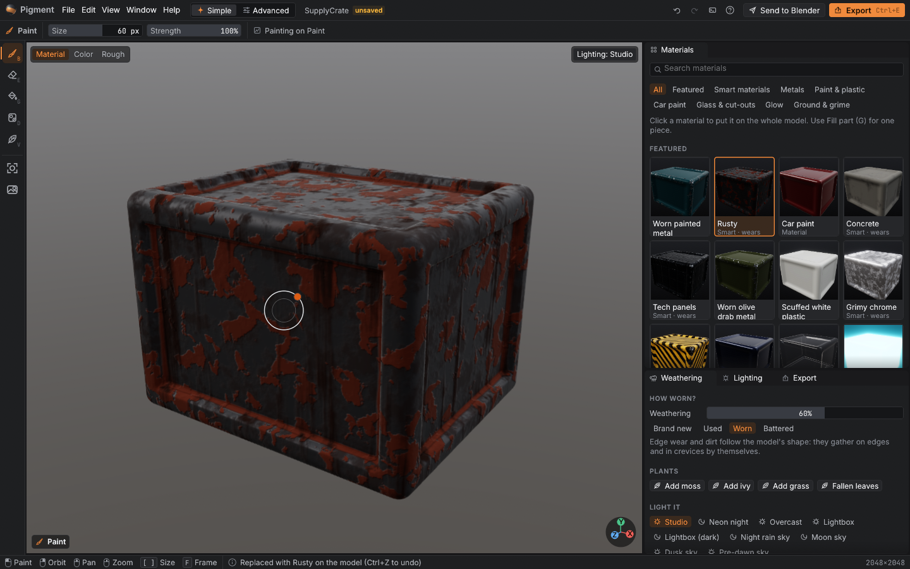
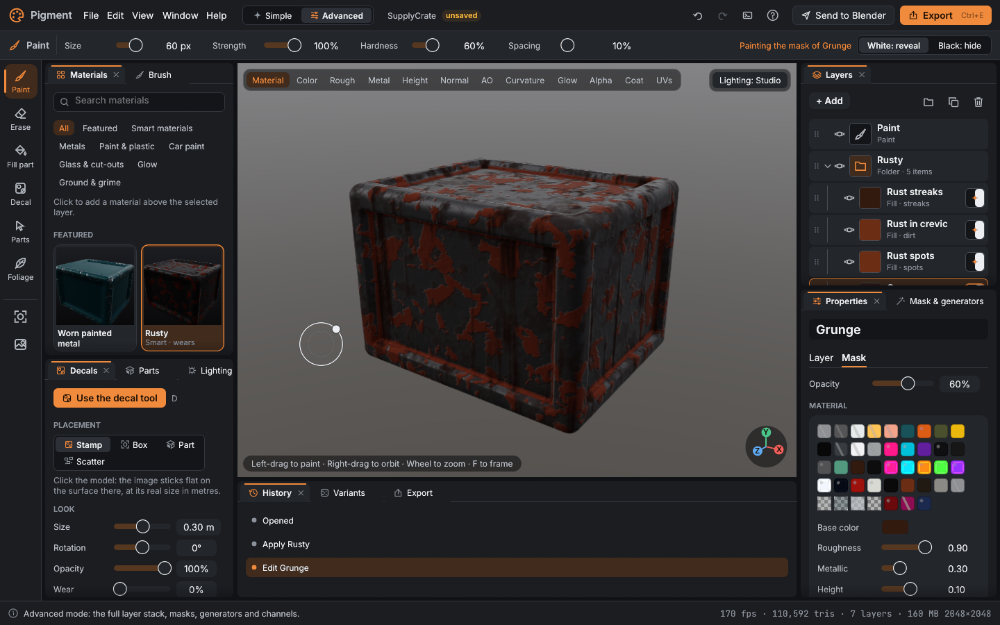
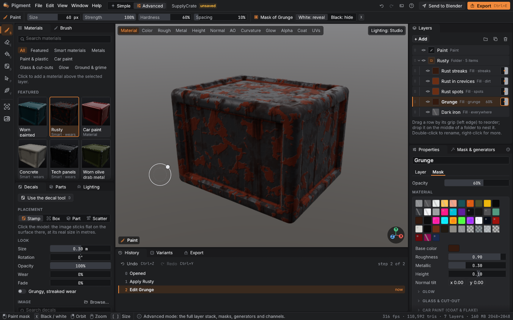
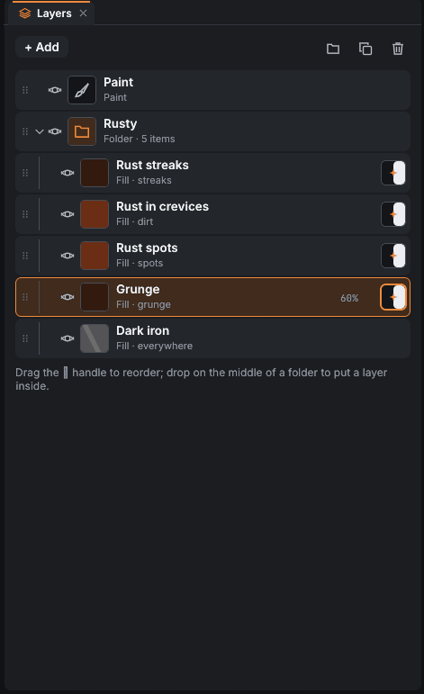
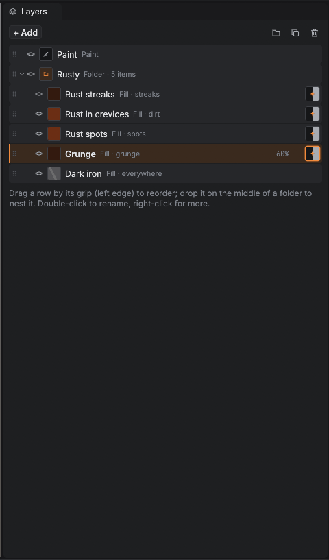
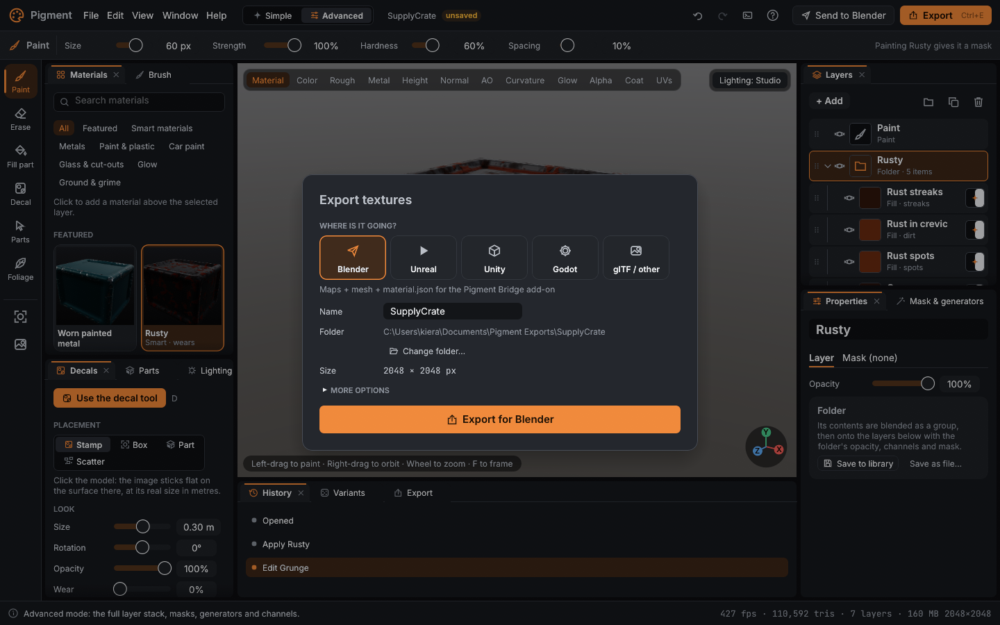
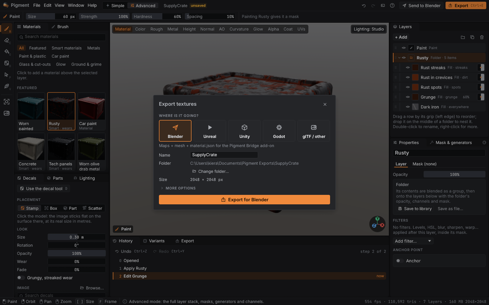
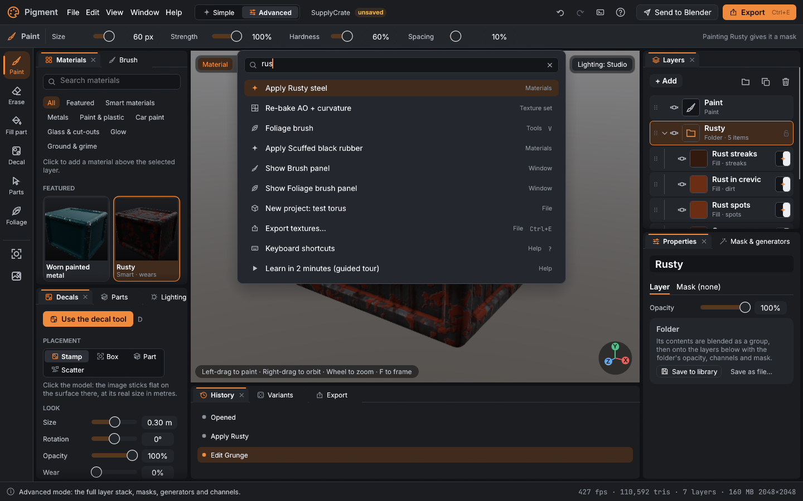
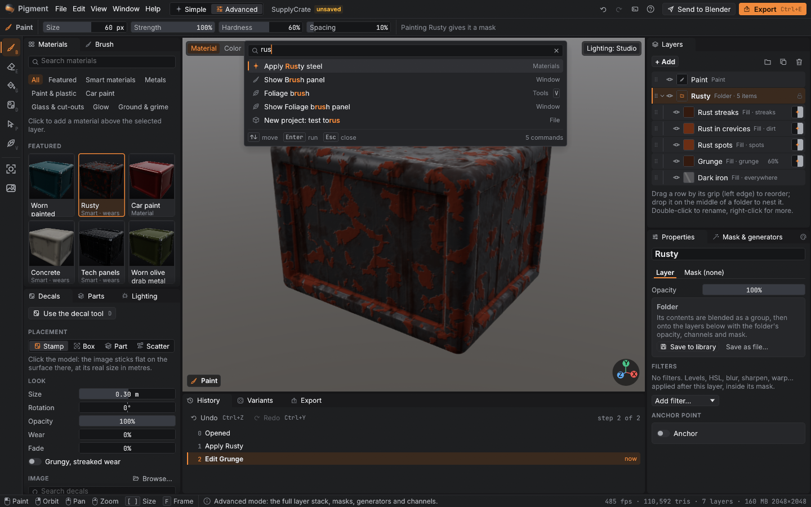

# Design workstream: darker, compact, keyboard-first

What changed (details in `docs/design/DESIGN_SYSTEM.md`, findings and status in
`UX_AUDIT.md`):

- **Tokens:** near-black, low-chroma palette (#161618 surround, #1E1F21 panels, #26272A
  rows, #2E2F32 / #3C3E43 hairlines); the accent is reserved for the selection, the
  active tool and the primary action; neutral drag-field fills; radii 2–4 pt; short
  shadows; 12.5 / 12 / 11 pt type with tracked upper-case captions and mono values.
- **Density:** `Density::Compact` (default, Blender-like 20–22 pt rows) and
  `Comfortable` (the old spacing), in Settings, the View menu and Ctrl+K; stored in
  `prefs.density`. Components read `design::metrics(ui)`.
- **Components:** `DragField` (value inside the bar; drag, Shift fine, Ctrl snap,
  double-click / Enter to type with simple maths, arrow-end nudges), `collapsible`
  sections remembered in `prefs.sections`, `MenuItem` rows for every context menu,
  status-bar `Hint`s with mouse glyphs, a stricter fuzzy `command_palette` with
  highlighting and Recent, slimmer tabs, icon-only tool rail with key letters, toasts
  with a status edge that hold while hovered, modals with a close button.
- **Screens:** status bar shows the tool's (or hovered control's) mouse / key hints;
  tool options use inline drag fields; layer rows are one line with an inline rename
  (double-click / F2), panel shortcuts (Ctrl+D, Ctrl+G, H, Delete) and a full context
  menu; History is numbered with Undo / Redo and a "now" marker; decals and foliage
  cards have quick search; decal tiles have a context menu.
- **Lint:** `no_raw_styles_outside_design` now also rejects `egui::Slider::new` and
  `egui::CollapsingHeader::new` in screens. New tests: neutral dark chrome, density
  ordering, fuzzy ranking, unit parsing, prefs round-trip of density and sections.

How to look at it: `PIGMENT_SHOTS=<dir> cargo test -p pigment --release design_shots -- --ignored`
renders every screen and panel offscreen (`crates/app/src/app/design_shots.rs`);
`ui_screenshots` and `design_gallery_screenshots` regenerate the docs images.

| | Before | After |
|---|---|---|
| Simple mode |  |  |
| Advanced mode |  |  |
| Layer stack |  |  |
| Export dialog |  |  |
| Command palette |  |  |

Known limits: see "Left for later" in `UX_AUDIT.md` (context menus on parts and library
materials, `DragValue` pairs without the fill bar, light theme not tuned as far).
