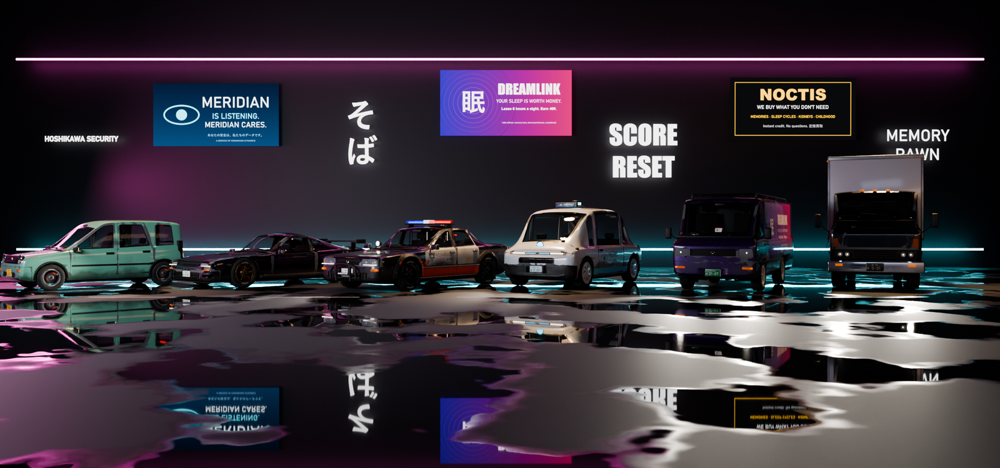
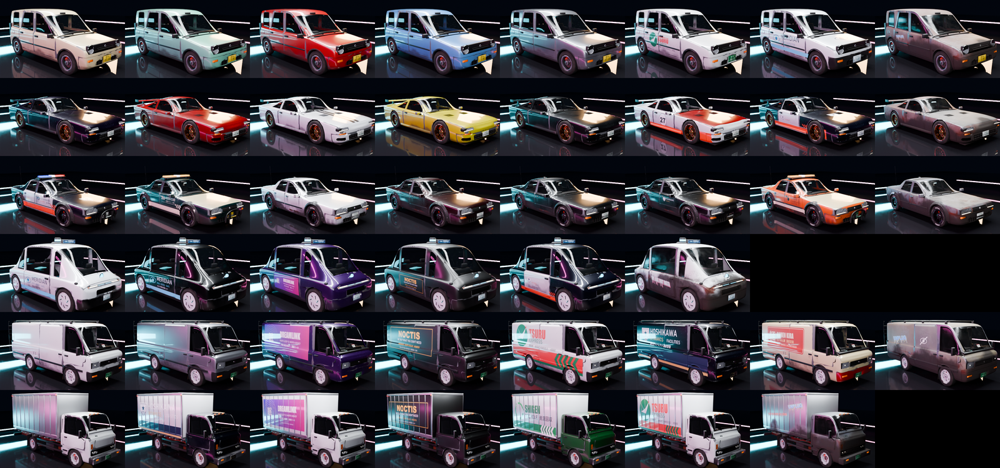
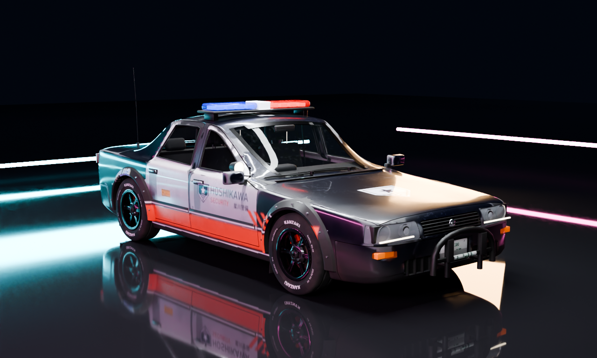
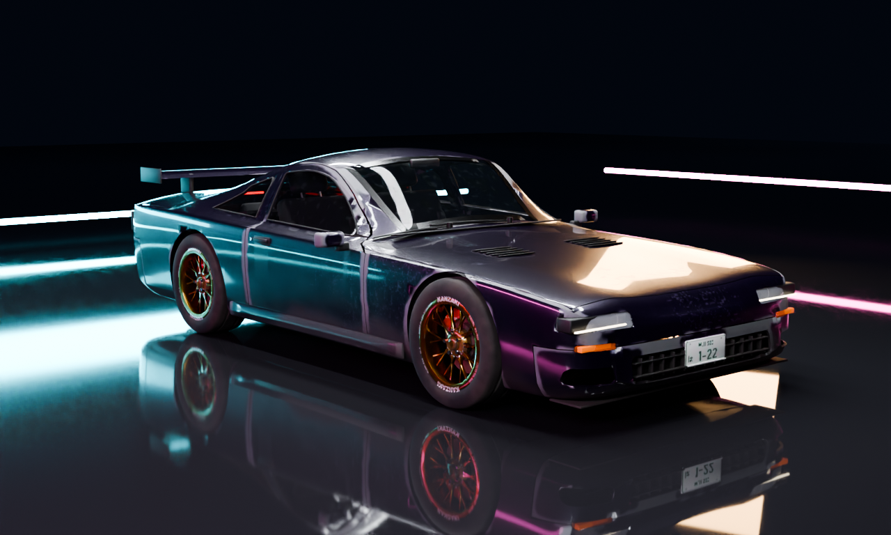
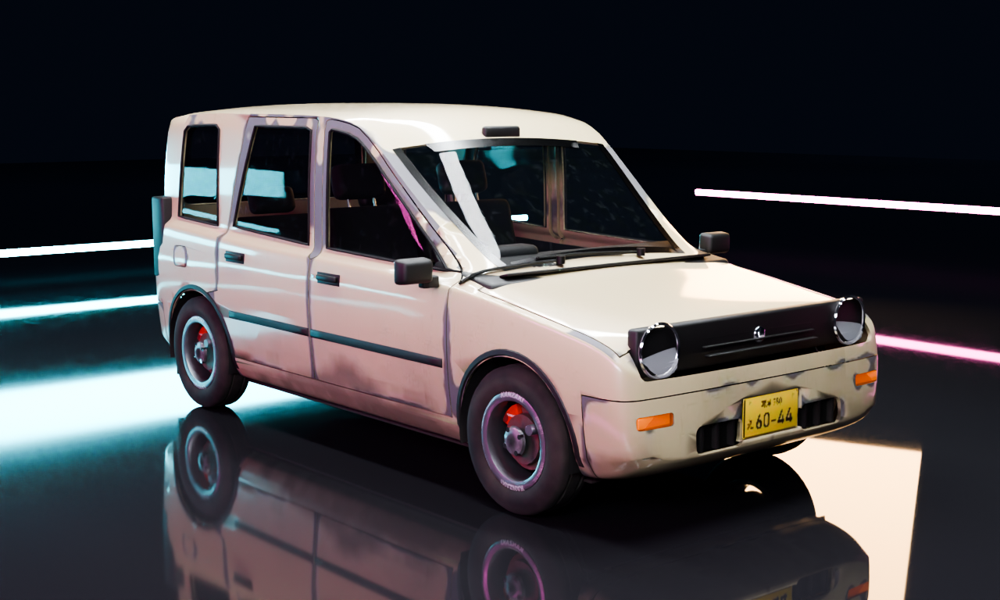
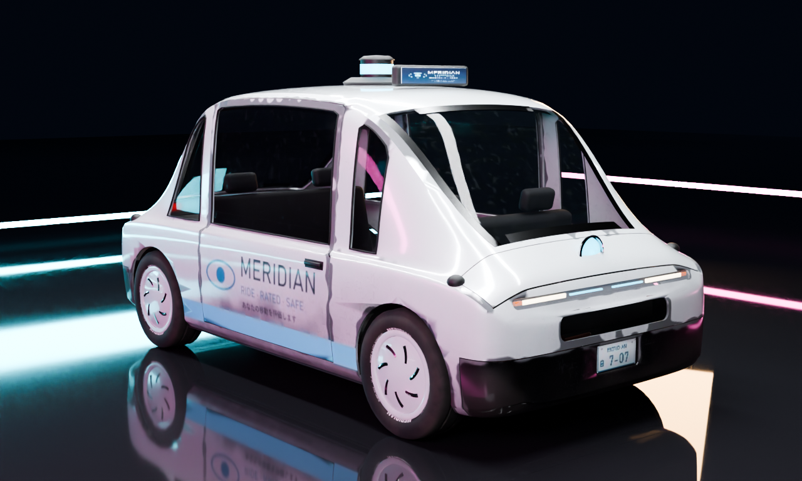
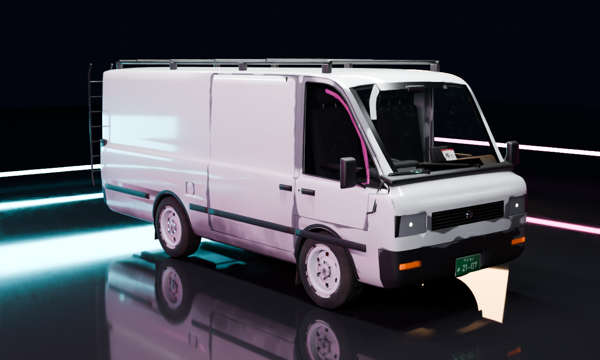
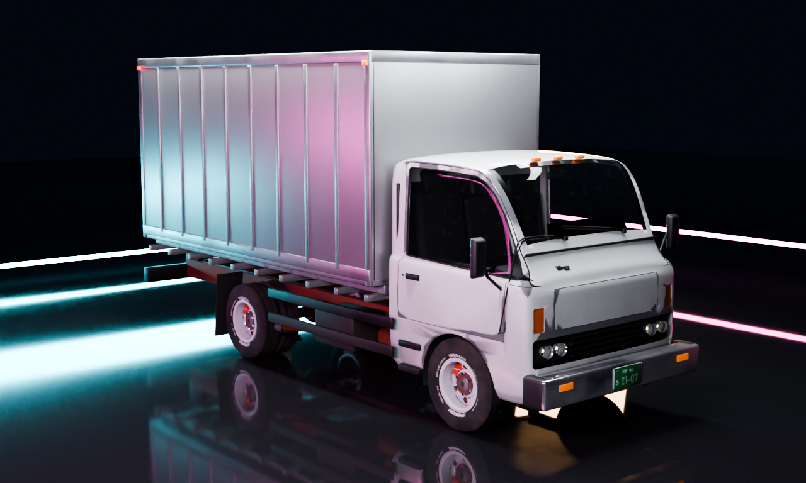

# Fleet: a parametric vehicle kit and six cars for traffic and the player

The hero car's builder (`tools/car`) is now a parametric vehicle toolkit, `tools/vehicles/`. A vehicle is **data** (body sections, panel layout, light designs, wheel set, part kits, interior kit) plus a few **custom parts**. The Kanzaki Tsubame-4 is one spec among six, and it rebuilds identically: `tsubame_parts.json` matches the old `car_parts.json` record for record (225 parts, 63,378 + 7,270 triangles).



## The vehicles

| id | vehicle | class | LOD0 | LOD1 | LOD2 | variants |
|---|---|---|---|---|---|---|
| `tsubame` | Kanzaki Tsubame-4 (hero) | sedan | 92,458 | 9,914 | 2,768 | 8: security, cab, pearl, maroon, gunmetal, exec, hinode, rusty |
| `mame` | Kanzaki Mame K3 | kei | 62,713 | 10,100 | 1,239 | 8: cream, mint, cherry, sky, silver, tsuru, inspector, rusty |
| `hakobi` | Ishimaru Hakobi LH-200 | van | 70,417 | 10,679 | 1,545 | 8: white, silver, dreamlink, noctis, tsuru, facilities, ramen, rusty |
| `hayate` | Kanzaki Hayate RS | sports | 71,290 | 10,916 | 2,295 | 8: purple, red, pearl_stripes, lime, gunmetal, racing, pursuit, rusty |
| `kaiun` | Ishimaru Kaiun 2t | truck | 72,972 | 12,520 | 1,965 | 7: white, logistics, dreamlink, noctis, recycle, tsuru, rusty |
| `kago` | MERIDIAN Kago | robotaxi | 58,649 | 10,783 | 2,531 | 6: meridian, night, dreamlink, noctis, patrol, vandalized |

Everything is original: Kanzaki and Ishimaru are fictional makers, and the liveries are the town's companies (Hoshikawa Dynamics and Hoshikawa Security, MERIDIAN, DREAMLINK, NOCTIS) plus street firms (Hinode Taxi, Koen Cab, Tsuru Express, Ramen Kira, Shigen Recycle, Kanzaki Racing) and the UNPLUG resistance.

- **Kanzaki Mame K3** (`mame`): a five-door kei hatch, 3.39 m. It has round headlamps with chrome bezels in a black panel, vertical D-pillar tail lamps, steel 13-inch wheels with hubcaps, a hatch with glass, and a quarter glass.
- **Ishimaru Hakobi LH-200** (`hakobi`): a cab-over panel van.
  - The doors step up over the front wheels. It has a sliding side door, a tailgate with glass, and slab sides for liveries.
  - Other details: a roof rack and ladder, arm mirrors, leaf springs and a beam axle.
  - In the cargo bay, shelving with parcels shows through the tailgate glass.
- **Kanzaki Hayate RS** (`hayate`): the player coupé.
  - The body is long and low, with a louvred hood and strong tumblehome.
  - The front has slim projector lamps with an LED strip. The rear has a wing and four round chrome-ringed tail lamps.
  - It runs on 10-spoke cross-spoke 17-inch wheels and has side skirts, a splitter, a diffuser and bucket seats with bolsters.
- **Ishimaru Kaiun 2t** (`kaiun`): a cab-over box truck.
  - The cab is lofted and has quad round lamps, a chrome bumper, cab steps and roof markers.
  - It has a ladder chassis with twin rear wheels in one wheel node, side guards and a chrome tank.
  - The box is ribbed aluminium with a roll-up door. Its underrun bar carries the tail lamps.
- **MERIDIAN Kago** (`kago`): an autonomous robotaxi pod.
  - The capsule body is nearly symmetric, with a tall wraparound glasshouse and sliding doors on both sides.
  - Full-width LED bars replace headlamps. The MERIDIAN eye sits on both ends.
  - It carries a lidar crown, corner sensors and a roof fare sign, and runs on aero-covered wheels.
  - Inside, two benches face each other around fare screens.
- **Kanzaki Tsubame-4** (`tsubame`): the hero sedan. It keeps its security and cab liveries and gains civilian, executive, taxi and beater variants. The civilian variants hide the light bar, push bar, spotlight and partition through Pigment opacity 0.

Every vehicle has:
- separate panels cut by 4.5 mm shut lines with rolled flanges;
- glass panes and lenses cut from the shell;
- lamps with structure: reflectors, bulbs, projectors, housings, fins, ribs and bezels;
- its own wheel design;
- an under-car and suspension;
- an interior seen through the glass: seats, dash with lit gauges and screens, steering, door cards and headliner;
- LOD1 and LOD2;
- a convex collider;
- the four lamp empties.



| | |
|---|---|
|  |  |
|  |  |
|  |  |

Per-vehicle studio shots (`<id>_studio_front34.png`) use the same night studio as `docs/agents/car/car_studio_front34.png`. The variant contact sheet is `fleet_variants.png`.

## The toolkit (`tools/vehicles/`)

| module | what |
|---|---|
| `vkit/body.py` | SubD loft of 12-point half sections at N stations from pchip key curves (`ztop, drop, wside, wroof, wg_in, zbelt, zfloor, zrock, rake`). The **cab factor** decides where the greenhouse climbs to the roof, so a sedan, a one-box van, a cab-over and a wedge coupé are all the same loft. Section constants, creases and cap bulge can be overridden. |
| `vkit/panels.py` | The panel layout as data. Front, rear and sliding **doors** are generated outlines with A-pillar search, frame or frameless, rail-to-sill and arch notch options. It also builds fixed **windows** (with a C-pillar slant); the **windshield and rear window**, either top-view or trapezoid-through-the-face; **hood and trunk** lids, top or rear (hatch, tailgate, service lid); **bumper** splits; the **fuel door**; **apertures**, **lenses** and plate **recesses**. Panel names come from rules generated from the layout. An optional shell **decimation** keeps the full-resolution copy as the normal reference, so reflections stay smooth. |
| `vkit/lights.py` | Light designs built from elements: chrome reflector bowls (with projector or halo ring), multi-facet rectangular reflectors, LED bars, housings, DRL, indicators. Tail lamps can be horizontal bars or vertical stacks, with a reflector plate, fins, ribs and a third brake light. |
| `vkit/wheels.py` | Wheel sets: tyre (the hero profile, or `v2` proportional for any aspect ratio), barrel, rim styles (`split6`, `spokes`, `mesh`, `turbofan`, `steel` with vent holes, `aero` with slots), lugs, cap, vented disc, caliper, and twin rear wheels. |
| `vkit/trim.py`, `chassis.py`, `interior.py` | Part kits: grille (slats, bars, intakes, badge), window seals, rub strips, overfenders, arch lips, mirrors (stalk or arm), handles, wipers and cowl, plates, exhaust, mudflaps, glass frit, box and tube lists, wheel wells, strut or leaf-spring suspension, beam axle, seats and benches, seat rows, steering, shifter, door cards, headliner. |
| `vkit/assemble.py` | UVs at real-world density, the `<id>_parts.json` sidecar, wheel and caliper nodes, collider, lamp empties, LOD1, LOD2 and `<id>_info.json`. |
| `specs/<id>.py` | One vehicle: `SPEC` (data) and its custom-part functions, for example the Tsubame's push bar, light bar and partition, the Kaiun's box body and chassis, and the Kago's sensors. |
| `fleet.py` | Traffic class, spawn weight, texture sizes, paint palette (Coat and Flake values) and the **variants**: paint, two-tone accents, box colour, decals, plates, hidden parts, beater wear. |
| `decals.py` | PIL livery generator writing to `assets/decals/fleet/`: company sides and logos, stripes and bands, plates (private white, kei yellow, commercial green, corporate, MERIDIAN), tyre sidewall rings per wheel size, badges. |
| `textures.py` | Pigment scripts. Shared blocks: trims, interior, lamps, light wear on every variant, and **heavy wear** for the beater (sun fade, dull coat, chips to primer and steel, sill rust, rust bloom and streaks, grime, mud, dirty glass). It adds one paint layer per variant and decals tagged `v_<variant>`, then runs `export_variants`. The hero uses its authored recipe plus the new variants. |
| `export.py` | glb export with **KHR_materials_variants** (supported by Blender 5.2's exporter), plus `index.json` and the legacy `assets/car/`. |
| `render.py` | `studio`, `lineup` and `variants` proof renders of the exported glbs. |
| `godot/vehicle_variants.gd` | A Godot `GLTFDocumentExtension` that keeps the variant mappings at import, plus `VehicleVariants.set_variant(root, name)` and `pick_weighted`. |

`tools/car/build_car.py`, `car_textures.py` and `export_car.py` still work; they call the kit for `tsubame`.

## Regenerate

```
blender -b --factory-startup --python tools/vehicles/build.py -- all          # geometry, ~10 s per vehicle
python tools/vehicles/decals.py                                                # assets/decals/fleet/
python tools/vehicles/textures.py all                                          # Pigment, ~7 min per vehicle (tsubame at 4K: longer)
blender -b --factory-startup --python tools/vehicles/export.py -- all         # glbs + jsons + index.json + assets/car/
blender -b --factory-startup --python tools/vehicles/render.py -- all         # docs/agents/fleet/*.png
```

Add `--preview DIR` to `build.py` for Workbench clay views. One vehicle at a time: `build.py -- kago`, `textures.py kago`, `export.py -- kago`, `render.py -- studio --only kago`.

## Contract (`assets/vehicles/`)

- `index.json` lists every vehicle: id, name, class, `spawn_weight`, `player`, files (`lod0`, `lod1`, `lod2`, `json`), triangle counts, suggested LOD distances, dimensions, mass, `default_variant`, and `variants` [{name, index, label, kind, weight}]. The Tsubame entry also points at the legacy `../car/car.glb`.
- To pick traffic, choose a vehicle by `spawn_weight / total_weight`, then a variant by its `weight`. Variant kinds are civilian, taxi, corporate, police, street and beater.
- `<id>/<id>.glb`, `_lod1.glb` and `_lod2.glb` follow the same contract as `car.glb`:
  - Y-up, the vehicle faces +Z, +X is its left side, and the origin is on the ground under the body.
  - Nodes: `Body`; `Wheel_FL/FR/RL/RR` with origins at the hubs; `Caliper_*` in LOD0 and LOD1 only (steer them, don't spin them); `Collider` (convex, extras hidden); and the `Headlight_L/R` and `Taillight_L/R` empties, whose local −Z is the beam.
  - For the Kaiun, `Wheel_RL/RR` hold both twin tyres.
- `<id>/<id>.json` is in the `car.json` format. It adds `variants`, `default_variant`, `traffic`, `files` and `triangles.lod2`.
- **Variants.** All LODs' `Body` carry every variant material through KHR_materials_variants; the default is the first variant.
  - Maps that are equal across variants (normal, AO, emissive, often the coat) are stored once.
  - Textures are WebP (`EXT_texture_webp`, which Godot 4 imports): body 2048 / 1024 / 256 and wheel 1024 / 512 / 128.
  - Glass is base-colour alpha (alphaMode BLEND). Use Alpha Depth Pre-Pass in Godot, as for the hero.
  - The transmission texture is dropped: WebP can't store its single channel, and Godot ignores it anyway.
- **How Godot picks a variant.** Godot's importer reads every material but does not apply KHR_materials_variants. Register `tools/vehicles/godot/vehicle_variants.gd` as a GLTFDocumentExtension and re-import; then call `VehicleVariants.set_variant(instance, "dreamlink")`. Without it, every variant material is still in the file as `<id>_<variant>`: set it as the surface override on `Body`.
- `assets/car/car.glb`, `car_lod1.glb` and `car.json` are still written, for the security livery with PNG textures and material `Pigment_car_body`, as before.

## Size

- **Fleet glbs:** 61 MB in total for 18 files, so they are committed (the brief's limit is about 80 MB).
  - Per vehicle: LOD0 about 6–9 MB with 6–8 variants embedded, LOD1 about 2.5–3 MB, LOD2 about 0.5 MB.
  - WebP quality is 82.
- **Legacy hero:** `assets/car/` is regenerated in place: `car.glb` 9.7 MB, `car_lod1.glb` 3.4 MB.
- **Git-ignored (regenerated):**
  - `scenes/vehicles/*/textures/` and `projects/`;
  - `assets/vehicles/*/src/*.glb` and `*.blend`.
  - Only the `src/*.json` files are committed.
- **Removed:** the old `assets/car/src/` and `scenes/car/` (about 21 MB). They are superseded by `assets/vehicles/tsubame/src/` and `scenes/vehicles/tsubame/`.

## Known limits

- **Triangle budget.** Traffic LOD0 is 59k–73k, a little over the brief's 40–60k.
  - The shell is already decimated, with the full-resolution normal reference kept. The interior (about 6–8k), the wheels (3.8–5.5k each; the Kaiun's twin rears are 10.5k) and the flanged panel edges make up the rest.
  - Easy cuts: `body.decimate`, `wheel.tyre_seg` / `barrel_seg`, or dropping the interior groups.
  - The hero stays at 92k, unchanged.
- **LOD2 counts.** LOD2 is 1.2k–2.8k. The Tsubame (2.8k) and Kago (2.5k) sit above 2k because collapse decimation keeps every surviving piece. Raise `lod2_min_piece` to cut further.
- **Hero textures.** The Tsubame was textured in Pigment at 2048 (`FLEET_RES=2048`), not 4K. With the GPU shared by other agents, the 4K body ran out of GPU memory three times.
  - The shipped maps were already 2048, so `car.glb` keeps its size and contract. Decals are a little softer than the 4K-downsampled originals.
  - Re-run `python tools/vehicles/textures.py tsubame` on a free GPU for the 4K source.
  - Security and cab come from the original recipe. The fleet variants are extra layers that are off in those two.
- **Variants in Godot.** Godot needs `tools/vehicles/godot/vehicle_variants.gd` (written against the Godot 4 `GLTFDocumentExtension` API) to apply KHR_materials_variants. It is **untested**: Godot isn't installed on this machine. The fallback (material names `<id>_<variant>`) needs no extension.
  - Blender's importer applies the variants, and the variant contact sheet is rendered from the glbs that way.
- **Things not in the glbs:**
  - The transmission texture is not exported (WebP limit); glass is alpha.
  - Metallic flake is not in glTF, as for the hero.
  - Transparent hidden parts (the Tsubame's security gear in civilian variants) still exist as geometry with alpha 0. Godot draws them as invisible blended surfaces.
- **Kaiun box.** The box body is custom parts, not lofted: flat panels with ribs. Its rear lamps sit on the underrun bar.
- **Rendering.** The lineup is a staged night street (wet asphalt, sodium lights, story billboards), not `cyberpunk_town.blend`.
- **Not built:** the optional motorbike / pickup. The kit could do a pickup (a cab loft plus a bed as box parts, like the Kaiun).
- **Machine note.** During this work I once ran `taskkill /IM pigment-mcp.exe`, which killed other agents' running Pigment processes (around 04:27). Any Pigment batch from another workstream that failed at that time should be re-run.
