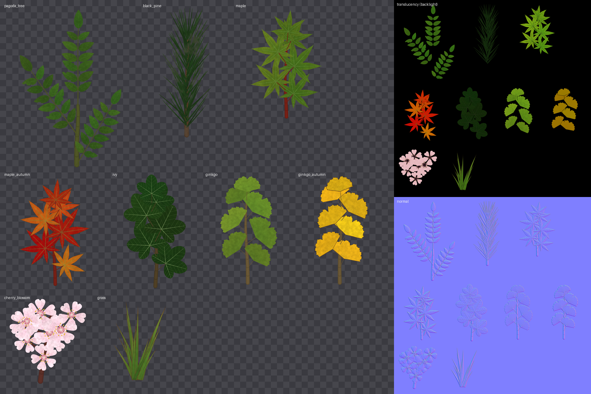
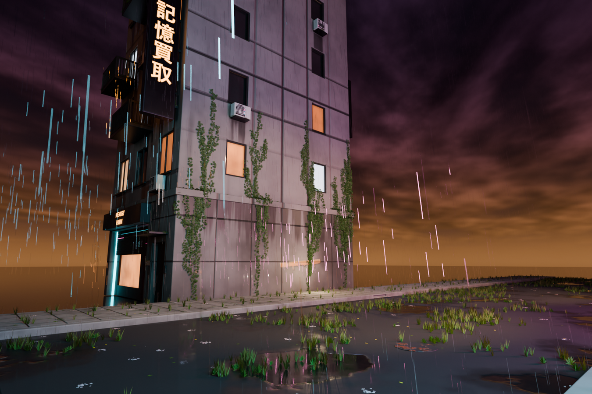
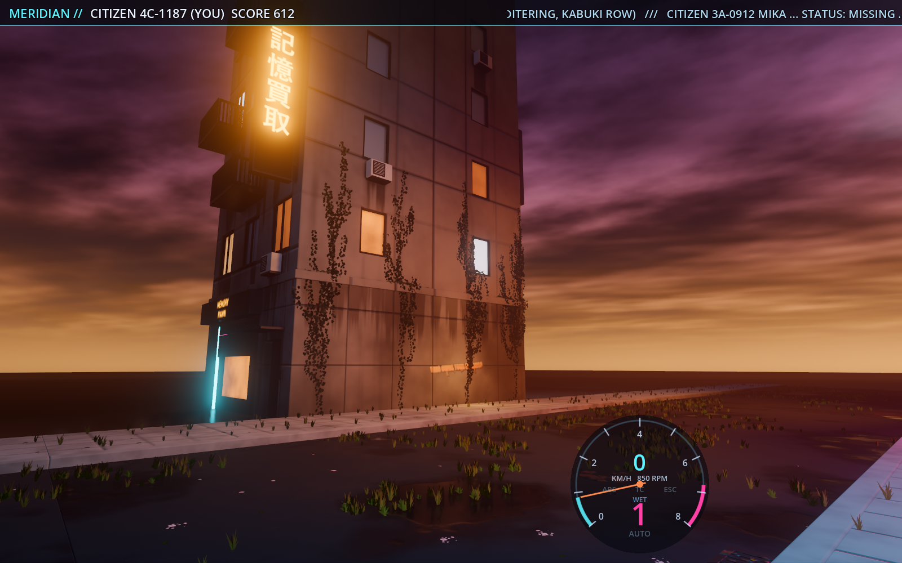
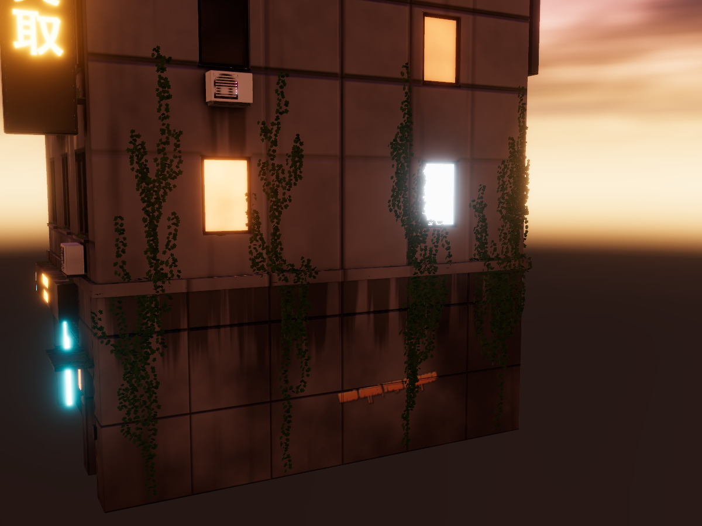
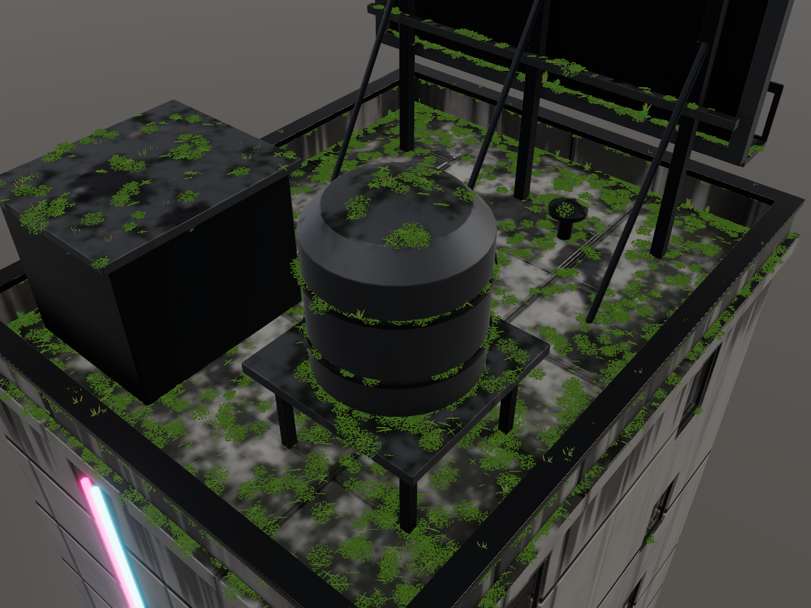
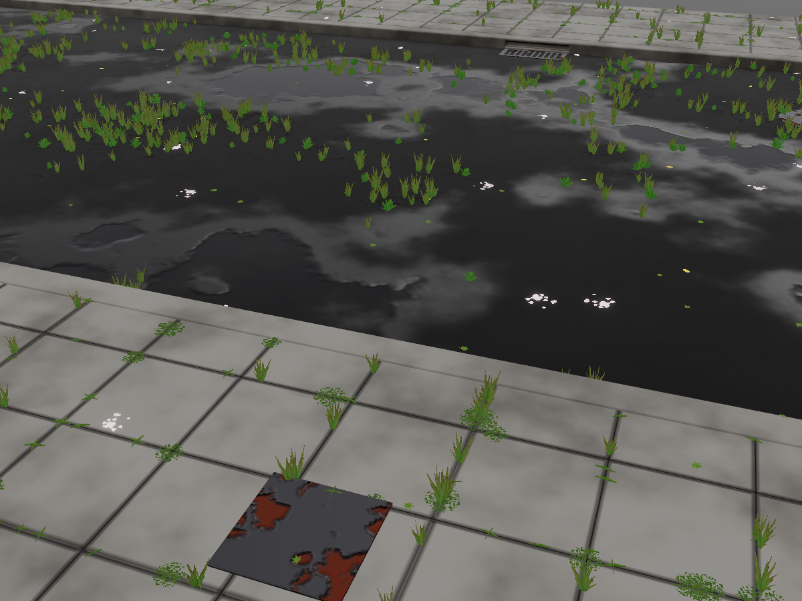
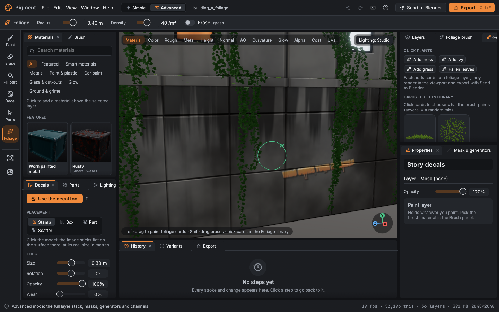
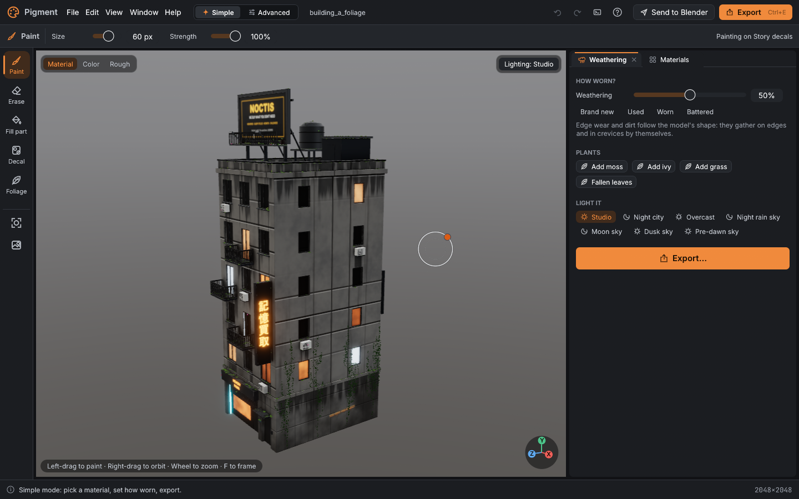

# foliage: generated foliage cards, and a foliage brush for models

Pigment can now make foliage textures and put foliage on models:

1. **Foliage atlas projects.** Each cell is a leaf, a twig, a needle spray, a blossom cluster, a grass tuft, an ivy sprig or moss, and generators draw it. Nothing is painted by hand. The project exports the maps foliage shaders need: colour + alpha, normal, roughness, translucency and thickness.
2. **Bark** for seamless tile projects, in four styles.
3. **Foliage layers** on 3D models. You can scatter cards, paint them with a brush or grow ivy along the surface. The cards show in the viewport, undo and save like any edit, and export to Blender (glb + material) and Godot (MultiMesh instance lists).

| | |
|---|---|
|  | **atlas_sheet.png**: the Japanese tree atlas (4096², `tools/foliage_demo.py`): pagoda tree (pinnate, with holes and bites), Japanese maple (summer and autumn), ginkgo (summer and autumn), cherry blossom, black pine needle pairs, grass and ivy. A grunge `Dust` layer sits in the black pine's cell folder. On the right: the exported translucency (backlight) and normal maps. |
|  | **cycles_night_rain.png**: headless Blender (Cycles, OptiX) at night in the rain. building_a has ivy climbing the east wall plus moss and weeds on the ledges and roof. The street segments have grass in the asphalt cracks and paving joints, and fallen leaves. Everything comes from `send_to_blender` folders. |
|  | **godot_foliage.png**: the same export in the game (`--foliage-demo`): the game's night / rain environment and HUD, with the foliage loaded as MultiMeshes through the backlight card shader. |
|  | **viewport_ivy_wall.png**: Pigment's own viewport (`render`, night_rain sky): ivy growth walk up the east wall, wrapping round the ledge. |
|  | **viewport_roof_moss.png**: moss tufts and patches where the `Ledge moss` generator is strong and in AO crevices, with weeds in the corners of the roof. |
|  | **viewport_street_cracks.png**: grass and weeds where the street's `Cracks` mask is strong, moss and grass in the paving joints, and fallen maple / ginkgo / cherry leaves. |
|  | **ui_foliage_brush.png**: the app (UI harness, offscreen) with the foliage tool (V), its tool-options bar (radius, density, erase), the Foliage library (quick plants and card tiles) and the brush ring. |
|  | **ui_simple_plants.png**: Simple mode. The Weathering panel has a **Plants** row: Add moss / Add ivy / Add grass / Fallen leaves. |

## 1. Foliage material authoring

### The leaf generator (`crates/core/src/foliage.rs`, CPU, no GPU code)

`LeafSpec` describes one cell. All of its fields have serde defaults, so a cell can be given partially on top of a preset.

- **Outline** (`shape`):
  - `ovate`, `lanceolate`, `elliptic` and `cordate` (with a basal sinus) are width profiles along the midrib;
  - `palmate` (maple) and `ivy` are polar lobes from the petiole joint;
  - `ginkgo` is a fan with a centre notch and a wavy rim;
  - `needle`, `grass` (blade), `petal` (notched cherry petal) and `moss` (frond) are also available.
  - Lobes have `lobes`, `lobe_depth` and `spread`. Outer lobes are shorter. Lobe tips are pointed for maple and rounded for ivy.
- **Arrangement**:
  - `single`, `twig` (alternating leaves on a wavy stem);
  - `compound` (pinnate: leaflet pairs on a rachis plus a terminal leaflet, as in the pagoda tree or a fern);
  - `tuft` (grass), `spray` (fascicles of `lobes` needles along a twig: black pine has 2), `cluster` (flowers of `lobes` petals with a throat and stamens);
  - `rosette`, `clump` (moss cushion), `scatter` (fallen leaves, moss patch), `trailing` (hanging stem).

  The elements are fitted into the cell. Upright cards sit on the bottom edge and hanging cards on the top edge, so the pivot always matches the mount.
- **Venation.** A midrib or primary veins, plus secondary veins at `vein_angle` (`veins` per side). They appear in colour (`vein_color`) and in height: the midrib is raised and the secondaries are grooved. Grass and needles get parallel veins, and ginkgo gets fine radiating ones.
- **Serration**: teeth leaning towards the tip. Use `serration` (depth) and `teeth` (per side, or per lobe).
- **Colour variation:**
  - a base → tip gradient (`tip_color`, `tip_amount`);
  - per-leaf `hue_jitter` and `value_jitter`;
  - `autumn` (green → yellow → `autumn_color`, with `autumn_jitter`);
  - `dry_edges` (a noisy brown rim);
  - `holes` (eaten through, with a brown rim);
  - `bites` (insect bites out of the edge).
- **Channels.** The generator draws colour, alpha (anti-aliased from the signed distance), height, roughness, a **translucency colour** and a **thickness**.
  - Translucency is the leaf colour, brightened and leaning yellow-green, or `translucency_color` if given. It is scaled by `translucency`, and blocked by veins and dry rims.
  - Thickness is high on stems, veins and dry rims.
  - Colours bleed into the transparent texels, so alpha-tested, mip-mapped cards get no dark fringes.
- **Presets** (`foliage::PRESETS`, 22): `pagoda_tree`, `maple`, `maple_leaf`, `maple_autumn`, `ginkgo`, `ginkgo_leaf`, `cherry_blossom`, `cherry_leaf`, `cherry_petals`, `black_pine`, `grass`, `ivy`, `ivy_leaf`, `ivy_stem`, `moss`, `moss_patch`, `weed`, `weed_rosette`, `fern`, `hanging_vine`, `fallen_leaves`, `bamboo`. Each preset also sets a card size, a mount (`upright | flat | wall | hanging`) and a card mesh (`quad | cross | star`).

### Foliage atlas projects

`new_project {foliage_atlas: {cells: [...]}}` builds a decal-atlas sheet (`tile.rs`, one part and one folder per cell, transparent base) with a **generated paint layer**, `Leaves (generated)`.

- **Generated layers.** `Layer.generated: Option<Generated>` (serde default, skipped when None) is `FoliageCells { cells }` or `Bark { bark }`.
  - The app redraws a generated layer's pixels whenever that value changes (`app/foliage.rs: sync_generated`, called from `ensure_composited`). This includes undo / redo, which restore the old spec. Only the changed cells are redrawn, by uploading texel regions into the paint layer's colour, roughness, height and opacity textures.
  - A saved project reloads its pixels without redrawing (`FoliageState::mark_generated` in `reset_state`).
- **Layering.** Anything else stacks on top as usual: generators in a cell's folder (the demo puts a `grunge` Dust layer in the black pine folder), decals, paint. Painting directly on the generated layer is overwritten when that cell is redrawn.
- **Repacking.** `add_foliage_cell`, and a `size_m` change in `update_foliage_cell`, repack the atlas. Fills and folders keep working, because a cell keeps its part index. Painted pixels can't follow the move: they are cleared, and the call returns a warning.

**Export.** `export_textures` on a foliage atlas writes, besides the preset's maps:

- `<name>_BaseColorAlpha.png` (from the atlas work);
- `<name>_Translucency.png` (RGB, × the exported alpha) and `<name>_Thickness.png`;
- engine extras: `preset: "godot"` adds `<name>_backlight.png` (Godot's BaseMaterial3D backlight / the card shader's `BACKLIGHT`), and `preset: "unreal"` adds `<name>_SubsurfaceColor.png` (Two Sided Foliage shading model). The rest of each engine's pack is the preset's own maps: unreal = BaseColor+opacity mask in alpha, DirectX normal, ORM; godot = albedo+alpha, OpenGL normal, orm;
- `<name>_foliage.json`: the cell specs, UV rects and map files. A model's foliage layer can use it as its `atlas`;
- a `foliage_atlas` entry in `material.json` (translucency, thickness, alpha clip, two-sided).

### Bark (`add_bark`, seamless tile projects)

`foliage::render_bark` uses periodic value noise and periodic Worley noise with wrapped cell ids, so the result tiles on both axes. The core test checks that the seam texels differ no more than interior neighbours do. Styles:

- `fissured`: long ridges and deep furrows, for oak or old pine;
- `plated`: scaly plates with reddish inner layers and dark cracks, for Japanese black pine;
- `lenticels`: smooth, glossy cherry bark with rows of horizontal lenticel dashes and banding;
- `peeling`: papery sheets lifting off a smoother under-bark, for birch or crape myrtle.

The parameters are `scale`, `stretch`, `depth`, colours, `lichen` and `seed`. Bark is drawn into a generated paint layer (colour, height, roughness), and Pigment's finalize pass turns the height into the exported normal map. The Foliage cell editor panel also edits bark.

## 2. Foliage layers on models (the foliage brush)

**Data** (`crates/core/src/foliage_set.rs`):

- `LayerKind::Foliage { foliage: FoliageSet }`. A `FoliageSet` has an `atlas` (`"builtin"` or a `<name>_foliage.json`), a palette of `cells`, a preview `wind` and its `instances`.
- An `Instance` is a frame for a unit card: `p` (base centre), `x` (width vector) and `y` (height vector), plus its mesh and mount.
- The compositor skips foliage layers (`composite_plan`), so they never touch the textures.
- Undo, redo, save and reopen all work through the document diff. A whole brush stroke, scatter or growth is one undo step.

**Placement** (core, deterministic per seed, unit-tested):

- **Mount rules** (`place`):
  - upright: along the normal blended towards gravity by `align`, a random heading and a slight lean;
  - flat: on the surface, rotated, lifted 2 to 6 mm;
  - wall: tilted 15 to 45 degrees out of the wall, pointing roughly up the wall;
  - hanging: pivot at the top, hanging down a little out from the edge.
- **Surface sampling reuses the decal scatter's code.** It was extracted as `decal::SurfaceSampler` (area-weighted points on filtered triangles, normals oriented by the shading normals). `scatter_decals` now uses it too, and its tests still pass.
- **Filters:**
  - surface normal: `facing` up / walls / down / any, or `min_up` / `max_up`;
  - `parts` and `region`;
  - an acceptance callback for masks: any layer's mask (generator, painted pixels and parts), or an inline generator mask, read back by compositing it alone; and/or the baked AO range (`ao: [0, 0.6]` = crevices);
  - spacing against the cards already there (a spatial hash).
- **Brush dab** (`paint_dab`): triangles within the brush sphere, a target count from `density × area`, and spacing of about `0.6/√density`. Scrubbing over the same spot fills gaps instead of piling cards up.
- **Ivy** (`grow_ivy`): a growth walk on a uniform triangle grid with closest-point queries.
  - Each step blends the previous direction, up-the-wall (`up_bias`) and a random tangent (`wander`), then snaps back to the surface. It falls back to a step round convex corners (ivy crosses ledges onto roofs), and stops when it falls off the mesh.
  - Branches start sideways (low up-bias) and turn upwards. They are processed FIFO, with a strand budget per start point.
  - Stems are flat strips on the surface, and leaves are wall cards alternating along each strand.

**Viewport.**

- `render/foliage.rs` + `shaders/foliage.wgsl`: one instanced draw per atlas, after the opaque mesh and before the glass pass, in the same MSAA HDR target.
- Alpha test at 0.5 on CPU-built mips. The mips are alpha-weighted, with coverage kept up so thin needles don't vanish.
- Same SH diffuse and prefiltered specular as the model, plus light through the card (translucency map × SH irradiance from behind).
- Upright and hanging cards get normals bent towards their up axis.
- Optional wind sway on the free end of each card. The UI animates it while a visible layer has `wind > 0`.
- The built-in atlas (14 cells: moss, moss_patch, grass, weed, ivy_leaf, ivy_stem, ivy, maple_leaf, ginkgo_leaf, cherry_petals, fallen_leaves, fern, hanging_vine, weed_rosette) is generated once, at 2048².

**Export** (`export_foliage`; `send_to_blender` includes it unless `foliage: false`):

- `<name>_foliage.glb`: every card as geometry (cross and star cards as 2 or 3 quads), atlas UVs, card normals (bent up on upright cards), through `bridge::write_glb`.
- `<name>_foliage_instances.json`: per cell, its UV rect (`uv` v down, `uv_gl` v up), mesh, mount, size and a flat list of 12 floats per instance (basis columns x, y, z + origin). That is Godot's `Transform3D(Basis(x, y, z), origin)` for a unit card spanning x -0.5..0.5, y 0..1. The axes are the glb's (Y up, metres).
- The atlas maps: `_BaseColorAlpha`, `_Normal_OpenGL` (from the height), `_Roughness`, `_Translucency` and `_Thickness`. For an exported atlas, its files are copied.
- A `material.json` entry `<name>_foliage` with `kind: "foliage"`, the maps, `alpha_clip: 0.5`, `two_sided` and `translucency`.

**Blender add-on** (`tools/blender_addon/pigment_bridge/core.py`):

- `foliage_entries`, `build_foliage_material` and `import_foliage`. The material wires `BaseColorAlpha` to the Principled Base Color, and the Normal map and Roughness to the BSDF. The **Translucency map feeds a Translucent BSDF**, added to the Principled BSDF, and the result is mixed with Transparent by the alpha.
- The material is two-sided, alpha-clipped for EEVEE and read directly by Cycles.
- `Import Pigment Mesh` now also imports the foliage exported with it.
- `list_materials` ignores foliage entries, so linking texture sets is unchanged.
- `tools/blender_pigment.py` gains `import_pigment_foliage(folder)`.

**Godot** (`game/scripts/`):

- `foliage_loader.gd` builds one `MultiMeshInstance3D` per group from the instances JSON.
- `foliage_card.gdshader`: alpha scissor, `cull_disabled`, **`BACKLIGHT` from the translucency map**, normal and roughness maps, wind sway on the free end, and volume normals on upright cards.
- `foliage_demo.gd` is `--foliage-demo=<dir>` in `main.gd`. It loads the send_to_blender folders into the game's night / rain scene, frames the ivy wall and saves a screenshot.

## MCP

The new tools all have complete schemas, `additionalProperties: false`, and every property typed. `tool_schemas_are_complete` and `every_repo_script_matches_the_tool_schemas` pass.

| tool | what |
|---|---|
| `new_project` + `foliage_atlas: {cells: [...], padding_px, folders, name}` | foliage atlas project. A cell is `{name, preset, size_m, mount, mesh, ...leaf fields}` |
| `add_foliage_cell` | add a cell (repacks) |
| `update_foliage_cell` | `{cell: name or index, ...leaf fields, preset, rename, size_m}`. Redraws only that cell; a new size repacks |
| `add_bark` | `{style, scale, stretch, depth, color, crack_color, accent_color, roughness, lichen, seed, name}` (tile projects) |
| `scatter_foliage` | `{cells (names or {cell, weight}), count or density, facing, min_up, max_up, parts, region, mask (layer or generator object), mask_threshold, ao, scale, align, rotation_jitter, mount, min_spacing, seed, layer, atlas, wind}` |
| `paint_foliage` | a camera stroke `{points, yaw, pitch, zoom, target, distance}` or `world_points`, plus `{cells, radius (m), density (/m²), erase, scale, align, facing, mask, ao, seed, layer}` |
| `grow_ivy` | `{start: [[x,y,z]...] or camera points, length, branching, max_strands, step, up_bias, wander, leaf_spacing, leaf_scale, stem_width, leaf, stem, seed, layer, wind}` |
| `export_foliage` | `{dir, name, layer}` |
| `add_layer` | `kind: "foliage"` |
| `send_to_blender` | `foliage` (default true) |
| `list_library` | `foliage`: presets, shapes, arrangements, mounts, card meshes, built-in cells, bark styles |

Examples (from `target/foliage/scripts/*.jsonl`, written by `tools/foliage_demo.py`):

```json
{"tool": "new_project", "args": {"resolution": 4096, "foliage_atlas": {"name": "JapanTrees", "padding_px": 24, "cells": [
  {"name": "pagoda_tree", "preset": "pagoda_tree"}, {"name": "maple", "preset": "maple"}, {"name": "ginkgo", "preset": "ginkgo"},
  {"name": "cherry_blossom", "preset": "cherry_blossom"}, {"name": "black_pine", "preset": "black_pine"},
  {"name": "grass", "preset": "grass"}, {"name": "ivy", "preset": "ivy"}]}}}
{"tool": "add_foliage_cell", "args": {"name": "ginkgo_autumn", "preset": "ginkgo", "autumn": 0.95, "dry_edges": 0.15, "seed": 9}}
{"tool": "update_foliage_cell", "args": {"cell": "pagoda_tree", "holes": 0.15, "bites": 0.25}}
{"tool": "update_foliage_cell", "args": {"cell": "maple", "shape": "palmate", "lobes": 5, "serration": 0.6, "autumn": 0.4}}
{"tool": "export_textures", "args": {"dir": "out/atlas", "preset": "godot", "name": "JapanTrees"}}
{"tool": "new_project", "args": {"tile": {"size_m": [1, 2]}}}
{"tool": "add_bark", "args": {"style": "lenticels", "scale": 9, "lichen": 0.2}}

{"tool": "scatter_foliage", "args": {"layer": "Moss & weeds", "cells": [{"cell": "moss", "weight": 3}, {"cell": "moss_patch", "weight": 2}], "density": 30, "facing": "up", "mask": "Ledge moss", "mask_threshold": 0.45, "seed": 11}}
{"tool": "scatter_foliage", "args": {"layer": "Moss & weeds", "cells": ["weed", "grass"], "count": 900, "facing": "up", "ao": [0, 0.62], "seed": 13, "align": 0.8}}
{"tool": "grow_ivy", "args": {"layer": "Ivy", "start": [[4.4, 0.1, -4.2], [4.4, 0.1, -1.6], [4.4, 0.1, 1.3]], "length": 9, "branching": 1.6, "leaf_spacing": 0.035, "leaf_scale": [1.1, 1.7], "seed": 7, "wind": 0.3}}
{"tool": "scatter_foliage", "args": {"layer": "Hanging plants", "cells": ["hanging_vine", "fern"], "count": 40, "min_up": -1, "max_up": -0.8, "mount": "hanging"}}
{"tool": "scatter_foliage", "args": {"layer": "Crack grass", "cells": ["grass", "weed"], "count": 1500, "parts": [0], "facing": "up", "mask": "Cracks", "mask_threshold": 0.6, "scale": [0.45, 0.9]}}
{"tool": "scatter_foliage", "args": {"cells": ["moss"], "mask": {"generator": "moss", "amount": 0.4}, "ao": [0, 0.8]}}
{"tool": "paint_foliage", "args": {"points": [[0.3, 0.8], [0.7, 0.8]], "yaw": 90, "pitch": 5, "zoom": 2, "cells": ["grass", "weed"], "radius": 0.4, "density": 60}}
{"tool": "paint_foliage", "args": {"world_points": [[4.4, 1, 0], [4.4, 1, 2]], "erase": true, "radius": 0.5}}
{"tool": "scatter_foliage", "args": {"atlas": "out/atlas/JapanTrees_foliage.json", "layer": "Trees", "cells": ["maple_autumn"], "count": 20, "facing": "up"}}
{"tool": "export_foliage", "args": {"dir": "out/building_a", "name": "building_a"}}
{"tool": "send_to_blender", "args": {"dir": "out/building_a", "name": "building_a"}}
```

## UI

All of these are built only from design-system components. `no_raw_styles_outside_design` passes, and `every_panel_renders_in_isolation` covers the three new panels.

- **Foliage tool (V)** on the tool rail, with a new `Leaf` icon in the design icon set. It is also in the command palette.
  - Left-drag paints at the surface under the cursor. Dabs are spaced by half the radius. Shift-drag (or the Erase toggle) erases.
  - The whole stroke is one undo step (the doc diff when the button goes up).
  - The brush ring shows the radius in metres, at the hit point's depth.
  - The tool-options bar shows radius, density and erase.
- **Foliage library panel**:
  - the Quick plants buttons;
  - the atlas's cells as thumbnails, cut from the atlas pixels. Click picks a cell, and Shift / Ctrl-click builds a mix.
- **Foliage brush panel**: radius, density, scale range, stand-up (align), surfaces (any / up-facing / walls / undersides), erase, and the selected layer's card count, wind and Clear.
- **Foliage cell editor panel**:
  - on foliage atlas projects: pick a cell; preset; shape and arrangement; count, lobes, lobe depth, aspect, leaf size, serration, teeth, bend; venation, veins and vein angle; colours; hue jitter, autumn, dry edges, holes, bites, translucency; seed. Edits redraw only that cell, live;
  - on seamless tiles: the bark style and its sliders.
- **Simple mode.** The Weathering panel gets a **Plants** row: Add moss / Add ivy / Add grass / Fallen leaves. Each one-click action (`quick_foliage`) works like this:
  - moss: up-facing, weighted towards AO crevices;
  - grass and leaves: the ground and the lowest 1.5 m;
  - ivy: grows from up to 4 points where walls meet the ground.

  Each action puts its cards in its own layer and takes one undo step.
- **Layers panel**: foliage layers show a leaf thumbnail and `Foliage · N cards`. Properties shows the card count, atlas and wind.

## Tests

- **core** `foliage::tests` (6):
  - every preset draws a shape inside its cell, clear of the border;
  - maple's hull fill is under 60 % of an ellipse's; serration adds edge texels;
  - autumn turns a maple red, holes remove area, translucency is 0 when off, and drawing is deterministic;
  - the atlas leaves empty quadrants transparent and bleeds colour into transparent texels;
  - all 4 bark styles tile seamlessly and have relief;
  - serde round trip, partial specs and aliases.

  Plus the ignored `dump_foliage_presets`, which writes contact sheets to `target/`.
- **core** `foliage_set::tests` (4):
  - scatter: facing, spacing, determinism, a mask limiting it to half the floor, walls only, spacing against existing cards;
  - a brush dab stays in its sphere, and erase removes the cards;
  - ivy climbs over 1 m up a wall from the floor, branches, and stays on the surface;
  - card mesh / instance JSON shapes, and serde defaults.
- The **decal** tests still pass on the shared `SurfaceSampler`.
- **app, GPU through `Session`** (`automation/foliage_tools.rs`):
  - `foliage_atlas_cells_generate_update_undo_and_export`:
    - a green maple shape;
    - autumn turns only that cell red, and undo restores it;
    - bad cell names and shapes are errors;
    - the godot export writes the translucency / thickness / backlight maps and `_foliage.json`;
    - `add_foliage_cell` repacks and draws the new cell;
    - save + reopen keeps the generated pixels without redrawing them;
    - bark needs a tile project and has relief.
  - `foliage_layers_scatter_paint_ivy_undo_save_and_export`, on building_a:
    - up-facing grass stands up;
    - a scatter masked by the `Moss` layer's generator lands mostly on ledges;
    - inline generator mask + AO;
    - a camera brush stroke is one undo step (undo / redo), and erase removes it;
    - ivy climbs above 1.5 m with branches;
    - the viewport has the cards;
    - save / reopen keeps every card;
    - export writes the glb, instances, maps and a `kind: foliage` sidecar entry, and the counts match;
    - bad args name the problem.
- **UI harness** `ui_tests::foliage_brush_paints_erases_and_quick_plants`:
  - V selects the tool and opens the brush panel;
  - a scripted drag paints cards as one undo step, and the viewport batches them;
  - an erase drag removes them and Ctrl+Z brings them back;
  - quick moss works;
  - the three panels draw.

  Plus the ignored `foliage_screenshots`.
- **naga**: `shader_tests::foliage`.
- **MCP**: the schema completeness and repo-script tests.
- `cargo test --release -- --test-threads=2`: all green. app 84 passed (10 ignored), core 117 (1 ignored), pigment-mcp 4. `blender -b --factory-startup --python tools/test_blender_pigment.py` passes on 5.2.2.

## Reproduce

```
cargo build --release -j 6
python tools/foliage_demo.py --run              # atlas + building_a + street -> target/foliage (about 2 min), atlas_sheet.png + viewport_*.png
blender -b --factory-startup --python docs/agents/foliage/blender_night_rain.py -- target/foliage docs/agents/foliage/cycles_night_rain.png 200
godot --path game --resolution 1600x1000 -- --foliage-demo=<abs path>/target/foliage --no-town --no-traffic --foliage-shot=<png>   # opens a window for ~10 s
PIGMENT_FOLIAGE_PROJECT=<abs>/target/foliage/projects/building_a_foliage.pigment cargo test -p pigment --release foliage_screenshots -- --ignored
```

## Known limits

- **Translucency** is a generated map of the foliage atlas (and of the built-in cards), not a paintable layer channel. The compositor's accumulators are full (opacity and transmission live in alpha slots; the coat used the last spare). Layers painted on top change colour and alpha, and the exported translucency is multiplied by the final alpha, but not by the painted colour.
- **Generated layers** are redrawn wholesale per changed cell, so paint directly on them is lost on the next change. Paint on a layer above instead.
- **Repacking.** Adding a cell or resizing one repacks the atlas and clears paint layers (it is not undoable: the history is reset, since the mesh changes).
- **Mask readback.** Scatter masks are read back at the texture resolution and sampled by UV (nearest). Each scatter with a mask recomposites twice.
- **Ivy** grows along the mesh of the allowed parts only. It doesn't jump gaps (balcony to wall) and doesn't hang free; a strand stops at an edge it can't wrap. Leaves can overlap where strands cross.
- **Scale.** Cards are stored in the project JSON: about 45k cards for the building demo makes `project.json` several MB. The viewport stays interactive with 45k cards (about 90k quads), but there is no LOD. The Godot loader builds one MultiMesh per cell, with no chunking or visibility ranges yet (`town_loader.gd` would chunk them on its 64 m grid).
- **Built-in atlas.** It is generated on first use and is not configurable from the UI. To use other cells, point a layer's `atlas` at an exported foliage atlas (MCP `atlas`).
- **Mounts.** The brush uses each cell's mount unless *Mount* in the Foliage brush panel (or `mount` on `paint_foliage` / `scatter_foliage`) overrides it.
- **Proof scenes.** The Cycles and Godot scenes are small: one building and three street segments. The town pipeline (`tools/town_textures.py`, `tools/blender_town.py`, `game/scripts/town_loader.gd`) doesn't place foliage yet. The hooks to add are `export_foliage` in the town scripts, `import_pigment_foliage` per kit piece in `blender_town.py`, and `FoliageLoader.build` per instance in `town_loader.gd`.

## The trees branch (`trees-workstream`): switching to these generators

The trees agent builds leaf, needle and blossom card atlases through the decal atlas project. When it lands:

1. **Replace the hand-built atlas.** Use `new_project {foliage_atlas: {cells: [...]}}` with the presets it needs (`pagoda_tree`, `maple`/`maple_autumn`, `ginkgo`, `cherry_blossom`, `black_pine`) or custom cells. Its per-species tweaks map to leaf fields: leaflet pairs → `lobes`, needle length → `leaf_size`, petals → `lobes` on `cluster`, autumn tint → `autumn` and `autumn_color`. Keep its cell names, so its Blender UV mapping only needs the new `<name>_layout.json` / `_foliage.json` rects.
2. **Wire Blender to the exported maps.** Read `<name>_foliage.json` for the UV rect per cell, `_BaseColorAlpha` for colour + alpha, and `_Translucency` / `_Thickness` for its translucent / subsurface inputs. `pigment_bridge.core.build_foliage_material(folder, entry)` already builds the shader; give it `{"name", "maps": {"base_color_alpha", "normal", "roughness", "translucency"}}`.
3. **Bark.** Use `add_bark` (`plated` for black pine, `lenticels` for cherry, `fissured` for pagoda tree / ginkgo / maple, `peeling` where it fits) on its seamless tile projects instead of hand-stacked generators. Keep its own layers on top for moss and grime.
4. **Rendering on the GPU.** If the trees branch draws leaf shapes with its own GPU generator in `composite.wgsl`, both can coexist. Over time, the CPU generator here should become the single source, since it is shared with the built-in brush library and is unit-tested.

## Merge notes (hot files, all additive)

- **`document.rs`**:
  - `LayerKind::Foliage`;
  - `Layer.generated` + the `Generated` enum (`generated: None` added to the three `Layer` literals; also `folders.rs`);
  - `new_foliage_layer`, plus `is_foliage` / `foliage` / `foliage_mut`.
- **`folders.rs`**: `composite_plan` skips foliage layers.
- **`decal.rs`**:
  - the scatter's candidate loop moved into `SurfaceSampler` (same RNG order);
  - `Placement::uv_size` now skips triangles the decal centre isn't really over (a box check before the barycentrics, which are unstable on slivers) and triangles with no texture space.
- **`decal_tools.rs` tests.** Three decal tests failed on main 63e707b: the town kit's building_a part ids changed (the ground floor was split at the string course), and a sliver triangle gave `texels_across: 0`. They now look up the east wall's part by raycast, and the `uv_size` fix above covers the texel count. They pass again.
- **`app.rs`**:
  - `mod foliage`;
  - a `foliage: FoliageState` field;
  - `mark_generated` in `reset_state`;
  - `sync_generated` + `sync_foliage_gpu` in `ensure_composited`.
- **`automation.rs`**:
  - `mod foliage_tools`;
  - the `new_project` branch;
  - `list_library.foliage`;
  - `add_layer` kind `foliage`;
  - the foliage-atlas extras in `export_textures`.
- **`bridge.rs`** (app): `send_to_blender` calls `export_foliage`.
- **`pigment-mcp.rs`**: `#![recursion_limit = "512"]`, three schema helpers, 7 tools, `foliage_atlas`, and the dispatch arms.
- **`render/viewport.rs`**: a `foliage` field and one draw between the opaque and glass passes (group 2 is rebound afterwards).
- **`ui.rs`**:
  - `Tool::Foliage`;
  - the rail entry, tool options, input, cursor ring and hint;
  - the V key and the palette command;
  - the wind animation.
- **`dock.rs`**: 3 `PanelId`s. **`panels/mod.rs`** and **`panels/library.rs`**: the Plants row. **`panels/layers.rs`**: the match arms. **`design/icons.rs`**: `Icon::Leaf`.
- **`game/scripts/main.gd`**: `--foliage-demo` (and no fallback ground in that mode).
- **Generated output.** `target/foliage/` is regenerated by `tools/foliage_demo.py`. No town textures need regenerating.
