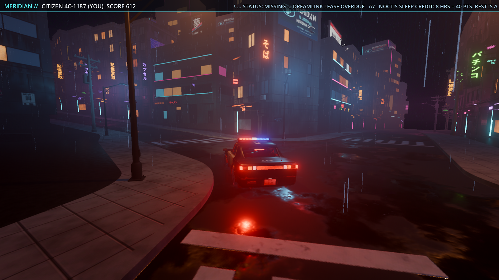

# godot: drivable night-city prototype of the Pigment town

The hillside cyberpunk town (from `tools/blender_town.py`, textured in Pigment) is exported to
game-ready glTF and driven in Godot 4.7 (Forward+) with the Kanzaki Tsubame-4 security car
from the car workstream.



Screenshots, all from the automated run (`--autoshot`, 1920x1080, saved at 1600 px):
- `01_spawn_chase.png`: spawn, chase cam, wet zebra crossing.
- `02_driving_chase.png`: driving into a junction.
- `03_hood.png`: hood cam.
- `04_brake_lights.png`: braking (tail lights brighten).
- `05_overview.png`: high view over the town.
- `06_crossroads.png`: street level at the J1 crossroads.

`perf.json` holds the numbers from the same run.

## How to play

1. Generate the town assets once (they are git-ignored, about 150 MB). See "Regenerate" below.
2. Open Godot 4.7, choose **Import**, pick `game/project.godot`, then press **F5**.
   The first open imports the textures (about 30 s).

| | Keyboard | Gamepad |
|---|---|---|
| throttle / brake, reverse | W / S (or arrows) | RT / LT |
| steer | A / D | left stick |
| handbrake (drift) | Space | A |
| reset to the nearest road | R | Y |
| camera: chase / far / hood | C | RB |
| roof light bar (red / blue) | L | X |
| rain on / off | F | |
| SDFGI on / off | G | |
| FPS / draw-call line | F3 | Back |
| quit | Esc | |

The car resets itself when it has been on its roof for 2 s, or when it falls out of the world.
The HUD shows the speed and gear, plus a MERIDIAN bar. The bar shows your citizen score: speeding,
crashes and clean driving change it. A ticker of other citizens' records scrolls past (story flavour).

## Regenerate

```
# 1. town export: builds the town with tools/blender_town.py build() (unchanged, same seed),
#    then writes game/assets/town/{meshes/*.glb, town_layout.json, images/, textures/}
blender -b --factory-startup --python tools/godot/export_town.py
#    (it runs the texture packer at the end; to run it alone:)
python tools/godot/pack_textures.py [--size 2048] [--force]
# 2. car: copy assets/car/car.glb + car.json into game/assets/car/ (already committed there)
python tools/godot/sync_car.py
# 3. import (or just open the project in the editor)
Godot_v4.7.2-stable_win64_console.exe --headless --path game --import
```

The export needs the Pigment textures in `scenes/town/textures/` (git-ignored, from
`python tools/town_textures.py`). In a worktree, link it to the main checkout's folder.
The export takes about 15 s plus about 1 min of packing. Without the town, the game starts
on a flat plane with a hint.

Automated runs (user args go after `--`):
```
godot --path game -- --autoshot=docs/agents/godot   # scripted drive, 6 PNGs + perf.json, quits (~45 s, opens a window)
godot --path game -- --bench=10                     # autopilot drive, prints BENCH {...}
godot --path game -- --bench-matrix                 # cost of each effect, static view
godot --headless --path game -- --drive-test        # physics only: 0-60, top speed, braking, rollover, reset
```
Other args: `--no-gi`, `--no-rain`, `--no-town`.

## What was built

### Export (`tools/godot/export_town.py`, headless Blender)
- It imports the kit like `town_layout_driver.py` does and calls `blender_town.build()`.
  It doesn't edit `blender_town.py`.
- It walks the `CyberpunkTown` collection, and every object becomes an instance of a mesh:
  - Objects that share mesh data (buildings, signs, lamps, poles, footings) share one glb.
  - Unique objects (terrain, road runs, junctions, walls, stairs, railings, wires, decals)
    get their own glb.
  - Curves are converted to meshes.
  - glbs carry material **names** only, not images.
  - The result is 69 meshes and 809 instances.
- `town_layout.json` holds:
  - `meshes`: file, surface material names, AABB, triangle count, category and collision kind.
  - `materials`: one of three types:
    - Pigment: the folder, `emissive_scale` from material.json / variant.json, and opacity;
    - image decals;
    - flat colours for Blender-procedural materials.
  - `instances`: mesh, a material remap for the per-building texture variants, and the Godot
    transform. Blender (x, y, z) maps to Godot (x, z, -y).
  - `lights`: 53 street lamps, 37 alley lights and 24 stair lights.
  - `roads`: the centre lines.
  - `spawn`.
- `pack_textures.py` turns each Pigment export into four maps at 2048 px or less:
  - `albedo` (opacity in alpha);
  - `orm` (AO, roughness, metallic);
  - `normal` (OpenGL, which is Godot's convention);
  - `emission`.

  It also writes `.import` files: VRAM-compressed, with mipmaps, and normal maps flagged. That
  way the headless import compresses them without the editor's 3D-usage detection.

### Godot (`game/`)
- **`town_loader.gd`** builds the town from the JSON:
  - Each mesh + material set becomes `MultiMeshInstance3D` chunks on a 64 m grid, so they
    frustum-cull. A mesh used once becomes a single `MeshInstance3D`. The result is 382
    multimeshes and 62 meshes.
  - Small props have visibility ranges: signs at 170 m, decals at 150 m, lamps and poles at 240 m.
  - Mesh LODs are generated on import.
  - Materials are `ORMMaterial3D`s built from the packed maps.
  - Emission strength is `emissive_scale × 1.3`.
  - Glass (opacity about 0.3) stays solid as dark, reflective panes. Only real holes are cut,
    using alpha scissor at 0.15.
  - Wet roads: asphalt and junction albedo × 0.78, roughness × 0.42. Pigment's puddles stay the
    glossiest, and SSR reflects the neon in them.
  - Blender-procedural paving, concrete and walls get triplanar noise albedo and normal maps.
- **Collision:**
  - box shapes for buildings and footings, cylinders for lamps and poles;
  - trimesh for terrain, roads, junctions, walls and stairs. Each trimesh gets its own
    StaticBody, because a Jolt compound of mesh shapes runs out of sub-shape ID bits;
  - invisible walls on the terrain's edge, since the roads run on 20 m past it.
- **Lighting:**
  - Sky: a procedural night sky with a purple city glow on the horizon.
  - Tonemap: AgX, exposure 1.25.
  - Glow: screen blend, HDR threshold 0.9.
  - Volumetric fog: density 0.018. The lamps inject into it, giving visible light cones.
  - Plus depth fog, SSR, SSAO, SSIL, and **SDFGI** for the emissive bounce. SDFGI is on by
    default; G toggles it.
  - Street lamps are OmniLights with distance fade. The 3 lamps nearest the camera cast
    dual-paraboloid shadows, re-picked every 0.3 s.
  - The moon is a dim directional light with no shadow.
- **Rain:** a GPUParticles3D streak volume (9000 particles) that follows the camera.
- **`car.gd` (VehicleBody3D)** is built from `car.glb` and `car.json`:
  - The convex `Collider` becomes the collision shape.
  - A `VehicleWheel3D` sits at each hub, one rest length above it, so the modelled ride height
    holds at rest.
  - The calipers follow the steering and suspension but don't spin.
  - The body's alpha-blended material is switched to Alpha Depth Pre-Pass.
  - Headlights are SpotLight3Ds on the `Headlight_*` empties (local −Z), tilted down 4°. The left
    one casts shadows.
  - Tail OmniLights brighten when braking or reversing.
  - The roof light bar flashes red and blue on L.
  - Tuning:
    - mass from `mass_kg` and suspension from `suspension_suggestion` (stiffness × 1.3, damping
      raised for stability);
    - grip = `friction_slip` × 1.15;
    - centre of mass 0.24 m lower than `car.json`, for an arcade feel without rollovers;
    - RWD;
    - steering that narrows with speed (0.55 rad down to 0.12 rad);
    - downforce;
    - handbrake: rear grip drops to 1.6 for drifts.
- **`chase_camera.gd`:**
  - follows the car's heading blended with its velocity;
  - springs in when a wall is in the way (ray cast on the physics tick);
  - FOV widens with speed;
  - uses physics interpolation (physics runs at 120 Hz).
- **`hud.gd`:** speed, gear, the MERIDIAN score bar and ticker, a controls hint and an FPS line.
- **`main.gd`** also has an autopilot that follows the road centre lines and drives on the
  left. It passes through junction centres when it changes runs, and gets itself unstuck. The
  automation uses it.

## Tests and performance

On the RTX 4070 Ti at 1920×1080, with vsync off and the autopilot driving (`perf.json`):

| | avg fps | 1 % low | draw calls | primitives |
|---|---|---|---|---|
| driving, SDFGI on (default) | **241** (4.1 ms) | 163 | 247 | 6.1 M |
| driving, SDFGI off | 282 (3.6 ms) | 200 | 288 | 7.1 M |
| overview from above | 276 | 194 | 271 | 3.8 M |

VRAM is about 1.45 GB with SDFGI on. The 60 fps target has roughly 4× headroom.

**Caveat: the GPU is shared with other agents.** When their Cycles renders filled about 10 of
the 12 GB of VRAM, Godot stalled completely on its first frames, and an early run measured
10 fps. Measure on an idle GPU. If VRAM is tight, `--no-gi` saves about 400 MB.

Headless `--drive-test` with the real car:
- 0–60 km/h in 3.4 s;
- braking from 64 km/h to 0 in 1.4 s over 12 m;
- 40 s of autopilot over three junctions with no rollovers (min up-vector 0.99);
- reset lands upright.

## Known limits / follow-ups
- **Roads rework:** the open-world roads branch changes `tools/blender_town.py`. After it is
  merged, re-run the export.
  - The exporter is generic: it walks whatever objects `build()` makes.
  - New road objects whose names start with `Road`, `Curb`, `Sidewalk` or `Junction` get trimesh
    collision. Any other large unique mesh does too.
  - Any material with a `pigment_folder` (or an image texture) is carried over.
  - If `build()` stops returning `runs`, the spawn and reset points fall back to the first
    road line.
- The decals from the roads rework would export as image materials, if they're separate mesh
  objects. Projected decals are not supported.
- Blender-procedural materials (paving, concrete, walls) are approximations in Godot:
  triplanar noise, without the zone colours.
- The car's single body material carries the light-bar emission, so the bar's texture always
  glows. The flashing comes from two OmniLights. Brake-light brightening uses lights only,
  because the body is one material.
- `car_lod1.glb` isn't used. Godot's auto-LOD on `car.glb` does the job.
- At junctions the autopilot sometimes clips a corner lamp. It unsticks itself after 3 s. This
  affects only the automation.
- Collision boxes for buildings use the kit's bounding box, awnings included.
