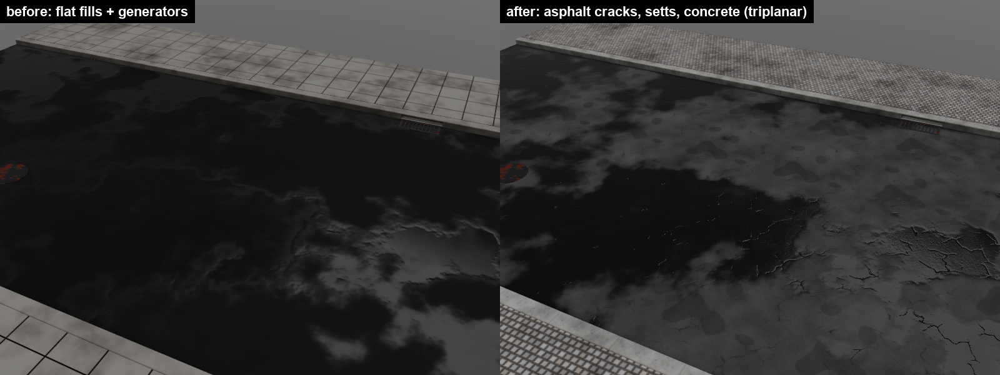
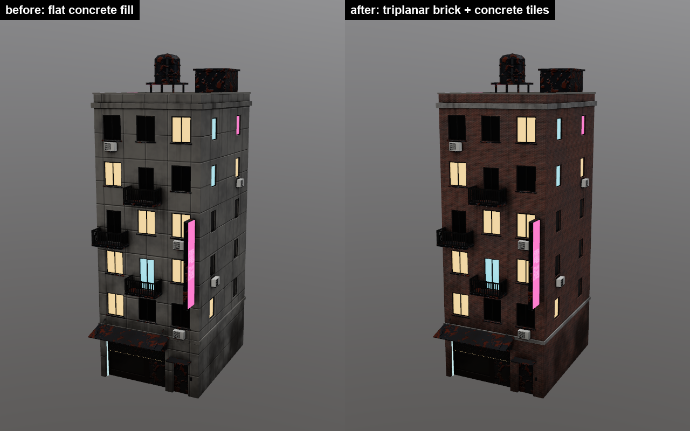
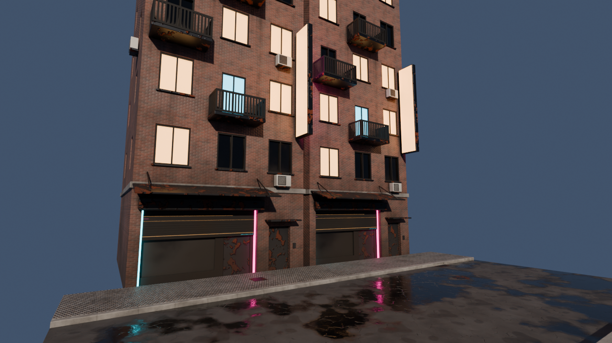

# Image fills (workstream `image-fills`)

Fill layers can take their base colour, roughness, height and normal from
tiling images instead of flat values, projected in UV space or triplanar in
world space.

## What was built

- **Data model** (`crates/core/src/image_fill.rs`): `Layer.image: Option<ImageFill>`
  (serde default, skipped when `None`, so old projects load unchanged).
  `ImageFill { images: ChannelImages { base_color, roughness, height, normal }: Option<String>,
  projection: uv|triplanar, tiling [u,v], offset [u,v] (tiles), rotation (deg), tile_size (m, triplanar),
  blend_sharpness, tint (sRGB), roughness_range [lo,hi], height_scale, normal_strength }`.
  Only fill layers use it. Paths are stored as written. Relative paths resolve
  from the project folder and its parents, then the mesh folder and its
  parents, then the working directory, so `assets/tiles/brick/normal.png`
  works for projects saved in the repo. `ImageFill::from_tile_set(dir)` picks up
  `base_color/roughness/height/normal.png` (plus common aliases).
- **GPU** (`render/tile_images.rs`, `render/texset.rs`, `shaders/composite.wgsl`):
  - Images load on demand with a CPU-built mip chain. Colour is filtered in linear light, and height is kept at 16 bits (Rgba16Float).
  - Fill layers don't use the paint-layer channel slots, so the images are bound *in those slots* (now filterable) with one new repeat/aniso sampler at binding 8. This adds no sampled textures, so we stay at the 16-per-stage limit.
  - Sampling uses `textureSampleGrad` with analytic gradients, so mips and anisotropic filtering work in the texture-space pass. For UV mode the gradients come from tiling/res. For triplanar they come from the world-position map's texel steps.
  - Triplanar: three non-mirrored planar projections, weighted by `|N|^sharpness`. The normal maps are applied UDN-style in world space, then converted into the texel's tangent frame, which is derived from the position map (`dP/dcolumn`, `-dP/drow`). That is the same convention the finalize pass uses for height-to-normal.
  - Image channels that fail to load fall back to the flat value (logged).
- **MCP**: an `image` arg on `add_layer` / `update_layer`:
  - `"image": "assets/tiles/brick"` sets a whole tile set.
  - `"image": null` removes the image fill.
  - `"image": {tile_set?, base_color?, roughness?, height?, normal? (path or null), projection, tiling (n or [u,v]), offset, rotation, tile_size, blend_sharpness, tint, roughness_range, height_scale, normal_strength}` changes only the given fields.

  Setting an image enables that channel on the layer. Missing files give an error. `list_layers` shows `image`, and `list_library` lists `tile_sets` and `image_projections`.
- **UI**: an "Image fill" section under "Fill material" on the Layer tab. It has a tile set picker (from `assets/tiles` or a browsed folder), projection, tiling or tile size and sharpness, offset, rotation, tint, roughness range, height scale, normal strength, per-channel image pick/clear, and a warning for missing files. It was checked by compiling only (no GUI windows were opened, per the rules).
- **Tile library** (`assets/tiles/<set>/`, generated by `tools/make_tiles.py`, 512 px, seamless, ~23 MB in total):

  | Set | Tile size | Description |
  |---|---|---|
  | `concrete_slab` | 2 m | formwork joints, tie holes, stains |
  | `brick` | 1 m | running bond, 4 x 14 courses |
  | `paving_setts` | 1 m | granite setts |
  | `corrugated_metal` | 1 m | 12 waves, rust |
  | `asphalt_cracks` | 2 m | crack network, patches |
  | `wallpaper_damask` | 1 m | flocked damask, half-drop repeat |
  | `wallpaper_stripes` | 0.5 m | regency stripe with satin bands and gold pinlines |
  | `wallpaper_floral` | 0.6 m | scattered blossoms and leaves on cream |
  | `wallpaper_art_deco` | 1 m | gold fans on deep teal |
  | `wallpaper_trellis` | 0.5 m | diamond lattice, mustard on charcoal |
  | `carpet_plush` | 1 m | cut pile, neutral greige (tint it) |
  | `carpet_berber` | 0.5 m | flecked loop pile |
  | `carpet_tiles` | 1 m | 50 cm office tiles, quarter-turned |
  | `carpet_hotel` | 1 m | red and gold quatrefoils on navy |
  | `wood_planks` | 1 m | oak boards, 14 cm, random joints |
  | `parquet_herringbone` | 1 m | 6 x 25 cm oak slats |
  | `floor_checker` | 1.2 m | black and white marble, 30 cm |
  | `floor_hex_tiles` | 1 m | white hex mosaic with black accents |
  | `terrazzo` | 1 m | polished chips in cream cement |
  | `marble` | 2 m | white veined slab |
  | `diamond_plate` | 1 m | steel tread plate |
  | `rubber_studs` | 1 m | studded rubber flooring |
  | `subway_tiles` | 0.9 m | glossy white 7.5 x 15 cm tiles |
  | `plaster` | 2 m | hand-trowelled, off-white (tint it) |
  | `wood_grain` | 1 m | plain oak grain along x |
  | `leather` | 0.3 m | pebble grain, mid tan (tint it) |
  | `linen` | 0.1 m | plain weave |
  | `denim` | 0.1 m | 3/1 indigo twill |
  | `carbon_fibre` | 0.05 m | 2x2 twill |
  | `hammered_metal` | 0.5 m | dimpled sheet, neutral grey (tint it) |

  The wall, floor and surface smart materials (`smart_material_groups` in `document.rs`) are built on these sets with `Document::tiled_fill`: triplanar at the set's size, so they need no UV scaling.

  Each set has an sRGB base colour, roughness, a 16-bit height and an OpenGL normal made from the height. Run `python tools/make_tiles.py --size 1024` for close-ups.

## Proof

- `scenes/town/image_fill_demo/street_segment_tiles.jsonl` is the original street stack with these changes:
  - triplanar `asphalt_cracks` on the road (2 m);
  - `concrete_slab` on the curbs;
  - `paving_setts` on the sidewalks, replacing the flat concrete and panel-line joints.
- `scenes/town/image_fill_demo/building_a_tiles.jsonl` is the original building_a stack with triplanar `brick` (1 m) on the shell (part 1) and `concrete_slab` on the floor bands (parts 39, 40).
- Run both with `pigment-mcp --script ...`. They render with the MCP `render` tool, export to `scenes/town/textures/<asset>_tiles/` (git-ignored) and save `.pigment` projects next to the scripts (git-ignored). Re-opening the saved project re-resolves the relative tile paths.
- Blender: `blender -b --factory-startup --python tools/render_image_fill_demo.py`. It imports both assets, applies the exported maps with `tools/blender_pigment.py: apply_pigment_material`, and renders `blender_tiles.png` (Cycles, OptiX).

## Tests

- core: serde defaults and round trip, old projects without `image` load, tile-set resolution from project parents, projection ids.
- app (`app/image_fill_tests.rs`, GPU via `Session`):
  - MCP args produce brick-red texels and a bent normal map;
  - UV mode and tint work;
  - errors for a missing file, a paint layer and an unknown projection;
  - save/open keeps the fill, and `null` removes it.
- `image_normals_agree_with_image_height`: for UV (rotated 30°) and triplanar, the final normals from a tile's normal map correlate (> 0.5, x and y) with the normals Pigment derives from the same tile's height map. This checks the frame and sign conventions.
- `cargo test --release -- --test-threads=1`: all green (core 67, app 30). With ten agents sharing the 12 GB GPU, the parallel default sometimes fails GPU tests with `wgpu error: Out of Memory`. That is environmental: the same tests pass when run serially.

## Known limits

- Images are referenced, not copied into the `.pigment` folder. A project moved away from the repo needs absolute paths, or the tiles next to it.
- One image set per layer. The four channels share one transform, and there is no per-channel tiling.
- The triplanar tangent frame comes from position-map differences. On the 1-texel border of UV islands that touch another island in UV space, the normal or mip choice can be slightly off.
- Non-uniform UV tiling doesn't rescale the normal-map tilt.
- If a tile set has both height and normal and both channels are on, the bump is applied twice (height goes through Pigment's height-to-normal, and the normal map is combined on top). Lower `height_scale` or turn one channel off if it looks too strong. The demo uses small height scales on purpose.
- The `assets/tiles` list in the UI and `list_library` is relative to the working directory.

## Merge notes (hot files touched, additively)

- `document.rs`: the new `Layer.image` field, plus `image: None` in the two `Layer { .. }` literals.
- `texset.rs`:
  - new `LayerParams` fields at the end (`img*`);
  - `image_fill_params()`;
  - the `tiles` field;
  - the layer bind group layout: channel slots 0-5 are now `ftex` (filterable), and a sampler was added at binding 8;
  - extra bind-group entries.
- `composite.wgsl`:
  - new `LayerParams` fields (must stay in the same order as the Rust struct);
  - `img_samp` binding 8;
  - the image-fill functions before `fs_layer`;
  - one block in `fs_layer`.

  If another workstream also appends to `LayerParams`, keep the Rust and WGSL orders identical, and stay under the 512-byte stride (now 384 bytes).
- `automation.rs`: `configure_image()` plus small hooks in `configure`, `layers` and `library`. `pigment-mcp.rs`: the `image` schema. `ui.rs`: one call in `layer_tab` plus `image_fill_editor()` at the end of the file. `app.rs`: `image_bases()` and one line in `ensure_composited`.
- No textures need regenerating for the existing town scripts (they are unchanged). To adopt tiles in the main town pipeline, port the layer swaps from the demo scripts into `tools/town_textures.py`.
