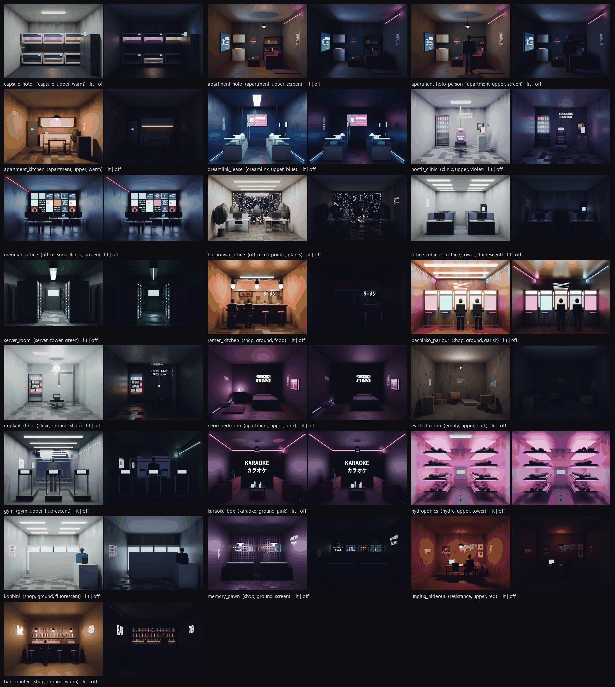

# Interior-mapped windows ("parallax windows")

Every window pane in the town and the open world now has a room behind it: 22 futuristic rooms
from the story world. They are built in headless Blender, textured in Pigment over MCP, rendered
with Cycles, and packed and graded by a new Pigment tool. Three shaders show them: Godot kit
buildings, Godot tower facades, and the far proxies. A Blender node setup does the same for
Cycles. No OSL is used.



| image | what |
|---|---|
| `rooms_contact_sheet.png` | All 22 rooms, lit and off layers, as packed in the atlas |
| `godot_parallax_two_angles.png` | Godot, night: building_c offices from two camera positions. You look up into the rooms (ceilings, light panels) and the view shifts with the camera |
| `godot_before_after.png` | The same view with `--no-interiors` (flat lit panes) and with interiors |
| `godot_tower.png` | A tower facade close-up: offices and server rooms behind the 2 m x 4 m pane grid |
| `godot_skyline_bridge.png` | The far skyline from the bridge (facades and proxies) |
| `blender_street.png`, `blender_street_before_after.png` | Cycles street of kit buildings with the node setup, before and after |

## Technique: pre-projected rooms plus depth, ray-marched

I picked the pre-projected single-image format over the five-face atlas. With five faces,
furniture is flattened onto the walls. With a pre-projected image, the furniture is rendered in
perspective, and the depth channel gives it real parallax.

- **Room.** A box `W x H` at the window plane, `D` deep (metres). Every room is authored as 4 x 3 m
  (4.5 x 3 m for offices) and 4–6 m deep.
- **Image.** What a pinhole camera sees from `E` metres in front of the window, on the room axis,
  with its frustum through the front rectangle. A room-space point `q` (x right, y up from the
  front centre, z ≤ 0 into the room) lands at:

  `s = E/(E - q.z)`, `uv = (0.5 + q.x·s/W, 0.5 - q.y·s/H)`

- **Alpha.** The depth of the surface seen, `-z/D`, from 0 at the window to 1 at the back wall.
- **Shader** (`game/scripts/interior_common.gdshaderinc`):
  1. Put the fragment on the pane in metres, and the view ray in pane tangent space.
  2. Find where the ray leaves the box.
  3. March 12 steps (5 at mid range, 0 far away) and project each sample into the image. The
     first sample that lies behind the stored depth is the hit, refined with a secant step.
  4. Read the colour there, at a mip chosen from the screen footprint of the pane.
- **Layers.** Two per room: *lit*, and *off* (only screens, neon and city glow). Dim panes scale
  the energy.
- **Dressing.** A procedural overlay 6 cm behind the glass, seen with parallax: blinds lowered to
  a random height, or curtains drawn from the sides. Lit rooms backlight it in the pane's colour.
- **Glass.** The interior is emission × (1 − Fresnel). The reflection comes from Godot's PBR
  specular, environment and SSR, on a 0.03-roughness pane. Pigment's own grime on the glass
  (roughness above clean glass) dulls and greys it.
- **Room choice.** A hash of the pane's world centre picks the room, so neighbours and
  instances differ. Room size scales up for large panes. The pane sits on a 0.9 m sill, slightly
  off centre.

### Which windows show what

- **Lit or not** comes from the variant's own Pigment lit-window layers: the emission map
  sampled at the pane centre. Palettes, variant seeds and the evicted / seized "lights_few"
  variants are all kept.
- **Pane colour picks the room pool** (`INTERIOR_SETS` in `town_loader.gd`; the same lists are in
  `blender_interiors.py`):
  - tungsten panes → warm rooms;
  - fluorescent → cool rooms;
  - Meridian blue → screen rooms.
- **building_a / building_b.** Panes below 4.2 m are shops: ramen, pachinko, implant clinic,
  karaoke, konbini, memory pawn, bar. Upper floors:
  - warm: apartments, kitchenette, neon bedroom, capsule hotel, evicted, UNPLUG hideout;
  - cool: Noctis clinic, gym, hydroponics, Dreamlink;
  - screen: holo apartment, Dreamlink, MERIDIAN.
- **building_c** (corporate): Hoshikawa office, cubicles, server room, MERIDIAN.
- **Towers**: offices and server rooms (hydroponics rarely). Proxies use a mixed set.

## Rooms (22)

capsule_hotel, apartment_holo, apartment_holo_person (rare silhouette at the window),
apartment_kitchen, dreamlink_lease (sleepers wired to the ceiling, blue), noctis_clinic,
meridian_office (a wall of screens), hoshikawa_office (plants, city-view back window),
office_cubicles, server_room, ramen_kitchen, pachinko_parlour, implant_clinic, neon_bedroom,
evicted_room (dark, boxes, PROPERTY plate), gym, karaoke_box, hydroponics, konbini, memory_pawn,
unplug_hideout, bar_counter.

Silhouettes of people appear in several rooms: ramen, pachinko, bar, MERIDIAN operators,
Dreamlink sleepers and Noctis patients.

## Pipeline

All output is git-ignored, under `scenes/town/textures/interiors/` and `game/assets/interiors/`.

```
python tools/interiors/interiors.py all            # everything, ~15 min on the 4070 Ti
  build     blender -b rooms.py build   -> meshes/<room>.glb (one mesh, Smart UV, one part per piece) + <room>.json (role per part box, decals, lights)
  texture   Pigment script per room (scenes/town/scripts/interiors/<room>.jsonl, committed)
  render    blender -b rooms.py render  -> renders/<room>_{lit,off,depth}.png (Cycles, canonical camera, 768 x 576, 128 spp, OptiX denoise)
  pack      Pigment pack_interiors      -> interiors_atlas.png (512 x 512 x 44 layers) + interiors.json
  windows   Pigment export_window_map   -> windows/building_{a,b,c}_WindowMap.png + _panes.json
  sheet     docs/agents/interiors/rooms_contact_sheet.png
  sync      game/assets/interiors/ (atlas imported as a mipmapped, VRAM-compressed Texture2DArray)
then:  godot --headless --path game --import
```

Each stage can be run alone, for example `interiors.py render konbini gym`.

**City build.** `city/models/tile_set/interiors.toml` is the smart model:

- `mesh:interiors`: the rooms;
- `recipe:interiors`: `interiors.py scripts`, which writes every Pigment script;
- `pigment:interiors/<room>` and `pigment:interiors/windows`: the Pigment runs;
- `export:interiors`: `interiors.py finish`, which does the renders, pack, sheet and game copy.

So `python -m tools.city build interiors` works, and so does editing one room. All 31 nodes start
stale; run `city adopt interiors` in a checkout that already has the outputs.

### What Pigment does for each room (the MCP script)

- `new_project` on the room glb at 2048, then `bake`.
- One fill per material role, masked to that role's parts. The parts are matched from the Blender
  sidecar boxes against `list_parts`.
- Generators per role:
  - wood grain: `stripes`;
  - grout: `tiles`;
  - weave: `spots`;
  - stains: `grunge`;
  - peeling paint;
  - leaf veins;
  - a cut-out mesh cage;
  - the city-view window: emissive `spots`.
- Wear and grime: wall scuffs (`gradient`), wall stains (`leaks`), floor wear, furniture
  `edge_wear`, and an AO-driven `dirt` Grime layer.
- Every poster, screen and neon sign is a `project_decal` (position + normal + size) on a
  "Decals" paint layer. Screens and neon use `emissive_strength`.
  - Story decals: MERIDIAN / score / Dreamlink / Noctis billboards, UNPLUG and MISSING posters,
    PROPERTY / OBSERVED plates, graffiti, shop signs.
  - Props decals: holo ads, kiosks, ramen menu and noren, arrows.
  - Neon decals.
- Then `export_textures` (separate) and `send_to_blender` (sidecar), plus `save_project`.

Lights are Blender's: ceiling panels and bulbs switch with the room. Neon, screens and grow
lights stay on in the "off" layer.

## New Pigment features (MCP)

### `export_window_map`

`{dir, name?, parts: [ids] | shape query, resolution?, pad?=4, outward_from?, up?}`

- Writes `<name>_WindowMap.png`, a UV-space grey map holding pane index + 1. It switches to
  16-bit above 255 panes.
- Panes grow `pad` texels into the empty gutter only, never over other parts. A nearest lookup
  at a pane edge still finds its pane, and frames never turn into glass.
- Also writes `<name>_panes.json` with, per pane: part id, centre, outward normal, right and up
  (as seen from outside), size in metres, and the centre UV. The centre UV comes from a
  least-squares affine fit over the outward faces only, so the back face of a thin pane doesn't
  pull it off.
- This lets any single-material building, Pigment's own kit included, get per-pane interiors
  without new UVs or mesh changes.

### `pack_interiors`

`{dir, name?="interiors", cell?=512, base_dir?, grade?, rooms: [{name, size [W,H,D], eye?, lit | faces {back,left,right,floor,ceiling}, off?, depth?, grade?, off_grade?, tags?}]}`

- Packs rooms into one vertical texture-array strip: RGBA8, two layers per room (lit, off),
  alpha = depth.
- Also writes the room table (`<name>.json`: size, eye, layers, tags, mean lit colour).
- Colour grade: exposure, contrast around mid grey, saturation, tint, lift and vignette, in
  linear light. A pack-wide grade is applied first, then the room's own.
- Missing `off` means the lit image at 3 %. Missing `depth` means the empty box.
- **Five-face rooms** in the classic layout are reprojected into the same format, with analytic
  depth. Use this to bring in hand-painted faces.
- Needs no GPU and no project; it is handled before a session is created.

### Core

`crates/core/src/interior.rs`: `pane_frames`, `part_map`, `box_hit`, `project_faces`, `Grade`,
`pack_atlas`. It is pure and tested.

## Shaders and integration

- **`game/scripts/interior_window.gdshader`** (kit buildings).
  - Reproduces the old ORMMaterial3D: albedo / ORM / normal / emission, alpha scissor and wet
    roughness.
  - Adds the window map lookup (`texelFetch`), the pane table (an RGBAF texture built by the
    loader from `_panes.json`) and the interior.
  - Uses `MODEL_MATRIX` per MultiMesh instance.
- **`interior_facade.gdshader`** (world towers).
  - The `WorldFacade_*` image materials become this shader. Their metre UVs give the 2 m x 4 m
    grid, with curtain or punched pane sizes per style.
  - Lit panes follow a hash, as in the Blender facade material (20 %, 12 % for `glass_dark`), in
    the same palette.
  - It also fixes the facade tile scale: the old StandardMaterial repeated the 8 m tile every
    metre.
- **`proxy_building.gdshader`** (cheap path): lit cells show one parallax plane half-way into a
  room, at mip 4. One texture fetch.
- **`town_loader.gd`** (additive): `_interior_material` (hooked at the top of `material()`),
  `_interior_params`, `_pane_texture`, `INTERIOR_SETS`, and `interiors_enabled`.
  - Missing files, or headless runs, fall back to the old materials.
  - `main.gd --no-interiors` turns interiors off for A/B comparisons.
- **`live_link.gd`**: the texture, image and emissive-scale hot swap also updates the shader
  materials.
- **Blender** (`tools/interiors/blender_interiors.py`, `add_interiors(mat, asset, folder)`): an
  OSL-free node setup.
  - UV map → window map (Closest) → pane table image (float, per variant: frame converted to
    Blender axes, lit flag, tint, and a room per `Object Info > Random` bucket).
  - Texture Coordinate Object and Geometry Incoming (→ object space) put the point and ray in
    tangent space.
  - Box exit, a 6-step unrolled depth march, then an atlas read.
  - Emission × (1 − Fresnel) is added to the Pigment BSDF. The pane itself is made dark, glossy,
    solid glass.
  - Wired in through `apply_pigment_material(..., interiors="building_a")` and in
    `blender_town.py variant_materials`. That one is on when the atlas exists; set
    `TOWN_INTERIORS=0` to skip.
  - Demo: `blender -b --factory-startup --python tools/interiors/blender_street_demo.py -- out.png [samples] [--plain]`.

## Performance

**Atlas memory.** One Texture2DArray: 44 layers of 512², mipmapped, S3TC/BC (DXT5 keeps the depth
alpha). That is 15 MB. The window maps are lossless R8, under 5 MB. The pane tables are a few KB.

**`--bench-spots`, 1920x1080.** Three runs per side, alternating, on a machine shared with other
agents' builds and Blender renders.

| spot | fps before (3 runs) | fps after (3 runs) | GPU ms before (mean) | GPU ms after (mean) |
|---|---|---|---|---|
| avenue | 101 / 82 / 137 | 73 / 112 / 120 | 3.77 | 4.24 (3.64 / 3.72 without the first run) |
| bridge → skyline | 147 / 86 / 132 | 73 / 110 / 112 | 4.37 | 3.08 |
| lookout | 153 / 228 / 94 | 110 / 97 / 105 | 2.91 | 3.12 |
| drive 20 s | 53 / 65 / 57 | 101 / 64 / 65 | 4.79 | 4.55 |

**What this shows.** Measured GPU time is the same within noise, about 3–4.5 ms. The shader only
does the march on pane fragments, with 12 / 5 / 0 steps by distance. The fps here is CPU-bound
by machine contention: render-thread and process time doubled for *both* sides compared with the
perf workstream's own numbers. So I couldn't re-measure the absolute 180–250 fps from
`docs/agents/perf/NOTES.md` today. GPU headroom for 120 fps is unchanged.

**VRAM.** Godot reported about +0.21 GB with interiors on, in every run. The atlas itself is
15 MB, so most of that is pipeline / material state from the new shader materials. I didn't track
it down.

**`--interior-shots`** also records fps and GPU ms per view in `shots.json`.

## How to add a room

1. In `tools/interiors/rooms.py`, write a function with the `@room("name", tags, W=, H=, D=)`
   decorator. Build it from the helpers:
   - `shell`, `box`, `cyl`, `ball`;
   - furniture: `table`, `chair`, `sofa`, `bed`, `shelf`, `boxes`, `plant`, `person`, `rack`,
     `desk_station`;
   - `screen` / `monitor` (with a story-decal image), `poster`, `decal`;
   - `neon`, `lamp_panel`, `bulb`, `light`.

   Roles are `paint(rgb, rough, metal, grain/tiles/fabric/...)` or `glow(rgb, strength)`.
2. Run `python tools/interiors/interiors.py build NAME`, then `texture NAME`, `render NAME`,
   `pack`, `sheet`, `sync`. Then `godot --headless --path game --import`.
3. Add it to a pool in `town_loader.gd INTERIOR_SETS` (and `SETS` in `blender_interiors.py`).
   Optionally add an exposure trim to `ROOM_EXPOSURE` in `interiors.py`.

Limits: 32 rooms (`interior_dims[32]`), and 8 per pick list.

## Tests

- `cargo test --release -- --test-threads=2`: 78 passed, 3 failed, 9 ignored.
  - The 3 failures are the `decal_tools` tests that place decals on
    `assets/town/building_a.glb` ("no spot met the constraints", plus a texel-density assert).
  - This branch doesn't touch that code or that mesh. They fail on the branch base: the kit was
    regenerated by the decalfix workstream.
  - New tests, all green:
    - core: `interior::tests` (5): pane frames, map dilation that never covers other parts, the
      canonical projection, grade, and face reprojection + packing + errors;
    - app (GPU session): `window_map_of_the_town_building_finds_its_panes`. It uses the real
      building_a: every pane's centre UV reads back its own index, normals point outward, and it
      also covers `pack_interiors` without a project.
- `python -m pytest tools/city/tests`: 26 passed.
- Godot `--headless -- --drive-test`: pass. `--traffic-test=60`: **PASS**. Interiors are skipped
  headless, but every script compiles.
- Shots: `godot --path game --resolution 1920x1080 -- --interior-shots=<dir> --no-traffic [--no-interiors]`.

## Known limits

- **Close, oblique shopfront panes.** Some ground-floor panes are close to the camera and very
  oblique. There the near side wall fills the pane and reads as a flat pale colour (the
  pre-projected image has few texels there). Bright white rooms (konbini, clinic) make it
  obvious.
- **Disocclusion.** As with any single-view depth march, what hides behind furniture smears a
  little.
- **Lit/unlit is per pane** from Pigment's emission. The old "Curtains" grunge layer still sits in
  the emission map, but the shader replaces it with its own blinds and curtains.
- **Tower panes** are lit by hash, the same as Blender. Towers have no Pigment lit-window
  selection.
- **No Pigment viewport preview** of interiors (optional; not done).
- **Hoshikawa city view.** Its back window uses emissive `spots`, which read as a busy pattern
  rather than a skyline.

## Merge notes

- `main` has moved on by about 32 commits (foliage, trees, ...). Expect conflicts in:
  - `game/scripts/town_loader.gd`: my changes are additive. The hook is 6 lines at the top of
    `material()`, the proxy material gets `_interior_params`, and there is a new "interiors"
    section before "instances".
  - `game/scripts/automation.gd` / `main.gd`: new mode `--interior-shots`, `--no-interiors`.
  - `crates/app/src/bin/pigment-mcp.rs`: 2 schema entries, 1 dispatch arm, and a pre-session
    `pack_interiors` branch.
  - `automation.rs`: `mod interior_tools`.
  - `tools/blender_town.py`, `tools/blender_pigment.py`: small additive hooks.
- **Generated data** (git-ignored): run `python tools/interiors/interiors.py all`, then
  `godot --headless --path game --import`. Or copy `scenes/town/textures/interiors/` and
  `game/assets/interiors/` from this worktree.
- `game/.gitignore` gains `assets/interiors/`.
