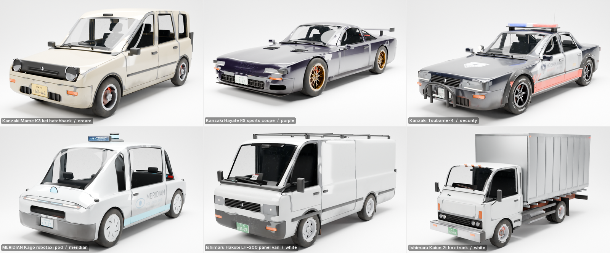
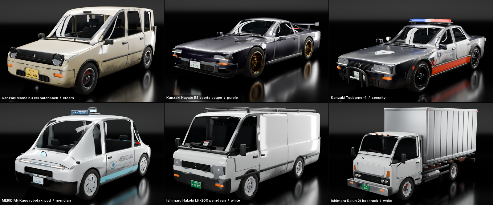
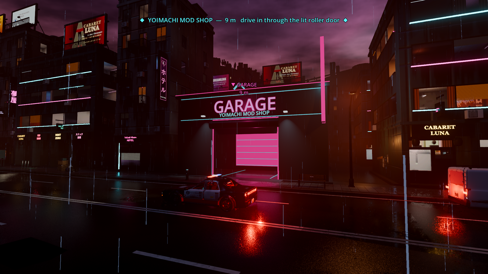
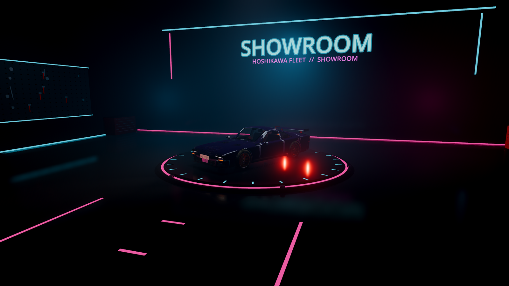
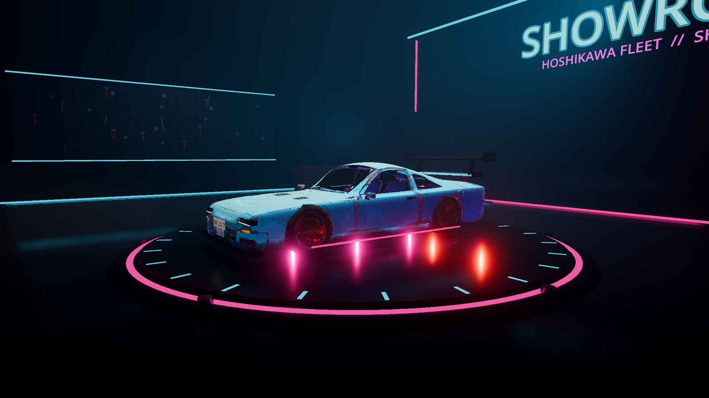
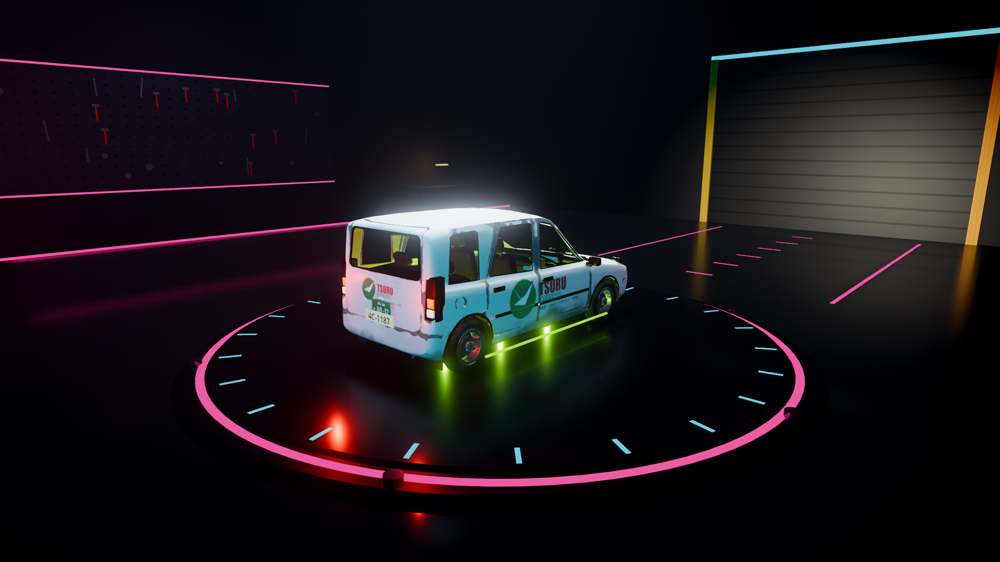
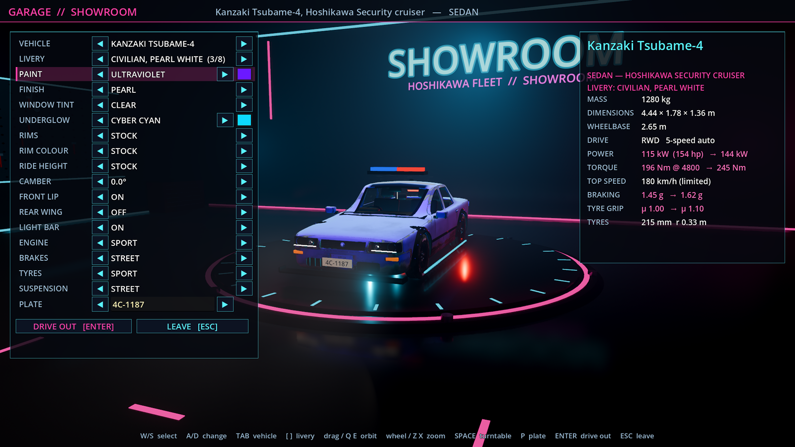

# Lightbox and showroom

## Blender lightbox

`tools/lightbox/lightbox_scene.py` is a headless Cycles studio for product shots of any glb in the repo: the six vehicles (with their liveries), props and town kit pieces. It works as a module (import it inside Blender) and as a CLI. `tools/lightbox/sheets.py` builds contact sheets with PIL. `tools/lightbox/make_hero_cars.py` rebuilds `docs/readme/hero_cars.png`.




### What it builds

- **Seamless cyclorama.** A floor curves through a quarter-circle cove into a back wall. It is made of 40 floor rows, 48 cove rows and 24 wall rows by 48 columns, all smooth shaded. Its size comes from the asset: the wall sits behind the circle the asset sweeps as it turns, so turntables and every preset keep the sweep behind the asset.
- **Two looks.**
  - `light`: a light-grey matte sweep with a big overhead softbox for the soft contact shadow. A key comes from front-left and a weak fill from front-right. A long thin strip high at the back puts a clean line on hoods and roofs, and a long horizontal strip at camera-right puts a line along the near flank. A wash lights the wall. Two black flags just out of frame stop white paint from turning to mush; they are invisible to the camera. Exposure is -0.3, so the floor stays just under clipping.
  - `dark`: a car-commercial look with a near-black glossy sweep. It has the same strip layout (two hood-line strips, a flank strip, a low front flank strip, thin vertical rims and a dim key), plus one large soft glow on the cove.
    - Through **light linking**, every light except the glow skips the sweep. The black mirror floor therefore shows the car's reflection and a soft horizon. It shows no rectangles from the lights.
- **Lights** are rectangular area lights scaled with the asset. Their energy scales with the square of the size, and they are hidden from the camera (`visible_camera = False`).
- **Camera presets:** `front34`, `side`, `rear34`, `rear`, `front`, `top` and `detail`.
  - The camera always looks along +Y at the sweep, and a preset turns the asset instead.
  - Framing is exact: `fit()` solves the perspective frustum in closed form against the asset's vertices, so the limiting pair of frame edges touches the asset at `1/pad` and the other pair is centred.
  - `top` dims the lights directly overhead, which would otherwise mirror into the roof.
  - `detail` frames the front-lower quarter (headlamp and front wheel) at 90 mm, f/2.8.
- **Render settings:** Cycles on OptiX GPU with adaptive sampling and OIDN denoise. The view transform is AgX with the Medium High Contrast look. Indirect clamp is 6.
- **Turntable:** the asset turns about its footprint centre and the camera and lights stay fixed. The camera is framed on the union of every angle, so nothing jumps between frames. `--anim` keyframes the turn linearly over frames 1..N, and `--blend` saves the scene.
- **Any glb.** Objects named `Collider*` are hidden. The asset is centred on its footprint and stands on z = 0, at the lowest visible vertex. Vehicles already have their origin on the ground.

### Liveries

Each vehicle glb carries its liveries as `KHR_materials_variants` on `Body` (see `docs/agents/fleet/NOTES.md` and `assets/vehicles/index.json`). Blender 5.2's glTF importer keeps them:

- `bpy.context.scene.gltf2_KHR_materials_variants_variants`: the variant names and indices, in the same order as `index.json`;
- `mesh.gltf2_variant_mesh_data`: one entry per mapping, with `material_slot_index`, `material` and the `variants` that use it.

`set_livery(asset, name_or_index)` assigns each mapping that lists the wanted variant to its slot. This is the importer's own "display variant", and the same method as `tools/vehicles/render.py`. If an imported mesh has no mapping data, it falls back to the material named `<id>_<variant>`.

### CLI

```
B="/c/Program Files/Blender Foundation/Blender 5.2/blender.exe"
L=tools/lightbox/lightbox_scene.py

# one still: preset, look, livery
"$B" -b --factory-startup --python $L -- still --asset hayate --preset front34 --look dark --livery racing --res 1600x1000
# any glb (props, town kit)
"$B" -b --factory-startup --python $L -- still --asset assets/props/vending_machine.glb --look light
# beauty grid of the six vehicles in both looks (grid_light.png, grid_dark.png)
"$B" -b --factory-startup --python $L -- grid --look both --res 960x600 --samples 160 --width 1600
# every livery of one vehicle
"$B" -b --factory-startup --python $L -- liveries --asset kago --look light
# all vehicles x all liveries, fleet_variants.png layout (rows mame..kaiun, 8 cells of 480x300 -> 1600x750)
"$B" -b --factory-startup --python $L -- fleet --look both --samples 64
# turntable: 8 frames + sheet; --anim keyframes it, --frames-dir keeps the frames, --blend saves the scene
"$B" -b --factory-startup --python $L -- turntable --asset tsubame --look dark --frames 8 --width 1600 --anim
# every camera preset of one asset
"$B" -b --factory-startup --python $L -- presets --asset hayate --look light
# props in both looks stacked into one file
"$B" -b --factory-startup --python $L -- grid --assets assets/props/ramen_cart.glb,assets/props/bus_stop.glb --cols 2 --look both --stack --out docs/agents/lightbox/props.png
# README hero, same 1600x1728 layout, lightbox sheet in place of fleet_variants.png
python tools/lightbox/make_hero_cars.py --sheet path/to/fleet_liveries_dark_nolabels.png
```

Common options:
- `--res WxH` sets the size of each image or cell. `--samples N` defaults to 128 for stills and 64 for livery cells.
- `--labels 0` turns off the cell labels. `--width N` sets the final width of a sheet.
- `--lod _lod1` picks a vehicle LOD. `--yaw DEG` adds a turn on top of the preset.

Sheets are composed by the system Python, because Blender's own Python has no PIL. The script finds it on `PATH`; set `LIGHTBOX_PYTHON` to override. `save_small` keeps every PNG under 1.5 MB. It tries full colour first, then 7 and 6 bits per channel (still true colour), and only then a 256-colour palette. The palette step shifts hues, so avoid it. The hero is saved at 6 bits per channel, 1.18 MB; the original was 2.2 MB at 8 bits.

As a module:

```python
import sys; sys.path.insert(0, "tools/lightbox"); import lightbox_scene as LB
LB.reset(); LB.setup_render((1600, 1000), 128)
a = LB.import_asset("hayate"); LB.set_livery(a, "racing")
LB.build_studio(a, look="dark")
LB.render(LB.shoot_camera(a, "front34", (1600, 1000)), "out.png")
```

### Proof

| file | what |
|---|---|
| `grid_light.png`, `grid_dark.png` | the six vehicles, default livery, `front34`, 960x600 cells at 160 samples |
| `fleet_liveries_dark.png`, `fleet_liveries_light.png` | all 47 liveries in the `fleet_variants.png` layout, labelled |
| `tsubame_turntable_dark.png` | 8 angles of the Tsubame-4 cruiser; the camera is fixed and the car turns |
| `props.png` | vending machine, ramen cart, data kiosk and bus stop, light look above and dark look below |
| `../../readme/hero_cars.png` | the README hero, rebuilt with the dark lightbox livery sheet (no labels) |

The hero keeps the original layout. The top 900 px are `pigment_ui_car.png`. A 78 px caption band follows, with the same text redrawn in Segoe UI and the ink widths matched to the original. The bottom is the 1600x750 livery sheet.

### Known limits

- **Town kit.** The meshes in `assets/town/*.glb` carry no textures; Pigment exports them into a git-ignored folder. They render as white clay, which disappears into the light sweep, so the proof uses props. Apply `tools/blender_pigment.py` materials first for textured buildings.
- **Paint.**
  - The fleet paints are rough metallic base plus coat, from textures. Under big soft lights they show broad sheen as well as the strip lines; the dark look keeps the lights narrow to limit this.
  - Pale liveries in the light look read a little low in contrast. That is the honest result of white paint in a white room.
- **Blown areas.** Very white vans can reach the top of the AgX curve on the flank lit by the flank strip in the dark look, about 1 % of the cell.
- **Framing.** Framing uses the vertices of the visible meshes, so alpha-0 hidden parts still count, such as the Tsubame's light bar in civilian liveries. Wheels count too.
- **Rigs.** The light rigs are tuned for assets that face -Y (the repo's glTF +Z front). Other assets still frame correctly, but presets like `front34` then show a different side.
- **GPU sharing.** Livery sheets use 64 samples per 480x300 cell, enough after denoise at the sheet's final 200x125. Raise `--samples` for print.

## Godot showroom

The game has drive-in garages: three garages in the open world that you drive into to customise the car. The original showroom is still there, as a shortcut. Code: `game/scripts/garage/`, the pause menu in `game/scripts/pause_menu.gd`, lot data in `game/data/garages.json`.







### Garages in the city
- `yoimachi_mods`: **Yoimachi Mod Shop** (magenta and cyan). It is on road r40, near the spawn, at Godot (-654, 4.4, 82).
- `hoshikawa_downtown`: **Hoshikawa Motors** dealership downtown (cyan and white). It is on road r95, at (-131, 4.8, 219).
- `port_chop`: **Minato Chop Shop** in the port, an underground chop shop (orange and red, with hazard posts). It is on road r195, at (1385, 3.5, 966).
- `game/tools/pick_garages.py` picks each lot from `assets/world/world_layout.json` (Godot coordinates and mesh AABBs) and `world.json` (road widths, heightfield). A lot sits behind the sidewalk of a straight, flat street or avenue, at least 30 m from junctions. Another road, a lamp, pole, signal, tower, warehouse, bridge or crane must not touch the lot, and the terrain must not rise into the floor.
- The city is built wall to wall, so a lot may replace ordinary buildings with their footing, shop signs, alley lights and street clutter. These are listed in `remove` and `remove_lights`. `Garage.prepare()` hands them to the town loader before `load_town`, through the new `skip_instances` and `skip_lights`.
- Re-run the picker after the world is regenerated. The world export and `tools/world/` were not changed.
- `garage_exterior.gd` builds each garage, with collision:
  - foundation, walls and roof;
  - an apron over the sidewalk gap;
  - a lit bay behind a half-rolled roller door, with an LED frame and lamps over the apron;
  - a neon **GARAGE** sign plus the shop name on the facade, and a vertical blade sign at the corner that reads along the road;
  - a bobbing chevron marker, and an `Area3D` trigger inside the bay.
- Within 70 m the HUD shows "◆ <shop> — 42 m  drive in through the lit roller door". A screen-space "▼ GARAGE / n m" tag stays on the door within 400 m.
- Parked traffic cars spawned on a driveway are removed after traffic setup.

### Interior (`garage_interior.gd`)
- It is a dark lightbox, built in code at (6000, 800, 6000), outside the world, with its own `Environment`.
- The set:
  - a glossy floor that sweeps through a 3.6 m cove into the back wall;
  - SSR and a box-projected `ReflectionProbe`;
  - neon strips: the cove edge, back-wall verticals, floor corners and ceiling bars;
  - a softbox panel over the turntable, with a soft-shadow (PCSS) key spot;
  - magenta and cyan fills, a rim spot and cove uplights;
  - a light volumetric haze;
  - a turntable lift with a neon ring and ticks;
  - pegboard tool walls with wall washes, red tool chests, tyre stacks and workbenches;
  - the roller door you came through;
  - the shop name in neon on the back wall.
- The interior lights have `light_specular = 0`. Highlights on the paint come from the emissive panel and strips, through SSR and the probe. Point-light specular showed up on the mirror floor as big blobs.
- While you are inside:
  - the world environment, moon, rain, HUD and traffic are switched off, and restored when you leave;
  - the player car is frozen on the turntable, with collision and processing off.

### Controls
| Input | Action |
|---|---|
| drive into a garage door | Enter (with a fade). |
| ENTER | Drive out with the changes; they are saved. You are placed on the apron outside the door, facing the road. |
| ESC (inside) | Leave without the changes. |
| **V** | Open the garage anywhere as a showroom. Leaving puts the car back where it was. V was free; G is GI. |
| **ESC** / pad Start | Pause menu: RESUME, GARAGE / SHOWROOM, QUIT. ESC used to quit straight away. |
| W/S or Up/Down | Select a row. |
| A/D or Left/Right, or the ◀ ▶ buttons | Change the selected row. |
| TAB / Shift+TAB, PgUp / PgDn | Next / previous vehicle. |
| `[` `]` | Previous / next livery. |
| mouse drag, Q/E | Orbit. |
| mouse wheel, Z/X | Zoom. |
| SPACE | Turntable on / off. |
| P, or click the plate | Edit the plate. |
| colour swatch next to PAINT / UNDERGLOW | Open a colour picker. |

The rows are: vehicle (every fleet vehicle in `assets/vehicles/index.json`), livery (every variant), paint (off or a 12-colour palette, plus a custom picker), finish (stock / pearl / chrome / matte), window tint, underglow, rims, rim colour, ride height, camber, front lip, rear wing, light bar, engine, brakes, tyres, suspension and plate. The right panel shows the specs from the real (not "easy") physics data: mass, dimensions, wheelbase, drive and gearbox, power at rpm, torque at rpm, top speed (gear, drag or limiter), braking g, tyre grip and tyre size. Tuned values appear as `stock → tuned`.

### How it works
- **Vehicle swap at run time.**
  - `garage.build_car()` does what `--vehicle=<id>` does: `car.gd` `setup(glb, json, id)`. The physics come from `data/vehicles/<id>.json` and the class defaults.
  - `install_car()` makes the new car `main.car` and rewires the chase camera, HUD and tach, impact and bump shake, the town's `collision_focus`, the traffic hero RID and collision mask, and the garages' player.
  - The old car is freed. The legacy hero car is rebuilt from its fleet glb the first time you enter.
- **Livery.**
  - It uses the fleet_variants swap: the `gltf_variants` meta from `addons/fleet_variants/vehicle_variants.gd`. Without that, the `<id>_<variant>` materials come from a runtime glTF parse.
  - The material goes onto the car's mesh copies by node name (`fleet.gd`).
- **Paint** (`car_paint.gdshader`).
  - It replaces the body material, with every texture and parameter copied from the livery's `StandardMaterial3D`, including the glTF emission multiply.
  - Texels close to the livery's paint colour are recoloured and keep their shading, so decals, wear, trim and glass stay.
  - The paint colour is found once per livery. The body mesh is binned into its outer shell: the highest up-facing triangle per 8 cm cell, and the outermost side-facing triangle per cell. The albedo is sampled under that shell, and the most common colour that shows on both the top and the sides wins.
  - The finish changes roughness, metallic and clearcoat inside the mask; pearl also adds a grazing-angle sheen. Window tint darkens the see-through part of the atlas.
- **Wheels.** The `Wheel_*` meshes come from another vehicle's glb, scaled to this tyre's radius and width. Rim colour uses the same shader in "bright metal" mask mode, so the tyres stay black. Camber adds a `Camber` node between `car.gd`'s steering pivot and its spinning meshes.
- **Physics.** Changes are applied relative to the values the car was built with (meta `tune_base`), so they never compound:
  - engine torque curve and peak ×1 / 1.12 / 1.25 / 1.4 (the torque look-up table is reset);
  - brake torque ×1 / 1.12 / 1.25 / 1.4;
  - tyre μ ×1 / 1.05 / 1.10 / 1.16, plus 0.8 % per degree of camber;
  - springs and anti-roll bars ×1 / 1.12 / 1.25 / 1.4, dampers ×√ of that;
  - ride height: −2 / −4 / −6 cm, which moves the hubs up in the body.
- **Body kit.** The lip, wing and light bar are made from boxes sized from the body's vertices: nose height, rear-deck height and roof. The light-bar lenses flash with `car.gd`'s L light bar. Plates are `Label3D`s on plates at both ends.
- **Save.**
  - Leaving with ENTER writes `user://garage.json` (or the `--garage-save=<path>` file).
  - On a normal launch, `garage.setup()` builds the player car from the save: "garage: loaded the saved car ...". This was tested with a hand-written save.
  - Automation flags (`--drive-test`, `--traffic-test`, `--autoshot`, `--vehicle`, ...) and `--no-garage-save` ignore the save.

### Flags and tests
- `--showroom-test` is headless, and `--fixed-fps 120` makes it faster. It prints `SHOWROOMTEST {...}` and `SHOWROOMTEST PASS/FAIL`; exit code 0 means pass. It takes about 20 s of game time.
  - It opens the garage and cycles **6 vehicles and 45 liveries**. For each, it asserts that the car was rebuilt with that vehicle's physics id, parked on the turntable, and that the Body material is the livery's.
  - It applies all **11 categories** and asserts each effect:
    - paint: shader params, plus the livery textures kept;
    - finish and tint params;
    - underglow lights and their colour;
    - a rim mesh from another vehicle, and the rim shader;
    - ride height on `w.rest`, and the camber node;
    - the lip, wing and bar nodes;
    - performance factors on `P.engine.peak_torque`, `P.brakes.max_torque`, `w.mu` and `w.k`, which stay put when applied again;
    - the plate text;
    - that the save round-trips, and that a car built from the save matches.
  - It drives **every vehicle about 8–15 m** in the city after driving out.
  - It **drives into all three garages** through the door: the trigger must open the garage. After that, the car must stand outside the door, facing the road, and drive off.
- `--showroom-shot=<dir> [--shots=ext,wide,custom1,custom2,menu] [--shot-garage=<i>]` opens a short-lived window, saves 1600-px PNGs and quits.

Results on this branch:
- `--showroom-test`: PASS (6 vehicles, 45 liveries, 11 categories, 6 drives, 3 garage entries).
- `--drive-test`: all checks pass.
- `--traffic-test=60`: PASS.
- `--road-clear-test`: `body_hits` `{}`, so no garage geometry is on any lane.

### Limits
- Garages exist on the open-world map only. The small `--map=town` has no lots in `garages.json`, but V still opens the showroom there.
- The paint mask is a colour match. Liveries whose decals share the paint colour get recoloured with it, and two-tone liveries recolour only the main tone.
- Rim swaps scale another car's wheel. A narrow donor on a wide car looks stretched.
- The kit parts are simple boxes, not modelled parts. The lip is placed from the body's lowest nose vertex, and can float or clip on unusual bumpers.
- Camber is mostly visual: it gives 0.8 % more μ per degree, and the tyre model has no camber thrust.
- Calipers do not follow camber.
- Inside the garage, traffic is paused (its process mode is disabled). Cars resume where they were.
