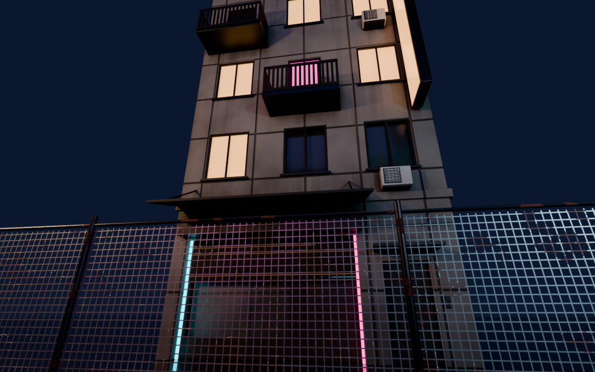
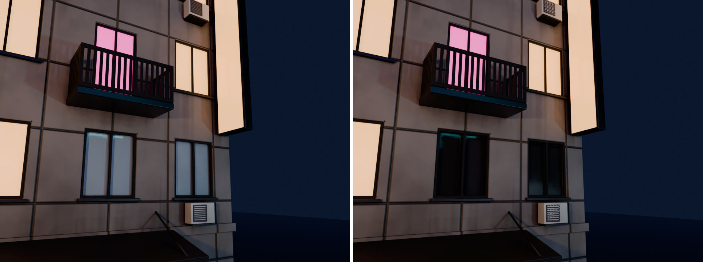

# Opacity / transmission channel

Pigment can now make glass and cut-outs. Two new channels run through the whole pipeline:

- **Opacity** is alpha: 1 = solid, 0 = a hole. Use it for fences, grilles and perforations.
- **Transmission** is glass: 0 = opaque, 1 = clear, refracting glass.

`opacity_fence_street.png`: building_a in Cycles, seen through the new chain-link fence kit piece. The fence panel is a single quad and the wire is a Pigment cut-out. `opacity_glass_before_after.png`: the same close-up rendered twice. On the left, Alpha and Transmission are unplugged. On the right they are wired. The unlit windows turn into see-through, reflective glass. The lit windows stay solid emissive panes, and the AC grille becomes perforated. `pigment_viewport_fence.png`: the fence in Pigment's own viewport.

## What changed

- **Document (`document.rs`).**
  - New `Channel::Opacity` and `Channel::Transmission`, so `Channel::ALL` now has 8 entries.
  - `Channels.opacity/.transmission` and `MaterialValues.opacity` (default 1) / `.transmission` (default 0), all with serde defaults. Old projects load with both channels off.
  - Plain fills keep both channels off, the same way emission is handled, so a grime fill can't make glass solid again. A fill turns a channel on when its values aren't neutral (`MaterialValues::is_see_through`). Paint layers have both channels on, and they only act where something was painted.
  - New presets: Clear glass, Tinted glass, Frosted glass, Cut-out.
- **Compositor (`composite.wgsl`, `texset.rs`).**
  - Opacity accumulates in `acc_color.a` and transmission in `acc_rmh.w`. These alphas were unused, so no new render targets were needed.
  - They end up in the material colour texture's alpha and the ORM texture's alpha.
  - Paint layers gain two Rg8 textures (value + coverage), bound at group 2 bindings 8 and 9. Blend modes, per-channel opacity and masks work as for any other channel.
- **Device limit (`render/gpu.rs: device_descriptor`).**
  - The compositor now needs 18 sampled textures per shader stage, and wgpu's default limit is 16.
  - Every device (app via eframe's `WgpuSetupCreateNew`, the headless `Session`, the tests) now asks for `min(32, adapter limit)`.
- **Brush (`apply.wgsl`, `paint.rs`).**
  - A second apply pass (`fs_apply_extra`) writes opacity and transmission. The main pass is already at the 32-byte colour-attachment limit.
  - `BrushGpu.extra` holds the values and on/off flags. Undo snapshots cover all 8 textures automatically.
- **Viewport (`viewport.wgsl`, `viewport.rs`).**
  - The opaque pass discards see-through texels.
  - A second "glass" pass draws them with premultiplied-alpha blending, depth-tested but not written.
  - Opacity scales everything, so cut-outs vanish together with their reflections. Glass swaps diffuse for the background and hides it only by its Fresnel reflection.
  - New view modes: `opacity` and `transmission` (UI chip "Alpha").
- **Project files.** A layer folder can now have `opacity.png` and `transmission.png` (LA8), written only when something was painted.
- **Export (`export.rs`).**
  - The unreal (BaseColor), unity (Albedo) and godot (albedo) presets become RGBA with opacity in alpha.
  - `separate` adds `_Opacity.png` and `_Transmission.png` (L8).
  - When the material is fully solid, alpha is dropped (RGB, the same as before) and these maps aren't written. A stale map from an earlier export is deleted. `export_textures` now lists only the files actually written.
- **UI.** The brush and fill value grid has Opacity and Transmission rows with toggles. The layer channel list shows both new channels.

## MCP

- `add_layer` / `update_layer` `values`: `opacity`, `transmission` (also now documented: `emissive`, `emissive_strength`). Giving either key turns its channel on.
- `paint_stroke` and `project_decal` take a new `values` object with the same keys. Opacity and transmission given there are painted. Example: punch holes:
  `{"tool":"paint_stroke","args":{"points":[[0.4,0.5],[0.6,0.5]],"values":{"opacity":0},"channels":["opacity"]}}`
- `channels` / `blend` accept `opacity` and `transmission`.
- `render` `view`: `opacity`, `transmission`.
- `list_library` materials report `opacity` and `transmission`.

Recipe for real glass: `values: {base_color: [0.6,0.7,0.75], roughness: 0.03, opacity: 0.3, transmission: 1}`.

Recipe for a perforated cut-out (`tools/town_textures.py: perforated`):
1. A "Cut-out" fill on the part, with only the opacity channel on.
2. A fill with `values: {opacity: 1}` masked by a `panel_lines` generator, which brings the bars back.

Don't use `invert` for this. A mask's `invert` also inverts its `parts` selection, so the holes would land on every other part.

## Blender (`tools/blender_pigment.py`)

- `_Opacity.png` goes to Principled **Alpha** and `_Transmission.png` to **Transmission Weight** (IOR 1.5). Sockets are looked up by name/identifier first, then by socket type with a name match.
- `configure_see_through(mat, alpha, transmission)` sets Blender 5.2's `surface_render_method = "DITHERED"`, plus `use_raytrace_refraction` and `thickness_mode = "SLAB"` for thin panes. Each property is set only if it exists. The legacy `blend_method` / `shadow_method` are set where present (before 4.2). Cycles needs nothing.
- Test: `blender -b --factory-startup --python tools/test_blender_pigment.py` has a new glass/cut-out case and passes on 5.2.2.

## Town

- Building windows: the old "Dark glass" layer is now a "Glass" layer (opacity 0.3, transmission 1, roughness 0.03). The lit-window emissive layers set `opacity: 1, transmission: 0`, so they stay solid glowing panes over the glass.
- AC fan grilles are perforated (30 holes/m).
- New kit piece `assets/town/fence.glb` (`tools/make_fence.py`): 3 m welded-wire fence with posts and rails, 16 cells/m, 1 cm wire, rust and grime. To texture it, run `python tools/town_textures.py fence`.
- `town_textures.py` honours `PIGMENT_MCP=<path to pigment-mcp.exe>`.
- Demo: `blender -b --factory-startup --python tools/opacity_demo_blender.py -- [out_dir] [samples]` (Cycles, OptiX, about 30 s).

## Testing

- `cargo test --release`: all tests pass.
- New tests:
  - core: `opacity_and_transmission_are_off_on_plain_fills_and_old_projects_load`
  - core: `opacity_goes_to_base_color_alpha_and_separate_maps_only_when_used`
  - GPU / session: `glass_and_cut_outs_flow_through_fill_brush_viewport_export_and_save`. It covers fill values, export values, RGBA unreal export, a viewport difference, a brush-painted hole, and save then reopen.
- Under heavy GPU sharing (other agents' tests) the session tests can hit `wgpu error: Out of Memory`. They pass with `-- --test-threads=2`.

## Limits

- The viewport's transparent pass is not depth-sorted. Overlapping glass within one mesh blends in draw order. Glass doesn't tint or refract what's behind it in the viewport (Cycles and EEVEE do).
- Debug views show everything opaque.
- Transmission in the "unreal/unity/godot" presets isn't exported (those engines have no standard map). Only `separate` writes it.
- A paint layer now costs two more Rg8 textures (8 MB each at 2K, plus 2 in the brush scratch set).
