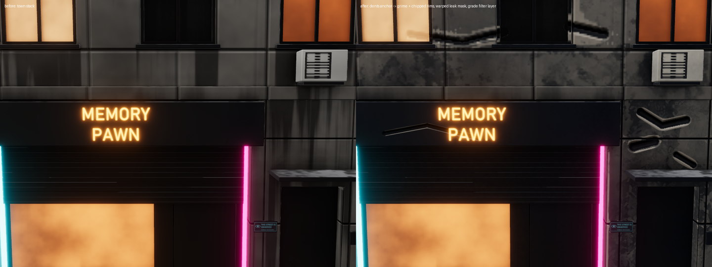
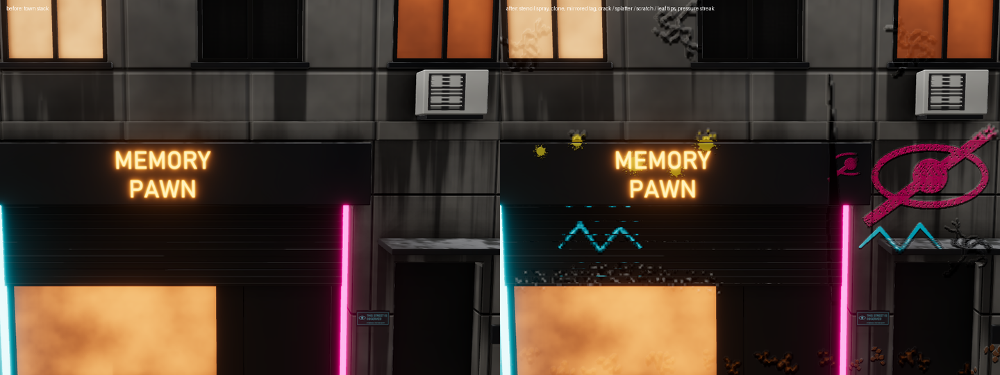
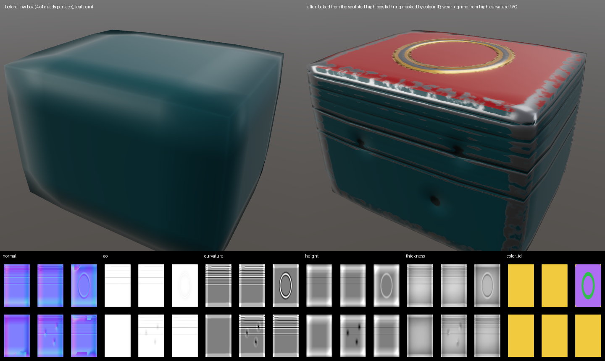
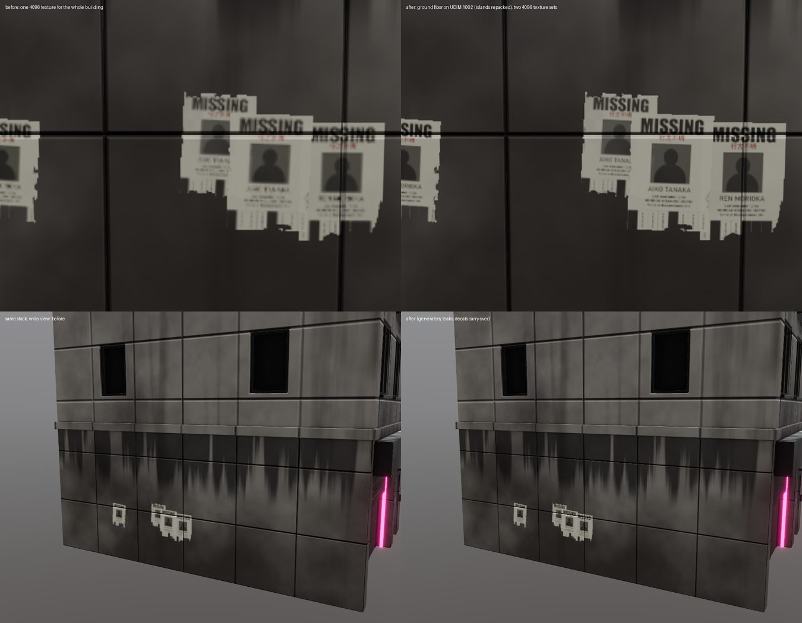

# Parity workstream: closing the gaps with industry-standard texture painters

Six features, done in order. Each section: what it does, MCP, UI, tests, proof, limits.

## 1. Filters / adjustment layers and anchor points

*building_a, 4096. Left: the town stack. Right: painted dents set as an anchor; grime gathers in them and the rims chip (both generators read the anchor's height); the Leaks mask is warped and slope-blurred; a Grade filter layer adds colour balance and roughness noise.*
Reproduce: `python docs/agents/parity/filters_demo.py 4096` (writes and runs `scenes/town/scripts/parity_filters_demo.jsonl`).

### What it does (`crates/core/src/filters.rs`)

**Filters** live in ordered stacks with enable toggles, in three places:

| where | runs on | gate |
|---|---|---|
| `Mask::filters` | the layer's evaluated mask (painted × generator × parts × invert) | – |
| `Layer::filters` | the composited stack right after the layer | the layer's mask (whole surface without one) |
| filter layer (`LayerKind::Filter`) | the stack below it | its mask × opacity |

Kinds: `levels` (in black / white / gamma, out black / white, per RGB and master), `hsl`, `color_balance` (shadows / midtones / highlights), `invert`, `clamp`, `blur` (separable gaussian), `directional_blur`, `sharpen` (unsharp mask), `warp` (world-space noise displacement), `slope_blur` (smear down the slope of noise or of the stack's height), `edge_detect` (Sobel), `height_to_normal` (keep the height = stronger bumps; off = convert height into normal detail and flatten it), `fill_holes` / `grow` / `shrink` (masks only), `noise_overlay` (MatFinish-style world noise on colour / roughness / height / mask). Layer filters have a `channels` list (default per kind).

**Seam-aware.** Every neighbourhood tap reads through the jump-flood padding map (`src_texel`), like the curvature blur: a tap that leaves a UV island takes the island's nearest texel, never background. Warp / slope blur / noise use world-space noise, so they are continuous across seams.

**Anchor points.** `Layer::anchor = Some(name)` on a layer or folder. After that step the compositor captures an Rgba16F texture: height, the anchor layer's mask × coverage × opacity, and colour luminance. Layers above read it through the mask generator's `input: {anchor, channel, strength, radius}`:
- every curvature-based generator (edge wear, dirt, grunge...) gets the anchor channel's *relief* (value minus its local ring average) added to its curvature: raised rims count as convex edges, dents as cavities. So edge wear follows painted scratches and dirt gathers in painted dents.
- the new `anchor` generator uses the channel directly as the mask (threshold = amount, softness, breakup).
An anchor can only be read by layers composited after it (checked by the MCP and offered that way in the UI).

**Persistence.** All new fields use serde defaults and are skipped when empty, so old projects load unchanged and projects without filters save byte-for-byte as before (test `old_projects_load_without_filters_or_anchors`).

### GPU (`render/texset.rs`, `shaders/filter.wgsl`, `composite.wgsl`)

- `LayerParams` grew by one `vec4` (`ext`: mask precomputed flag, anchor input mode, relief radius, strength): **496 of 512 bytes**. Further per-layer data must go into a storage buffer, as part masks did.
- A layer whose mask has filters, that has filters itself, or that is a filter layer has its mask evaluated once (`fs_mask_eval`) into `mask_cache[layer]` (R16F), then filtered by ping-pong over two scratch textures. The layer pass then binds the cached mask (`ext.x = 1`); the generator still runs for its side channels (height profile, jitter) when the ground options need them.
- Acc filters (`fs_filter_acc`) read the accumulation set (group 1), the filter's input (group 3) and a gate texture. Separable filters take two passes through a pool slot. Only the selected channels change; opacity, transmission, coat and flake never do.
- The anchor input texture is binding 15 of the layer / folder groups (22 sampled textures per stage, limit 32).
- **Partial composites (painting).** Spatial filters read neighbours that pool slots only hold where they were just written. So when filters are present, every pass is widened by the total reach of all filters and anchor lookups; the region shrinks as filters consume their reach, and the final pass still covers the rect plus everything the change can spread to. Persistent textures (mask caches, anchors) are only written where valid. Stacks without filters run exactly the passes they did before.

### MCP

| tool | args |
|---|---|
| `add_filter` | `layer`, `kind`, `target` (`layer` default / `mask`), `index`, plus filter fields: `radius` (texels at 2048, scales with resolution), `amount`/`strength`, `angle`, `scale`, `seed`, `levels {in_black, in_white, gamma, out_black, out_white}` (number = master, or `[r, g, b(, master)]`), `hue`, `saturation`, `lightness`, `shadows`/`midtones`/`highlights` `[r, g, b]`, `min`, `max`, `use_height`, `channels`, `enabled` |
| `update_filter` | `layer`, `target`, `index`, any filter field, `move_to` (a different `kind` resets the parameters) |
| `remove_filter` | `layer`, `target`, `index` |
| `set_anchor` | `layer`, `anchor` (name; default the layer's name; `null` removes) |
| `add_layer` / `update_layer` | `kind: "filter"` (default position: top), `filters: [...]`, `anchor`, `mask.input {anchor, channel: height\|mask\|color, strength, radius}` (`null` = bakes), `mask.filters: [...]`, generator `anchor` |
| `list_layers` | `kind: "filter"`, `filters`, `anchor`, `mask.filters`, `mask.input` |

Errors name the problem: unknown kind, a mask-only filter on a layer, an anchor that doesn't exist or isn't below the layer.

### UI

- Properties panel: a **Filters** section (filter cards with enable switch, move up / down, remove, the kind's parameters and a channel picker; *Add filter…*), and an **Anchor point** switch with a name field.
- Mask panel: **Input** (mesh bakes or *anchor · channel*, with strength and radius) under the generator, and **Mask filters**.
- Add layer menu: **Filter layer**. Filter layers show a sliders icon and their filters in the subtitle.
All built from `design::` components (lint test passes).

### Tests

- core: `filters::tests` (4): kinds round trip and targets, reach scaling, old projects unchanged, filters / anchors / generator input round trip, `anchors_below`.
- GPU (`gpu_tests_filters.rs`, flat quad with a hard gradient mask): mask blur softens, grow / shrink move the edge, disabled = identical; filter layer invert, opacity 0.5, inverted mask gate, levels; the `anchor` generator reproduces the anchor's mask; edge wear with anchor height finds the rim of a raised area only; **partial composites under blur + sharpen filter layers equal a full composite** (max diff ≤ 2).
- shaders: `shader_tests::filter` (naga).
- Session: `filters_and_anchors_over_mcp` (HSL / levels change renders, toggles, errors, input + mask filters, save / reopen identical, undo).
- UI: `filter_stacks_and_anchor_in_panels` (clicking a layer filter's and a mask filter's switch disables it).
- `ui_frame_timing` (4096): idle 1.15 / 1.35 ms, painting 3.5 / 4.1 ms (p95 8.6 / 9.7 ms), unchanged.

### Known limits

- Layer filters act on the stack *result* inside the layer's mask, not on the layer's content before blending; a blur on an unmasked paint layer therefore blurs the stack below too. Use a mask, or put the filter in the mask.
- Grow / shrink / fill holes use a square (separable) structuring element. Blur and morphology cap at 32 taps per side (larger radii are sampled sparsely).
- Seam-aware means "stays on its island", not "continues on the neighbouring island across the seam".
- A spatial filter at the top of a big stack widens every pass while painting (cost grows with the radius).
- Each anchor costs one Rgba16F texture (128 MB at 4096); each filtered mask one R16F texture.

## 2. Brush engine

*building_a, 4096, one `Brushwork` paint layer over the town stack: spray paint through a stencil (the crossed-eye mark), part of it cloned onto the pillar, a mirrored tag (symmetry X through the building's centre: the left copy is the mirror of the right one), crack tips with random angles and painted height, splatter on the shutter box, scratches whose angle follows the stroke, a pressure-ramped grime streak, leaves along the pavement.*
Reproduce: `python docs/agents/parity/brush_demo.py 4096` (writes and runs `scenes/town/scripts/parity_brush_demo.jsonl`).

### What it does

- **Dynamics** (`crates/core/src/brush.rs`, `DabGenerator`): pointer samples (position, pressure) become dabs with size, angle, opacity and flow. Spacing is a fraction of the *current* (pressure-scaled) diameter, and pressure is interpolated between samples. Pressure curves (`min`, `gamma`) drive size (on by default), flow and opacity. Jitter covers size, angle, position and flow, with a seeded RNG so strokes replay identically. The angle can follow the stroke. Lazy mouse: the brush trails the pointer by N px.
- **Flow.** At flow 1 a stroke never exceeds its opacity (max-blended stroke mask, as before). Below 1, dabs add up (an additive stamp pipeline) and the apply pass caps the mask at the stroke opacity.
- **Tips (alphas).** `tools/make_brush_tips.py` writes 11 procedural 256² grey stamps to `assets/brushes/` with an `index.json`: round, square, chalk, spray, splatter, cracks, scratches, grunge_1, grunge_2, leaves, dots. They load into a texture array and are sampled rotated by the dab angle. The default stays the analytic round falloff with hardness.
- **Pen input.** `egui::Event::Touch { force }` (winit maps pen and touch pressure on Windows) sets the pressure; lifting the pen resets it to 1, so a mouse paints at full pressure.
- **Line and path tools.** Shift-click paints a straight line from the end of the last stroke. Path tool: clicks add points (drawn as an overlay), Enter paints the polyline, Esc clears. Over MCP, `points` is the polyline.
- **Stencil.** A screen-space image (luminance × alpha) multiplies the brush coverage at each texel's screen position. It has opacity and invert. Hold **S** over the viewport: drag moves, Shift+drag rotates, wheel scales. The overlay shows the image.
- **Symmetry** (object space). Mirror planes X / Y / Z through the mesh centre (or a given centre) and radial copies around an axis, up to 16 transforms. A texel at *p* is painted when *T p* is under the brush and visible, so a stroke on the visible side also paints the hidden mirrored side. Tiles touched by mirrored dabs come from screen bins of the transformed mesh, so undo snapshots stay tight.
- **Clone** (Alt-click sets the source). The first stroke fixes the offset (aligned clone), and the apply pass copies the pre-stroke texels at `t + offset` in every enabled channel, coverage-weighted.
- **Smudge.** The stroke's direction in UV (raycast under the dabs) gives a drag vector, and each texel takes the average of the pre-stroke texels behind it along that vector, so colour is dragged along.

### GPU

- `stamp.wgsl`: `Stamp.params` = hardness, angle, tip layer (0 = round), flow. Group 0 adds the tip array, a sampler, the `Fx` uniform (16 symmetry matrices, flow mode, stencil placement) and the stencil image. A texel takes the max over symmetry transforms of the coverage of `T p` (screen projection, depth visibility and facing are all checked at the transformed point), times the stencil.
- `apply.wgsl`: `Brush.stroke` (opacity cap for flow strokes) and `Brush.tool` (clone / smudge, offset in texels, smudge taps).
- Painting stays smooth: `ui_frame_timing` at 4096 gives painting 3.96 / 4.55 ms (p95 9.9 / 10.8 ms) against 3.5 / 4.1 ms before.

### MCP: `paint_stroke` new optional args

`tip`, `pressure` (number or one per point), `pressure_size` / `pressure_flow` / `pressure_opacity` (bool or `{min, gamma}`), `spacing`, `flow`, `angle`, `follow_angle`, `jitter {size, angle, position, flow}`, `lazy`, `seed`, `symmetry {x, y, z, radial, axis, center}`, `stencil {image, center, rotation, scale, opacity, invert}`, `tool: paint | clone | smudge`, `clone_source: [x, y]` (viewport point), `smudge`. Every call starts from the defaults, so scripts replay exactly; a clone source persists until a non-clone stroke. `list_library` lists `brush_tips`. Old calls behave as before.

### UI

The Brush panel gains Tool (Paint / Clone / Smudge, segmented), Tip (library picker, angle, follow), Stroke (flow, lazy mouse, a Jitter section, a Pen pressure section with three curves, the Path tool button), Symmetry (X / Y / Z, radial count and axis) and Stencil (load / remove, opacity, scale, rotation, invert). The viewport handles Shift-click, the path, Alt-click and S-drag, and draws the stencil and path overlays (`app/brush_tools.rs`).

### Tests

- core `brush::tests` (6): spacing follows pressure, pressure ramps, seeded and bounded jitter, angle follows the stroke, lazy mouse trails, the symmetry group (mirrors, radial, cap 16), polyline resampling, pressure curves, UV under a ray.
- Session `automation::brush_tools::tests` (a flat quad): light pressure gives a thin stroke, a ramp lands in between; the square tip covers more than a round dab and the cracks tip much less; an unknown tip gives an error; low flow is fainter; position jitter covers more rows; symmetry X puts paint on both halves; a stencil lets paint through its white half only (checked on screen); clone copies a dot (and needs a source); smudge drags blue into the band beside a line.
- UI `brush_engine_pen_line_and_path`: touch force sets the pressure and lifting resets it; click paints, Shift-click paints a line; path clicks only add points and Enter paints once; the Brush panel renders with clone + symmetry; the tip library loads.
- The existing stroke, undo, seam and tile-wrap tests still pass.

### Known limits

- No pen **tilt**: egui / winit don't pass tilt through on this path. `InputPoint.tilt` exists for when they do.
- **Clone works in UV space.** Source and destination must be on the same UV island, or on islands laid out the same way; cloning between unrelated islands copies whatever lies at that UV offset. Industry-standard painters clone in screen space, which would need a screen-UV pass.
- Smudge pulls from the *pre-stroke* pixels, so one stroke smears what was there before it, not what it already smeared.
- Symmetry needs a symmetric mesh: the mirrored point must lie on the surface. Visibility is tested at the mirrored point, so hidden mirrored areas only get paint where the mirror is visible.
- **Particle brushes** (falling, dripping, spray-and-stick physics) are not implemented. They were optional, and I spent the time on features 3-6. Spray tips plus position jitter cover spray-and-stick looks.

## 3. High-to-low baking and ID maps

*The generated pair (`hibake::test_pair`): a bevelled box with 4 × 4 quads per face (low), and a sculpted high version with ~110k triangles: three dents on the front, a raised ring on the lid, grooves round the sides, and three materials (body, lid, ring). After the bake, the normal detail comes from the high mesh, the lid and ring are painted with **ID colour masks**, and edge wear and grime read the **high mesh's** curvature and AO. Bottom row: the baked normal, AO, curvature, height, thickness and colour ID maps.*
Reproduce: `python docs/agents/parity/hibake_demo.py`.

### What it does (`crates/core/src/hibake.rs`, CPU)

- **BVH ray caster** (median split, iterative traversal). It matches brute-force `Mesh::raycast` in the tests and is used for every map.
- The low mesh is rasterised in UV space (texel centres, barycentrics). Each texel casts from the **cage** (`p + n * cage`) inward along `-n` over `2 * cage`, so detail on both sides of the low surface is found. Texels whose ray misses (corners where the high surface strays past the cage) take the nearest surface along ±n. Hit rate on the test pair is about 100%.
- **Auto cage**: 1.25 × the 98th percentile of the gap from the high vertices to the low surface (rays both ways along the high normals). A fixed `cage` in metres overrides it.
- **Maps**:
  - `normal`: tangent space, OpenGL / +Y up, the same convention as Pigment's normal maps and image fills;
  - `normal_object`, `position` (normalised to the bounds);
  - `height`: signed distance along n, 0.5 = on the low surface;
  - `ao`: cosine-weighted Hammersley rays on the high mesh, with a max distance;
  - `curvature`: per-vertex mean curvature of the welded high mesh, interpolated, 0.5 = flat;
  - `thickness`: inward cone rays, 1 = thick;
  - `color_id`: high-mesh material, or its vertex colours with `id_source: vertex_color`;
  - `material_id`: the low mesh's own materials, no high mesh needed.
- All maps are written in parallel (`std::thread::scope`) and dilated 4 texels into the gutter. The 2048² bake of the test pair with 8 maps takes about 6 s.
- **Meshes carry materials**: `Mesh::tri_material` / `material_names` (glTF primitive materials, OBJ `usemtl` + `.mtl`) and `colors` (glTF `COLOR_0`). `write_obj` writes materials too. Feature 4 builds its texture sets on these.

### Applying the bake

- AO and curvature replace the mesh bakes' R/G through a write-masked pass (`copy_rg.wgsl`), so drip and rain exposure stay. Every generator (edge wear, dirt...) then follows the high detail. The files are re-applied whenever the mesh bake runs again, e.g. on open.
- The tangent normal becomes a **Baked normal** fill layer: an image fill with only the normal channel on, at the bottom of the stack.
- The colour ID map (or the material ID map) becomes `Document::id_map`, bound in the compositor's shared group.
- **ID mask**: `Mask::id_color {color, tolerance}`. The mask is multiplied by "the ID map's colour is within the tolerance". This took the last free 16 bytes of `LayerParams` (`idc`): it is now **exactly 512 bytes**, so any further per-layer data must go into a storage buffer.

### MCP

- `bake {high_mesh, cage (number | "auto"), maps: [normal, normal_object, position, thickness, ao, curvature, height, color_id, material_id], id_source: material | vertex_color, ao_samples, ao_distance, dir, normal_layer}` returns `{maps: {id: path}, cage, hit_rate, ms, id_map, layers}`. Plain `bake` (no `high_mesh` / `maps`) is the old mesh bake.
- Mask `id_color: {color: [r, g, b], tolerance}` (`null` removes it) on `add_layer` / `update_layer`. It errors if the project has no ID map.

### UI

- Texture set & bake panel, **High-poly bake** card: choose the high mesh, automatic cage or a cage slider, map toggles, colour ID from vertex colours, and **Bake from high poly**.
- Mask panel, **ID colour** section: swatches of the ID map's colours (click to mask by one, click again to clear), tolerance, *Any ID*.

### Tests

- core `hibake::tests`: the BVH matches brute force; the bake finds the sculpt (dent lower in height, the dent wall tilts the tangent normal, flat area faces out, AO, lid colour on top, body colour on the front, convex + concave curvature, thickness, material ID); ID colours are distinct.
- Session `high_to_low_bake_and_id_masks_over_mcp`: materials survive the OBJ round trip; maps need `high_mesh`; all 9 maps are written; a Baked normal layer appears and the rendered normals change; an ID mask paints only the lid; bad args error; save / reopen keeps the bake, the ID map and the mask; `material_id` bakes from the low mesh alone.
- UI `high_bake_and_id_mask_panels`: the ID palette has 3 colours and both panels render.
- `shader_tests::copy_rg`.

### Known limits

- CPU only, no GPU path. 2K bakes take seconds; AO and thickness dominate (rays per texel).
- One UV tile per bake. Feature 4 adds UDIM tiles; for now UVs outside 0-1 wrap into the tile.
- Height is normalised to the cage (±cage → 0..1) and isn't applied as a layer automatically. Use it as an image fill height if wanted.
- Curvature is a per-vertex estimate, so it needs a reasonably dense high mesh. Its contrast is fixed (5% of the bounding radius).
- No explicit cage mesh: the cage is a distance along the averaged low normal. Very concave low meshes can catch the wrong surface; a per-part cage would help.

## 4. Multiple texture sets and UDIM tiles

*building_a at 4096, the west wall's missing-person posters, same town script. Before: one 4096 texture for the whole 26 m building, and the names are mush. After: `new_project.udim_tiles: [{tile: 1002, below_y: 3.6}]` moves the ground floor to UDIM 1002 with its UV islands repacked to fill the tile (1.52× texel density here), giving two 4096 texture sets. Every layer, decal and bake call runs on both (`texture_set: "*"`), and "AIKO TANAKA" / "REN MORIOKA" become readable. Bottom: the wide view is unchanged, because generators, leaks and decals carry over.*
Reproduce: `python docs/agents/parity/udim_demo.py 4096` (writes `scenes/town/scripts/parity_udim_demo.jsonl`, about 3 min).

### What it does

- **Texture sets** (`crates/core/src/texsets.rs`). A `SetSpec` (name, materials, UDIM tile) selects part of the mesh. Its sub-mesh keeps only those triangles with UVs moved into 0..1, and keeps the **whole mesh's part ids** (`Mesh::tri_part`), so part masks in scripts work in every set. Each set is a full `Document`: its own layers, resolution, history, bakes and GPU `TexSet`.
- Sets come **from materials** (glTF primitive materials / OBJ `usemtl`; meshes now carry `tri_material`), **from UDIM tiles** (`1001 + u + 10 v`, v up, UVs beyond 0..1), or from an explicit list.
- **UDIM moves.** `move_to_tile` moves a triangle selection (`below_y` / `above_y` / `parts` / `parts_where`) to a new tile. It shelf-packs its UV islands at the largest uniform scale that fits, so the density gain is real. Moves are recorded (`Document::udim_moves`, triangle ranges) and re-applied on open.
- **In the app** (`app/texsets_app.rs`) the active set lives in the usual fields, so every tool works unchanged, and the others are parked. Switching swaps them.
  - The **viewport draws every set** (`Viewport::draw_sets`), each with its own material textures; the paint depth includes all of them.
  - **Generators stay continuous**: every set uses the whole object's noise frame and bounds (`TexSet::set_frame`).
  - **Bakes see the whole object**: AO and drip shadows are cast by the full mesh (`Baker::occluder`), so the ground-floor set still gets leaks from sills above it.
  - **Painting crosses sets**: a finished stroke's dabs (with its view, brush, symmetry and stencil) are replayed on every other set that has a layer of the same name. The result is seamless across set and tile borders, with one undo step per set.
- **Save / open.** The first set goes in the project folder, the others in `sets/<name>/`, each a normal project folder listed in the main manifest (`extra_sets`). Old single-set projects have neither field and load as one set, tile 1001. OBJ `.mtl` files are now copied into projects.
- **Export.** One file per set and tile, `<name>_<set>_<map>.<udim>.png`.

### MCP

| tool | args |
|---|---|
| `new_project` | `texture_sets: "materials" \| "udim" \| [{name, materials: [ids or names], udim, resolution}]`, `udim: true`, `udim_tiles: [{tile, below_y, above_y, parts, parts_where, margin}]`. Returns `texture_sets` and `udim_moves` (with `density_gain`) |
| `list_texture_sets` | → `{active, texture_sets: [{name, active, materials, udim, resolution, triangles, layers}], udim_tiles}` |
| `texture_set` on `add_layer`, `update_layer`, `delete_layer`, `list_layers`, `add_smart_material`, `apply_smart_material`, `save_smart_material`, `add_filter`, `update_filter`, `remove_filter`, `set_anchor`, `paint_stroke`, `project_decal`, `scatter_decals`, `bake` | a set name or index (default: the active one), or `"*"` = every set. With `"*"`, results come back per set, and a decal or scatter that misses a set is skipped there. The active set is restored afterwards |
| `export_textures` | with sets: every set and tile, `<name>_<set>_<map>.<udim>.png` |

### UI

A **Texture set** switcher at the top of the Layers panel (name · resolution · tile). The Texture set & bake panel has **One set per material** / **One set per UDIM tile**, enabled when the mesh has several.

### Tests

- core `texsets::tests`: UDIM numbering (v-down conversion), splitting by material covers every triangle once, the island repack gains density, sub-mesh UVs land in 0..1, export names, recorded moves round trip, old projects have no set fields.
- Session `texture_sets_and_udims_over_mcp`: sets by material (the lid at 1024); a layer in one set only; `"*"` adds to all; a stroke paints yellow in both sets; save / reopen keeps both sets, their layers and resolution; export names; a UDIM move gives density gain > 1.5 and `tile_1001` / `tile_1002` exports; a bad `udim_tiles` entry errors.
- UI `texture_set_switcher_and_viewport`: split by material; the panels render with the switcher; editing the parked lid set shows up in the viewport.

### Known limits

- Layers aren't *linked* across sets: each set has its own stack, and `"*"` applies the same edit to every set. Strokes replay by layer *name*.
- Clone and smudge strokes aren't replayed across sets (their UV offsets are set-specific).
- Undo history is per set. Undoing in one set doesn't undo the replayed part of a stroke in another.
- Each set keeps its own GPU textures and accumulation buffers (VRAM grows with the number of sets).
- Saving a multi-set project rewrites every set's pixels, and opening bakes each set twice (once alone, once with the whole-mesh occluder).
- The UDIM move cuts islands that span the selection boundary (a wall spanning floors gets a seam at 3.6 m). Re-baked normals stay continuous, but painted textures meet at a cut.
