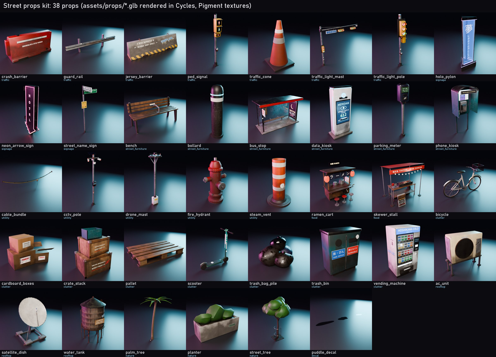
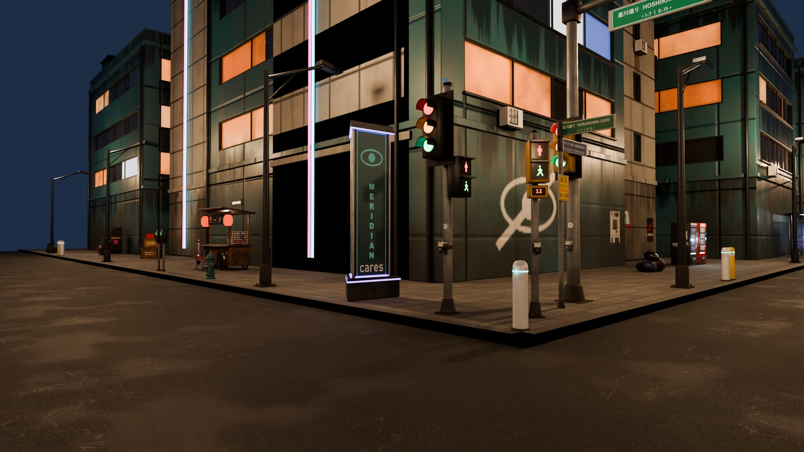

# Street props kit (workstream `props`)

38 original, game-ready street props for the open world, modelled in headless Blender,
textured in Pigment through the MCP (`pigment-mcp --script`) and exported as glTF for Godot,
with an index and a scatter API for the world generator.




- `lineup.jpg`: every exported `assets/props/<name>.glb` (the Godot files, not the Pigment
  projects) rendered in Cycles, one tile each (`render_proof.py lineup` + `contact_sheet.py`).
- `street_night.jpg`: a test crossroads at night with town-kit buildings and lamps, dressed by
  `scatter_props()` on `scatter.demo_context()` (`render_proof.py street`). The placements are in
  `street_scatter.json`.

## The props

| category | props |
|---|---|
| traffic | `traffic_light_pole` (vertical 3-light head + pedestrian head + push button), `traffic_light_mast` (6.6 m arm, 2 horizontal heads, street-name blade, camera), `ped_signal` (walk / stop + countdown), `guard_rail` (4 m W-beam, tileable), `crash_barrier` (water-filled, 1.8 m), `jersey_barrier` (checkpoint, 3 m), `traffic_cone` |
| signage | `street_name_sign` (crossed JP/EN blades), `holo_pylon` (see-through emissive holo ads), `neon_arrow_sign` (wall-mounted marquee) |
| street furniture | `bus_stop` (glass, lightbox ads, bench, timetable, LED roof), `bench` (anti-sleep divider), `bollard` (LED ring), `parking_meter` (PAY BY SCORE), `data_kiosk` (MERIDIAN citizen-score monolith), `phone_kiosk` (PUBLIC LINE - MONITORED) |
| utility | `cctv_pole` (MERIDIAN eyes), `drone_mast` (charging pad + parked drone), `fire_hydrant`, `steam_vent` (manhole steam stack), `cable_bundle` (8 m span) |
| food | `ramen_cart` (yatai, noren, lit lanterns), `skewer_stall` (glowing coals, string lights) |
| clutter | `vending_machine` (drinks / Noctis memories / ramen), `trash_bag_pile`, `trash_bin`, `cardboard_boxes`, `pallet`, `crate_stack`, `bicycle`, `scooter` |
| rooftop | `ac_unit`, `satellite_dish`, `water_tank` |
| nature | `planter`, `street_tree`, `palm_tree` (luxury island, ground uplighter) |
| decal | `puddle_decal` (three alpha puddles as nodes `Puddle_S/M/L`) |

Story content is everywhere: MERIDIAN stickers and plates on meters, poles and kiosks, citizen-score
and FLAGGED FOR RE-EDUCATION kiosk screens, Noctis / Dreamlink / MERIDIAN / Hoshikawa Security ads on
the bus stop and holo pylon, UNPLUG tags and crossed-eye stencils, MISSING posters, a CHECKPOINT 9 /
SCORE 500+ jersey barrier, NOCTIS BIOLOGICS crates, ration-zone water tank, "NO SCORE NEEDED" ramen.
Decal art: `tools/props/make_prop_decals.py` -> `assets/decals/props/` (72 images) plus the existing
`assets/decals/story/`.

## Pipeline (all scripted, deterministic)

| step | command | output |
|---|---|---|
| model | `blender -b --factory-startup --python tools/props/build_props.py [-- names] [--clay DIR]` | `assets/props/src/<name>.glb` (untextured, final UVs) + `<name>.json` (pieces, groups, bboxes, lights, sockets, collider shapes) |
| decals | `python tools/props/make_prop_decals.py` | `assets/decals/props/*.png` |
| textures | `python tools/props/props_textures.py [names] [--jobs 2] [--no-run]` | `scenes/props/scripts/*.jsonl` (committed), `scenes/props/projects/*.pigment` and `scenes/props/textures/` (both git-ignored: 24 MB + textures, rebuilt by the script) |
| export | `blender -b --factory-startup --python tools/props/export_props.py [-- names] [--no-index]` | `assets/props/<name>.glb`, `<name>_lod1.glb`, then runs `write_index.py` |
| index | `python tools/props/write_index.py` | `assets/props/index.json`, `assets/props/variants/*` |
| proof | `blender ... tools/props/render_proof.py -- lineup --cpu` / `-- street`; `python tools/props/contact_sheet.py` | `docs/agents/props/` |
| test | `python tools/props/test_scatter.py` | determinism, spacing, blocked discs, facing, districts, rule overrides |

`props_textures.py` is the regenerate script for the textures; the header of each file has its usage.

### Modelling (`tools/props/proplib.py`, `models_street.py`, `models_clutter.py`)
- A small bmesh kit: `box` (bevelled), `cyl`/cone, `lathe`, `sweep` (tubes along polylines with
  parallel-transport frames), `prism` (extruded profiles: W-beam, jersey, barrier, arrow), `blob`
  (lumpy ellipsoids: bags, foliage), `torus`/arcs, `grid` (+ `solidify_last`: tarps), `ribbon`
  (fronds, noren), `transform_all` (lean a bike on its stand).
- Every primitive is a *piece*: a closed surface tagged with a name and a material group. Pigment
  makes one part per connected surface, so `props_textures.py` asks Pigment for its parts
  (`list_parts`) and maps each to its piece by bbox (exact match, else the smallest box that holds
  it). All masks are part masks on named groups; no part ids are hard-coded. Max 60 surfaces per
  prop (Pigment's part masks stop at 256).
- Real-world scale; Blender front is -Y so the glTF front is +Z; origin on the ground at the
  footprint centre (wall props: on the wall at the mount point; the cable span: midway between
  the two anchors).
- UVs: smart project, all islands at one texel density, text-carrying pieces (ads, screens,
  signs, lenses) boosted 1.5-4x, packed (AABB). Texel density is recorded per prop (index
  `material.texels_per_m`; 90-600 texels/m, signs and screens much higher).
- 216 to 4,032 triangles per prop at LOD0. LOD1 (Decimate) for the 18 bigger props.

### Texturing (Pigment MCP, `props_textures.py`)
Per prop: group fills with presets / values -> edge wear, scratches, rust (edge wear x spots),
AO grime, ground dirt (ground gradient x grunge), rain streaks, leaks (drip bake) on tall props,
moss on concrete / tanks / bark, a wet sheen (roughness only) -> emissive groups (lit lenses, LEDs,
neon, screens, lightbox ads, lanterns, coals, beacons) -> glass and holo via opacity / transmission,
perforated grilles, grates and the bike basket as cut-outs (the town's two-layer recipe) ->
a "Story decals" paint layer -> a light film of grime over the decals.
- Decals on vertical faces are anchored (`position` + `normal` + `size`, upright, exact metres,
  fitted to the piece's face from its bbox); up-facing ones use part mode.
- Variants (`export_variants`): ad swaps (bus stop 5, holo pylon 3, kiosk screens 4, vending
  fronts 3, marquee words 4, street-name pairs), colour swaps (bench, bin, hydrant, bollard,
  bike, scooter, barrier, crates, traffic-signal housings...) and tag on/off.

### Export (`export_props.py`)
glb per prop: one root node = the main mesh (named like the prop), with its driven nodes (traffic
lamps), a hidden `Collider` mesh and `Light_*` / `Socket_*` empties parented under it. One Pigment
material (base colour, ORM, normal, emissive + `KHR_materials_emissive_strength`; glass adds
transmission / alpha). Textures embedded as JPEG (PNG where alpha is needed) at 256-1024 px; LOD1 at
half size.

## index.json (assets/props/index.json)

```
{ "version": 1, "conventions": {...}, "districts": [...], "slots": {slot: description}, "scatter_fields": {...},
  "total_bytes": ...,
  "props": { "<name>": {
      "title", "category", "desc",
      "files": {"lod0": "<name>.glb", "lod1": "<name>_lod1.glb"?},
      "lod": {"lod0_tris", "lod1_tris"?, "lod1_from_m"?, "visible_to_m"},
      "size_m": [x, y, z], "footprint": {"w", "d", "radius", "center": [x, z]}, "bounds": {"min", "max"},
      "mount": "ground" | "wall" | "span",  "tile_length"? (barriers, rails),  "span"? (cables),
      "nodes": {"main", "all", "driven": ["Lamp_A_Red", ...]},
      "collider": {"type": "box|cylinder|compound|none", "shapes": [{"type": "box", "center", "size"} | {"type": "cylinder", "center", "radius", "height"}], "node": "Collider"},
      "lights": [{"name": "Light_Shelter", "pos", "type": "omni|spot", "color", "energy", "range", "dir"}],
      "sockets": [{"name": "Socket_Steam", "pos", "kind": "steam|smoke", "dir"}],
      "signals"?: {"vehicle_heads": [{"head", "facing", "lamps": {"red": "Lamp_A_Red", ...}}], "ped_heads": [...],
                   "lamp_positions": {node: {pos, dir, color}}, "lit_colors": {...}, "how_to_drive": "..."},
      "material": {"alpha": ["OPAQUE"|"BLEND"], "texture", "texels_per_m", "emissive"},
      "variants": [{"name", "default": true} | {"name", "albedo": "variants/...", "emission"?: "...", "emissive_scale"}],
      "scatter": {"slots", "density": {district: n}, "offset", "spacing", "clearance", "facing", "yaw_jitter",
                  "cluster"?, "cluster_line"?, "cluster_gap"?, "along"?, "mount_height"?, "run"?, "decal"?} } } }
```

Lights in Godot: an `OmniLight3D` / `SpotLight3D` at each `Light_*` (spot direction = local -Z),
`light_energy` roughly `energy / 30`, `omni_range` = `range`.

### Traffic signals (for the traffic agent)
Lamp nodes: `Lamp_<head>_<Red|Amber|Green>` and `Ped_<head>_<Walk|Stop>` (+ `Ped_A_Count` on
`ped_signal`). Heads: pole `A` (vertical, faces +Z) and `Ped_A` (faces +X); mast `A` on the pole,
`B` (x 3.3 m) and `C` (x 5.7 m) on the arm, all facing +Z; horizontal heads read green-amber-red
from the viewer's left. Every lamp node shares the prop material and its emissive texels are the
*lit* lens: to switch a lamp off, give that node a material override with emission off (or
`emission_energy_multiplier = 0`); restore the shared material to switch it on.

## Scatter API (tools/props/scatter.py)

```python
import sys; sys.path.insert(0, "tools/props")
from scatter import scatter_props, demo_context
placements = scatter_props(context, rules=None, seed=None, density_scale=1.0)
```

`context` (Godot space, metres): `seed`, `district`, `lines` (`slot`, `points`, `district`,
`side` or `toward`, `width` for `alley_span`), `points` (corner / crossing: `pos`, `dir` into the
road, optional `curbs` directions; default a square corner), `areas` (rooftop / plaza / road polygons with height in y), `blocked` (discs to keep free).
`rules`: None (all props, index rules), a list of names, or `{name: partial rule}` overrides.
Returns `{prop, file, lod1, pos, yaw, scale, variant, slot, district, collider, xform}` per prop;
`xform` is a Godot `Transform3D` as 12 floats (basis columns, then origin), the same format as
`town_layout.json`. Deterministic per seed; per-prop spacing, global clearance discs, clusters
(bike rows, scooter groups, meter rows), runs (guard rails / barriers chained along a line with
`tile_length`), facade mount heights, alley spans scaled to the wall gap, and variant picks that
don't repeat back to back. `demo_context()` builds a crossroads to try it; `python
tools/props/scatter.py --demo` prints what each district gets.

## Sizes

`assets/props`: 22.7 MB for 38 LOD0 glbs, 18 LOD1 glbs and the variant swaps (`index.json` `total_bytes`),
plus 2.7 MB of Pigment source meshes in `assets/props/src/` and 6 MB of decal PNGs.

## Testing
- `python tools/props/test_scatter.py`: passes (determinism, seeds, spacing, blocked discs, curb props facing the road, nothing on the walk landing in the road, district mixes, Godot xform, rule list / overrides).
- Offsets are per slot: `curb` props always sit back on the walk and `frontage` / `alley` props out from the wall, at least half their depth; corner props move along one of the two curbs.
- The Pigment previews (`%TEMP%/pig_props/*.png`), the clay renders (`build_props.py --clay`) and
  the Cycles lineup were checked by eye for every prop.
- No Rust changes: `cargo test --release` is unaffected by this workstream.

## Known limits
- Variant swaps cover albedo and emission only; roughness / normal maps are shared (decals barely
  change them). Godot has to build a material per variant.
- One material per prop: props with glass / holo / cut-outs export as `alphaMode BLEND`. Use
  Alpha Depth Pre-Pass (or Alpha Scissor for puddles and grilles) in Godot, as for the car.
- LOD1 is a plain Decimate: fine for distance, not hand-made.
- Lamps are lit in the texture; the traffic agent must switch them per node (above).
- The scatter API knows only what the context tells it (no ray casts against the world), so lines
  must already sit on the walk / wall surfaces.
- The street proof is a test crossroads with town-kit buildings, not the full town .blend; its road
  and building textures come from the main checkout's git-ignored `scenes/town/textures`.
- Textures are git-ignored: run `props_textures.py` (about an hour for all 38 on a shared GPU)
  before `export_props.py` / `render_proof.py`. Under heavy GPU sharing a pigment-mcp run can fail
  (out of memory); rerun with `--jobs 1`.
