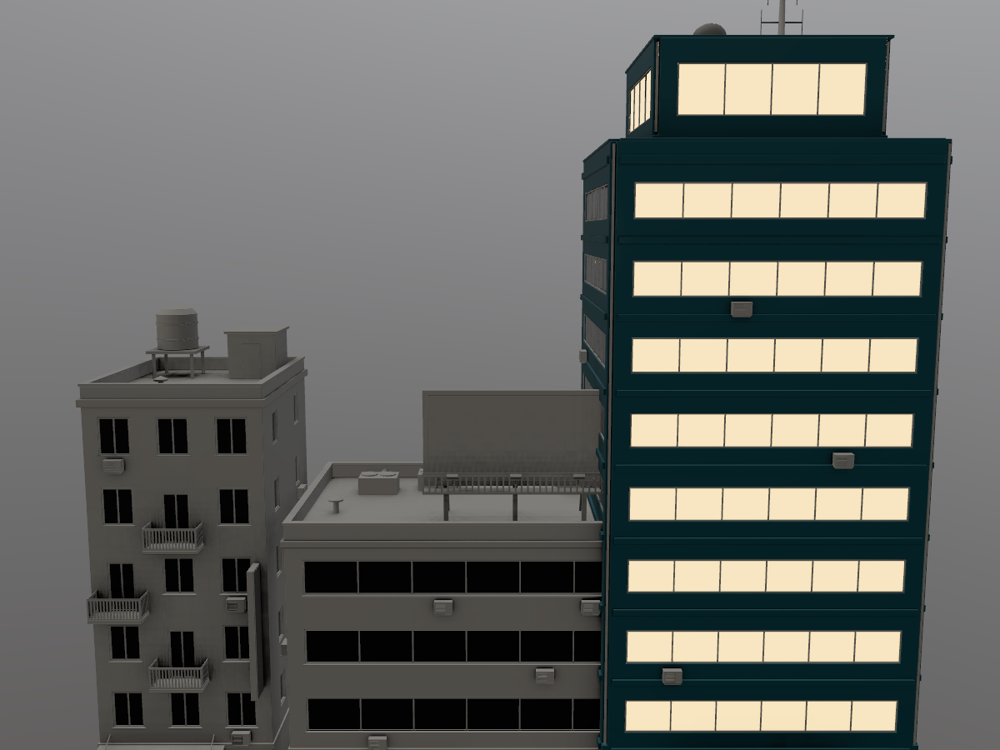

# scale-mcp: more parts, faster export, sturdier MCP



*Three town buildings joined into one mesh (596 parts), textured at 4K through
`pigment-mcp --script docs/agents/scale-mcp/town_block.jsonl`. The tower's
teal shell, edge-worn trim and lit windows use part ids up to 595, which the
old 256-part limit couldn't select. Every selection is a shape query
(`mask.parts_where`), not a list of ids.*

## 1. Part masks past 256 parts

- **Before:** a layer's part selection was a 256-bit bitset in its uniform
  block (`pbits[8]`). Ids of 256 and above were silently dropped.
- **Now:** every visible layer's selection is packed into one storage buffer
  (`@group(2) @binding(8) part_bits`). `LayerParams.misc.y/z` hold each
  layer's offset and length in words, and the bitset is only as long as its
  highest selected id. The limit is now `MAX_SELECTABLE_PARTS = 65534`, set by
  the R16Uint part-id map that stores id + 1.
- **Old projects:** they load unchanged. `Mask.parts` is still a `Vec<u32>`
  and the file format didn't change.
- **Bad ids:** a part id that doesn't exist now fails with a message naming
  the argument instead of being dropped, e.g.
  ``add_layer: `mask.parts[1]` = 900: no such part (the mesh has 218 parts, ids 0..217)``.
- **Town scripts:** removed the `i < 256` filter from `tools/town_textures.py`.
- **Test mesh:** `Mesh::tile_grid(n)` is a synthetic mesh with n x n parts.
  The town block (above) is built by `tools/make_town_block.py` in headless
  Blender. Its output goes to `assets/town/generated/`, which is git-ignored,
  so regenerate it with
  `blender -b --factory-startup --python tools/make_town_block.py`.
- **Town buildings:** none of them exceeds 256 parts on its own
  (a = 176, b = 218, c = 202). That's why the proof joins all three.

## 2. Export speed

Profiling a 4K `separate` export (7 PNGs) showed the time went to:

- five GPU readbacks, each with its own submit and wait;
- per-pixel f16 to sRGB `powf` conversion of the HDR emissive map (16M texels);
- per-pixel `match` packing;
- seven PNG encodes, one after another.

Changes:

- `gpu::readback_many`: all five material maps are copied in one command
  buffer, with one submit and one wait. Saving a project does the same for
  the six channels of each paint layer.
- The f16 conversions (emissive and height) are 65536-entry lookup tables,
  one entry per half-float bit pattern, run in parallel chunks.
- `export::pack` copies plane by plane instead of matching on each pixel.
- `export::export_with` packs and encodes every map on its own thread.
  Saving a project also encodes the layer channels in parallel.
- New `compression` option: `none | fastest | fast (default) | balanced | best`.
- `export_textures` now returns
  `timing_ms {gpu_finish, read_back, encode, total}`.
- The export dialog in the app has a "PNG compression" dropdown.
- At the default level the output is pixel-identical to before, and the files
  are byte-for-byte the same size (checked by decoding the old and new
  building_b maps).

**4K `building_b`, `separate` preset.** Same machine and same script. Each
export runs right after a `render`, so earlier GPU work doesn't count against
it.

| | before | after |
|---|---|---|
| `export_textures`, quiet machine | 1.23 / 1.31 / 1.41 / 1.45 / 1.54 s | 0.25 / 0.26 / 0.27 / 0.29 / 0.32 s (about 5x) |
| `export_textures`, 9 other agents building | 4.9 / 7.5 / 8.4 s | 0.3 / 0.4 / 1.4 s |

Compression levels on the same material (quiet machine):

| level | export time | size of the 7 PNGs |
|---|---|---|
| fast (default) | 0.32 s | 8 MB |
| fastest | 0.33 s | 19 MB |
| none | 0.37 s | 225 MB |
| balanced | 1.10 s | 8 MB |
| best | 2.64 s | 8 MB |

Once encoding runs in parallel, `fast` is the right default. `fastest` only
helps on a CPU-starved machine.

## Benchmark: town building end to end

```
pigment-mcp --script building_b.jsonl
```

This is `scenes/town/scripts/building_b.jsonl` with its output paths moved
to temp. It runs 28 steps: `new_project` at 4K, a bake, 19 part-masked layers,
3 decals, 2 renders, the export and a save.

| | wall time | export |
|---|---|---|
| before (master 6cb2ed5), quiet | 4.6 / 4.8 / 4.9 s | 1.2-1.4 s |
| after, quiet | 3.1 / 3.3 / 3.5 / 3.9 s | 0.25-0.29 s |
| before, loaded machine | 30.6 / 48.0 / 70.6 s | 4.9-8.4 s |
| after, loaded machine | 8.6 / 22.7 / 25.1 s | 0.3-1.4 s |

The new per-step timings (stderr) show where the rest of the time goes on a
quiet run:

- `new_project` 1.0 s
- `save_project` 1.2 s (down from about 1.5 s)
- all 19 `add_layer` calls 0.3 s
- export 0.3 s

Timings swing a lot because ten agents share the 16-core machine and the GPU.
The rows above are separate runs, not averages.

## 3. MCP robustness and ergonomics

- **Schema validation.** Before running, every call is checked against the
  tool's JSON schema by the new module `pigment_engine::mcp_args`. It reports:
  - unknown keys, with a did-you-mean;
  - wrong types and values outside an enum;
  - missing required arguments;
  - `minimum`, `maximum` and `maxItems` violations.

  Nested paths are named, e.g.
  ``add_layer: unknown argument `mask.part` (did you mean `parts`?)``,
  ``batch: `calls[0].arg` ...`` and
  ``export_textures: `compression` = "max" is not one of: none, fastest, fast, balanced, best``.
  Integers are strict: `4096.0` is rejected because the tools read integers
  with `as_u64`, which used to drop such values silently. Every tool schema
  now sets `additionalProperties: false`.
- **Schemas fixed to match what the tools read.** These were missing or untyped:
  - `values.emissive` and `values.emissive_strength`;
  - a typed `layer` (name or index) wherever a layer is chosen;
  - a full `mask` schema: generators enum, `parts`, `parts_where`, effects
    capped at 2;
  - `project_decal`: `channels`, `mask_value`, `width`, `height`;
  - the `preset` enum.
- **Tests guard the schemas:**
  - `tool_schemas_are_complete`: every property is typed and every required
    key is declared;
  - `every_repo_script_matches_the_tool_schemas`: every line of the checked-in
    `scenes/**/*.jsonl` scripts passes validation.
- **Clearer errors when a value is wrong.** Unknown layer, material, smart
  material, generator, view, channel or blend mode now names the argument and
  lists the valid values. For an unknown layer it lists the stack.
- **`--script` flags:**
  - `--keep-going` / `--continue` runs every step even after errors, then
    exits with 1 if any step failed. The default still stops at the first
    error.
  - `--check` only validates every line against the schemas. It needs no GPU,
    so it's a quick lint for generated scripts.
- **`--script` output:**
  - Tool output stays on stdout in the same `[tool] ...` format, so
    `town_textures.py` still parses it.
  - Per-step timing goes to stderr (`[line 27] export_textures: 296 ms`). Each
    step waits for its own GPU work, so the time is charged to the right step.
  - A summary at the end gives the total, the time per tool and the three
    slowest steps.
  - Bad JSON or a line without `tool` is reported with its line number
    instead of panicking.
- **`get_project_info`:**
  - mesh: name, source, triangles, vertices, UVs, bounds, size;
  - texture resolution;
  - parts: count, the max selectable id, and which layers use part masks
    (with their highest id);
  - layers: count, visible, paint, masked, names;
  - bake: whether it's baked, and its settings;
  - project folder, modified flag and undo depth;
  - export settings and the last export's timing;
  - GPU memory used.
- **`batch`:**
  - Arguments: `{calls: [{tool, args}], stop_on_error = true}`.
  - Returns `{ok, failed, skipped, total_ms, results: [{index, tool, ok, ms, result | error}]}`.
    Tool JSON is unwrapped, and render images are left out (the result keeps
    the saved path).
  - Any failure makes the MCP result an error.
  - A batch can't contain another batch.
- **Filtering in `list_parts`:**
  - With no arguments it returns the same array as before.
  - Filters: `min_`/`max_` for `triangles`, `thickness`, `width`, `length`
    (alias `size`), `area` and `volume`; `facing` (x, y or z: the axis of the
    thinnest side); `inside` (a centre box, `null` = unbounded); `ids`.
  - Sorting and paging: `sort` (id, triangles, size, area, thickness, volume),
    `order` (biggest first by default), `limit`, `offset`, `ids_only`.
  - With any filter or sort it returns
    `{total_parts, matched, returned, offset, parts}`. Each part has
    `thickness`, `area` and `facing`, and numbers are rounded to mm.
  - The query logic is `pigment_core::partquery`, which has no GPU code.
- **Shape queries in `pick_parts`:** `{"shape": {"max_thickness": 0.02, "min_area": 1.0}}`
  returns `{parts: [ids], count}`. The `points` mode is unchanged and now
  reports bad points by index.
- **`mask.parts_where` (in `add_layer` and `update_layer`):**
  - It takes the same query and turns it into part ids when the call runs.
    The project stores those ids.
  - That lets a static script say "every thin pane bigger than 0.3 m² on the
    east building" without hard-coding ids.
  - With `parts` as well, it takes the union of the two.
  - A query that matches nothing is an error, because an empty selection
    would mean the whole model.

## How it was tested

`cargo test --release` passes, including these new tests:

| Test | What it checks |
|---|---|
| `gpu_tests::part_masks_select_parts_far_beyond_256` | 64x64 tile grid (4096 parts); exactly parts 0, 300, 2049 and 4095 light up |
| `texset::part_bitset_covers_ids_far_past_the_old_256_limit` | the bitset packing |
| `mesh::tile_grid_has_one_part_per_tile_in_order` | the synthetic mesh |
| `export::plane_packing_matches_per_pixel_sampling` | the new packer matches the old per-pixel path for every preset |
| `export::every_compression_level_round_trips_in_parallel_export` | each compression level decodes to the original pixels |
| `io::half_float_tables_match_direct_conversion` | the lookup tables, the peak and the parallel chunking |
| `partquery::*` | the shape queries |
| `mcp_args::*` | the validator and its messages |
| `pigment-mcp` bin tests | schema completeness, every repo script validating, named errors, batch output |
| `automation::part_queries_project_info_and_named_errors` | `list_parts` filters, `pick_parts` shape, `parts_where`, bad part ids, unknown layer / material, `get_project_info` |

`tests::gpu_lock` makes the Session tests take turns. Run all at once, they
ran the shared 12 GB GPU out of memory, because each Session allocates a 2K
texture set.

## Known limits

- Ids at 65534 and above share one value in the R16 part-id map, so they
  can't be told apart. That's 256x the old limit.
- The storage buffer holds one bitset for each visible layer that has a part
  selection, sized to that layer's highest id. A layer with 65k selected parts
  costs 8 KB. Not a concern.
- `inside` filters on the part's bounding-box centre, not on its geometry.
- `--script` charges each step's GPU time to that step by waiting after it.
  That slightly reduces CPU/GPU overlap in scripts. `pigment-mcp` used as a
  live MCP server doesn't wait.
- `new_project` (mesh load, part split, 4K texture set and bake) and
  `save_project` are now the slowest steps for a town building. Both are
  candidates for a later pass.
