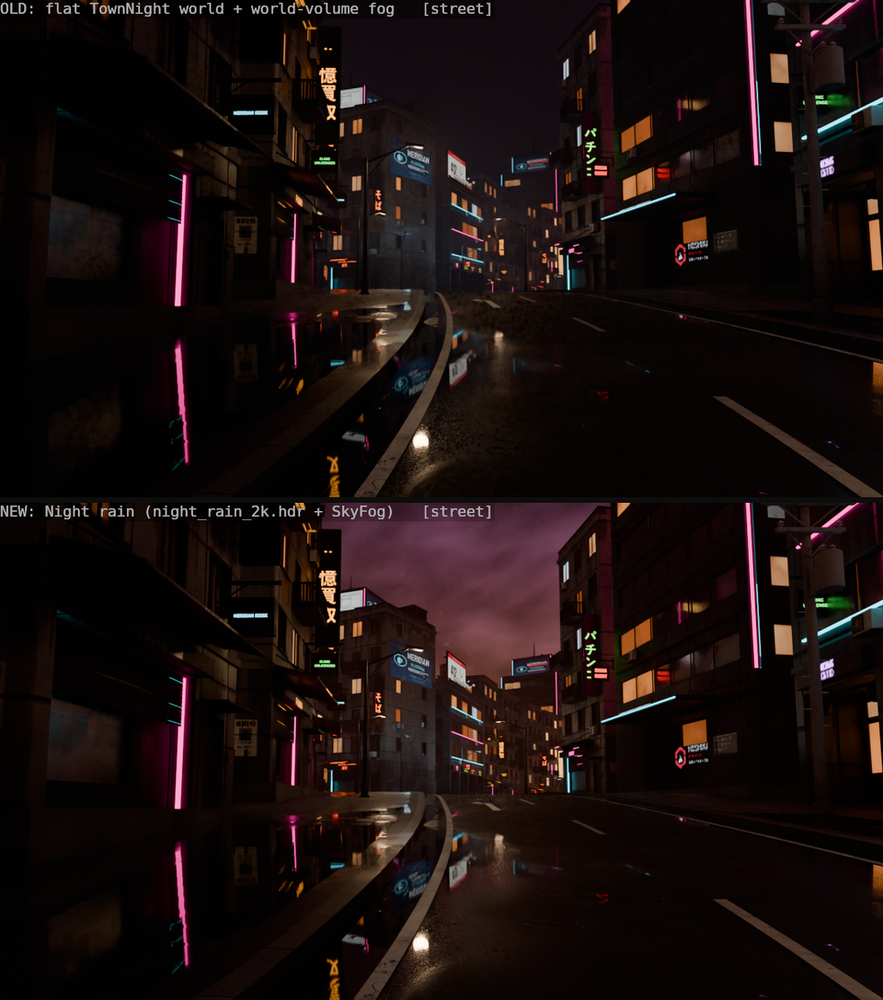

# sky: a night sky for the rainy megacity (Blender, Pigment, Godot)

One procedural sky, baked to equirect HDRs, used by all three tools:
Blender (`apply_sky`, the town build calls it), Pigment (`lighting: "night_rain"`, ...)
and Godot (`game/sky/`). They all use the same orientation, so the MERIDIAN glow and the
searchlights hang over the same streets everywhere.



## Presets

| id | look | HDR (2048x1024) |
|---|---|---|
| `night_rain` (default) | low, heavy overcast lit from below by the city: sodium orange at the horizon, magenta, then blue-black overhead; a few breaks with faint stars; three faint searchlights; the MERIDIAN eye glowing cyan/red on the cloud base over the downtown district | 3.5 MB |
| `night_moon` | the same city glow, a thinner, broken deck, more stars, a hazy moon (aureole + corona) behind thin cloud | 3.3 MB |
| `dusk` | purple-orange sunset under the clouds: the sun 2.5 deg below the horizon lights the cloud base pink/orange on its side, violet overhead | 2.7 MB |
| `predawn` | cold blue hour, thin broken cloud, pale gold seam in the east, fading stars, weaker city glow | 2.7 MB |

Previews: `<preset>_equirect.png` (the whole panorama, tone-mapped AgX). `--views` also
renders `<preset>_view.png`, a 12 mm street-level camera looking at the interesting part of
the sky (not committed, to keep the docs small).

## How it is made (`tools/sky/make_sky.py`, headless Blender)

The sky is a Blender world shader built from nodes, then baked with a Cycles
panoramic (equirect) camera. A 2K bake takes under a second per preset.

- **Cloud decks.** Each layer is a horizontal plane at height H. The view ray is
  projected onto it (`p = d.xy * H / d.z`), so cloud cells shrink and crowd into the
  horizon the way a real deck does. Density is fBm noise:
  - domain-warped by a low-frequency vector noise and stretched along the wind;
  - big soft masses plus a finer billow detail;
  - remapped with a smoothstep coverage;
  - cut by a large-scale "breaks" noise where the stars show.
  Level of detail: the projection squeezes more and more cloud into each pixel near
  the horizon, so octaves fade out with elevation instead of aliasing (that was what
  made the first versions look like radial hair).
- **Volume without a volume.** A second density sample, offset toward the brightest
  glow, gives a light gradient through the cloud: lit undersides and darker crevices.
  Thick cloud is brighter (it scatters more of the city light back down). The colour
  is the light-pollution gradient, multiplied in. That gradient is an elevation ramp
  (sodium, then magenta, purple and blue-black) times an azimuth term: rolling
  districts plus a "downtown" lobe at Blender azimuth 60 deg.
- **Haze.** An exponential horizon haze, a flat far stratus band, and a dark ground
  below (it fades out over about 5 deg), so the skyline reads as a silhouette.
- **Extras, kept subtle.**
  - Searchlights: thin beams in the hazy air, each with a spot on the cloud base.
  - The MERIDIAN eye: an almond wash, a cyan iris ring and a red pupil, projected on
    the low deck at azimuth 75 deg, elevation 24 deg.
  - Stars: Voronoi points visible only through the breaks.
  - The moon: a disc dimmed by the cloud, plus an aureole and a corona.

### Commands

```
# all presets: assets/sky/<p>_2k.hdr, previews, Godot copies + resources
blender -b --factory-startup --python tools/sky/make_sky.py
# one preset, with the orientation self-check (procedural vs baked-and-reapplied)
blender -b --factory-startup --python tools/sky/make_sky.py -- --presets dusk --check
# 8K (git-ignored; also copied to game/sky/, where CitySky prefers it once imported)
blender -b --factory-startup --python tools/sky/make_sky.py -- --res 8k --no-preview
```

`--check` renders the procedural world and the baked HDR (through `apply_sky`) with the
same rotated camera. Relative mean error is 0.7-1.2 % for all four presets, which is
interpolation only, so the orientation matches.

### Orientation (shared by every tool)

The HDRs use the glTF / Pigment / Godot convention:
- the image centre (u = 0.5) looks along glTF -Z, which is Blender +Y;
- u grows toward +X.

How each tool reads them:
- **Pigment** reads them directly.
- **Godot** reads them through `city_sky.gdshader`. It writes the mapping out
  explicitly instead of using PanoramaSkyMaterial, so the result doesn't depend on
  engine internals. `town_layout.json` maps Blender (x, y, z) to Godot (x, z, -y),
  which keeps the sky aligned with the town.
- **Blender** turns its Environment Texture -90 deg about Z (`apply_sky` does this,
  as `tools/blender_lookdev.py` already did).

## Blender: `apply_sky(scene, preset)`

```python
ns = {"__name__": "make_sky", "__file__": "tools/sky/make_sky.py"}
exec(open(ns["__file__"]).read(), ns)
ns["apply_sky"](bpy.context.scene, "night_rain")   # or night_moon / dusk / predawn
```

It sets up three things:

- **World "Sky".** The HDR feeds an Environment Texture (Cubic). Camera rays see it at
  strength 1. All other rays use the preset's `world_light`: 0.6 at night, 0.8 at
  dusk and pre-dawn. That way the sky lights the scene only a little, and the street
  lamps and neon stay dominant. If the HDR is missing it falls back to the
  procedural node tree (`procedural=True` forces that).
- **"SkyFog" volume box.** This is a box, not a world volume: Cycles' infinite world
  volume swallows the background, which is why the old sky was invisible.
  - It covers the bounding box of the scene's meshes plus 60 m.
  - Principled Volume, denser near the ground: `density * (0.3 + 0.7 exp(-h / 35 m))`.
  - It glows with the city haze: emission = `glow * density`, so thick fog tends
    toward `glow`.
- **"Moon" sun lamp.** It is aimed along the preset's key light (the moon, or the
  low sun at dusk), with that light's colour and energy.

`tools/blender_town.py build()` now calls it at the end. `TOWN_SKY = "dusk"` in the
exec namespace picks another preset; `TOWN_SKY = None` keeps the old flat world.
`town_layout_driver.py daylight()` hides the fog box.

## Pigment

`render`, `render_turntable`, `export_variants(preview)` and `export_lighting` accept
the sky ids as `lighting` values: `night_rain | night_moon | dusk | predawn`. Aliases
like `sky:dusk` and `Pre-dawn sky` also work. The viewport's Lighting menu has a row of
sky buttons, greyed out when the HDR can't be found.

The HDR is looked up in this order:
1. `$PIGMENT_SKY_DIR`;
2. `assets/sky/` under the working directory or its parents;
3. the same under the executable's folder or its parents;
4. the source checkout.

The skies are real night radiance, so use `exposure` of about 1.5 (night), 0.3 (dusk)
or 1.0 (pre-dawn) to judge an asset. `docs/agents/sky/pigment_skies.jsonl` is the
script behind `pigment_skies.png`: building_a under the old `night` preset, then each sky.

```json
{"tool": "render", "args": {"yaw": 200, "pitch": -14, "zoom": 0.8, "lighting": "night_rain", "exposure": 1.5, "background": true}}
```

Code:
- `pigment_core::envmath`: `SKIES`, `sky_id`, `lighting_id`, `sky_dirs`, `sky_path`,
  `EnvImage::load`, `EnvImage::lighting`, `lighting_names`.
- `Environment::lighting` in `render/env.rs`.

The changes in `automation.rs` (3 call sites + 1 test), `ui.rs` (one added row) and
`pigment-mcp.rs` (enum lists) are small, local edits.

## Godot (`game/sky/`)

| file | what |
|---|---|
| `city_sky.gdshader` | sky shader: samples the panorama in the shared convention; `energy`, `rotation_degrees` uniforms |
| `sky_<preset>.tres` | `Sky` resource per preset (ShaderMaterial + the HDR) |
| `<preset>_2k.hdr` (+ `.import`) | copies of the bakes (identical blobs to assets/sky, so git stores them once). Imported as BC6H, high quality, no mipmaps |
| `sky_presets.json` | per preset: HDR band means (zenith ... horizon, ground), fog colours, ambient energy, key light |
| `city_sky.gd` | `class_name CitySky`: `apply(env, preset)`, `setup_key(light, preset)`, `sky(preset)`, `names()` |
| `sky_night.tscn` | ready-made `WorldEnvironment` (night_rain sky, ambient/reflections from it, AgX, glow, horizon-matched fog + volumetric fog) with a `Moon` DirectionalLight3D |

Fog colour matches the horizon: `fog_light_color` is the HDR's mean 0-3 deg band at 15 %
of its radiance. It has the same hue, but stays dimmer than the sky, so the buildings
read as silhouettes against it. `fog_sky_affect` is 0, because the panorama already
has its own haze.

### Using it in `main.gd` (Godot agent)

`main.gd` builds its Environment in code. Keep that code, and replace the
ProceduralSkyMaterial block and the fog colour lines with:

```gdscript
const CitySky := preload("res://sky/city_sky.gd")
...
env = Environment.new()
CitySky.apply(env, args.get("sky", "night_rain"))   # sky, ambient, reflections, fog colours
# ... keep the tonemap / glow / SSR / SDFGI / fog density settings ...
var moon := DirectionalLight3D.new()
CitySky.setup_key(moon, args.get("sky", "night_rain"))
```

Remove `env.ambient_light_energy = 0.9` and the `fog_light_color` /
`volumetric_fog_albedo` / `volumetric_fog_emission` lines, or apply the sky after
them. Alternatively, instance `res://sky/sky_night.tscn` in place of the hand-made
WorldEnvironment.

A `--sky=dusk` user arg then switches presets.

Checked headless (`godot --headless --path game --import`, then a `--script` that
loads `sky_night.tscn`, applies every preset with `CitySky` and checks the panorama,
the fog and the key light direction). Not rendered in Godot: this workstream opens
no windows.

## Proof

- **Town**, Cycles, 96 spp, OptiX, denoised, AgX Punchy, from
  `scenes/town/cyberpunk_town.blend`. The textures came from the main checkout's
  `scenes/town/textures`, linked in.
  - `town_street_old_vs_new.png`, `town_drone_old_vs_new.png` and
    `town_aerial_old_vs_new.png`: the old flat `TownNight` world on top, `night_rain`
    below.
  - `town_presets.png`: street and drone views under night_rain, night_moon, dusk
    and predawn.

  Command:

  ```
  blender -b --factory-startup scenes/town/cyberpunk_town.blend --python tools/sky/sky_proof.py -- \
     --skies old,night_rain,night_moon,dusk,predawn --shots street,drone,aerial --out <tmp> --sheet docs/agents/sky
  ```

- `pigment_skies.png`: Pigment, building_a under the old `night` preset, then the four skies.
- The equirect preview of each preset.
- The predawn aerial shot is missing: that render stalled behind other agents' GPU jobs.
  The predawn street and drone shots are in `town_presets.png`.

## Tests

- `pigment-core envmath::tests::game_skies_resolve_and_load` checks:
  - name and alias resolution, and that `night` is still the built-in preset;
  - that every committed HDR loads at 256 px;
  - that each has a warm horizon brighter than its zenith and a dark ground;
  - that night is darker than dusk;
  - the orientation: the downtown glow at Blender azimuth 60 deg shows up in
    Pigment's uv where expected.
- `pigment automation::tests::game_sky_lighting` (GPU) checks:
  - every sky (and an alias) becomes the session environment;
  - the background has a warm horizon under a dark top;
  - dusk is brighter than night;
  - `export_lighting(predawn)` round-trips through `hdri`;
  - unknown skies are errors.

## Known limits

- **2K is soft for in-game backgrounds**: about 5.7 px per degree. Bake 8K for the
  game (`--res 8k`, then reimport). `CitySky.sky()` picks up `*_8k.hdr` or `*_4k.hdr`
  when they have been imported.
- The clouds are static, with no drift. A shader sky could scroll a cloud layer;
  the panorama can't.
- Stars are about 1 px at 2K and alias a little when the camera turns.
- The fog box is sized when `apply_sky` runs. Call it again, or pass `fog_bounds`,
  if the town grows.
- Not rendered in Godot, see above. The orientation there relies on the explicit
  shader mapping and the town exporter's axis mapping.
- `scenes/town/cyberpunk_town.blend` is not re-saved with the new sky. The next run of
  `tools/town_layout_driver.py` (which calls `build()`) saves it with the sky.
