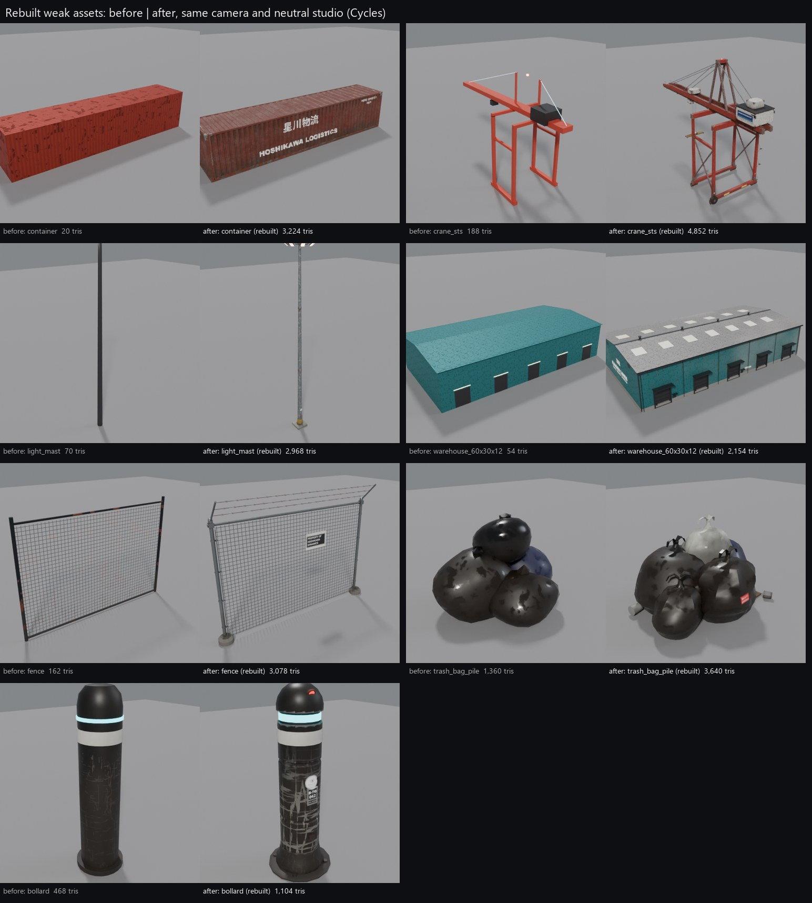

# Trees workstream, part 2: asset audit and rebuilds of the weakest assets

The trees are part 1 (`NOTES.md`). They are not covered here.



## Images

| file | what |
|---|---|
| `audit_contact_sheet_props.jpg` | Every `assets/props/*.glb` (38), one tile each |
| `audit_contact_sheet_world.jpg` | The town kit (`assets/town/*.glb` with its Pigment maps), the world procedural meshes (`world_meshes.Kit`: port kit, signal poles, landmarks, one tower per crown), the exported bridge parts and sea wall, the fleet and the hero car |
| `lame_before_after.jpg` | The 7 rebuilt assets. Before and after use the same camera and light |
| `lame_after_closeups.jpg` | Close-ups of the rebuilds: container side and doors, crane machinery house and travel gear, mast head and base, warehouse door bay, fence top and base, bollard head |
| `lame_before_after_port_world.jpg` | The Minato port inside the open world (a `world_build` region, same cameras). Before = the main checkout, after = this branch |

Red frames on the audit sheets mark the assets picked for rebuilding. Each tile's label gives the triangle count and textured / UNTEXTURED.

## Audit method

- **Renderer:** `tools/asset_audit/audit_render.py` (headless Blender 5.2, Cycles, 24 samples, denoised, AgX).
- **Studio:** each asset is rendered alone in the same neutral setup:
  - a mid-grey floor and a grey sky;
  - three sun lamps (warm key, cool fill, rim), so a 0.3 m cone and a 70 m crane get the same light;
  - a 3/4 front view (the asset's front is Blender -Y), framed to the bounding sphere.
- **Hidden:** colliders, sockets and light empties.
- **Recorded per tile** (in `stats.json`): triangles, size, material count, whether an image texture is used, and the camera. Before/after pairs reuse the before camera.
- **Asset sources:**
  - **Props:** the exported glbs.
  - **Town kit:** the glbs with `blender_pigment.apply_pigment_material` from `scenes/town/textures/<asset>`.
  - **World procedural meshes:** built live from `tools/world/world_meshes.py` (`Kit.get(key)`) with their Blender materials.
  - **Bridge parts and sea wall:** the main checkout's exported `game/assets/world/meshes/*.glb`, read-only.
  - **Fleet and hero car:** `assets/vehicles/*/<id>.glb` and `assets/car/car.glb`.
- **Quality bar:** the hero car, the fleet and the best props (vending machine, ramen cart, traffic signals, water tank).

## Ranked weak list

The trees (`street_tree`, `palm_tree`, `planter`, `tree_broad`, `tree_pine`) are left out because part 1 replaces them.

| # | asset | kit | instances in the world | why |
|---|---|---|---|---|
| 1 | `container` | world (`Kit.container`) | 3,131 | A 20-triangle box with a dark quad for the doors. No corrugation, frame, castings, doors or markings, and no texture beyond a tiling sheet. It is the most repeated mesh in the world. |
| 2 | `crane_sts` | world (`Kit.crane`) | 41 | 188 triangles of plain boxes in one flat paint, with no texture. It is the skyline of the port, yet has no travel gear, stays, house detail, cab, spreader or stairs. |
| 3 | `light_mast` | world (`Kit.mast`) | 89 | 70 triangles: a black stick with a box on top. No base, floods, door or texture. |
| 4 | `warehouse_*` | world (`Kit.warehouse`) | 68 | 54 triangles: a box, a two-quad roof and flat black door quads, with uniform tinted sheeting. No eaves, gutters, door frames, canopies, roof features, signage or weathering. |
| 5 | `fence` | town kit (`tools/make_fence.py`) | town layout | 162 triangles: one quad and four plain cylinders. Its texture was a uniform wire with spots. |
| 6 | `trash_bag_pile` | props | 953 | Four noisy blobs with a knot sphere. They read as rocks, not tied bags, and carry no story. |
| 7 | `bollard` | props | 4,481 | A plain lathe with no base, fixings or features. It is the most-instanced prop, so its plainness repeats everywhere. |

These were weak too, but were not rebuilt (reasons in "Left unfinished" below):

- **Fallback `signal_pole` / `signal_pole_long`** (`world_meshes.Kit.signal`, about 100 triangles, untextured). Unused while `assets/props/traffic_light_mast.glb` exists.
- **Landmarks and procedural towers.** Stacked boxes of 38–354 triangles, saved by the facade texture. The HQ and MERIDIAN spire read as primitives up close.
- **Bridge parts and sea wall.** Their geometry is fine, but the exported glbs carry no textures.
- **`steam_vent`, `parking_meter`, `satellite_dish`.** These are adequate.
- **Fleet: the `hakobi` and `kaiun` fronts.** Plain, as noted before. They are still at the fleet bar elsewhere.

## What was rebuilt and how

### 1–3. Port kit: `container`, `crane_sts`, `light_mast` (now props-kit assets)

**Geometry** is in `tools/props/models_port.py` (new). It is registered in `build_props.py` and `catalog.py` (category `port`, no scatter slots).

**`container`**: an ISO 40' box, 12.19 × 2.44 × 2.59 m.
- Trapezoidal corrugation as real geometry: 278 mm pitch on the sides, deep ribs on the front wall, a shallow transverse roof.
- Frame: 8 corner castings, posts, top rails, bottom C-rails with lips, headers and sills.
- Underside: floor and 13 cross-members.
- Door end: ribbed leaves with frames, 4 lock rods with guides, cams and keepers, handles with hubs and retainers, 8 hinges, a gasket, CSC and customs plates.

**`crane_sts`**:
- Travel gear: sill beams, equalisers, 8 bogies, 16 wheels and buffers.
- Structure: tapered legs with hazard collars, portal beams and ties, X-braces.
- Girders: two box girders with trolley rails, grated walkways and handrails. The boom tapers to the tip.
- A-frame with an apex head and sheave, forestays and backstays.
- Machinery house with an E-room, banner panels, louvres, door and number board.
- Trolley, operator cab with glazing, ropes, headblock and spreader with twistlocks.
- Boom floods, a land-side stair tower with landings, a cable reel, and aviation beacons.

**`light_mast`**:
- Base: concrete plinth, base plate, 8 anchor bolts with nuts, 8 gussets, hazard sleeve.
- Shaft: 3 tapered galvanised sections with slip joints.
- Base fittings: access door with lock, mast plate, cabinet with conduit.
- Head: lowering ring with spokes, 8 tilted floods with lit glass, cap, lightning rod and beacon.

**Textures:** `tools/props/props_textures.py`, recipes `r_container`, `r_crane_sts` and `r_light_mast`, plus a shared `port_rust` stack (salt fade, rust bloom, pits, rust runs).
- **Container:** 7 line liveries, one per yard colour. These are new decals in `make_prop_decals.py`: HOSHIKAWA LOGISTICS, TSURU EXPRESS, NOCTIS BIOLOGICS cold chain, SHIGEN RECYCLE, KAIGEN LINES, MERIDIAN SECURE CARGO and DREAMLINK DATA FREIGHT.
  - Each livery has an owner code (ISO-style), a weights block, a CSC plate and a MERIDIAN SCANNED customs seal.
  - UNPLUG, "NOT DATA", MISSING-poster and crossed-eye tags are switched on per variant.
- **Crane:** a "HOSHIKAWA PORT · every box scored by MERIDIAN" banner, an STS-07 board, DANGER rail warnings, UNPLUG and MISSING tags, and a MERIDIAN sticker on the cab.
- **Mast:** a MINATO PORT YARD MAST 12 plate, a high-voltage cabinet label, an UNPLUG poster, an OBSERVED plate and a MERIDIAN sticker.

**Variants:**
- Container: `rust` (default), `blue`, `white`, `green`, `orange`, `grey`, `teal`. These are exactly the yard colours `placement.py` already assigns.
- Crane: `red` (default), `blue`, `white`.

**World hook:** `tools/world/world_build.py` already prefers `assets/props/<key>.glb` over `Kit.get(key)`, so the world asset keys are unchanged. One additive function, `prop_variant_material()`, maps an instance's `variant` to the prop's index variant (an albedo/emission swap on a material copy). Without it, every container would be rust.

**Interface kept:**
- Same keys, origins (bottom centre), size, stacking pitch, long axis X with doors at +X, and crane leg and boom layout.
- The `export_town.py` name classification (container: box, crane: trimesh, light_mast: cyl) is unchanged.
- The old `Kit.container`, `Kit.crane` and `Kit.mast` code stays as the fallback.

**Supporting changes (additive):**
- `proplib.uv_unwrap` honours a `uvlow` face attribute: hidden backs of single-skin sheets get a sliver of the atlas. This lifted the container from 68 to 120 texels/m.
- `write_index.py` keeps the committed variants of props whose Pigment folders are not on the machine. Before this fix, exporting one prop wiped every other prop's variants from `index.json`.

### 4. `warehouse_<L>x<W>x<H>` (world procedural, `world_meshes.Kit.warehouse`)

The function was rewritten in place. It keeps the key format, origin, axes and footprint.

**Geometry:**
- Concrete base course and corner flashings.
- A low gable with overhanging eaves, soffits, fascias, rake trims, gutters and downpipes, a ridge cap, roof vents and skylight strips.
- Each roll-up door: frame jambs and header, slats, bottom bar, canopy, lamp and dock bumpers.
- Personnel doors with canopies and lamps.
- Gable louvres.
- A line sign on both gables (container-line logos) and one story graffiti tag per building.

**Materials:** new in `kit_materials`:
- `cladding()`: the Pigment `corrugated` tile, weathered at building scale with salt fade, rust runs from the eaves, and road grime up the first 1.6 m;
- a grey roof sheet;
- `plinth`;
- `skylight`;
- `decal_flat`.

### 5. `fence` (town kit)

- **Model:** `tools/make_fence.py`, rewritten.
  - Galvanised posts on concrete footings with dome caps.
  - 45° barbed-wire arms leaning over the street side, carrying 3 twisted two-wire strands with barbs.
  - Top rail through loop caps, a bottom tension wire, tension bars and bands, and wire ties.
  - A HOSHIKAWA PROPERTY plate wired to the mesh.
  - The chain-link is still one cut-out quad, as before.
- **Textures:** `fence()` in `tools/town_textures.py`, rewritten.
  - Parts are told apart by shape: panel, plate, footings, barbed wire, metal.
  - Layers: galvanised spangle, rust bloom, barb rust, rust runs, moss on the footings, grime, and the story plate decal.
- **Interface:** same object name, origin, 3 × 2 m bay and -Y facing.

### 6–7. `trash_bag_pile`, `bollard` (props)

**`trash_bag_pile`:**
- **Model:** `models_clutter.py`, the `sack()` helper and `m_trash_bag_pile`.
  - 5 slumped, flat-bottomed sacks with lumps from their contents, pleats gathered into twisted necks, and two tie ears each. Bags are black, blue and translucent white.
  - A burnable-day sticker and a MERIDIAN waste tag ("SORTING ERROR −3 PTS", a new decal).
  - Litter: a can, a cup with lid, and a flattened box.
- **Recipe:** crinkle, stretch marks, leaking juice, rain spots, soggy cardboard, and a `tagged` variant.
- **LOD1:** new.

**`bollard`:**
- **Model:** `models_street.py`, `m_bollard`.
  - Cast collar with bolts set in the paving, and a cast foot.
  - Post with two turned grooves, a key lock and an ID plate (new decal).
  - Reflective band, and an LED ring in a recessed throat.
  - Domed cap with a MERIDIAN sensor eye.
- **Recipe:** bumper scuffs and tyre rubber near the ground, a MERIDIAN sticker, and a `tagged` variant (UNPLUG). The colour variants `yellow` and `pearl` are kept.
- **LOD1:** new.

**Interface kept** for both: names, sizes, origins, colliders, `Light_Ring`, and the scatter rules.

## Triangles (LOD0 / LOD1)

| asset | before | after LOD0 | after LOD1 | textures |
|---|---|---|---|---|
| container | 20 | 3,224 | 967 | 2048 Pigment → 1024 embedded; 6 variant albedos |
| crane_sts | 188 | 4,852 | 1,698 | 2048 → 2048; 2 variants |
| light_mast | 70 | 2,968 | 1,038 | 1024 → 1024 |
| warehouse_60x30x12 | 54 | 2,154 | (none: world procedural) | Pigment `corrugated` tile, building-scale weathering in the material, decal quads |
| fence | 162 | 3,078 | (none, as before) | 4096 Pigment |
| trash_bag_pile | 1,360 | 3,640 | 1,456 (new) | 1024 → 512 |
| bollard | 468 | 1,104 | 552 (new) | 1024 → 512 |

Budget notes:

- **Containers:** 3,131 at 3.2k triangles is about 10M triangles across the whole port.
  - The world loader puts containers in a per-region MultiMesh and does not switch LODs for world meshes. `container_lod1.glb` (967) is there for when it does.
  - The bollard (4,481 instances) was kept at 1.1k for the same reason.
- **Crane texel density** is low, about 11 texels/m, because the crane is 92 m long. Banners and boards use UV boosts. It reads well from 30 m and further.

## Regenerate / re-export

```
# port kit + bags + bollard (props pipeline)
blender -b --factory-startup --python tools/props/build_props.py -- container crane_sts light_mast trash_bag_pile bollard
python tools/props/make_prop_decals.py      # or only the new ones: container_* crane_* mast_* waste_tag bollard_plate
python tools/props/props_textures.py container crane_sts light_mast trash_bag_pile bollard --jobs 1
blender -b --factory-startup --python tools/props/export_props.py -- container crane_sts light_mast trash_bag_pile bollard   # + write_index.py

# fence (town kit)
blender -b --factory-startup --python tools/make_fence.py
python tools/town_textures.py fence         # -> scenes/town/textures/fence/ (git-ignored)

# warehouse + the world picking up the new port props / variants
blender -b --factory-startup --python tools/world/world_driver.py -- --stages build,export   # NOT run here (55 min)

# proof images
python tools/asset_audit/audit_manifest.py OUT/manifest.json
blender -b --factory-startup --python tools/asset_audit/audit_render.py -- OUT/manifest.json OUT/tiles
python tools/asset_audit/audit_sheet.py OUT/tiles docs/agents/trees/audit_contact_sheet_props.jpg --groups props --cols 8 --tile 250
python tools/asset_audit/audit_sheet.py --pairs BEFORE AFTER docs/agents/trees/lame_before_after.jpg --ids world/container,... --cols 2 --tile 380
blender -b --factory-startup --python tools/asset_audit/port_shot.py -- OUTDIR --shots yard,quay,shed --sky day [--root MAIN --world-dir DIR]
```

- **Godot:**
  - The props are re-imported by Godot from `assets/props`.
  - The world needs `world_driver.py --stages build,export` to replace `game/assets/world/meshes/{container,crane_sts,light_mast,warehouse_*}.glb`. The props become `PROP_*` meshes, as the other props already are.
  - `tools/godot/sync_vehicles.py` is not needed: no vehicle changed.
- **Textures** (`scenes/props/textures`, `scenes/town/textures/fence`) are git-ignored. In this worktree, `scenes/town/textures` is a local folder of per-asset junctions to the main checkout, with a real local `fence/`, so the main fence maps were not overwritten.
  - On merge, run `python tools/town_textures.py fence` in the main checkout.
  - Re-run `props_textures.py` for these props anywhere the glbs are re-exported.

## Merge hot spots

- **`tools/props/props_textures.py`** (additive):
  - PAINTS entries `c_*` and `crane_*`;
  - GROUP `bag_white` and SOFT;
  - port recipes and `crest()`;
  - `r_trash_bag_pile` and `r_bollard` rewritten in place.
- **`tools/props/catalog.py`:** 3 new entries before "nature-lite". Edits to `trash_bag_pile` and `bollard` (res, lod1, desc).
- **`tools/props/models_clutter.py`:** `sack()` and `m_trash_bag_pile` only. The tree / planter functions were not touched.
- **`tools/props/models_street.py`:** `m_bollard` only.
- **`tools/props/build_props.py`:** the module list gains `models_port`, and the `uvlow` attribute is removed. **`proplib.py`:** the `uvlow` block in `uv_unwrap`.
- **`tools/props/write_index.py`:** keeps the old variants when the Pigment folders are missing.
- **`tools/props/make_prop_decals.py`:** `CONTAINER_LINES`, `container_logo` and new decal keys.
- **`assets/props/index.json`:**
  - regenerated, with the 3 new props;
  - LOD1 entries and a `tagged` variant for the bags and the bollard;
  - `total_bytes` from 22.7 to 39.7 MB, mostly the crane's 2048 maps and variants.
  - Re-run `write_index.py` after merging if other agents changed props.
- **`tools/world/world_build.py`:** `import json`, `prop_variant_material()`, and one `elif` in the instance-variant block.
- **`tools/world/world_meshes.py`:**
  - new `cladding()`;
  - `Kit.warehouse` replaced;
  - new `kit_materials` keys: `cladding`, `roof_sheet`, `plinth`, `skylight`, `decal_flat`.
- **`tools/town_textures.py`:** `fence()` replaced. **`tools/make_fence.py`:** rewritten. **`scenes/town/projects/fence.pigment`:** re-saved.
- `tools/blender_town.py`, `town_loader.gd`, `world_gen.py` and `placement.py` were not touched.

## Left unfinished

- **Not run:** the full world re-export. `game/assets/world/meshes` in the main checkout still has the old port meshes.
- **Godot:**
  - **Not checked:** the new props in Godot (no Godot run).
  - **Warehouse materials stay Blender-procedural.** The weathering lives in the Blender material, so Godot gets the "flat" approximation, as before. Real Pigment maps would need per-size warehouse projects.
  - **Prop variants and image materials:** `export_town.describe_material` exports a prop variant material as an `image` material (albedo only), the same as the existing props.
- **Not rebuilt:** signal-pole fallback, landmarks and towers, bridge textures, the van and truck fronts.
- **Placement issue, unchanged:** in the port placement some cranes stand over warehouse roofs. It was already like this before; see the top-down shot.
