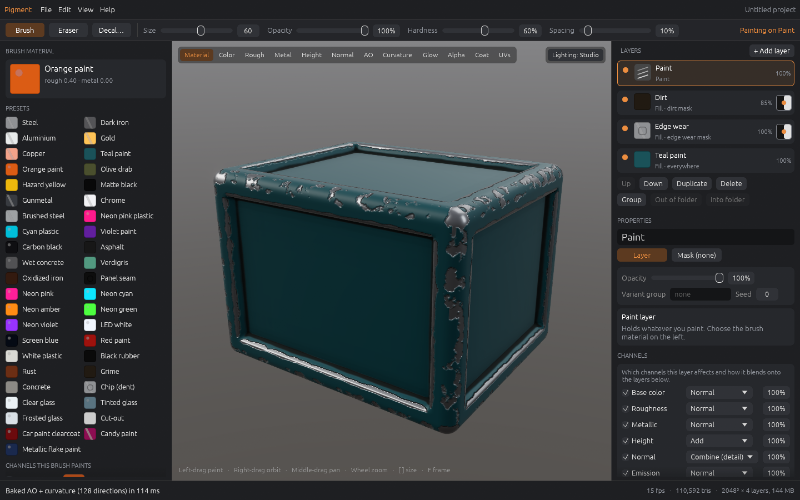
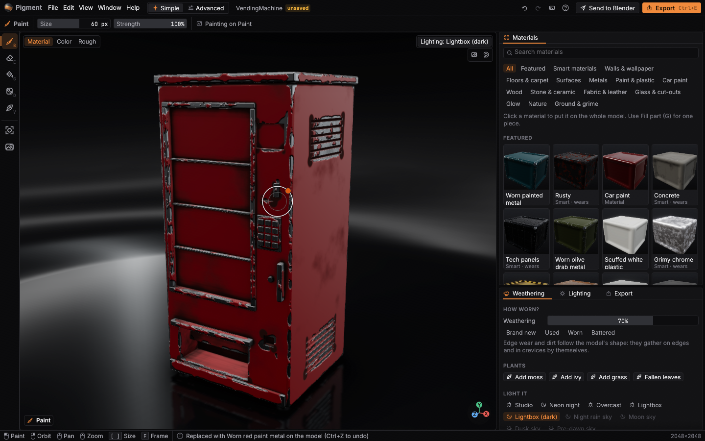
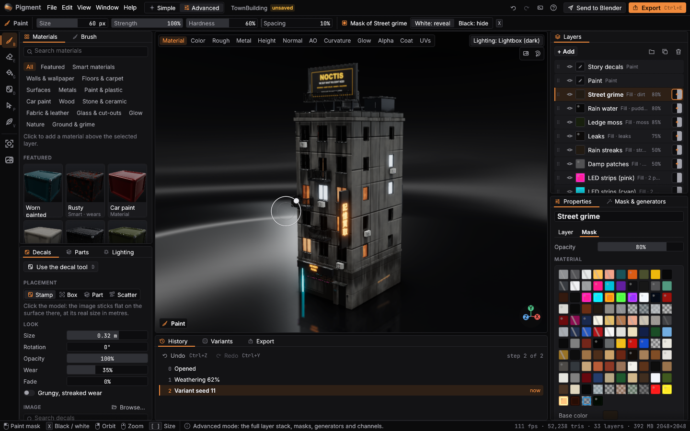
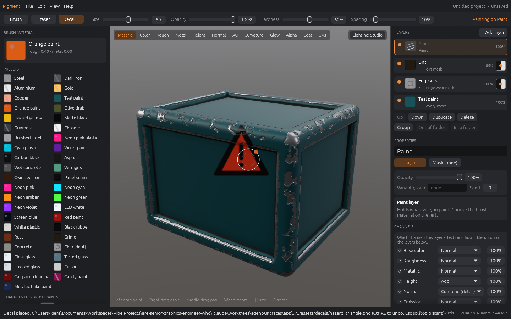
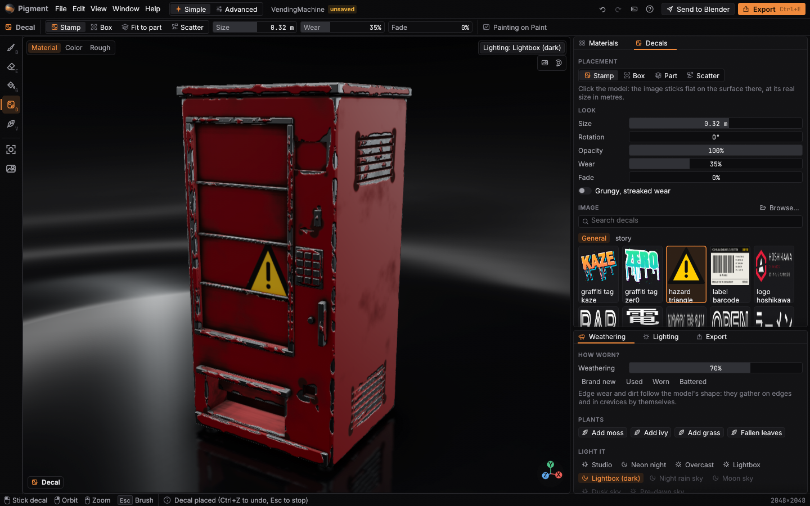
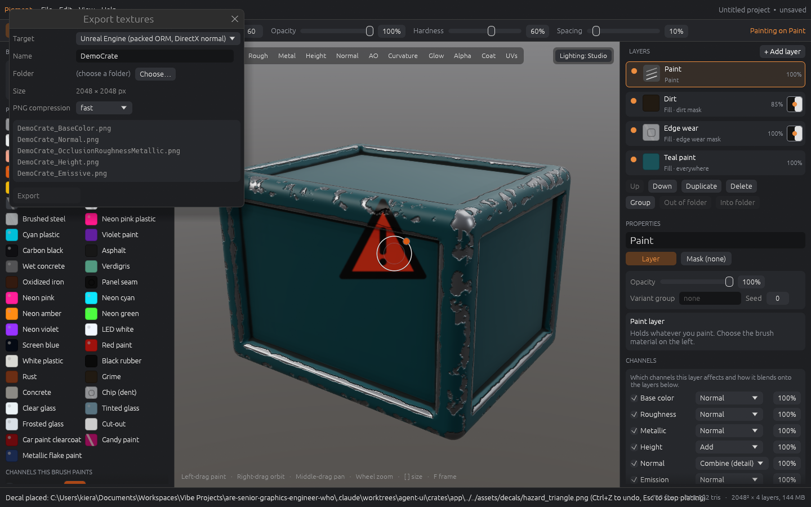
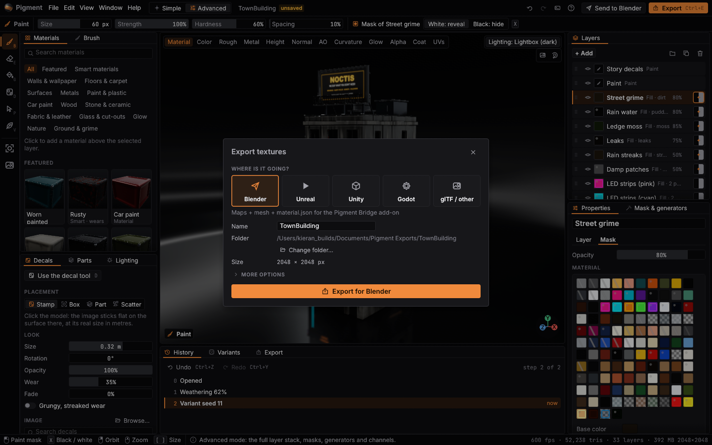
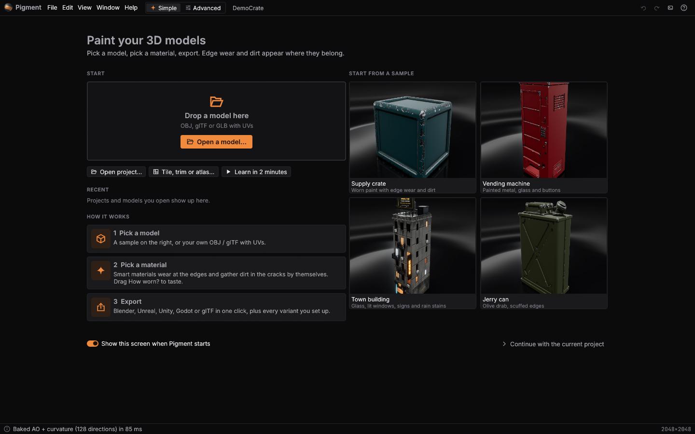
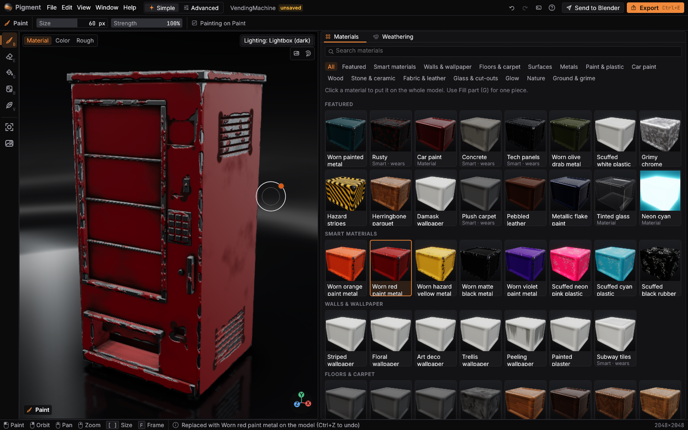
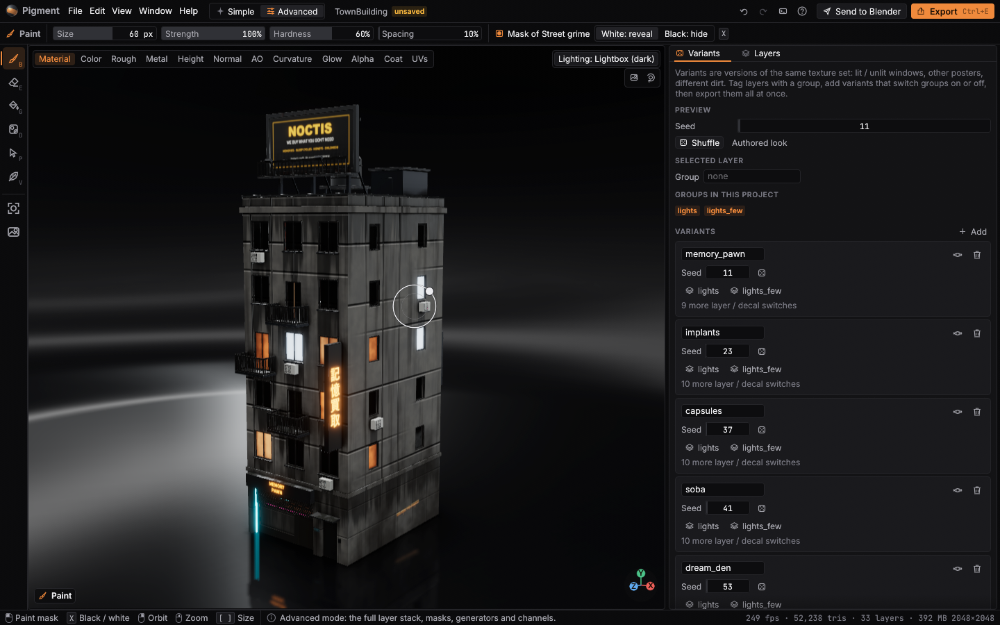

# UI workstream: an approachable Pigment

Goal: make Pigment excellent for a complete beginner while staying powerful for experts,
with a design system first and every panel dockable. All screenshots were captured from
the app's own frame function offscreen (`app/harness.rs`), never from an OS window.

| | Before | After |
|---|---|---|
| Main / Simple |  |  |
| Advanced | (same screen as above) |  |
| Decal tool |  |  |
| Export |  |  |
| Welcome | (none: opened on the demo crate) |  |
| Material library | (43 flat swatches in a list) |  |
| Variants | (MCP only) |  |

Also: `command_palette.png`, `shortcuts.png`, `advanced_mode_light.png`, `layout_painting.png`,
`layout_compact.png`, and the design gallery in `docs/design/gallery*.png`.

## UX audit (before)

Walked every flow in the old UI (`git show cbfbbf3:crates/app/src/app/ui.rs`):

1. **No first-run path.** The app opened straight onto the demo crate. No recent files,
   no samples; drag-and-drop worked but nothing said so. A modal-ish tour card appeared once.
2. **Materials were a flat list** of 43 presets with flat colour squares (no rendering), no
   search or categories, in a left panel next to 11 channel checkboxes.
3. **Smart materials were hidden** in "+ Add layer"; applying two stacked them on top of each
   other, so "try Rusty, then Concrete" produced a mess. No previews.
4. **Weathering** meant finding the Edge wear layer, its mask tab and an Amount slider.
5. **Export** needed a folder dialog every session, blocked the window while PNGs encoded
   (seconds at 4K), and the result was a very long status line. No Blender button.
6. **Bakes blocked** the window (`poll(Wait)` on the UI thread).
7. **Decals**: an OS file dialog every time, only the camera "rect" mode; the anchored
   placement, scatter and wear existed only over MCP. The brush ring was drawn while
   placing decals.
8. **Parts** were buried in the Mask tab and shown as a debug list (`[3, 5]`).
9. **Layer order** by Up / Down buttons and an "Into folder" menu; no drag and drop.
10. **Generator picker** was a text combo of 14 names; no previews.
11. **Image fills**: a combo of tile-set names, no thumbnails.
12. **Variants**: a text field and a seed in the layer tab, nothing else.
13. **Lighting / bloom / skies** in a dropdown on the viewport.
14. **Tile / trim / atlas projects** were MCP-only.
15. **No command palette**, a read-only History submenu, shortcuts only listed in Help.
16. **Hard-coded colours** throughout `ui.rs` and `tour.rs`, default egui font, text buttons
    instead of icons, no light theme, low-contrast disabled text.
17. **Nothing remembered**: window size, panel sizes, theme; no autosave or recovery.
18. **Status bar** showed fps / triangles / VRAM to everyone.
19. **Errors** were raw `anyhow` chains ("Couldn't open that file: ...").
20. **Viewport**: zoom went to the orbit centre, F framed the whole model only, no gizmo,
    the hint text sat under the HUD.
21. **Fixed layout**: three fixed side panels, nothing could be moved, closed or floated.

## What changed

**Design system** (`app/design/`, `docs/design/DESIGN_SYSTEM.md`): semantic colour roles for
a dark and a light theme, spacing / radius / elevation / type / icon / motion / size tokens,
embedded Inter and JetBrains Mono (OFL, licences in `crates/app/assets/fonts`), a 62-icon
vector set on an 18 pt grid, and components (buttons, icon and tool buttons, toggles,
segmented, tabs, slider rows with value fields and units, swatches, cards, the layer row,
rich tooltips, toasts, modals, empty states, progress, search, command palette, property
grid, asset tiles, key caps, badges). `pigment --design-gallery` shows them all. Tests: WCAG
contrast of every text role on every surface; a lint that rejects raw colours and magic
sizes in screen files.

**Docking** (`app/dock.rs`, `app/panels/`): every panel is a widget struct registered by
`PanelId` (`trait Panel`): Viewport, Materials, Weathering, Brush, Layers, Properties,
Channels, Mask & generators, Decals, Parts, Variants, Lighting, History, Export, Texture
set. Drag tabs to tab / split, drop outside to float, close and reopen from Window, presets
Beginner / Painting / Texturing / Compact, named custom layouts, Reset layout. egui_dock
has no egui 0.37 release, so this is a small equivalent styled with the tokens.

**First run** (`welcome.rs`): open a model (or drop one), open a project, recent files,
samples with rendered previews (crate, vending machine, town building, jerry can; the car
when its paintable body exists), tile / trim / atlas, "Learn in 2 minutes", and a
**Recover** card after a crash. The guided tour became coach marks next to the control
they point at, started from the welcome screen or Help.

**Simple mode** (default): Materials library with live thumbnails, tools Paint / Erase /
Fill part / Decal, a "How worn?" slider (scales every edge wear, dirt, scratch, rust, leak,
moss and puddle generator; 50% = as authored), lighting presets, Export. Clicking a
material **replaces** the model's material (keeps paint and decals); Fill part (G) puts it
on one part and replaces that part's previous fill. Three clicks: sample → material →
Export.

**Advanced mode**: Layers with drag-and-drop reorder / nest (grip handle, above / into /
below hints), lock, right-click menu; Properties with a grouped material editor (Surface,
Glow, Glass & cut-out, Car paint coat / flake) and an image-fill browser with tile-set
thumbnails; Channels; Mask & generators with a grid of rendered generator previews;
Parts list with filter; Variants (seed preview, groups, recorded decals, defs); Texture set
& bake; History (click a step to jump).

**Decal tool** (D): image browser for `assets/decals` by folder, modes Stamp (click: flat
on the surface, real size in metres, ghost outline under the cursor), Box (camera drag, the
old mode), Fit to part (click a part's face) and Scatter (count, size range, walls only,
seed), with opacity, wear, fade and grunge. Uses the engine's box decals and scatter; one
undo step each (a scatter is one step).

**Export** (Ctrl+E): target cards (Blender, Unreal, Unity, Godot, glTF / other), a default
folder `Documents/Pigment Exports/<name>`, file list under More options. Pixels are read
back on the UI thread, PNG encoding + writing runs on a worker with a progress toast.
**Send to Blender** writes maps + `<name>.glb` + `material.json` for the add-on.

**Polish**: top bar with icons (undo / redo with labels, palette, help, Send to Blender,
Export), tool rail with shortcut tooltips, context tool-options bar, command palette
(Ctrl+K, fuzzy), shortcut sheet (?), toasts, friendly error messages with advice, bakes
tracked on the GPU queue without blocking, autosave every 3 minutes to
`<config>/pigment/autosave` (recovery offered on the welcome screen; cleared on clean exit or
when a project is opened), remembered window size, layouts, theme and UI scale
(Ctrl + / -), Settings dialog. Viewport: zoom towards the cursor, F frames the selected
layer's parts, axis gizmo, per-tool hint chip, simplified view chips in Simple mode.

## Round 2: filling the gaps

- **Variants in the UI.** The Variants panel defines, edits, previews (one undo step) and
  deletes variant definitions, and **Export N variants** writes them all with previews.
  It used to be MCP-only. See `docs/agents/variants/NOTES.md`.
- **Pictures of your work.** Two viewport buttons (under *Lighting*), View > Save image
  (Ctrl+Shift+R) and the palette save a 2× image of the model without the UI, or an
  8-view turntable sheet, into `<export folder>/<asset>/renders`. Same code as the MCP
  `render` / `render_turntable` tools.
- **`Session::lend`** (`automation.rs`) moves the UI's app into an automation session for
  one call and back (also on panic), so UI features reuse MCP tools instead of copying
  them. The UI wrappers live in `app/session_tools.rs` and put the camera and view back.
- **Saved with the project:** layer lock (`Layer.locked`) and the weathering level
  (`Document.weathering`, plus each weathering layer's "as authored" amount in
  `Layer.wear_base`). All three are skipped when at their defaults, so older projects
  load unchanged and untouched projects save byte-for-byte as before.
- **Foliage brush mount** override (Cell's own / Upright / Flat / Wall / Hanging); MCP
  `paint_foliage` now honours `mount` too (it parsed it but dropped it).
- **History labels**: "Weathering 62%", "Lock Paint", "Hide Glass", "Variant seed 11",
  "Edit variants" instead of "Edit <first changed layer>".
- **Welcome screen**: a *How it works* strip on first run; the sample previews are
  rendered at 960×720 on the dark lightbox and shown at up to 640 px (they were shrunk to
  128 px and blurred); Export / Send to Blender are hidden until there's something to export.
- **Screenshots** re-staged on the vending machine and the finished town building,
  on *Lightbox (dark)* (glossy floor, reflection, contact shadow), with real history steps.

## Tests

`cargo test --release -- --test-threads=2`: all green (80 app lib tests incl. GPU, 107 core,
MCP / schema tests). New:

- `ui_tests::welcome_sample_material_export`: welcome → click the crate sample → Rusty
  replaces the material → weathering scales generators → Ctrl+E → click Export → maps,
  mesh and `material.json` written, dialog closed.
- `ui_tests::folder_drag_and_drop`: drags a layer's grip onto a folder row with scripted
  pointer input; plus the pure above / into / below rules.
- `ui_tests::decal_tool_stamp_and_scatter`: D, click the model, pixels change, one undo
  step; scatter is one step; Esc returns to the brush.
- `ui_tests::simple_advanced_toggle`: clicks the mode toggle, Ctrl+Tab round trip keeps a
  customised layout, P picks parts.
- `ui_tests::lock_and_weathering_survive_save_and_open`,
  `variants_panel_defines_and_exports` (two variants from the panel, folders + previews +
  sidecars, project unchanged, preview + undo, duplicate names refused) and
  `save_render_and_turntable` (Ctrl+Shift+R writes a 2× PNG, camera put back).
- `ui_tests::fill_part_tool_targets_one_part`, `command_palette_runs_commands`,
  `history_panel_jumps`, `autosave_and_recover`, `library_thumbnails_render_and_cache`,
  `hidpi_renders_at_scale`, `every_panel_renders_in_isolation` (every `PanelId` registered
  and drawn alone; selection-dependent panels with a masked layer).
- `dock::tests` (layout JSON round trip for every preset, dock / split / float / close /
  reopen, repair), `prefs::tests` (round trip through disk, corrupt file falls back).
- `design::tests` (contrast, raw-style lint).

Ignored (run by hand): `ui_screenshots`, `design_gallery_screenshots`, `sample_previews`
(writes `assets/samples/*.png`), `ui_frame_timing`.

## Performance

The paint path (`begin_stroke` / `apply_stamps` / composite) is unchanged. Whole-window frame
time measured offscreen with `ui_frame_timing` (1440 x 900, RTX 4070 Ti, waits for the GPU
each frame), 4096² texture set:

| | idle frame | painting frame (mean / p95) |
|---|---|---|
| Simple layout | 1.4 ms | 3.7 / 9.4 ms |
| Advanced layout | 1.3 ms | 4.4 / 10.8 ms |

Thumbnails render two per frame only while some are missing (a 256² texture set on a small
crate, Pigment's own compositor and viewport), are kept as GPU textures, and are cached as
PNGs in `<config>/pigment/thumbs` (versioned), so later launches load them instantly.
Directory listings used by panels are cached for 3 s.

## Known limits

- The car sample needs `assets/vehicles/hayate/src/hayate_body.glb` (regenerated by
  `tools/car`); the committed `car.glb` / `hayate.glb` exports have no UVs or embed textures
  Pigment can't read, so the welcome screen shows the jerry can instead.
- Floating panels are egui windows inside the main window (not OS windows).
- *Export N variants* and *Save image* run on the UI thread (they reuse the MCP code,
  which renders and reads back synchronously), so the window waits while they run:
  a moment for an image, a few seconds per variant on a 4K building.
- The car sample's preview (`assets/samples/car.png`) wasn't re-rendered with the others
  on the dark lightbox: its paintable body (`tools/car`) wasn't generated in that checkout.

## Merge notes

- Conflict hot spots: `crates/app/src/app/ui.rs` (rewritten; old panels moved to
  `panels/*`), `crates/app/src/app.rs` (new `ui: UiState` field, `create_with`,
  `new(cc, startup, gallery)`, async bake branch in `bake()`, `request` → `run_pending_ui`),
  `tour.rs`, `main.rs`, `folders_ui.rs` (`insert_layer` / `duplicate_selected` moved here).
  Branches that edited the old `ui.rs` panels should port their widget into the matching
  `panels/*.rs` file and use `design::` components (the lint test will flag raw colours).
- `crates/app/Cargo.toml` adds `serde` (workspace). No new external crates.
- New assets: `crates/app/assets/fonts/*` (OFL), `assets/samples/*.png`.
- MCP: no tool changes; `Session` still builds the app with `PigmentApp::create` (default
  preferences, synchronous bakes), so scripts behave as before.
