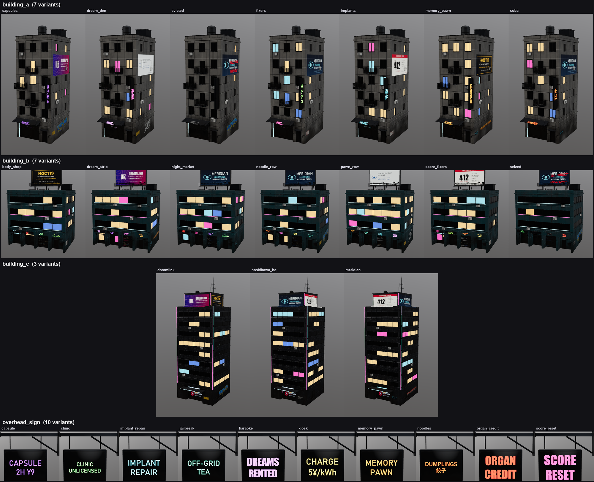

# Texture variants + story signage (workstream `variants`)

The town repeated 3 building meshes ~86 times with the same BAR/OPEN signs and the same
lit windows. Now one Pigment project per asset authors every candidate story decal once,
and `export_variants` writes N texture sets from it without re-running the script.



## What I built

**Core (`crates/core/src/variants.rs`, pure data and tested):**
- `Layer.variant`: a group tag, a seeded `part_subset` and the recorded `decals`.
  It's one serde-default field, so old projects load unchanged.
- `Document.variants`: the active `seed` plus the stored variant definitions.
- `part_subset {from, to, salt}` keeps the mask parts whose `part_roll(seed, salt, part)` falls
  in `[from, to)`. Layers with the same salt and disjoint ranges get disjoint parts, so each
  lit window is warm, cyan, pink or Meridian-blue, never two of them.
- The variant seed also offsets generator seeds (`seed % 9973`), so grime and streaks differ
  per variant. Seed 0 keeps the authored look byte-identical.
- `resolve(doc, variant)` applies `disable`, then `enable`, then `swaps`, and lists the paint
  layers whose decals changed. A selector that matches nothing is an error, so typos fail loudly.

**App / MCP:**
- `project_decal` now records each decal on its paint layer (args minus the layer). New args:
  - `name`: defaults to the image stem.
  - `variant`: the group tag.
  - `enabled: false`: record the decal for variants but don't paint it in the authored look.
  - `box: {min,max}` or `{center,size}`: aim at an area of a wall. Building shells are
    single huge parts, so `part` can't target a wall area.
  - `facing: "+x" | "-x" | "+y" | "-y" | "+z" | "-z"`: choose which side to project from.
- `add_layer` / `update_layer` take `variant` (group) and `part_subset` (creates a white mask if needed).
- **`export_variants`**:

  ```
  export_variants(dir, name?, preset="separate",
                  variants?: [{name, seed, enable:[...], disable:[...], swaps:{sel: image | {image, tint, emissive_strength, ...}}}],
                  only?: [names], folder?="{name}__{variant}", preview?: {yaw, pitch, width, height, exposure, dir}, dry_run?)
  ```

  - Selectors are layer names, decal names, group tags, or `"*"` (everything tagged).
  - Layers whose decals changed get a scratch resource and their enabled decals are replayed.
    The replay goes through the normal decal path with no undo entries.
  - Afterwards the authored document and pixels are restored exactly (tested), and the scratch
    GPU memory is freed. Variant ids are never reused.
  - `variants` are stored in the project, so `save_project` keeps them and a later call can omit them.
  - `dry_run` validates the definitions and reports what each variant shows.
- UI (layer tab): variant-group field, the list of recorded decals, and a **Seed** box that
  previews any variant seed live. Exporting variants is MCP-only.

**Decal fixes (`tools/make_story_decals.py`):**
- Plate text is now sized to fill the plate.
- CJK lines use Yu Gothic, so 門限 renders.
- MISSING posters: the photo is clipped to its frame, and the name, note and tear-off phone
  tabs each have their own band (a few tabs are torn off). See [decal_fixes.png](decal_fixes.png).

**Content (`tools/town_textures.py`):** building and overhead-sign recipes rewritten on the story decals.

| Asset | Variants | Zoning |
|---|---|---|
| building_a | 7: memory_pawn, implants, capsules, soba, dream_den, evicted, fixers | Neon blade sign (both faces) and ground shop sign. Corporate billboard high on the +x wall; some variants add a back-wall ad. Graffiti, UNPLUG and MISSING posters at street level on both sides. Authority plate by the door. |
| building_b | 7: noodle_row, body_shop, dream_strip, score_fixers, pawn_row, seized, night_market | Four shop bays, each with its own street-economy sign. Rooftop corporate billboard. Graffiti, posters and plates on the ground-floor side and back walls. |
| building_c | 3: hoshikawa_hq, meridian, dreamlink | The corporate tower. Lobby logo plus a HOSHIKAWA SECURITY or MERIDIAN KIOSK band. Corporate billboards (Meridian eye, citizen score, Dreamlink, Noctis, defaced) on all four crown faces. Resistance tags at its feet. |
| overhead_sign | 10 shops | Ten different shops, a few with a different sign on each face. |

- Each variant also has its own seed, so the lit windows differ.
- `evicted` and `seized` swap the `lights` group for `lights_few`: an almost dark building
  with PROPERTY OF HOSHIKAWA plates and resistance graffiti.

## Output contract (for the Blender layout)

```
scenes/town/textures/<asset>__<variant>/<asset>_BaseColor.png   (+ _Roughness _Metallic _AO _Normal_OpenGL _Height _Emissive)
scenes/town/textures/<asset>__<variant>/variant.json
```

- **Assets:** building_a, building_b, building_c and overhead_sign now export **only**
  variant folders. The old `scenes/town/textures/<asset>/` folder is no longer written for these
  four. Streets, lamp and pole keep the old `<asset>/` folder.
- **Picking a variant:** a variant is any folder matching `<asset>__*`. Pick one per instance with
  a seeded RNG, and avoid repeating the variant of the previous or neighbouring instance of the
  same asset. With 7 variants for a/b, adjacent buildings never need to match.
- **`variant.json`:** `{asset, variant, seed, preset, emissive_scale, decals: [{name, group, image}], hidden_layers}`.
- **Emission strength:** each variant's emissive map is normalised to its own peak, so set the
  emission strength from `emissive_scale` (it can differ between variants).
- **Calling `apply_pigment_material`:** use `apply_pigment_material(obj, folder=<variant folder>, name=<asset>, emission_strength=emissive_scale)`.
  The file names inside are unchanged.
- **Texture sizes:** building_a/b 2048, building_c 4096, sign 1024. That keeps ~27 texture sets
  within Cycles' VRAM.

## How I tested

- `cargo test --release`: all green. New tests:
  - core: `variants::tests` (5).
  - app (GPU): `export_variants_makes_distinct_sets_and_restores_the_project` checks:
    - a typo in a selector errors and stores nothing;
    - the 4 variants (seed, enable/disable, image + tint swap, all off) give different emission
      maps, and "all off" is dark;
    - re-exporting is deterministic and doesn't replay untouched layers;
    - the authored doc and Signs pixels are unchanged afterwards;
    - the definitions survive save.
  - app (GPU): `decal_on_a_world_box` checks `box` and `facing`.
- Real content: `python tools/town_textures.py building_a building_b building_c overhead_sign`
  exports 27 variant sets plus previews (`%TEMP%/pig/town_variants/`). The contact sheet above
  is built from those previews.

## Known limits

- A replayed layer is rebuilt from its decal records only. Keep variant decals on their own
  paint layer (the town uses "Story decals"); brush strokes on that layer would be dropped in
  variants that change it.
- Decals projected onto masks (`mask: true`) aren't recorded or varied.
- Selectors are case-insensitive and match layer names *and* groups. Don't give a layer the same
  name as a group (I hit this: a layer named "Story" was hidden by the group `story`).
- Decal image paths are stored as given (relative to the working directory when the script ran).
- The building_b sign boxes are a 5:1 strip, so the ~2:1 shop signs come out small.
- `part_subset` only selects part ids below 256, like the rest of the part-mask system.
- Regenerating the textures requires running `python tools/town_textures.py` (the textures folder is git-ignored).
