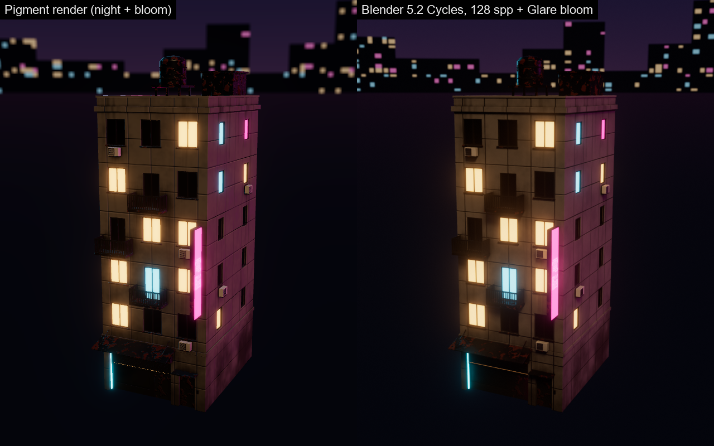

# Viewport and MCP render quality

The viewport and the MCP `render` tool now show the same thing, and it
previews Blender (Cycles) closely: emissive signs glow, the town can be judged
at night, and one call shows an asset from every side.



## What was built

- **HDR pipeline + bloom.** The viewport renders into an `Rgba16Float` 4x MSAA
  target. A new post pass (`shaders/post.wgsl`) runs a mip-chain bloom
  (Jimenez 2014):
  - a 13-tap downsample with a Karis average (no fireflies) and a soft-knee
    threshold, over up to 6 mips from half resolution;
  - a 3x3 tent upsample that lerps each mip with the blurrier one below it
    (the hardware blend constant is the radius);
  - an ACES (Hill fit) tone map at the end.

  Alpha in the HDR target marks scene-referred pixels (tone-mapped, may bloom)
  versus display-referred channel views (passed through), so the channel
  views (base colour, roughness...) are unchanged. Bloom applies in the
  Material view only.
- **Lighting presets** (`pigment_core::envmath`):
  - `studio`: the existing softboxes.
  - `night`: a dark blue sky with a magenta/sodium horizon glow and a
    procedural skyline of lit windows, wet dark ground, a cyan and a magenta
    neon tube as rim lights, and a sodium street lamp as the key.
  - `overcast`: a CIE overcast sky over grey ground.

  HDRIs (`.hdr` / `.exr`, via the image crate) were already loadable in the
  UI. They are now also loadable from the MCP and cached by path.
- **Shading** (`viewport.wgsl`):
  - multi-scattering energy compensation (Fdez-Agüera 2019) on top of the
    split-sum IBL, so rough metals no longer lose energy;
  - the dominant specular direction for rough lobes (Lagarde);
  - horizon occlusion for normal-mapped reflections;
  - specular occlusion from AO (Lagarde, already there and kept);
  - multi-bounce AO for diffuse (GTAO fit);
  - a fix for BRDF-LUT sampling: it used the env's repeat sampler, so
    `N·V ≈ 1` wrapped around.
- **Background** now shows the environment unblurred (mip 0). This is what
  Blender's world shows; before, the blurred mip 2.5 smeared the night lights
  into a wash.
- **Contact sheets** (`pigment_core::sheet`) lay tiles out in a grid with
  labels, using a built-in 3x5 pixel font.
- **UI** (viewport → Lighting menu): Studio / Night city / Overcast buttons, a
  Bloom checkbox with threshold / intensity / radius sliders, and the existing
  HDRI loader, exposure and rotation.
- **`tools/blender_lookdev.py`** renders a Pigment-textured asset in headless
  Cycles with Pigment's exact camera, world lighting (from `export_lighting`),
  emissive scale, ACES 1.3 view transform and a compositor Glare bloom.

## MCP

`render` gained these arguments (they persist across renders until changed,
like `exposure`):

| arg | meaning |
|---|---|
| `lighting` | `studio` \| `night` \| `overcast` |
| `hdri` | path to an equirect `.hdr` / `.exr` (overrides `lighting`) |
| `exposure` | EV (existed) |
| `env_rotation` | degrees around +Y |
| `bloom` | `true` \| `false` \| `{threshold: 0.8, intensity: 1.0, radius: 0.6}` (defaults shown; on by default) |
| `views` | `["front","back","left","right","top","bottom"]` or `"all"` → one labelled contact-sheet PNG; `width`/`height` are per tile (default 384), `columns` optional |

The views follow Blender's numpad conventions: front looks at the glTF +Z face
(Blender -Y), right is seen from +X, top from above.

New tools:
- `render_turntable(frames=8, pitch=15, start_yaw=0, zoom, width=384, height=384, columns=4, path, + lighting/hdri/exposure/bloom/view)`
  returns `frames` evenly spaced views as one contact sheet, each labelled `YAW n`.
- `export_lighting(lighting="night", path, width=2048)` writes the preset as an
  equirect Radiance `.hdr` to light a Blender world identically. In Blender,
  rotate the Environment Texture's mapping -90° about Z;
  `tools/blender_lookdev.py` does this.

Example:
```json
{"tool": "render", "args": {"yaw": 25, "pitch": 12, "width": 640, "height": 800, "lighting": "night", "bloom": {"intensity": 1.0}}}
{"tool": "render_turntable", "args": {"frames": 8, "pitch": 12, "width": 320, "height": 400, "lighting": "night"}}
{"tool": "render", "args": {"views": "all", "lighting": "overcast"}}
```

## Proof (town buildings)

The `scenes/town/projects/building_{a,b,c}.pigment` projects (built by
`tools/town_textures.py`) were opened in `pigment-mcp --script`, their textures
exported to `scenes/town/textures/`, and rendered:

- `lighting_and_bloom.png`: building_a in studio without bloom (before),
  night without bloom, and night with bloom.
- `town_night_bloom.png`: buildings a, b and c at night with bloom.
- `turntable_night.png`: `render_turntable`, 8 frames.
- `views_overcast.png`: `render(views: "all", lighting: "overcast")`.
- `pigment_vs_cycles_night.png`: the same asset, camera and night lighting in
  Pigment and in Blender 5.2 Cycles (128 spp, OptiX, denoised, ACES 1.3, Glare
  bloom, emission strength = Pigment's exported `emissive_scale` 6.0). Command:

  ```
  blender -b --factory-startup --python tools/blender_lookdev.py -- --mesh assets/town/building_a.glb \
    --maps scenes/town/textures/building_a --name building_a --hdri night.hdr --out a_cycles.png --bloom --emission 6.0
  ```

### Differences from Cycles

The framing, the light direction and colour (sodium key on the front, magenta
rim on the right, cyan on the left edges), the skyline position and the
material read all match. What differs:

1. **No shadows or emissive light transport in Pigment.** Cycles shades the
   shopfront under the awning, darkens the rooftop tanks, and lets the lit
   windows and neon light their frames and the wall around them. Pigment only
   has image-based lighting with the baked AO, so emissive surfaces glow (via
   bloom) but light nothing.
2. **Bloom shape.** Pigment's bloom is wider and a little stronger than
   Blender's Glare node in Bloom mode. Use `bloom: {radius: 0.4}` for a
   tighter halo.
3. **Tone mapping.** Pigment uses Hill's ACES fit and Blender uses OCIO
   ACES 1.3. Mid-tones agree; Pigment is slightly more saturated on the
   magenta-lit wall.
4. **Environment resolution.** Pigment downsamples the environment to 1024
   px wide, so the background skyline is softer than Blender's 2048 px.
5. **AO is double-counted in Blender.** `blender_pigment.py` multiplies base
   colour by the baked AO (factor 0.5) on top of Cycles' own occlusion, so
   crevices are a bit darker in Blender. Pigment applies the AO once, in
   lighting.

## Tests

- `pigment-core`:
  - `envmath::tests::lighting_presets_resolve_and_differ` checks name
    resolution, that night is darker than overcast and has coloured rims, and
    that overcast is brighter overhead.
  - `environment_round_trips_through_hdr`.
  - `sheet::tests::{grid_layout_places_tiles, labels_are_drawn}`.
- `pigment` (GPU):
  - `automation::tests::bloom_lighting_presets_and_contact_sheets` checks
    that:
    - bloom adds a pink halo around neon and channel views never bloom;
    - night is less than half as bright as studio and overcast on the model;
    - bad lighting names and missing HDRIs are errors;
    - an exported `.hdr` loads back via `hdri`;
    - turntable and `views` sheets have the right size;
    - unknown views are rejected.
  - `shader_tests::post` validates `post.wgsl` with naga.
- `cargo test --release`: all pass.

  With about 8 GB of the 12 GB GPU used by other processes, the default
  parallel run can hit `wgpu error: Out of Memory` in random GPU tests. The
  same tests pass with `-- --test-threads=2` (or 1). That's an environmental
  issue, not a regression.

## Known limits

- No real-time shadows or emissive-as-light: see difference 1 above.
- Bloom runs only in the Material view, and the bloom threshold is in exposed
  units.
- Contact-sheet labels are A-Z, 0-9 and `-+.` only.
- The procedural night skyline is a background only. It is too small to
  matter for lighting.
