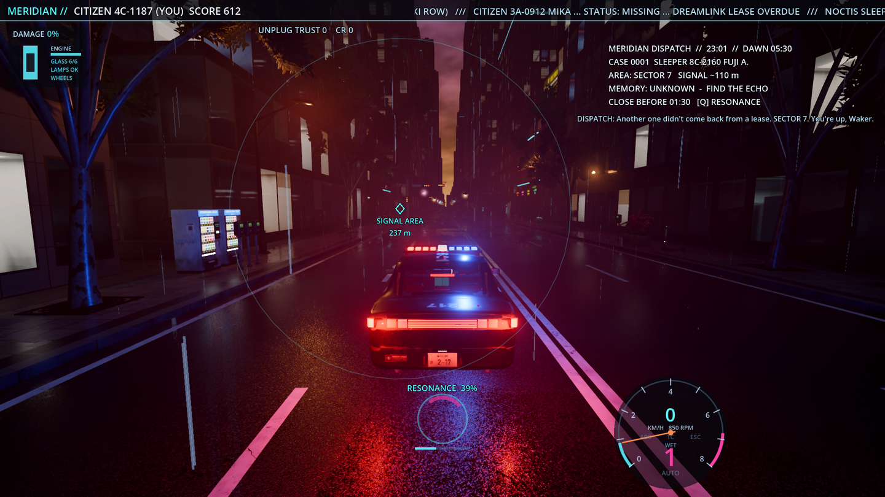
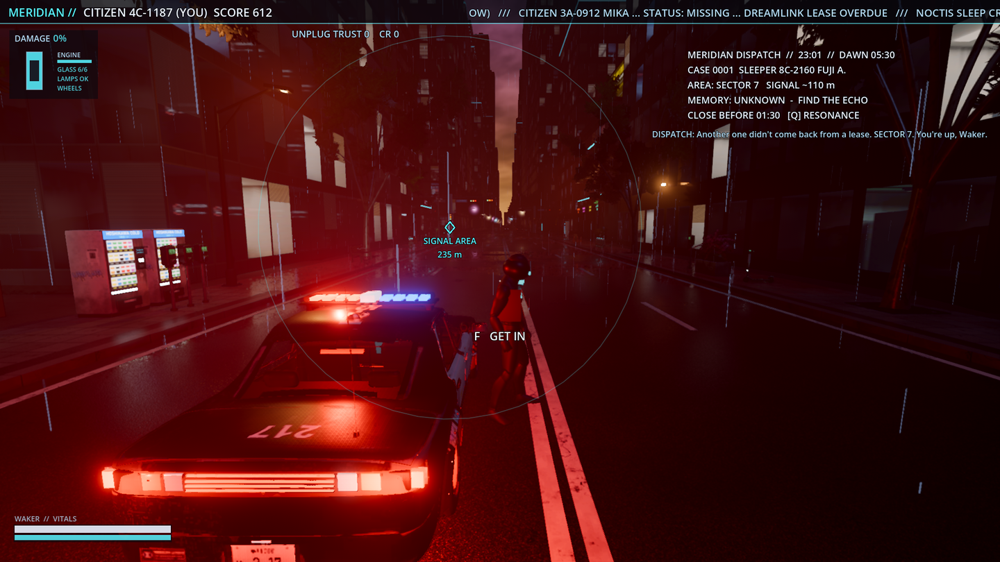
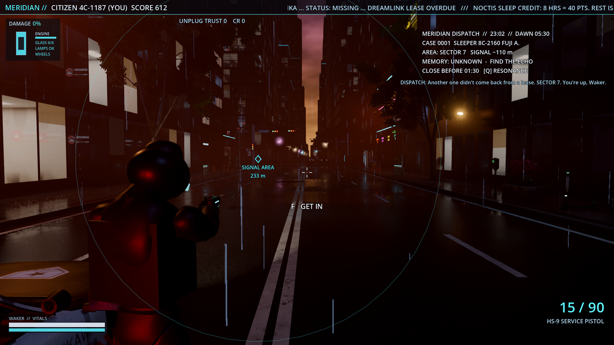
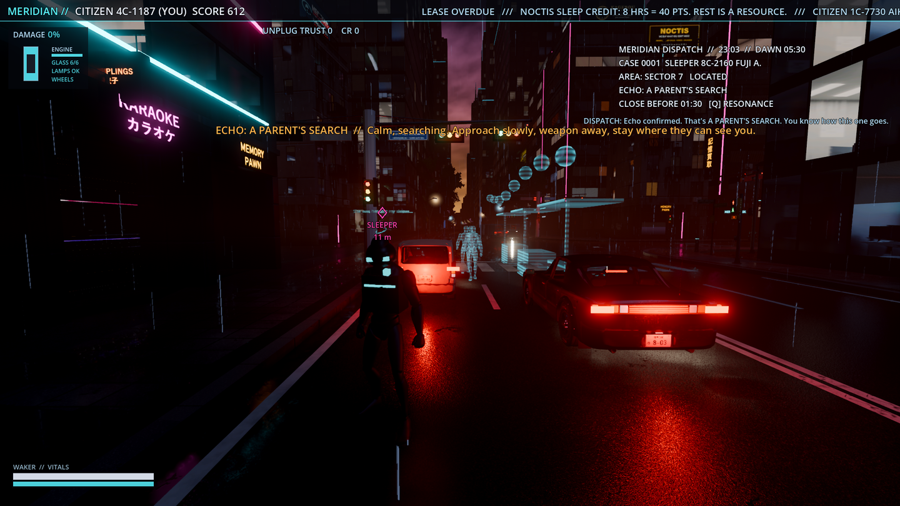
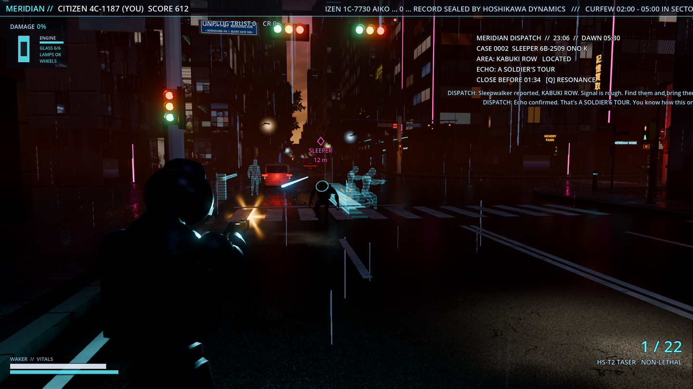

# Waker: on foot, the kit, and Sleepwalker cases

You play a Hoshikawa **Waker**. Dreamlink / Noctis lease citizens' sleeping minds to MERIDIAN at night
and hand them leased memories in return. Sometimes a sleeper doesn't fully come back: a
**Sleepwalker** is awake and walking the city inside someone else's memory. MERIDIAN pings their
Dreamlink signal and the Waker on duty has to find them and bring them back before dawn.

This branch adds third-person on-foot play, getting in and out of cars, a data-driven kit that leans
non-lethal, the case loop with five memory archetypes, the HUD for all of it, tests, proof shots and
the weapon models (Blender + Pigment).

## Controls

| | keyboard / mouse | pad |
|---|---|---|
| get out / in (player car, a woken courier's van, any car you left) | **F** | Y |
| move / walk / sprint | WASD / hold **Alt** / hold **Shift** | left stick / - / L3 |
| crouch (toggle) | Ctrl | B |
| jump, vault (≤ 1.4 m), mantle (≤ 2 m) | Space (into the obstacle) | A |
| look | mouse (captured on foot) | right stick |
| aim (zoom, slower, strafing) / fire | hold **RMB** / **LMB** | LT / RT |
| reload / holster | R / H | X / d-pad down |
| kit slots / cycle | **1-6** / wheel | d-pad left / right |
| quick EMP throw | Z | - |
| shoulder swap | X (or C, the camera key) | R3 |
| **Resonance** scan (also in the car) | hold **Q** | LB |
| **Wake** | hold **E** | d-pad up |
| report / let them keep it | **1 / 2** after a wake | |
| case log (pauses) | **Tab**, or CASE LOG in the Esc menu (N there: next case now) | |
| siren | L (light bar on the cruiser) | X |
| rain | moved from F to **F4** (F is the door) | |

Esc still opens the pause menu (the mouse is released while it's open, in the garage and in the car).
Right-drag still orbits the chase camera while driving. The garage drive-in works only from the car;
opening it from the pause menu while on foot puts you back in the car first.

## Systems

| folder | what |
|---|---|
| `game/scripts/player/` | `player.gd` CharacterBody3D controller (walk 1.7 / jog 4.2 / sprint 6.8 m/s, crouch, jump, vault / mantle, slopes up to 48°, ray-based stair step-up, health + armour, hit reactions, death -> respawn at the car if it's within 400 m or the nearest Hoshikawa Waker post), `ots_camera.gd` (shoulder camera: sphere-cast collision, shoulder swap, aim zoom, recoil kick, blend-in from the chase camera), `player_body.gd` (**the body adapter**, see below), `aim_modifier.gd` (SkeletonModifier3D aim layer: spine yaw / pitch towards the crosshair, hip twist for strafing). |
| `game/scripts/weapons/` | `combat.gd` (hitscan / melee / thrown resolution, hearing events, every pooled effect: 32 tracers, 6 muzzle flashes with lights, 96 impact decals with per-surface textures, 10 spark emitters, 64 shell casings in one MultiMesh, 4 EMP charges; shooting street props uses the damage workstream's destructibles additively: glass shatters, lamps can be shot out), `weapon_user.gd` (inventory, ammo, fire rate, buffered trigger, reload, spread bloom, model in hand), `weapon_models.gd`, `weapon_audio.gd`. Data: `game/data/weapons/*.json`. |
| `game/scripts/waker/` | `waker.gd` (the layer: input map, car <-> foot hand-over, posts, siren), `case_manager.gd` (night clock 22:00-05:30, dispatch, scan, echo, wake sync, choice, scores, unlocks, audits, save), `sleepwalker.gd` (perception + per-archetype brains), `echo.gd` (memory echo ghosts), `climb_course.gd`, `courier_driver.gd`, `audit_drone.gd`, `stories.gd` (all the words), `waker_hud.gd`, `case_log.gd`, tests / shots. |

### The kit (`game/data/weapons/`)

| slot | id | | notes |
|---|---|---|---|
| 1 | `stun_baton` | Komori stun baton | melee cone, 0.55 stun per hit |
| 2 | `taser` | HS-T2 taser | 2 darts, a hit stuns most sleepers outright |
| 3 | `service_pistol` | HS-9 | lethal, 24 hp, headshot x2.5 |
| 4 | `smg` | HS-K Shrike | lethal, unlocked at MERIDIAN 640 |
| 5 | `shotgun` | Mukade-12 | lethal, 8 pellets, unlocked at MERIDIAN 700 |
| 6 | `emp` | Hush EMP charge | thrown, 1.4 s fuse, 7.5 m: stuns every sleeper and stalls cars (the courier's van) |

**Add a weapon:** drop `game/data/weapons/<id>.json` (copy one: `kind` hitscan / melee / thrown,
`slot`, `lethal`, `damage`, `stun`, `headshot`, `rate`, `auto`, `pellets`, `spread_hip` / `spread_aim`,
`bloom`, `recoil`, `mag`, `reserve`, `reload`, `tracer` bullet / arc, `casing`, `sounds` {fire, reload,
dry, hit}, optional `unlock` {meridian}). Give it to the player in `player.gd _ready` (or through
`case_manager._apply_unlocks`). Model: add a function to `tools/weapons/make_weapons.py` and its id to
the three tool scripts; without a glb a primitive stand-in is built (`weapon_models.gd`).

### Sleepwalker cases

* **Dispatch:** a road point 150-420 m away; the HUD gets a circle (80-110 m) somewhere around it and
  a radio line (tone: corporate at MERIDIAN >= 680, cold under 480, neutral between).
* **Signal hunt:** hold Q: a soft directional lobe (wide and wobbly when weak, sharper with the UNPLUG
  "ghost band") and the signal strength; works from the car.
* **Memory echo:** within ~60 m the memory replays as cyan ghosts and props; the archetype is
  revealed with a one-line how-to.
* **Archetypes** (`sleepwalker.gd`):
  * *The search* (grieving parent): wanders calling a name; sprinting, a drawn or aimed weapon, gunfire
    or the siren drop their calm, at ~0 they flee; quiet and still, it climbs back.
  * *The tour* (soldier): the combat brain: sight cone + line of sight, hears gunshots, patrol -> alert ->
    cover (samples spots with something solid between it and you, peeks and shoots in bursts) /
    flank (when there's no cover or it's pinned) / charge (close, melee) / hunt (lost you). Taser,
    baton or EMP stun it for 6-7 s: that's the window to wake it.
  * *The ascent* (climber): spawns a scaffold course (crate, stairs, 1.6 m gap, 1.5 m ledge, stairs, a
    deck 5 m up) and runs it ahead of you; cornered at the top it calms. The course is sized for the
    controller and the test runs it as the player too.
  * *The last run* (courier): drives a van along the road graph once you're within 120 m. Box it in
    (held under 1.5 m/s for 2.5 s with your car within 12 m), ram it, or EMP it; the courier gets
    out dazed. The van can be taken afterwards.
  * *The last train* (swarm, after case 3): four sleepers share one memory and one calm value.
* **Wake:** within 3.6 m, inside their 65° focus cone, walking (< 2.6 m/s, no sprint), weapon away,
  sleeper calm >= 0.6 or stunned: hold E for 2.5-3.5 s. The prompt says what's in the way.
* **Choice:** REPORT (Hoshikawa wipes the fragment: pay = archetype pay + 150 non-lethal bonus + up to
  120 time bonus, MERIDIAN +15 / +25 non-lethal) or LET THEM KEEP IT (UNPLUG trust +12, MERIDIAN -20,
  a vignette; seven vignettes piece together whose memories are leased).
* **Failure:** killing a sleeper (MERIDIAN -60, -250 CR, UNPLUG -8), or the deadline / dawn (-10).
  Lethal hits on a sleeper cost -4 each ("excessive force"); force on a harmless one -6 once.
* **Unlocks:** MERIDIAN 640 SMG, 700 shotgun; UNPLUG 25 dampener (wakes 40 % faster), 50 ghost band,
  75 `unplug_livery` (listed in the save for the garage to pick up).
* **Audits:** under MERIDIAN 450, every ~4 min a Hoshikawa drone hunts you for 45 s; 10 s in its
  searchlight within 30 m = -150 CR, -10 MERIDIAN. Lose it by driving off or breaking line of sight.
* **Pace:** cases every ~60 s (45 s at high MERIDIAN, 90 s low, slower at high UNPLUG; rain speeds it
  up). Save: `user://waker.json` (`--waker-save=<path>`). MERIDIAN score is the main HUD's citizen score.

**Add an archetype:** an entry in `stories.gd ARCHETYPES` (+ `FRAGMENTS`), a brain function in
`sleepwalker.gd` (match in `_physics_process`, set `state`; `wakeable()` / `focus_ok()` gate the wake),
a ghost layout in `echo.gd build()`, a spawn step in `case_manager._activate()` if it needs props, and
add it to `_pick_archetype()`.

## Switching the body to the NPC pipeline's MPFB officer

The stand-in is the CC0 Quaternius *Universal Animation Library* mannequin
(`game/assets/characters/ual/`), imported with a BoneMap to `SkeletonProfileHumanoid` + rest fixer
(`tools/waker/setup_ual_import.gd`), so its skeleton is `%GeneralSkeleton` with profile bone names and its
clips are portable. Everything that draws a humanoid goes through `game/scripts/player/player_body.gd`.

After the `npc-workstream` merge:
1. Make sure the officer scene is imported with the same retarget (BoneMap with
   `SkeletonProfileHumanoid`, unique skeleton name `GeneralSkeleton`, rest fixer on), which is what that
   pipeline produces.
2. In `player_body.gd` set `MODEL` to the officer scene (e.g. `res://assets/characters/officer_male.glb`
   from the NPC branch). For per-instance choice (male / female officer), set `body.model = "<path>"`
   before `add_child` in `player.gd _ready`.
3. Keep `ANIMS` on the UAL gltf (its clips are already retargeted to the profile), or point it at the NPC
   pipeline's library if they ship the same clip names (`CLIP` maps role -> clip name; edit there if
   names differ).
4. Drop the waker gear primitives if the officer model has its own uniform: `LOOKS.waker.gear = []` and
   `tint` unused (or skip `set_look` for that model).
5. Sleepers can use the NPC pedestrians the same way (`Sleepwalker` builds its body through the adapter;
   the look adds the cyan Dreamlink halo).
6. Ragdoll: `sleepwalker.gd _death_hook` calls `res://scripts/npc/character/ragdoll.gd`'s static
   `ragdoll(body, skeleton, impulse) -> bool` when that file exists; adapt the call to the real API
   name there. Without it the death clip plays.
7. Crowd hook: when an echo is found the manager calls
   `get_tree().call_group("npc_civilians", "on_incident", pos, 30.0)`; give the NPC pedestrians that
   method (flee from `pos`) and they scatter.

## Sound drop-in

Generated by `python tools/audio/make_weapon_sounds.py` into `game/assets/audio/weapons/`. A better pack
goes in `game/assets/audio/weapons_pack/` with the same base names (wav / ogg / mp3, variations
`_1.._n`): `pistol_shot smg_shot shotgun_shot taser_zap taser_hit baton_swing baton_hit dry_fire
reload_mag reload_shell reload_cell casing_tink impact_concrete impact_metal ricochet body_hit
emp_throw emp_arm emp_blast siren(loop) scan_pulse wake_sync(loop) wake_chime echo_hum(loop)
dispatch_beep audit_drone(loop)`.

## Weapon models

`blender -b --factory-startup --python tools/weapons/make_weapons.py` (low-poly, bevelled, UV'd parts,
part bboxes in json) -> `python tools/weapons/weapons_textures.py` (pigment-mcp scripts in
`scenes/weapons/scripts/`: base materials per part role, curvature / AO bake, edge wear, scratches, grip
stipple, scuffs, grime, 1024 export) -> `blender ... tools/weapons/export_weapons.py` ->
`game/assets/weapons/<id>.glb` (512 px textures embedded, `Muzzle` empty). 576-2260 triangles each.

## Tests

| flag | covers |
|---|---|
| `--onfoot-test` | walk / jog / sprint speeds, jump height, 25° slope up, 60° slope blocked, stairs, vault 0.9 m, mantle 1.6 m, camera held off a wall, out of the car (parks, stays put), back in |
| `--weapons-test` | pistol body / headshot damage, reload, empty-trigger reload, taser stun, baton, shotgun pellets, EMP radius, 500 shots through the pools with no node growth, per-shot and sustained cost |
| `--waker-test` | dispatch, radio, rough area, resonance (strength rises, points right), echo + archetype, parent startle / settle / wake, report; soldier sight, states, shooting, cover / flank, hearing, taser-stun -> wake, keep + vignette; kill = failed case; climber course + chase to the top + wake, and the player running the course; swarm shared calm + four wakes; dawn failure; audit flag; unlocks; courier on real streets (drives, locked van, EMP stall, dazed exit, wake); save round trip |
| `--waker-shots=<dir>` | the five PNGs above + `perf.json` (windowed) |
| `--no-cases` | no case loop; on foot / kit / door still work |

Results on this branch (headless): `--onfoot-test`, `--weapons-test`, `--waker-test` PASS; `--drive-test`,
`--traffic-test=60`, `--damage-test` PASS. `--showroom-test` passes most runs but its drive-in check for
the `yoimachi_mods` garage is intermittent (the car stops 6-15 m short, 9 s budget); it failed 1 in 5
runs with the original traffic manager as well, so it looks like traffic randomly in the way rather than
this branch, but worth a look at merge.

## Performance

* Headless, sustained SMG fire: waker + combat **0.35 ms/frame**; hitscan + flash + casing **~19 µs per
  shot**; the case loop ~40 µs/frame.
* Windowed (RTX 4070 Ti, 1080p, full city, rain, SDFGI), during the proof firefight: waker + combat +
  HUD + cases **0.36 ms/frame** (`waker 18, combat 72, cases 56, hud 125, player 90 µs`), ~64 fps
  vsync-bound; the walking frame was 13.6 ms. Everything is pooled; nothing allocates per shot.

## Licences

* Character stand-in + animations: Quaternius *Universal Animation Library* (standard), **CC0 1.0**
  (`game/assets/characters/ual/LICENSE.txt`), via the gltf mirror github.com/J-Ponzo/gltf-universal-animation-library.
* Weapon models, textures, sounds, story text: original to this repo.

## Merge hot spots

* `main.gd`: flag doc lines, `waker` / `player_focus` vars, the `waker.setup(self)` call after the pause
  menu, one `elif` in the test chain.
* `hud.gd`: controls hint text only. `pause_menu.gd`: a CASE LOG item, taller panel.
* `traffic_manager.gd`: `_player_pos()` follows `main.player_focus`; `_collect_obstacles()` adds the
  on-foot Waker and sleepers.
* Input: F left `toggle_rain` for the door (rain is F4); new actions are registered at run time in
  `waker.gd _setup_input` (project.godot untouched).
* `.gitignore` / `game/.gitignore`: weapon texture outputs.

## Limits

* No navmesh: sleepers steer straight with wall feelers; the soldier's cover is sampled from real
  collision each 1.5 s. On wide-open streets it flanks instead.
* Strafing uses the forward / reversed walk-jog clips plus a hip twist (the UAL standard set has no
  strafe clips); enter / exit is a walk to the door + the Interact clip, the body is hidden in the car.
* The courier's van is a full `car.gd` (its own physics and damage); only one at a time.
* Civilians don't physically exist yet (traffic pedestrians are MultiMesh silhouettes): the soldier
  doesn't shoot at them; the `npc_civilians` hook is ready for the NPC branch.
* The garage doesn't spend credits yet; `credits` and `unlocks` are in `user://waker.json`.
