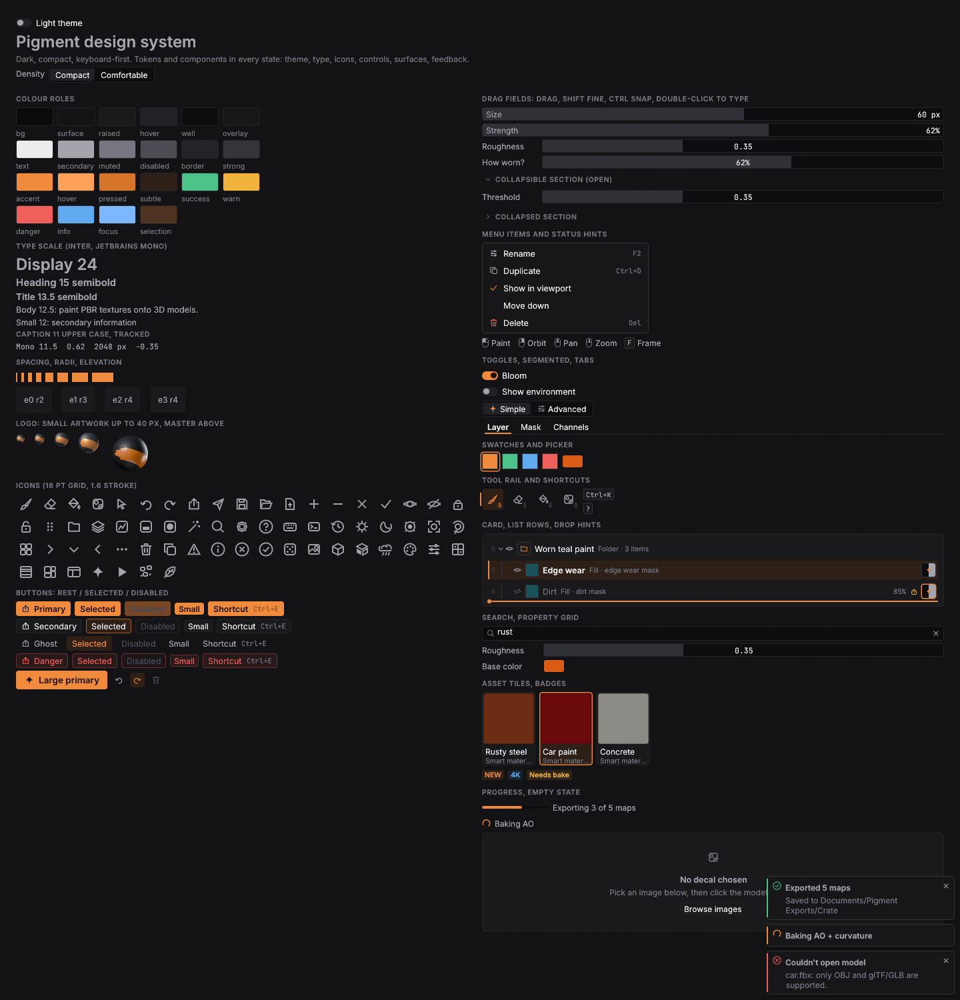
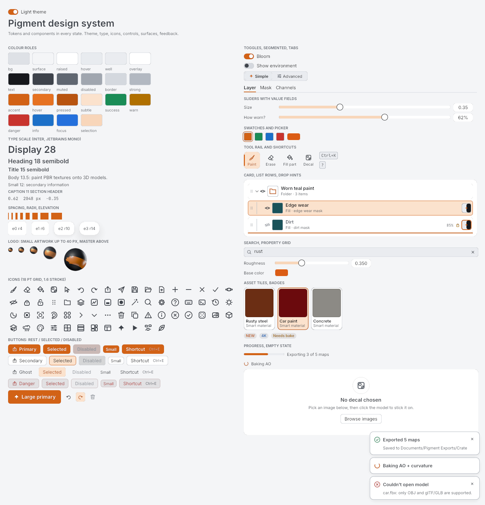
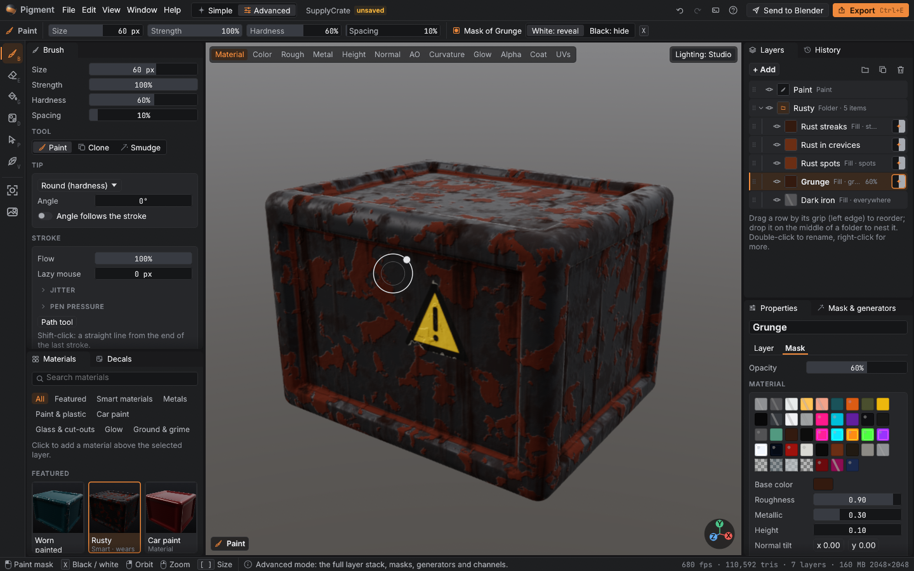
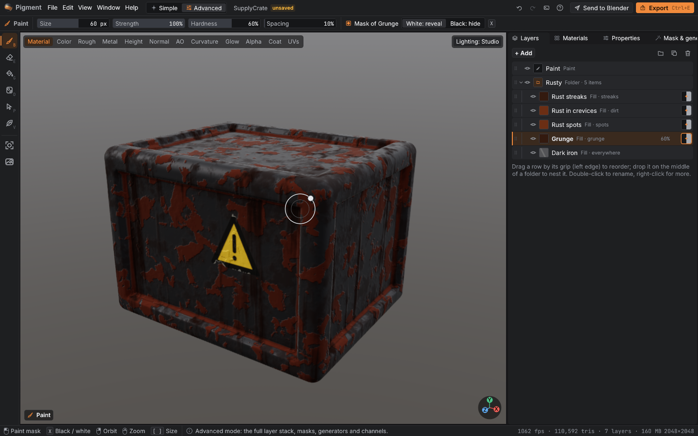

# Pigment design system

Code: `crates/app/src/app/design/` (`mod.rs` tokens, density and theme, `fonts.rs`,
`icons.rs`, `components.rs`, `gallery.rs`). Every screen is built from these tokens and
components. The test `design::tests::no_raw_styles_outside_design` fails the build if a
screen file (`ui.rs`, `tour.rs`, `welcome.rs`, `dialogs.rs`, `dock.rs`, `folders_ui.rs`,
`panels/*`) uses a raw `Color32::from_rgb/from_gray/...`, a named colour, a literal
spacing, margin, radius or font size, a raw `egui::Slider` (use `DragField` /
`slider_row`) or a raw `egui::CollapsingHeader` (use `collapsible`). Other tests check
WCAG contrast for every text role on every surface in both themes, that the dark chrome
stays neutral and dark, and that Compact is denser than Comfortable.

See it live: `pigment --design-gallery`. Every screen offscreen:
`PIGMENT_SHOTS=<dir> cargo test -p pigment --release design_shots -- --ignored`.

| Dark | Light |
|---|---|
|  |  |

## Principles

1. **The model is the brightest thing on screen.** The chrome is near-black, low-chroma
   grey (a hint of cool), flat, with hairline borders and 2–4 pt corners. No gradients,
   no big shadows. The orange accent is spent only on the selection, the active tool and
   the one primary action per screen area.
2. **Dense, like a tool.** Blender-density rows (20–22 pt controls, 28 pt layer rows),
   12–12.5 pt text, 11 pt upper-case tracked captions, a 4 / 6 / 8 pt rhythm. Numbers are
   monospace and live *inside* their drag fields. Users who want air pick the
   Comfortable density (Settings, View menu or the palette).
3. **Keyboard first.** Ctrl+K finds any action by fuzzy search (recent ones first). Every
   icon button's tooltip and every menu item shows its key; the tool rail shows the
   tool's letter. The status bar always says what the mouse and modifier keys do right
   now: the active tool's controls, or the hovered control's (drag fields).
4. **Clarity for beginners.** Say what a thing does in plain words, next to it: tooltips
   have a title, a sentence and the shortcut. Empty states explain what would appear and
   offer the next action. Simple mode shows a material library, a few tools, one
   weathering slider, lighting and Export; Advanced shows the full stack.
5. **Direct manipulation.** Click a material and the model changes. Click a part to fill
   it. Click the surface to stick a decal. Drag a layer by its grip to move or nest it.
   Drag a panel tab to re-dock it. Right-click anything in a list for its actions.
6. **Remember and never block.** Collapsed sections, layouts, density, theme and recent
   commands persist in `prefs.json`. Bakes, exports and autosaves run without freezing
   the window and report through toasts (hover a toast to keep it).

## Tokens

### Colour roles (`design::Palette`)

| Role | Dark | Light | Use |
|---|---|---|---|
| `bg` | #161618 | #D6D8DC | behind everything, viewport surround, tab strips |
| `surface` | #1E1F21 | #ECEDF0 | panels, bars, the active tab |
| `surface_raised` | #26272A | #F7F8FA | rows, cards, hovered tabs |
| `surface_hover` | #303135 | #E0E2E6 | hovered rows and buttons |
| `well` | #151618 | #FAFAFB | text fields, drag fields, tracks |
| `field_fill` | #383B42 | #CCD2DC | the value part of a drag field (neutral, never the accent) |
| `overlay` | #242528 | #FAFAFB | menus, toasts, dialogs, palette |
| `glass` | near-black 84% | white 84% | viewport HUD chips |
| `border` / `border_strong` | #2E2F32 / #3C3E43 | #D0D3D8 / #B0B5BD | hairlines / hover and emphasis |
| `text` | #E4E5E8 | #16181C | primary text (>= 7:1 on every surface) |
| `text_secondary` | #A8ABB1 | #3E434B | labels (>= 4.5:1) |
| `text_muted` | #80848C | #606771 | hints, captions (>= 3:1) |
| `text_disabled` | #54575D | #A0A6AF | disabled |
| `accent` / `hover` / `pressed` | #F08A3C / #FFA058 / #D6742A | #D26216 / #E67222 / #B85410 | selection, active tool, the primary action |
| `accent_subtle` | #3A2A1E | #FAE0CA | selected rows and tools |
| `on_accent` | #1A1006 | #FFFFFF | text on accent |
| `success` `warn` `danger` `info` | #4CC38A #F2B33D #F0605A #60AAF0 | #1A8C56 #B07000 #C8342E #1C70C8 | status |
| `focus` | #7DB7FF | #2470DC | keyboard focus ring, the field being typed in |
| `selection` | #543A24 | #F8D6BA | text selection |
| `scrim`, `shadow` | | | behind modals, elevation |

### Density (`design::Density`, `design::metrics(ui)`)

`Compact` (default) or `Comfortable`, stored in `prefs.density`, switched with
`set_density` (Settings > Density, View > Compact density, or "density" in Ctrl+K).
Components read the live sizes from `metrics(ui)`:

| Metric | Compact | Comfortable |
|---|---|---|
| `control_h` (buttons, menu items, property rows) | 22 | 28 |
| `control_h_sm` (small buttons, segments, section headers) | 18 | 22 |
| `field_h` (drag fields, egui interact height) | 20 | 24 |
| `icon_btn` | 22 | 28 |
| `tool` (rail buttons; Comfortable adds labels) | 32 | 36 + label |
| `row_h` (layer rows; Compact puts name and kind on one line) | 28 | 44 |
| `thumb` | 20 | 32 |
| `tab_h` (dock tabs) | 24 | 30 |
| `status_h` | 22 | 28 |
| `label_w` (property label column) | 84 | 96 |
| `pad` (panel padding) | 8 | 12 |
| `gap` (item spacing x, y) | 6, 4 | 8, 6 |

### Spacing (`design::space`)

`XXS 2 · XS 4 · SM 6 · MD 8 · LG 12 · XL 16 · XXL 24 · XXXL 32` points. Compact layouts
live on 4 / 6 / 8: panel padding `MD`, items in a row `SM`, rows `XS`, sections `SM`
above a caption, dialogs `XL`.

### Radii and elevation

`radius::SM 2` (thumbnails, key caps, badges) · `MD 3` (buttons, fields, rows) · `LG 4`
(cards, tiles, tabs, menus) · `XL 4` (dialogs) · `PILL` (switches only).
`elevation(0)` flat · `1` hairline lift · `2` menus, popovers, toasts (2 pt offset, 8 blur)
· `3` dialogs, palette (6 pt, 20 blur).

### Type (`design::font`, `design::fonts`)

Inter (OFL) for the interface, JetBrains Mono (OFL) for numbers, values, shortcuts and file
names; egui's default fonts stay behind them for symbols. Files and licences:
`crates/app/assets/fonts/`.

| Token | Size | Weight | Use |
|---|---|---|---|
| `DISPLAY` | 24 | SemiBold | welcome title |
| `HEADING` | 15 | SemiBold | dialog titles, layer name |
| `TITLE` | 13.5 | SemiBold | card titles, the app name |
| `BODY` | 12.5 | Regular | default |
| `SMALL` | 12 | Regular | labels, hints, tabs |
| `CAPTION` | 11 (10.5 upper case, +0.6 tracking) | SemiBold | section headers |
| `MONO` | 11.5 | JetBrains Mono | values, sizes, paths, key caps |

### Icons (`design::Icon`)

64 icons drawn as vectors on an 18 x 18 grid with a 1.6 pt stroke that scales with the
icon, 2 pt padding, round joins (`Icon::ALL`). Sizes: `icon::SM 13` (inline, rows, tabs),
`MD 16` (tools), `LG 22`, `XL 32` (empty states). An icon always has a text label or a
tooltip.

### Motion (`design::motion`)

`FAST 0.08 s` (toggles), `NORMAL 0.12 s` (egui animation time, toasts sliding in),
`SLOW 0.24 s` (fades), `TOAST 4 s` on screen (errors 10 s, held while hovered). Easing
`ease_out` (cubic) and `ease_in_out`.

### Sizes (`design::size`)

The compact constants behind `metrics`: controls 22 (small 18), drag fields 20, icon
buttons 22, tools 32, layer rows 28, thumbnails 20, library tiles 80, tab bar 24, status
bar 22, splitters 3, label column 84, dialogs 500 wide.

## Components (`design::components`)

| Component | API | Notes |
|---|---|---|
| Buttons | `Btn::primary/secondary/ghost/danger(label).icon().shortcut().small()/large().selected().enabled().fill()` | one primary per screen area (the top bar's Export, a dialog's main action) |
| Icon button | `IconBtn::new(icon, tip).shortcut().selected().enabled().size()` | 22 pt; tooltip shows the shortcut |
| Tool button | `tool_button(ui, icon, label, tip, shortcut, selected)` | icon-only with the key letter in the corner (labels in Comfortable); active = accent icon, tinted fill, accent bar |
| Drag field | `DragField::new(&mut v, range).percent()/.decimals(d)/.suffix(s)/.unit(u).logarithmic(b).label(s).width(w)` | Blender-style: value inside a bar that fills to its place in the range (signed ranges fill from zero, no centre marker; a fill edge never cuts through the label or value). Drag to scrub, Shift fine, Ctrl snaps to round steps, double-click or Enter to type (accepts `2*3`, `40+5`, units), arrow ends and Left / Right nudge. Hover puts its controls in the status bar |
| Property row | `slider_row(_ex)(ui, label, &mut f32, range, Unit, log, tip)` | label column + drag field |
| Property grid | `prop_grid`, `prop_label(ui, label, tip)` | label column + control column |
| Collapsible section | `collapsible(ui, key, title, default_open, add)` | small chevron + tracked caption; open state remembered in `prefs.sections` |
| Section header | `section`, `section_with(…, trailing)` | caption with tracking |
| Menu item | `MenuItem::new(label).icon().shortcut().checked().enabled().danger()` | the same row in every context menu: icon column, label, key on the right |
| Status hints | `hint_row(ui, &[Hint])`, `hint_mouse/hint_key/hint_mod`, `paint_mouse`, `set_hover_hints` | Blender-style mouse glyphs and key caps |
| Toggle | `toggle(ui, &mut bool, label)` | animated switch |
| Segmented | `segmented(ui, &mut v, &[(value, icon, label)])` | wraps in narrow panels |
| Tabs | `tabs(ui, &mut v, &[(value, label)])` | underline style, hover fill |
| Swatches | `swatch`, `paint_material_swatch`, `color_picker` | material swatch shows sheen, gloss, glow, see-through |
| Cards | `card`, `card_selectable`, `overlay_frame`, `glass_frame` | flat fill + hairline |
| Layer row | `layer_row(ui, &LayerRow, payload)` | grip (drag source), fold arrow, eye, thumbnail, name + kind (elided, full text on hover), opacity, lock, mask thumbnail; `name_rect` for inline rename; `drop_zone_at` + `paint_drop_hint` for above / into / below |
| Tooltips | `tooltip_body`, `.rich_tip(title, body)` | title, sentence, key cap |
| Toasts | `Toasts::push / finish / show` | info, success, warn, error, progress; coloured edge; hover holds them |
| Modal | `modal(ctx, id, title, width, add)` | scrim, close button, Esc / click-outside dismiss |
| Empty state | `empty_state(ui, icon, title, body, action)` | |
| Progress | `progress(ui, Some(frac) / None, label)`, `icons::spinner` | |
| Search field | `search_field(ui, &mut String, hint)` | icon + clear button; Esc clears |
| Command palette | `command_palette(ctx, &mut state, &[Command])`, `rank_commands`, `fuzzy_match` | Ctrl+K; every query word matches a substring or word-initial runs (no scattered letters); matches highlighted; empty query lists Recent, then by group; arrows / Tab / PgUp / PgDn, Enter, Esc, click outside |
| Asset tile | `asset_tile(_ex)(ui, w, img_h, texture, fallback, title, subtitle, selected)` | library, generators, decals, foliage, tile sets, samples |
| Key cap, badge | `kbd`, `badge` | |

States: every interactive component draws rest, hover (`surface_hover` / `border_strong`),
pressed, selected (`accent_subtle` fill with accent text / icon / edge), keyboard focus
(1.5 pt `focus` ring) and disabled (`text_disabled`, half-strength fill).

### Do and don't

- Do take colours from `pal(ui)` roles and sizes from `metrics(ui)`. Don't write `Color32::from_rgb` in a screen.
- Do use `space::*` steps. Don't use `add_space(5.0)`.
- Do use `DragField` / `slider_row` for numbers. Don't use `egui::Slider`.
- Do use `collapsible` for optional groups. Don't use `egui::CollapsingHeader`.
- Do give every icon-only button a tooltip (`IconBtn` requires one) and its shortcut.
- Do put the most likely action in a primary button. Don't put a second primary in a panel; use secondary.
- Do give list items a right-click menu built from `MenuItem`s with their keys.
- Do explain an empty panel with `empty_state`. Don't leave it blank.
- Do report long work with a progress toast. Don't block the frame.
- Do show material colours with `srgb()` / swatches (they're data, not tokens).

## Layout grid of the main window

```text
┌ top bar 30: logo · File Edit View Window Help · [Simple|Advanced] · project ··· ↶ ↷ ⌘K ? · Send to Blender · Export ┐
├ tool options 26: tool · drag fields with inline labels (Size 60 px | Strength 100% ...) · paint target / mask colour ┤
├ rail ┬ dock ───────────────────────────────────────────────────────────────────────────────────────────────────────┤
│ 40   │  left column (Advanced)  │  viewport (HUD: view chips, lighting, active tool chip, axis gizmo)  │  right    │
│      │  Materials / Brush       │                                                                      │  Layers   │
│      │  Decals / Parts / ...    ├──────────────────────────────────────────────────────────────────────┤  Props    │
│      │                          │  bottom: History / Variants / Export                                 │  Mask     │
├ status 22: (mouse) Paint (mouse) Orbit … [ ] Size · message · job progress ······ texture size (· fps, tris, VRAM) ┤
```

Simple mode's default ("Beginner") is the viewport plus a right column: Materials on top,
Weathering / Lighting / Export below.

## Docking panels

`dock.rs` is a small docking system (egui_dock has no release for egui 0.37). The window
is a tree of splits whose leaves hold tabbed panels.

- **Drag a tab** onto another leaf: the centre adds it as a tab, an edge (outer 22%) splits
  the leaf left / right / top / bottom. Tabs are flat on a darker strip; the active tab
  joins its panel. The drop zone is highlighted with an accent-tinted
  rectangle and a label ("Add Layers here" / "Split: Layers").
- **Drop a tab outside the dock**, or right-click it and choose *Float as window*, to float
  it. A floating panel has a *Dock* button to go back.
- **Close** a tab with its x; reopen it from **Window**. The viewport can't be closed.
- **Splitters** between leaves are 3 pt: lighter when hovered, accent while dragged.
- **Layouts**: Window > Layouts has the presets *Beginner*, *Painting*, *Texturing*
  (Advanced) and *Compact*, your saved layouts, *Save current layout as…* and *Reset
  layout*. Simple and Advanced mode each remember their own layout.
- **Persistence**: layouts are part of `prefs.json` (`<config>/pigment`), saved two seconds
  after a change and on exit; broken layouts are repaired on load (the viewport is
  restored, duplicates dropped).
- **Panels** are widget structs registered by `PanelId` in `panels/mod.rs` (`trait Panel`).
  Each keeps its own state (the library's search and category, the decal browser's
  folder, the parts filter), and its scroll position is stored per panel id. To add a
  panel: add a `PanelId`, implement `Panel`, register it in `Panels::new`.

Panels: Viewport, Materials, Weathering, Brush, Layers, Properties, Channels, Mask &
generators, Decals, Parts, Variants, Lighting, History, Export, Texture set & bake.

| Painting layout | Compact layout |
|---|---|
|  |  |
