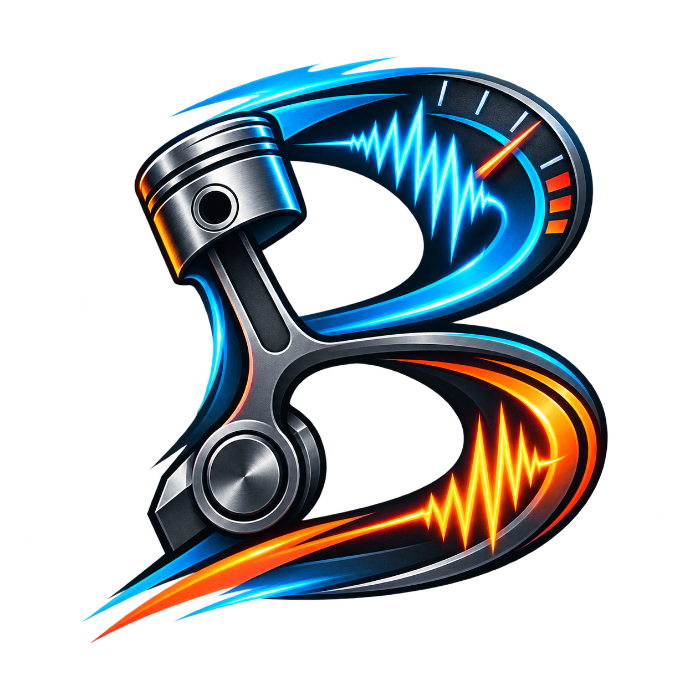

# Bungee Engine Audio for Godot



Modulares Echtzeit-Motoraudio, ein optionaler Arcade-Fahrzeugsimulator und ein optionales Tuning-/Debug-UI für Godot 4.7. Die Audiowiedergabe basiert auf [Bungee](https://github.com/bungee-audio-stretch/bungee).

Modular real-time engine audio, an optional arcade vehicle simulator, and an optional tuning/debug UI for Godot 4.7. Audio playback is powered by [Bungee](https://github.com/bungee-audio-stretch/bungee).

- [Deutsch](#deutsch)
- [English](#english)

---

# Deutsch

## Funktionen

- Echtzeit-ACC/DCC-Mischung aus Motor-WAVs mit einem gemeinsamen StreamGenerator
- Start, Kill, Idle und Limiter-WAV sowie künstliches Idle und RPM-Rücksprung
- Getriebe-Whine, Shift Up/Down, Reifen, Turbo, BOV, Supercharger und Backfire
- 2D-/3D-Audio, Richtungsklang, Höhenfilter, Phaserschutz und HardLimiter
- weich einblendbares Reverb: Tunnel, Garage, Draußen und Unterführung
- Innenraumklang: Straßenauto, Rennauto und blechernes Rennwagen-Cockpit
- optionaler Arcade-Simulator mit Leistung, Masse, Getriebe, Traktion, Wheelspin, Rennstart und Dyno
- optionales deutsches/englisches UI mit mehreren Designs und Fahrzeug-Presets
- einfache API für eigene Fahrzeugsysteme

## Installation

1. Den vollständigen Ordner `addons/bungee` in das Projekt kopieren.
2. Unter **Projekt → Projekteinstellungen → Plugins** das Plugin **Bungee Engine Audio** aktivieren.
3. Im Dialog **Kindknoten hinzufügen** die gewünschten Klassen auswählen:

```text
BungeeEngineAudio
└── BungeeVehicleSimulator      optional
	└── BungeeSimulatorUI       optional
```

Der Simulator muss direkt unter `BungeeEngineAudio` liegen; das UI direkt unter dem Simulator. Der Engine-Node funktioniert auch allein.

`BungeeEngineAudio` und `BungeeVehicleSimulator` besitzen eigene farblich zusammengehörige Node-Symbole. Dadurch lassen sie sich im Hinzufügen-Dialog und Szenenbaum leichter unterscheiden.

Alternativ kann `demo/bungee_engine_audio_demo.tscn` direkt geöffnet und gestartet werden. Die Szene enthält bereits alle drei Nodes, verwendet die BaseCar-Soundbank und startet mit ausgeschaltetem Motor sowie englischem UI.

Das Plugin ergänzt nur fehlende Input-Actions und überschreibt keine vorhandenen Belegungen:

| Action | Tastatur | Controller |
| --- | --- | --- |
| `gastrigger` | W | rechter Trigger |
| `braketrigger` | S | linker Trigger |
| `handbraketrigger` | Leertaste | A |
| `shiftuptrigger` | E | rechte Schultertaste |
| `shiftdowntrigger` | Q | linke Schultertaste |

## Schnellstart

Node-Aufbau erzeugen, eine Soundbank wählen und das Projekt starten. Der Motor ist anfangs absichtlich aus. Er startet über den runden UI-Knopf oder per Script:

```gdscript
$BungeeEngineAudio.start_engine()
```

Neue Nodes verwenden 2D-Audio, damit sie ohne `Camera3D` hörbar sind. Für räumlichen Fahrzeugsound `Use 3D Audio` aktivieren und eine aktive `Camera3D` oder einen `AudioListener3D` verwenden.

## Eigenes Fahrzeugsystem

Ohne Simulator `Live Input Mode` auf **Extern / eigene Fahrzeuglogik** stellen. Im automatischen Modus reichen Motorstatus und normalisierte RPM:

```gdscript
@onready var engine_audio: BungeeEngineAudio = $BungeeEngineAudio

func _ready() -> void:
	engine_audio.start_engine()

func _physics_process(_delta: float) -> void:
	engine_audio.rpm_position = clampf(current_rpm / max_rpm, 0.0, 1.0)
```

Steigende RPM erzeugt ACC und Aufladung; fallende RPM erzeugt DCC und kann BOV beziehungsweise aktiviertes Backfire auslösen. Turbo und Supercharger dürfen gleichzeitig laufen.

Für vollständige eigene Kontrolle `Automatic Load From RPM` deaktivieren:

```gdscript
engine_audio.update_live_inputs(current_rpm / max_rpm, throttle, speed_kmh, current_gear, is_shifting)
engine_audio.number_of_gears = 6
engine_audio.max_speed_kmh = 280.0
engine_audio.handbrake = handbrake
engine_audio.wheelspin = wheelspin
engine_audio.is_reversing = is_reversing
```

Zusatzsysteme und Ereignisse:

```gdscript
engine_audio.update_forced_induction(true, 0.0, true, true) # Turbo + Kompressor, Auto-Boost
engine_audio.update_forced_induction(true, boost, false, false) # eigener Boost 0..1
engine_audio.trigger_shift_up_sound()
engine_audio.trigger_shift_down_sound()
engine_audio.trigger_bov_sound(boost)
engine_audio.trigger_backfire_sound(load_strength)
engine_audio.stop_engine()
```

## Reverb und Fahrerperspektive

Diese Werte gehören zur Umgebung/Kamera und werden nicht in Fahrzeug-Presets gespeichert:

```gdscript
# Tunnel
engine_audio.reverb_enabled = true
engine_audio.reverb_preset = BungeeEngineAudio.ReverbPreset.TUNNEL
engine_audio.reverb_amount = 1.0

# Innenkamera
engine_audio.cabin_enabled = true
engine_audio.cabin_preset = BungeeEngineAudio.CabinPreset.RACE_COCKPIT
engine_audio.cabin_amount = 1.0

# Zurück nach draußen; Fade Speed glättet den Wechsel
engine_audio.reverb_amount = 0.0
engine_audio.cabin_amount = 0.0
```

Gemeinsame Effektkette:

```text
Richtungsklang → Höhen → Innenraum → Cockpit-Charakter → Reverb → HardLimiter
```

Existiert ein Projekt-Bus namens `EngineTone`, sendet der interne Bus dorthin und danach zu Master. Ohne `EngineTone` geht die Ausgabe direkt zu Master.

## Soundordner

```text
sounds/
├── Vehicles/<Fahrzeug>/
│   ├── ACC.wav
│   ├── DCC.wav
│   ├── Idle.wav       optional
│   └── Limiter.wav    optional
└── Effects/
	├── Backfire/   ├── BOV/       ├── EngineState/
	├── ShiftDown/  ├── ShiftUp/   ├── skid/
	├── Supercharger/ ├── Turbo/   └── Whine/
```

ACC und DCC sollten unkomprimierte PCM-WAVs mit sinnvoll angeglichener Lautheit sein. Nur Audiodateien verwenden und weitergeben, für die entsprechende Rechte vorhanden sind. Details: [sounds/README.md](sounds/README.md).

Die Starter-Sounds enthalten ihre Godot-Importvorgaben. Godot importiert sie beim ersten Projektscan automatisch als PCM und setzt Loop beziehungsweise One-Shot passend zum Soundtyp. Eine manuelle Umwandlung ist nicht erforderlich. Für später hinzugefügte eigene WAVs müssen die Importoptionen einmal passend gesetzt werden.

## Fahrzeug-Presets

Mitgelieferte Typen liegen unter `presets/vehicles`, eigene UI-Presets im Editor unter `presets/custom`. Fahrzeug-Presets speichern Fahrzeug-, Fahrhilfe- und fahrzeugbezogene Soundwerte. Laufende Zustände, UI-Design, Dyno-Skala, Reverb und Innenraumperspektive sind ausgeschlossen.

## Spieleexport

Das Plugin muss beim Export aktiviert sein. Danach liegen offene Inhalte neben der EXE:

```text
<Spielordner>/
├── MeinSpiel.exe
├── assets/sounds/             offene WAV-Dateien
└── vehicle_presets/
	└── custom/                Benutzer-Presets
```

Für speicherbare Presets muss der Spielordner beschreibbar sein. Die mitgelieferte GDExtension unterstützt aktuell Windows x86-64 mit Godot 4.7 oder neuer. Andere Plattformen benötigen passende Bungee-Bibliotheken und Einträge in `bin/bungee.gdextension`.

## Lizenz

Bungee steht unter der Mozilla Public License 2.0 (`MPL2.0.txt`). Die übrigen Addon-Dateien verwenden `LICENSE.txt`. Audio darf nur mit den erforderlichen Rechten verteilt werden.

---

# English

## Features

- Real-time ACC/DCC engine WAV blending through one shared StreamGenerator
- Start, kill, idle and limiter WAVs plus simulated idle and RPM limiter cuts
- Transmission whine, shift up/down, tires, turbo, BOV, supercharger, and backfire
- 2D/3D audio, directional tone, treble shaping, phaser protection, and hard limiting
- Smoothly blendable reverb: tunnel, garage, outdoor, and underpass
- Cabin sound: street car, race car, and a sharper metallic race cockpit
- Optional arcade simulator with power, mass, transmission, traction, wheelspin, race launch, and dyno
- Optional German/English UI with multiple styles and vehicle presets
- Simple API for custom vehicle controllers

## Installation

1. Copy the complete `addons/bungee` folder into the project.
2. Open **Project → Project Settings → Plugins** and enable **Bungee Engine Audio**.
3. Add the required classes from **Add Child Node**:

```text
BungeeEngineAudio
└── BungeeVehicleSimulator      optional
	└── BungeeSimulatorUI       optional
```

The simulator must be a direct child of `BungeeEngineAudio`; the UI must be a direct child of the simulator. The engine node also works on its own.

`BungeeEngineAudio` and `BungeeVehicleSimulator` use matching custom node icons, making them easier to distinguish in the Add Node dialog and scene tree.

Alternatively, open and run `demo/bungee_engine_audio_demo.tscn`. It already contains all three nodes, uses the BaseCar sound bank, and starts with the engine switched off and the UI set to English.

The plugin adds only missing input actions and never replaces existing bindings:

| Action | Keyboard | Controller |
| --- | --- | --- |
| `gastrigger` | W | right trigger |
| `braketrigger` | S | left trigger |
| `handbraketrigger` | Space | A |
| `shiftuptrigger` | E | right shoulder |
| `shiftdowntrigger` | Q | left shoulder |

## Quick start

Create the node structure, select a sound bank, and run the project. The engine intentionally starts switched off. Start it with the round UI button or from code:

```gdscript
$BungeeEngineAudio.start_engine()
```

New nodes default to 2D audio so they work without a `Camera3D`. Enable `Use 3D Audio` for spatial vehicle sound and provide an active `Camera3D` or `AudioListener3D`.

## Custom vehicle controller

Without the simulator, set `Live Input Mode` to **External / custom vehicle logic**. In automatic mode only engine state and normalized RPM are required:

```gdscript
@onready var engine_audio: BungeeEngineAudio = $BungeeEngineAudio

func _ready() -> void:
	engine_audio.start_engine()

func _physics_process(_delta: float) -> void:
	engine_audio.rpm_position = clampf(current_rpm / max_rpm, 0.0, 1.0)
```

Rising RPM produces ACC and boost; falling RPM produces DCC and can trigger BOV or enabled backfire. Turbo and supercharger can run simultaneously.

Disable `Automatic Load From RPM` for full external control:

```gdscript
engine_audio.update_live_inputs(current_rpm / max_rpm, throttle, speed_kmh, current_gear, is_shifting)
engine_audio.number_of_gears = 6
engine_audio.max_speed_kmh = 280.0
engine_audio.handbrake = handbrake
engine_audio.wheelspin = wheelspin
engine_audio.is_reversing = is_reversing
```

Optional systems and events:

```gdscript
engine_audio.update_forced_induction(true, 0.0, true, true) # turbo + supercharger, auto boost
engine_audio.update_forced_induction(true, boost, false, false) # custom boost 0..1
engine_audio.trigger_shift_up_sound()
engine_audio.trigger_shift_down_sound()
engine_audio.trigger_bov_sound(boost)
engine_audio.trigger_backfire_sound(load_strength)
engine_audio.stop_engine()
```

## Reverb and driver perspective

These properties belong to the environment/camera and are excluded from vehicle presets:

```gdscript
# Tunnel
engine_audio.reverb_enabled = true
engine_audio.reverb_preset = BungeeEngineAudio.ReverbPreset.TUNNEL
engine_audio.reverb_amount = 1.0

# Interior camera
engine_audio.cabin_enabled = true
engine_audio.cabin_preset = BungeeEngineAudio.CabinPreset.RACE_COCKPIT
engine_audio.cabin_amount = 1.0

# Return outside; Fade Speed smooths the transition
engine_audio.reverb_amount = 0.0
engine_audio.cabin_amount = 0.0
```

Shared effect chain:

```text
Directional tone → Treble → Cabin → Cockpit character → Reverb → Hard limiter
```

If a project bus named `EngineTone` exists, the internal bus sends its output there and then to Master. Without `EngineTone`, output goes directly to Master.

## Sound folders

```text
sounds/
├── Vehicles/<Vehicle>/
│   ├── ACC.wav
│   ├── DCC.wav
│   ├── Idle.wav       optional
│   └── Limiter.wav    optional
└── Effects/
	├── Backfire/   ├── BOV/       ├── EngineState/
	├── ShiftDown/  ├── ShiftUp/   ├── skid/
	├── Supercharger/ ├── Turbo/   └── Whine/
```

ACC and DCC should be uncompressed PCM WAV files with reasonably matched loudness. Only use and distribute audio for which you have the required rights. Details: [sounds/README.md](sounds/README.md).

The starter sounds include their Godot import settings. On the first project scan, Godot automatically imports them as PCM and applies looping or one-shot playback according to the sound type. No manual conversion is required. WAV files added later by the user still need suitable import options once.

## Vehicle presets

Bundled archetypes are stored in `presets/vehicles`; custom UI presets use `presets/custom` in the editor. Vehicle presets store vehicle physics, assists, and vehicle-related sound settings. Runtime state, UI style, dyno scale, reverb, and cabin perspective are excluded.

## Game export

Keep the plugin enabled during export. Open content is copied next to the executable:

```text
<Game folder>/
├── MyGame.exe
├── assets/sounds/             open WAV files
└── vehicle_presets/
	└── custom/                player presets
```

The game folder must be writable if players should save presets. The bundled GDExtension currently supports Windows x86-64 with Godot 4.7 or newer. Other platforms require matching Bungee libraries and entries in `bin/bungee.gdextension`.

## License

Bungee uses the Mozilla Public License 2.0 (`MPL2.0.txt`). The remaining addon files use `LICENSE.txt`. Only distribute audio files for which you own the necessary rights.
