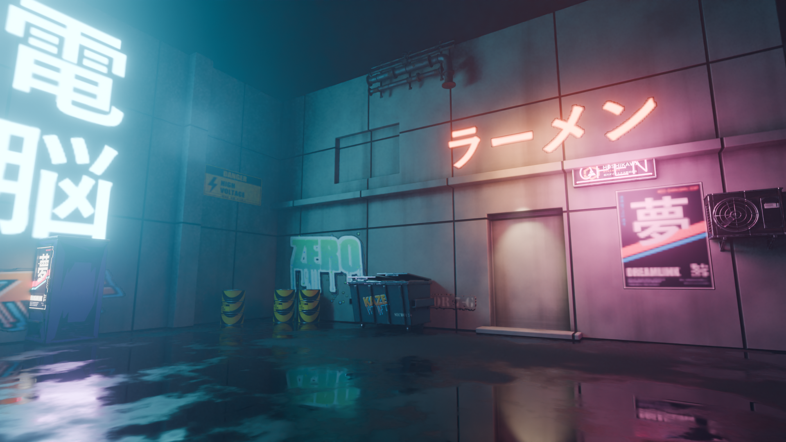

# Cyberpunk alley



Built with Blender and Pigment working together:

1. **Props** were modelled by headless Blender scripts (`assets/blender/*.py`),
   and the **alley shell** was built live in Blender through the Blender MCP.
   Both were exported as GLB with one UV set.
2. **Texturing** went through the **Pigment MCP server** (`pigment-mcp`), using
   smart materials, pattern generators and projected decals (`assets/decals/`).
   The scripts are replayable:
   ```
   cargo build -p pigment --release --bin pigment-mcp
   target/release/pigment-mcp --script scenes/cyberpunk/texture_props.jsonl
   target/release/pigment-mcp --script scenes/cyberpunk/walls_stack.jsonl
   ```
   They write the Pigment projects (`projects/*.pigment`) and the texture maps
   (`textures/`, git-ignored because they can be regenerated).
3. **Assembly** happened in Blender. `tools/blender_pigment.py` builds Principled
   BSDF materials from Pigment's "separate" export. Emission strength is the
   exported `emissive_scale` times an artistic factor. Lighting is neon area
   lights, a hazy world volume and compositor bloom, rendered in Cycles (OptiX):
   1920×1080 at 200 samples in about 30 s on an RTX 4070 Ti.

`cyberpunk_alley.blend` is the assembled scene. It references the textures in
`textures/`, so run the scripts above first.
